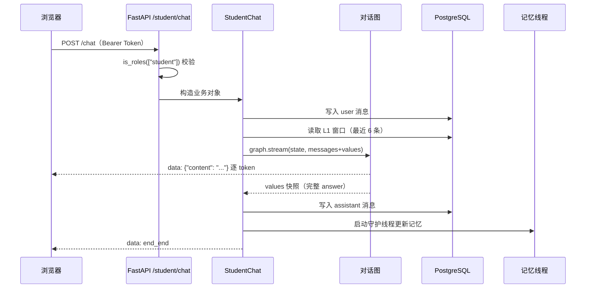
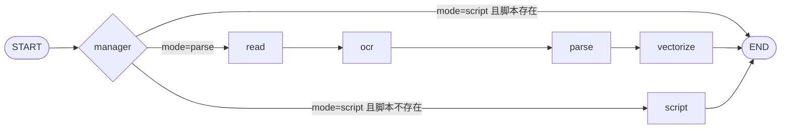
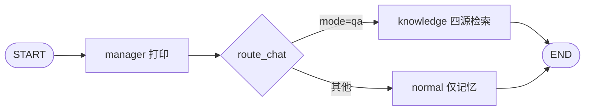
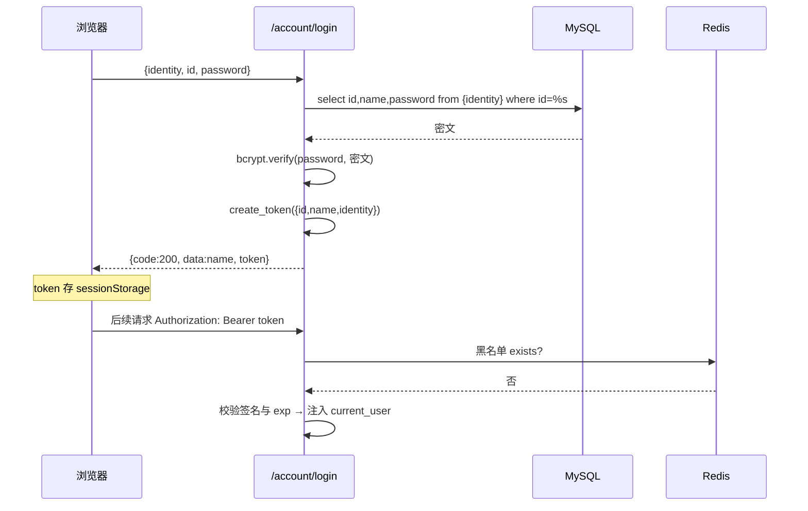

# 面向高校课堂的 AI 互动智课系统

> **InteractiveClassroom** — 教师上传一份课件，系统自动把它变成"可讲、可问、可测"的课堂资源。
>
> 后端 FastAPI + LangGraph ｜ 前端 Vue 3 + Vite ｜ 向量库 ChromaDB ｜ 图数据库 Neo4j ｜ 关系库 MySQL / PostgreSQL ｜ 缓存 Redis

| 项目信息 | 说明 |
| --- | --- |
| 项目名称 | 面向高校课堂的 AI 互动智课系统（InteractiveClassroom） |
| 开发周期 | 2026.04 – 2026.08 |
| 运行环境 | Windows 11、PyCharm、Anaconda3、Python 3.12 |
| 技术栈 | FastAPI、Vue 3、LangChain / LangGraph、ChromaDB、Neo4j、PostgreSQL、MySQL、Redis、JWT |
| 系统形态 | 前后端分离，教师端 / 学生端双角色 |

---

## 1. 项目概述

### 1.1 背景：课件与"智课"之间缺了一层翻译

高校课堂的核心资产是课件，形态是 PPT、PDF 和一堆附件。这些文件对**人**是友好的，对**系统**却几乎是黑盒：文字散落在几十页幻灯片里，公式和图表是图片，知识点之间的层级关系只存在于教师的脑子里。

于是同一份课件，在三个环节里要被反复"人工翻译"：

1. **备课**：教师要从几十页幻灯片里自己提炼知识点、组织讲稿；
2. **答疑**：学生复习时只能翻页找答案，或者去问通用大模型，得到的回答与教师口径未必一致；
3. **测评**：教师出题、批改、写评语，全是重复劳动，且很难针对每个学生给出差异化反馈。

本项目要做的，就是把这层"翻译"自动化，形成一条闭环：

> 教师上传课件 → 系统解析出结构化知识点 → 生成授课脚本 → 学生围绕这门课对话提问 → 系统出题并给出学情点评

整个过程不依赖人工标注，也不要求教师改变已有的备课习惯——课件还是那份课件，只是它从此可以被检索、被追问、被测验。

### 1.2 系统解决的三个具体问题

| 问题 | 传统做法 | 本系统的做法 |
| --- | --- | --- |
| 课件内容无法被检索 | 只能靠人翻页、Ctrl+F 找关键词 | 解析为知识点图谱 + 向量切片，语义检索与结构化检索互补 |
| 答疑口径不一致 | 学生问通用大模型，答案与教师讲法脱节 | 四源检索（问答库 / 课件库 / 知识图谱 / 授课脚本）后作答，优先教师口径 |
| 缺少练习与反馈 | 教师手工出题、批改 | 基于本章知识点自动出题，交卷后生成五段式学情点评报告 |

### 1.3 角色与核心场景

系统只有两类角色，权限边界清晰。

**教师（teacher）**

- 上传课件（PDF / PPT / PPTX，≤ 100 MB），填写课程名与章节名；
- 点击"处理"，后台异步完成解析、知识点抽取、向量化；
- 查看 / 重新生成该课件的**授课脚本**（Markdown）；
- 删除课件时，级联清理它的所有衍生数据。

**学生（student）**

- 选择课程与章节，进入对话：普通闲聊、知识点提问；
- 查看历史会话、继续之前的对话、删除会话；
- 针对某个课件做一次知识测试，提交后查看点评报告。

### 1.4 能力清单

- **多模态课件解析**：PPT/PPTX/PDF 文本抽取 + 图片抽取 + OCR + 大模型结构化
- **双知识库**：Neo4j「课程—章节—知识点」三层图谱 + ChromaDB 语义切片，互补检索
- **智能对话**：条件路由 + 四源检索 + SSE 流式输出
- **四层记忆**：窗口 / 摘要 / 长期事实 / 学生画像，后台线程异步更新
- **自主测验**：检索增强出题 + 自由文本作答 + 生成式学情点评
- **工程能力**：JWT 鉴权、角色权限、bcrypt 密码、Token 黑名单、全链路降级

---

## 2. 技术选型与理由

选型不是"流行什么用什么"，每一项都对应一个具体约束。下表先给结论，后面逐条解释。

| 层次 | 选型 | 关键理由 |
| --- | --- | --- |
| Web 框架 | FastAPI | 原生 async、SSE 直出、Pydantic 入参校验、自动 OpenAPI |
| AI 编排 | LangGraph | 需要"按状态分流 + 多节点复用"，线性 Chain 表达不了 |
| 大模型 | 通义千问（DashScope，OpenAI 兼容协议） | 国内可直连、支持流式、按 token 计费；接口兼容便于切换本地模型 |
| 向量库 | ChromaDB | 嵌入式部署、零运维、按 collection 隔离、支持 metadata 过滤 |
| 嵌入模型 | bge 系列中文模型（本地加载） | 中文语义检索效果稳定；本地部署避免数据出境与调用成本 |
| 图数据库 | Neo4j | 课程—章节—知识点天然是图，且需要按层级做覆盖式检索 |
| 关系库 | MySQL + PostgreSQL | MySQL 存账号/课件等强结构化业务数据；PostgreSQL 存对话流水与记忆 |
| 缓存 | Redis | 验证码（5 分钟 TTL）与 JWT 黑名单（按剩余有效期 TTL） |
| 前端 | Vue 3 + Vite + Element Plus | 组合式 API 上手快、Vite 冷启动快、组件库覆盖后台界面 |

### 2.1 为什么是 FastAPI 而不是 Flask/Django

系统的三个硬需求直接排除了同步框架：

1. **流式输出**。对话要逐字吐给前端，FastAPI 的 `StreamingResponse` + `text/event-stream` 是最短路径；Flask 做 SSE 需要额外处理线程与生成器上下文。
2. **长耗时任务的非阻塞**。课件解析可能跑几分钟，接口必须"立刻返回、后台继续"。
3. **入参校验**。`ChatSchema`、`TestFinishSchema` 这类结构用 Pydantic 声明一次，校验、文档、类型提示三件事一起解决。

Django 的 ORM 与 Admin 在本项目里用不上（业务表只有 3 张，且大量手写 SQL 更直观），反而带来更重的启动成本。

### 2.2 为什么是 LangGraph 而不是 LangChain Chain

这是本项目最值得讲的一个选型。用 Chain 也能把"读文件 → OCR → 调模型 → 写库"串起来，但会遇到两个问题：

- **流程有分支**。课件解析与"查看授课脚本"共用同一套节点，只是入口不同：脚本已存在就直接返回，不存在才生成。Chain 表达"条件分支 + 提前终止"很别扭。
- **状态要跨节点共享**。`CoursewareState` 里有 18 个字段，节点之间靠它传递中间产物；Chain 只能靠返回值层层透传。

LangGraph 的 `StateGraph` 正好对应这两个需求：状态是一个 `TypedDict`，节点是纯函数（读 state、返回增量），分支用 `add_conditional_edges` 声明。代价是引入了框架心智负担，但对"多节点 + 有分支 + 要复用"的场景是划算的。

### 2.3 为什么是 ChromaDB 而不是 Milvus/FAISS

- **部署成本**：Chroma 是嵌入式库，进程内直接读写本地目录，不需要额外起服务；Milvus 需要一套集群组件，对单机项目过重。
- **元数据过滤**：`where={"course_name": ...}` 是刚需（课件库必须按课程/章节过滤），FAISS 只做纯向量近邻，过滤要自己在外层实现。
- **代价**：Chroma 的并发写入能力弱，多进程同时写同一目录会锁冲突。当前是单进程单实例部署，可以接受；如果要做多副本，需要换成服务化向量库。

### 2.4 为什么用四个存储而不是一个

这四个库各自解决一种"形状"的数据，混用会互相拖累：

- **MySQL**：账号、课件元数据。需要事务、唯一约束、按 id 精确查询。
- **PostgreSQL**：对话流水与记忆。数据量随时间线性增长，需要 `TEXT` 字段、按 session 聚合、连接池。
- **Neo4j**：知识点层级。需要"某课程某章节下全部知识点"这种沿边遍历，用 SQL 递归查询会很难写。
- **Redis**：短生命周期状态。验证码和黑名单都是"到点自动消失"，用关系库要额外写清理任务。

引出下一章：这些组件在代码里是怎么被组织起来的。

---

## 3. 系统架构

### 3.1 分层结构

```
┌──────────────────────────────────────────────────────────┐
│  前端  Vue3 + Vite (8080)                                 │
│  Home / Login / SignUp / Teacher / Student                │
└───────────────┬──────────────────────────────────────────┘
                │ HTTP + SSE（Bearer Token）
┌───────────────▼──────────────────────────────────────────┐
│  Web 层  FastAPI (8000)                                   │
│  system_router  /account    登录、注册、验证码邮件、登出     │
│  teacher_router /courseware 上传、解析、脚本、删除          │
│  student_router /student    对话、会话、测试、评价          │
│  schema（Pydantic 校验） / util（JWT、连接池、密码）        │
└───────────────┬──────────────────────────────────────────┘
                │ 业务对象（类）
┌───────────────▼──────────────────────────────────────────┐
│  业务层  纯 Python 类，不依赖 FastAPI                      │
│  LoginAccount / AddAccount / CoursewareUpload /            │
│  CourseWareParse / CoursewareDelete / StudentChat / ...    │
└───────────────┬──────────────────────────────────────────┘
                │ state / 检索 / 提示词
┌───────────────▼──────────────────────────────────────────┐
│  AI 层                                                     │
│  agent/teachers  课件解析图（read→ocr→parse→vectorize）    │
│  agent/student   对话图（normal/knowledge）、测试图         │
│  memory          四层记忆（窗口/摘要/长期/画像）            │
│  tool            课件检索、Neo4j 检索                      │
│  prompt          YAML 提示词 + 模板渲染                    │
│  model           ChatOpenAI 单例（在线/本地）              │
└───────────────┬──────────────────────────────────────────┘
                │
┌───────────────▼──────────────────────────────────────────┐
│  数据层  MySQL · PostgreSQL · ChromaDB · Neo4j · Redis    │
└──────────────────────────────────────────────────────────┘
```

分层的关键约束是：**业务层不 import FastAPI**。`CoursewareDelete`、`StudentChat` 这些类只接收普通参数（或 `Request` 用于拿 `app.state`），因此可以脱离 HTTP 单独测试，也方便未来搬去做定时任务或 CLI。

### 3.2 目录结构

```
InteractiveClassroom/
├── IC_Server/                     后端
│   ├── main.py                    入口：lifespan、CORS、路由注册
│   ├── app/
│   │   ├── web/                   接口层
│   │   │   ├── system_router/     登录、注册、邮件、登出
│   │   │   ├── teacher_router/    课件上传/解析/脚本/删除
│   │   │   ├── student_router/    对话/会话/测试/评价
│   │   │   ├── schema/            Pydantic 模型
│   │   │   ├── tool/              MySQL 读写工具类
│   │   │   └── util/              JWT、密码、连接池、黑名单
│   │   └── ai/                    AI 层
│   │       ├── agent/teachers/    课件解析图与节点
│   │       ├── agent/student/     对话图、测试图与节点
│   │       ├── memory/            四层记忆（manager/save/retrieval）
│   │       ├── tool/              课件检索、Neo4j 检索
│   │       ├── prompt/            YAML 提示词 + 加载器
│   │       └── model/             ChatOpenAI 单例
│   ├── data/                      数据集、向量库持久化目录、模型
│   └── static/                    抽出的图片、授课脚本、评价报告
└── IC_Client/                     前端
    └── src/  components/ router/ main.js
```

### 3.3 三个智能体，一张表看清各自职责

| 智能体 | 入口 | 节点 | 产出 |
| --- | --- | --- | --- |
| 课件解析图 | `POST /courseware/parse`、`GET /courseware/script` | manager → read → ocr → parse → vectorize | 知识点图谱、向量切片 |
| 学生对话图 | `POST /student/chat` | manager → normal / knowledge | 流式回答 |
| 测试评价图 | `POST /student/test/start`、`/finish` | manager → start / finish → evaluation | 题目、点评报告 |

三张图都在 `main.py` 的 lifespan 里**只构建一次**，挂到 `app.state` 上全局复用。LangGraph 的编译产物是无状态的（`checkpointer=None`），多个请求并发调用同一个实例不会串状态——状态是每次调用时传入的 `dict`。

### 3.4 一次对话的完整时序



注意两处设计：**先落 user 消息再跑图**（保证审计顺序），**流式结束后才落 assistant 消息**（保证落库的是完整回答，而不是拼接中的半成品）。

---

## 4. 核心链路一：课件解析与智课生成

### 4.1 为什么做成"异步任务 + 状态轮询"

一份 78 页的 PPT，解析全过程大约包括：逐页抽文本、抽取并 OCR 图片、按 12 页分块调 6~7 次大模型、写图谱、写向量库。实测耗时在分钟级，远超 HTTP 请求的合理等待时间。

因此接口采用"受理—轮询"模式：

1. `POST /courseware/parse` 先把 MySQL 里的 `parse_status` 置为 `0`（处理中），用 `asyncio.create_task` 起后台任务，**立刻**返回 `{code:200, message:"课件开始处理"}`；
2. 前端每 5 秒轮询 `GET /courseware/list`，根据 `parse_status` 更新按钮与提示；
3. 后台任务结束时写 `1`（成功）或 `3`（失败）。

这样做的好处是接口响应时间与解析耗时解耦；代价是**失败必须自己兜底**——没有队列重试、没有断点续跑，进程重启则任务丢失。

`parse_status` 是这套机制的核心，取值语义必须固定：

| 值 | 含义 | 谁写入 |
| --- | --- | --- |
| 0 | 处理中 | 解析接口受理时 |
| 1 | 已完成 | 后台任务成功 |
| 2 | 未处理 | 上传时默认值 |
| 3 | 失败 | 后台任务异常 |

### 4.2 五个节点各自做什么



**（1）read：把文件拆成"页 + 文本 + 图片"**

- PPTX：用 `python-pptx` 逐页遍历 shapes，`has_text_frame` 的收段落文本，`PICTURE` 类型的把图片 blob 存到 `static/img/{课件名}/slide_{页}_img_{序}.ext`；
- PDF：用 PyMuPDF 的 `get_text()` 取文本、`get_images(full=True)` + `extract_image` 取图；
- PPT（老格式）：`python-pptx` 读不了，先用 `win32com` 调 PowerPoint 的 `SaveAs(path, 24)` 转成 pptx 再解析，并用 `pythoncom.CoInitialize/CoUninitialize` + `finally` 保证 COM 资源释放。

输出 `slide_contents`（`[{page, text, images}]`）——注意这是**按页组织**的，后续合并与分块都以 page 为单位，页码信息一路保留到图谱里做溯源。

**（2）ocr：只处理图片里的字**

PaddleOCR 懒加载成全局单例（`use_angle_cls=True, lang='ch', det_db_box_thresh=0.3, device='CPU'`），逐页逐图顺序识别，取 `line[1][0]` 拼接。两个细节体现工程性：

- 单张图识别失败写入 `[OCR失败: 异常信息]` 占位并继续，不中断整份课件；
- PaddleOCR 未安装时把 `ocr_status` 置为 `error` 而不是抛异常——OCR 是增强项，不是必选项。

**（3）parse：分块调用大模型抽知识点**

- 先 `_merge_content` 按页合并"原文 + OCR 文本"，并过滤 `$$` 开头且长度 ≤ 20 的噪声行（多为公式残留）；
- 按 `CHUNK_SIZE = 12` 页一块切分，每块独立构造提示词、同步 `llm.invoke`；
- 返回的 JSON 用 `json.loads` 解析，按 `name` 去重后写 Neo4j；
- 某块解析失败返回空列表；若整份课件抽出的知识点为 0，会用简化提示词**逐块补跑一次**（兜底而不是直接失败）。

为什么是 12 页？页数太少会让单次提示词信息碎片化，太多则模型倾向于"概括"而丢细节。12 页大约对应一章的体量，既能保持上下文完整，又不至于超出模型的稳定抽取区间。

**（4）vectorize：把知识点写进向量库**

这里有一个值得注意的取舍：**不直接复用 parse 节点的内存结果，而是回到 Neo4j 查一遍**。

- 好处：向量库与图谱共用同一个事实源，不会出现"图里有、库里没有"的漂移；
- 代价：多一次查询；若 `content` 为空则退化为只有标题的切片。

写入前先按 `course_name + chapter_name` 删除旧数据，再写新数据——**重解析是幂等的**，同一章重复处理不会产生重复切片。

**（5）script：生成授课脚本**

从 Neo4j 按同一套 Cypher 拉出该课程/章节的知识点，拼成 `- [类型] 名称（第 N 页）：内容` 的清单，交给模型生成 Markdown 讲稿，剥掉代码块围栏后写到 `static/md/script_{courseware_id}.md`。

脚本是否已存在由 manager 节点判断：存在则直接读文件返回（`script_status=exists`），不存在才进 script 节点生成（`done`）。如果该课件从没解析过（图谱里没有知识点），返回 `no_kp`，接口映射为 400 并提示"请先处理课件"。

### 4.3 状态设计

`CoursewareState` 是一个 `TypedDict`，18 个字段大致分四组：

| 组 | 字段 | 作用 |
| --- | --- | --- |
| 入参 | `courseware_path` `course_name` `chapter_name` `file_type` `courseware_id` | 由接口层注入 |
| 中间产物 | `extracted_text` `slide_contents` `extracted_images` `img_temp_dir` `ocr_text` | read / ocr 产出 |
| 状态标记 | `parse_status` `ocr_status` `vectorize_status` `script_status` | 各节点写入，便于观察与容错 |
| 模式与输出 | `mode` `script_path` `script_content` `script_mode` | manager 分流、script 产出 |

状态用 `TypedDict` 而不是 `Pydantic` 模型，是因为 LangGraph 只要求"字典 + 类型注解"，不需要运行时校验；省一次序列化开销。

### 4.4 数据落点

| 数据 | 位置 | 说明 |
| --- | --- | --- |
| 原始课件 | `data/data_download/{uuid}.ext` | 上传时重命名，避免重名覆盖 |
| 抽取的图片 | `static/img/{课件名}/` | 供 OCR 与前端预览 |
| 授课脚本 | `static/md/script_{id}.md` | 一份课件一份脚本 |
| 知识点 | Neo4j | `(:Course)-[:HAS_CHAPTER]->(:Chapter)-[:HAS_KNOWLEDGE_POINT]->(:KnowledgePoint)` |
| 向量切片 | ChromaDB `courseware` collection | metadata 含课程/章节/类型/页码 |

Neo4j 的节点属性：`KnowledgePoint{name, content, type, page, source_file}`。其中 `source_file` 是上传时的 UUID 文件名，用于删除课件时精确清理（`DETACH DELETE`），**不参与检索隔离**——检索按课程/章节走，因为同名章节在不同课件间需要互相覆盖（重解析幂等）。

### 4.5 这一环的设计权衡

1. **图而不是流水线**：解析与脚本共用 state 与节点，入口由 manager 分流。将来加"重新生成单个知识点"这类分支，只需加一条条件边。
2. **先写状态再异步**：接口秒回、前端可见进度，代价是异常兜底责任落在业务代码上。
3. **以课程+章节为幂等单元**：重解析不影响其他课件；但如果两份课件都叫"第一章 绪论"，后解析的会覆盖前者的知识点。
4. **分块 + 去重**：用调用次数换召回率。代价是跨块语义可能割裂（一个概念被切在 12/13 页边界上）。

---

## 5. 核心链路二：学生对话

### 5.1 两个对话入口，一条条件路由

前端只有两种对话形态，加上独立的测试入口：

| 入口 | mode | 走哪个节点 | 是否检索 |
| --- | --- | --- | --- |
| 普通对话 | `normal` | normal | 不检索，只用记忆 |
| 知识点提问 | `qa` | knowledge | 四源检索 |
| 知识测试 | `test` | 测试图（走 `/test/*` 接口） | 出题时检索课件库 + 图谱 |

路由逻辑只有一行判断：`mode == "qa"` 进 knowledge，其余进 normal。这样切分的原因是两类问题的成本差异巨大——闲聊不需要检索、也不该触发四源查询的延迟；而知识点提问必须带上课程材料，否则回答没有依据。

### 5.2 对话图



manager 节点只打印日志、不修改状态；真正的判断在 `route_chat` 这个路由函数里。把"路由"从"节点"里拆出来，是为了让节点保持纯粹的"读状态—做事情—写结果"，符合 LangGraph 的惯例。

### 5.3 四源检索：为什么要四个源

只用向量检索，会缺两类信息：**结构**（这一章一共有哪些知识点）和**口径**（老师这节课到底怎么讲）。所以 knowledge 节点同时查四个地方：

| 源 | 方式 | k / 上限 | 解决什么问题 | 失败时 |
| --- | --- | --- | --- | --- |
| 问答库 `teach_qa` | 向量相似度 | k=5 | 常见问题的标准答案 | 段落缺失 |
| 课件库 `courseware` | 向量 + 课程/章节过滤 | k=5 | 具体页面的原文表述 | 段落缺失 |
| Neo4j 知识图谱 | Cypher 沿边遍历 | LIMIT 30 | 章节下知识点的**完整清单**与页码 | 返回空串 |
| 授课脚本 | 直接读 md 文件 | 8000 字符截断 | 教师的讲解逻辑与强调重点 | 返回空串 |

四者的定位是互补的：向量管"像不像"，图谱管"全不全"，脚本管"对不对味"。

Neo4j 检索的 Cypher 逻辑：有章节就按章节过滤，没有就按课程；`DISTINCT` 去重后取 `name/type/page`，格式化成 `- 名称（类型，第 N 页）`。这个清单进入提示词后，模型回答时会知道"这一章还有哪些点没讲到"，而不是只围绕检索命中的那几段。

### 5.4 提示词编排：动态拼接而不是固定模板

`knowledge_node` 的 system prompt 是**按检索结果动态拼出来的**：

```
【基础提示词】（knowledge_node.yaml：角色、回答要求、引用规范）
【授课脚本】   ← 有脚本才拼
【课程知识库】 ← 有课件检索结果才拼
【知识点结构】（课程 - 章节）
【问答库】
【对话摘要】   ← 有摘要才拼
【长期记忆】   ← 有事实才拼
【学生画像】   ← 有画像才拼
```

这样做的原因很直接：**空段落会污染提示词**。如果模型看到"【课程知识库】（空）"，它可能真的回答"根据课程知识库，没有相关内容"，而不是退回到通用知识。所以每个段落都遵循"有值才出现"，并且每段都带一个明确的小标题，让模型知道这段话的来源与可信度。

拼接顺序也有讲究：脚本与课件库在前（本课程第一手材料），问答库在后（跨课程，可能串味），记忆最后（是背景不是事实依据）。

### 5.5 流式输出：双通道各取所需

`graph.stream(stream_mode=["messages", "values"])` 同时开两条流：

- **messages**：拦截图里每一次 LLM 调用，`chunk` 是 token、`meta["langgraph_node"]` 告诉你是哪个节点产生的。用节点白名单 `("normal", "knowledge")` 过滤，避免把 manager 之类的调试输出推给前端；
- **values**：每执行完一个节点返回一次完整 state 快照，用它取最终 `answer` 落库。

为什么要两条？因为单靠 messages 拼出来的文本可能不完整（节点间有拼接、有前后缀），单靠 values 又拿不到逐字体验。两条流分工：**messages 负责"显示"，values 负责"存储"**。

前端侧用 `@microsoft/fetch-event-source` 消费（原生 `EventSource` 不能带自定义请求头，而这里必须带 `Authorization`）。流以 `data: end_end` 结束，前端据此关闭 loading 状态。

### 5.6 容错

对话链路的降级是分层的：

- 单个检索源失败 → 该段落缺失，继续回答；
- 图执行超过 `recursion_limit=10` → 推送"本轮对话处理异常，请稍后重试"；
- 其他异常 → 推送"AI 回复生成失败"，仍然把这句话落库并结束流；
- 记忆更新失败 → 只打日志，完全不影响对话。

`recursion_limit` 从默认 25 收紧到 10，是因为这套图最长链路只有 2 步（manager → 业务节点）。收紧后一旦出现意外的环，能快速失败而不是把 token 烧完。

---

## 6. 核心链路三：四层记忆

### 6.1 为什么不能"把历史全塞进去"

假设一次会话 50 轮，每轮 200 字，全量拼接约 1 万字，接近 1.5 万 token。每问一句都要重新付一次这个成本，而且模型对超长上下文的中间部分注意力会衰减（"lost in the middle"）。

四层记忆的思路是：**近处保原文，远处保要点，长期保事实，全局保画像**。

### 6.2 四层各自的职责

| 层 | 内容 | 存储 | 写入时机 | 读取时机 |
| --- | --- | --- | --- | --- |
| L1 窗口 | 最近 6 条原始消息 | `Redis` | 每轮对话 | 每次对话前 |
| L2 摘要 | 窗口之外的旧对话压缩 | `PostgreSQL` | 消息数 > 6 后**每轮**更新 | normal / knowledge |
| L3 长期事实 | 跨会话的事实性记忆 | `Chromadb/PostgreSQL` | **每轮**从问答中抽取 | normal / knowledge |
| L4 画像 | 学习特点（薄弱点、偏好、兴趣） | `Redis` | 消息数 > 6 且有课程名时更新 | knowledge<br />（normal 有课程名时也读） |

L2 与 L4 的触发阈值都是 `window_size = 6`：会话没超过一个窗口时，摘要和画像没有信息增量，直接跳过。

### 6.3 一轮对话结束后的调度

```python
after_round(session_id, user_id, mode, course, chapter, question, answer):
    # 1. L3：抽取本轮事实（每轮都做）
    facts = long_agent.extract(question, answer)
    if facts: long_memory.add(user_id, facts)

    count = summary_memory.count(session_id)

    # 2. L2：窗口外的旧消息压缩进摘要
    if count > 6:
        older = window_memory.read(session_id, count - 6, offset=6)
        new   = summary_agent.regenerate(old_summary, older)
        summary_memory.write(session_id, new)

    # 3. L4：用全部长期事实重新提炼画像
    if count > 6 and course_name:
        new = profile_agent.regenerate(old_profile, long_memory.list(user_id))
        profile_memory.write(user_id, course_name, new)
```

三个细节值得说：

- **L2 只压窗口外的消息**（`offset=6`），窗口内的原文仍然以 L1 形式保留，摘要与原文不重叠；
- **L4 的素材是 L3 的全部事实**，而不是原始对话。画像需要"稳定特征"，原始消息里噪声太多；先抽事实再提炼特征，等于做了一次降噪；
- **整个函数包在 try/except 里**，由 `threading.Thread(daemon=True)` 异步执行。记忆是增强功能，任何失败都不该让用户的这一轮对话失败。

### 6.4 权衡

| 决策 | 收益 | 代价 |
| --- | --- | --- |
| 窗口只留 6 条 | token 可控、近因完整 | 更早的细节只能靠摘要，会丢原话 |
| 摘要每轮更新 | 信息滞后小 | 每轮多一次 LLM 调用 |
| L3 每轮抽取 | 事实不遗漏 | 每轮多一次 LLM 调用 + 一次写库 |
| 画像用事实而非原文 | 特征更稳定 | 依赖 L3 的质量，上游错则下游错 |
| 后台线程 | 不阻塞 SSE 收尾 | 进程退出时任务可能丢失（daemon） |

---

## 7. 核心链路四：知识测试与学情点评

### 7.1 出题：检索增强 + 题型覆盖

`POST /student/test/start` 的入参是课程、章节、课件 id，出参是纯题干列表。内部两步：

1. **检索**：用 `{课程} - {章节} 核心考点` 作为查询，去课件库向量检索 `k=5`，同时从 Neo4j 拉该章节知识点清单；
2. **生成**：提示词要求"严格输出 10 道题的 JSON 数组，键名固定为 `qno`、`content`，题型覆盖概念理解 / 方法辨析 / 应用举例 / 知识联系 / 总结反思，不得超出给定材料"。

题目结构刻意做得简单——只有题号和题干，没有选项、没有标准答案。原因是这里的定位是**开放性练习**：学生用自然语言作答，评价由模型按"回答要点"给，而不是做选择题判分。这种设计降低了题库维护成本，代价是无法做客观自动判分（见 7.4）。

### 7.2 收卷：先落库，再评价

`POST /student/test/finish` 收到 `questions[]` 与 `answers[]` 后：

1. 逐题交错写入 `chat_history`：`assistant` 存 `【练习题 i/n】题干`，`user` 存 `作答：...`，`mode='test'`。这样历史会话里能完整回放这次测试；
2. 拼 `qa_table`（题号 | 题目 | 学生作答）交给评价节点；
3. 评价结果覆盖写入 `static/evaluation/evaluation_{courseware_id}.md`（只保留最新一版）；
4. 返回文件路径；查看接口 `GET /evaluation/latest` 直接读文件。

一个刻意的取舍：**开始测试不落库，收卷才落库**。好处是不会留下一堆"点开又退出"的半成品会话；代价是中途退出无法恢复。

### 7.3 评价报告：五段式

`evaluation_node.yaml` 规定的结构：

| 段落 | 内容 | 篇幅 |
| --- | --- | --- |
| 一、整体表现 | 对本轮作答的总体判断 | 约 100 字 |
| 二、逐题点评 | 回答要点、评价、关联知识点 | 每题 80~120 字 |
| 三、知识点掌握雷达 | 表格：知识点 / 掌握程度（熟练·一般·待巩固）/ 备注 | 覆盖本章主要知识点 |
| 四、学习建议 | 可执行的改进建议 | 3~5 条 |
| 五、鼓励语 | 正向反馈 | 简短 |

"雷达表"用 Markdown 表格而不是图片，是为了前端可以直接渲染、学生可以复制，也避免引入图表库。

### 7.4 局限（要主动讲）

- **没有 rubric**：不设分值、不设维度权重，完全由模型生成定性评价。优点是自然，缺点是不可复现、不可横向比较。
- **题量由模型决定**：提示词要求 10 道，但接口不校验返回数量，实际以数组长度为准。
- **只有自由文本作答**：没有选项、没有标准答案，无法自动判对错，只能做"要点覆盖度"的软评价。

---

## 8. 数据与存储设计

### 8.1 五个存储的分工

| 存储 | 存什么 | 关键约束 |
| --- | --- | --- |
| MySQL | `student` / `teacher` / `courseware` | 主键 id、`parse_status` 状态机 |
| PostgreSQL | `chat_history` / `conversation_summary` / `student_profile` / `long_memory` | session_id 索引、user_id 索引、复合主键 |
| Neo4j | Course / Chapter / KnowledgePoint | 三层关系 + 唯一约束 |
| ChromaDB | `teach_qa` / `courseware` 两个 collection | metadata 过滤（课程、章节、页码） |
| Redis | 验证码、JWT 黑名单 | TTL 自动过期 |

### 8.2 MySQL：账号与课件

```sql
student / teacher：id, name, email, password, create_time
courseware：id, original_filename, saved_filename, file_path,
            course_name, chapter_name, upload_time,
            file_size, file_type, parse_status
```

`password` 存 bcrypt 密文（60 字符左右），字段长度留到 255 是为了将来换算法时不改表。

### 8.3 PostgreSQL：对话与记忆

四张表全部由 `PostgresConn.open_pool()` 在服务启动时幂等创建（`CREATE TABLE IF NOT EXISTS`），不需要手工执行 SQL：

| 表 | 主键 | 用途 |
| --- | --- | --- |
| `chat_history` | `id BIGSERIAL` | 全量消息流水，session_id / user_id 各一个索引 |
| `conversation_summary` | `session_id` | 每会话一条摘要，upsert 覆盖 |
| `student_profile` | `(user_id, course_name)` | 每学生每课程一条画像 |
| `long_memory` | `id SERIAL` | 每条事实一行，按 user_id 查 |

连接池用 `psycopg_pool.ConnectionPool(min_size=2, max_size=10, autocommit=True)`，作为**类级单例**挂在 `PostgresConn._pool` 上——整个进程只有一份池，避免每个请求新建连接。

### 8.4 Neo4j：知识点图谱

```
(:Course {name})
   -[:HAS_CHAPTER]->
(:Chapter {name, course})
   -[:HAS_KNOWLEDGE_POINT]->
(:KnowledgePoint {name, content, type, page, source_file})
```

为什么用图而不是一张 `knowledge_point` 表？因为核心查询是"某课程某章节下的全部知识点"，在关系库里要么写递归 CTE，要么每次 join 三张表；在图里就是一条路径模式。

`source_file` 记录了来源课件（UUID 文件名），删除课件时用它做 `DETACH DELETE`，保证只删该课件的知识点，不误伤同一课程的其他课件。

### 8.5 ChromaDB：两个 collection

| collection | 写入方 | 切片内容 | metadata |
| --- | --- | --- | --- |
| `teach_qa` | 离线脚本 `Teaching_QA.py` | 标准问题 + 相似问法 | answer、category、source |
| `courseware` | 解析链路 `vectorize_node` | `名称：内容` | course_name、chapter_name、type、page、source_file、kp_name |

问答库是**离线构建**的（Excel → Document → Chroma），课件库是**在线增量**的（每次解析写入）。两者分开，是因为更新频率完全不同：问答库一学期改一次，课件库每次上传都变。

### 8.6 Redis：两个短生命周期场景

- **邮箱验证码**：`setex(id, 300, captcha)`，5 分钟自动过期，重复发送先 `delete` 旧值；
- **JWT 黑名单**：登出时 `setex(f"token_blacklist:{token}", remaining, "1")`，TTL 恰为 token 的剩余有效期。这样不需要定时清理任务，token 自然过期时黑名单也一起消失。

### 8.7 一致性：删除是最难的

删除一份课件要清理六处：MySQL 记录、原始文件、授课脚本、评价报告、ChromaDB 向量、Neo4j 知识点。`CoursewareDelete` 逐个执行并收集结果：

```python
results = [
    ("MySQL记录", self._del_mysql()),
    ("原始文件", self._del_file()),
    ("授课脚本", self._del_script()),
    ("评价报告", self._del_eval()),
    ("Chroma向量", self._del_chroma()),
    ("Neo4j知识点", self._del_neo4j()),
]
```

任何一项失败都返回 500 并列出失败项，而不是"尽力而为、静默成功"。这是**部分成功必须可见**的原则：如果向量删了但图谱没删，学生还能检索到"幽灵知识点"，这种问题静默失败最难排查。

---

## 9. 接口与鉴权

### 9.1 统一约定

所有业务接口返回：

```json
{ "code": 200, "message": "登录成功", "data": { } }
```

- `code`：业务码，200 成功 / 500 业务失败 / 400 参数或前置条件不满足；
- `message`：可直接展示给用户的中文提示；
- `data`：业务数据，失败时为 `null`。

鉴权失败**不用业务码**，而用 HTTP 401/403。原因是 axios 的响应拦截器按 `err.response.status` 分流，401 清登录态、403 提示无权限；如果塞进 `code` 里，前端要解析两层才能判断。

### 9.2 接口清单

| 方法 | 路径 | 说明 | 角色 |
| --- | --- | --- | --- |
| POST | `/account/login` | 登录，返回 token | 公开 |
| POST | `/account/signup` | 注册 | 公开 |
| POST | `/account/email` | 发送验证码邮件 | 公开 |
| POST | `/account/logout` | 登出，token 入黑名单 | 已登录 |
| POST | `/courseware/upload` | 上传课件 | 教师 |
| GET | `/courseware/list` | 课件列表 | 教师/学生 |
| POST | `/courseware/parse` | 触发解析 | 教师 |
| GET | `/courseware/script` | 查看/生成授课脚本 | 教师/学生 |
| POST | `/courseware/script/delete` | 删除脚本 | 教师 |
| POST | `/courseware/delete` | 级联删除课件 | 教师 |
| POST | `/student/chat` | 对话（SSE） | 学生 |
| GET | `/student/session/list` | 会话列表 | 学生 |
| GET | `/student/session/detail` | 会话消息 | 学生 |
| DELETE | `/student/session` | 删除会话 | 学生 |
| POST | `/student/test/start` | 出题 | 学生 |
| POST | `/student/test/finish` | 收卷并评价 | 学生 |
| GET | `/student/evaluation/latest` | 查看评价 | 学生 |

### 9.3 一次登录的完整链路



---

## 10. 安全设计

### 10.1 密码：bcrypt 而不是 MD5

`passlib.CryptContext(schemes=["bcrypt"])`，注册时 `hash_password`、登录时 `verify_password`。

选择理由：

- MD5/SHA 是**快**哈希，GPU 每秒能算上亿次，加盐也只能防彩虹表，防不住离线暴力破解；
- bcrypt 是**慢**哈希，内置盐、成本因子可调（默认 12），一次校验约几十毫秒。这个"慢"正是防护：攻击者每秒能尝试的次数被压到个位数。

代价是登录接口的 CPU 开销变高，但登录是低频操作，可以接受。

### 10.2 JWT：无状态与可吊销的折中

- 算法 HS256，密钥来自 `.env` 的 `SECRET_KEY`（用 `secrets.token_urlsafe(32)` 生成）；
- payload：`{id, name, identity, iat, exp}`，过期时间默认 720 分钟；
- 校验：`jwt.decode` 验签 + 验 exp，失败抛 401。

JWT 的好处是服务端不用存会话，水平扩展时不需要共享 session；坏处是**签出去就撤不回**。项目用 Redis 黑名单补上这一环（10.3）。

### 10.3 黑名单：用 TTL 代替清理任务

登出时：

```python
remaining = max(exp - now, 1)          # 剩余有效期，至少 1 秒
setex(f"token_blacklist:{token}", remaining, "1")
```

把 TTL 设为**token 的剩余寿命**，token 自然过期时黑名单条目自动消失，不需要任何定时任务。每次请求多一次 Redis `exists`，这是无状态方案为了"可吊销"付出的唯一成本。

一个已声明的降级策略：Redis 异常时**放行**（fail-open）。理由是把"不能登出"与"整个系统不可用"相比，后者代价更大；这是一个明确的取舍，不是疏忽。

### 10.4 权限：依赖注入而不是中间件

```python
def is_roles(*allow_roles):
    def user(now_user: dict = Depends(get_current_user)):
        if now_user.get("identity") in allow_roles[0]:
            return now_user
        raise HTTPException(403, "用户身份不被允许访问该接口")
    return user
```

粒度到**单个接口**，在 Swagger 里也能直观看到每个接口的角色要求。代价是"漏写就裸奔"——中间件可以兜底，依赖注入不能。缓解办法是把角色矩阵写进文档（9.2），并在 code review 时逐个核对。

### 10.5 安全加固项

| 加固点 | 当前做法 | 可改进 |
| --- | --- | --- |
| 表名拼接 | 按 `identity` 选表 | 加白名单（仅 student/teacher） |
| 登录提示 | "账号不存在"与"密码错误"分开 | 统一为"账号或密码错误"，防枚举 |
| CORS | 只允许 `http://localhost:8080` | 部署时改为环境变量 |
| 文件校验 | 扩展名 + 大小 | 增加文件头（magic number）校验 |
| 密钥管理 | `.env` 明文 | 走 secret 管理并定期轮换 |

---

## 11. 稳定性与性能

### 11.1 单例与连接池

| 对象 | 创建时机 | 为什么单例 |
| --- | --- | --- |
| 三个智能体 | lifespan 启动 | 图编译有成本，且编译产物无状态 |
| 大模型客户端 | 首次调用 | 复用 HTTP 连接，减少 TLS 握手 |
| PostgreSQL 连接池 | lifespan 启动 | 避免每请求建连 |
| PaddleOCR 引擎 | 首次 OCR | 加载模型几秒到几十秒 |
| 嵌入模型 | 首次向量化 | 同上 |

### 11.2 后台任务

两种"后台"用了不同机制，因为约束不同：

- **解析任务**用 `asyncio.create_task`：跑在同一事件循环里，需要 `await` 图执行（LangGraph 的 `ainvoke`），且要与请求共享 `app.state`；
- **记忆更新**用 `threading.Thread(daemon=True)`：内部是同步的 LLM 调用与数据库写入，放线程里不阻塞事件循环。

代价也要说清楚：`create_task` 的任务如果内部有同步阻塞调用（LLM、OCR、文件 IO），会卡住整个事件循环，影响同进程的其他请求。这是当前实现的真实瓶颈（见 11.4）。

### 11.3 降级矩阵

| 组件失败 | 行为 | 用户体验 |
| --- | --- | --- |
| 某个检索源 | 该段落缺失，继续回答 | 回答变薄，但不报错 |
| Neo4j | 知识点结构为空 | 少一个源 |
| 授课脚本缺失 | 跳过脚本段落 | 少一个源 |
| 记忆读写 | 打日志，返回空值 | 无感知 |
| Redis | 放行（不校验黑名单） | 登出失效风险 |
| 图执行异常 | 推友好提示并落库 | 明确告知失败 |
| 评价生成失败 | 返回 500，但问答已落库 | 可重试收卷 |

整体原则：**读路径尽量 fail-open，写路径尽量 fail-closed**。少一个检索源不影响正确性，但"课件显示已处理、实际没有知识点"是必须暴露的错误。

### 11.4 已知瓶颈

- 解析链路的 LLM 调用与 OCR 都是同步阻塞，跑在事件循环里会拖慢并发请求；
- 四源检索是串行的（问答库 → 课件库 → Neo4j → 脚本），延迟相加；
- 会话列表用 `GROUP BY` 实时聚合 `chat_history`，会话量大后需要预聚合表；
- ChromaDB 单进程写入，无法多实例共享。

---

## 12. 前端设计

### 12.1 路由与守卫

五条路由，三条公开、两条需要登录：

| 路径 | 页面 | login | identity |
| --- | --- | --- | --- |
| `/` | Home 身份选择 | false | – |
| `/login` | 登录 | false | – |
| `/signup` | 注册 | false | – |
| `/teacher` | 教师工作台 | true | teacher |
| `/student` | 学生学习台 | true | student |

守卫做两件事：没有 token 就回首页；token 存在但 `identity` 与页面要求不符（学生 token 访问教师页）也回首页。前端守卫只是体验优化，真正的权限在后端 `is_roles`。

### 12.2 请求层

`main.js` 里把 axios 挂到 `app.config.globalProperties.$axios`，组件通过 `getCurrentInstance().proxy.$axios` 使用（Vue 3 的 `<script setup>` 没有 `this`）。

两个拦截器承担了大部分横切逻辑：

- **请求**：从 `sessionStorage` 取 token，注入 `Authorization: Bearer`；
- **响应**：401 清空 storage 并跳登录页，403 提示"当前身份无权访问"。

这样做的好处是业务组件里不用写任何鉴权代码；坏处是全局副作用（401 时清空所有 storage）需要团队共识。

### 12.3 页面职责

| 页面 | 关键交互 |
| --- | --- |
| Home | 选择教师/学生身份，写入 sessionStorage |
| Login | 账号密码登录，成功后存 token 与姓名 |
| SignUp | 表单校验 → 发验证码 → 输入验证码 → 注册 |
| Teacher | 上传（课程/章节/文件）、列表、处理（轮询状态）、查看脚本、删除 |
| Student | 选择课程课件、两种模式对话、流式渲染、历史会话、知识测试与报告 |

教师页的状态轮询值得单独说：点击"处理"后每 5 秒拉一次列表，直到没有 `parse_status === 0` 的记录才停；如果存在 `3`，提示"有课件处理失败"。进入页面时用静默模式检查一次，避免"上次没处理完"的提示打扰。

### 12.4 SSE 的消费

对话接口不是 XMLHttpRequest，而是 `fetch-event-source`：

```js
await fetchEventSource(url, {
  method: 'POST',
  headers: { 'Content-Type': 'application/json', Authorization: `Bearer ${token}` },
  body: JSON.stringify(payload),
  onmessage(ev) { /* 追加内容，遇到 end_end 收尾 */ },
  onerror(err) { throw err }   // 抛错终止，防止静默无限重连
})
```

`onerror` 里主动抛错是个容易忽略的细节：默认行为是自动重连，对于"已生成一半的回答"会重复请求、重复计费。

---

## 13. 部署与运行

### 13.1 依赖

| 组件 | 版本建议 | 用途 |
| --- | --- | --- |
| Python | 3.12 | 后端运行时 |
| Anaconda3 | ≥ 2023.09 | 环境管理 |
| Node.js | ≥ 20.19 | 前端构建（Vite 8 要求） |
| MySQL | 8.x | 账号、课件 |
| PostgreSQL | ≥ 14 | 对话、记忆 |
| Redis | ≥ 7 | 验证码、黑名单 |
| Neo4j | 5.x | 知识图谱 |
| GPU + CUDA | 可选 | 向量化加速 |

### 13.2 启动步骤

```bash
# 1. 后端环境
conda create -n ic_server python=3.12 -y
conda activate ic_server
pip install -r requirements.txt        # 待补：当前需按依赖清单手动安装

# 2. 配置
cd IC_Server
cp .env.example .env                   # 填入连接串、模型名、密钥

# 3. 初始化数据
python data/data_processing/Teaching_QA.py   # 问答库向量化

# 4. 启动后端
python main.py                         # http://localhost:8000/docs

# 5. 启动前端
cd ../IC_Client
npm install
npm run dev                            # http://localhost:8080
```

### 13.3 关键配置

| 变量 | 说明 |
| --- | --- |
| `MODEL_ONLINE_NAME` / `DASHSCOPE_API_KEY` | 在线模型（DashScope） |
| `MODEL_LOCAL_NAME` / `LOCAL_URL` | 本地模型（OpenAI 兼容端点） |
| `VECTORIZE_MODEL_PATH` | 本地嵌入模型目录，`local_files_only=True` |
| `QA_CHROMADB_PATH` / `CW_CHROMADB_PATH` | 两个向量库目录 |
| `RAW_DATA_PATH` | 问答数据集 xlsx |
| `MYSQL_HOST` / `MYSQL_PORT` / `MYSQL_USER` / `MYSQL_PASSWORD` / `MYSQL_DATABASE` | MySQL |
| `POSTGRESQL_URL` | PostgreSQL 连接串 |
| `REDIS_HOST` / `REDIS_PORT` / `REDIS_PASSWORD` / `REDIS_DB` | Redis |
| `NEO4J_HOST` / `NEO4J_ACCOUNT` / `NEO4J_PASSWORD` / `NEO4J_NAME` | Neo4j |
| `SECRET_KEY` / `ALGORITHM` / `ACCESS_TOKEN_EXPIRE_MINUTES` | JWT |
| `WINDOW_MEMORY_ROUND` / `WINDOW_MEMORY_EXPIRE_TIME` | 记忆窗口参数 |

### 13.4 常见问题

| 现象 | 原因 | 处理 |
| --- | --- | --- |
| `conda` 不是内部命令 | 未加入 PATH | 使用 Anaconda Prompt |
| 启动报 CUDA 不可用 | `chromadb_model.py` 里 `device="cuda"` 写死 | 改为 `"cpu"` |
| 嵌入模型加载失败 | `local_files_only=True` 但目录为空 | 先下载模型到 `VECTORIZE_MODEL_PATH` |
| 问答库检索为空 | 未跑 `Teaching_QA.py` 或路径不对 | 检查 `RAW_DATA_PATH` 与 `count()` |
| 登录 401 | token 过期或已登出 | 重新登录 |
| 课件一直"处理中" | 后台任务异常但未写状态 | 查日志，手工把 `parse_status` 置 3 |

---

## 14. 面试讲解要点

### 14.1 60 秒版本

> 这是一个面向高校课堂的 AI 教学系统，分教师端和学生端。教师上传 PPT 或 PDF 后，后端用 LangGraph 编排五个节点做解析：抽文本、OCR 图片、按 12 页分块调大模型抽知识点、写 Neo4j 图谱、写 ChromaDB 向量库，并生成一份授课脚本，整个过程后台异步执行、前端轮询进度。学生端可以围绕课件提问，回答前做四源检索——问答库、课件库、知识图谱、授课脚本，动态拼进提示词，用 SSE 流式输出。对话带四层记忆：窗口、摘要、长期事实、学生画像，由后台线程异步更新，所以能跨会话做到个性化。学生还能基于本章知识点做一次十道题的测验，交卷后生成五段式学情点评。工程上做了 JWT 加 Redis 黑名单的鉴权、bcrypt 密码、以及全链路的降级。

### 14.2 高频追问

**Q1：为什么用 LangGraph，用 Chain 不行吗？**
Chain 是线性的，表达不了"同一套节点、两种入口"（解析 vs 查看脚本）和"提前终止"（脚本已存在直接返回）。LangGraph 的 `StateGraph` 让状态成为显式契约，分支用条件边声明，节点是纯函数，测试和扩展都更容易。

**Q2：四层记忆具体怎么分工？会不会重复？**
L1 是最近 6 条原文，只负责"近因"；L2 只压**窗口之外**的旧消息（`offset=6`），与 L1 不重叠；L3 每轮抽事实，是跨会话的；L4 用 L3 的全部事实提炼画像，不直接读原文。四层按"时间跨度 × 抽象程度"正交划分，不存在重复读取。

**Q3：为什么检索四个源，不直接都丢给大模型？**
课件动辄几十页，全塞进去既贵又会被模型概括掉细节。四源各管一段：向量管语义相似，图谱管"这一章到底有哪些点"的完整性，脚本管教师口径的一致性，问答库管高频问题的标准答案。检索是"用一次查询换一次上下文压缩"。

**Q4：SSE 为什么同时开 messages 和 values 两条流？**
messages 给用户看（逐字），values 给系统存（完整）。单靠 messages 拼接可能不完整，单靠 values 又没有流式体验。两条流各取所需，是"显示"与"持久化"的解耦。

**Q5：JWT 无状态，怎么做到登出即失效？**
登出时把 token 写进 Redis 黑名单，TTL 设为 token 的**剩余有效期**，token 过期时黑名单自动消失。每次请求多一次 `exists` 查询，这是可吊销性付出的成本。

**Q6：课件解析为什么先写状态再异步？**
解析是分钟级任务，同步做会超时。先置 `parse_status=0` 再 `create_task`，接口立刻返回，前端轮询状态。代价是异常必须自己兜底——没有队列重试，进程重启任务就丢了，这是当前版本的短板。

**Q7：12 页分块的依据是什么？**
太少会让单次提示词信息碎片化、跨页概念被切断；太多模型会倾向概括而丢细节。12 页约等于一章，实测在这个区间知识点抽取的召回与稳定性最好。分块后按名称去重，弥补跨块重复。

**Q8：重解析会不会产生重复数据？**
不会。写入前按 `course_name + chapter_name` 先删后写，同一章重复解析是幂等的；图谱侧同理。代价是"同名的不同章节"会互相覆盖，这是用课程+章节做幂等单元的副作用。

**Q9：全链路降级会不会掩盖问题？**
读路径 fail-open（少一个检索源照样回答），写路径 fail-closed（解析失败必须置 3、删除部分失败必须报 500）。原则是：**影响质量可以降级，影响正确性必须暴露**。

**Q10：这个项目最大的不足是什么？**
三点：解析链路没有任务队列与断点续跑，长任务可靠性不足；出题与评价没有 rubric，结果不可复现；四源检索串行 + 同步 LLM 调用阻塞事件循环，并发能力受限。前两点是架构级问题，第三点需要做线程池/进程池隔离。

### 14.3 怎么讲"难点"

面试官更关心你**踩过什么坑、怎么定位**。可以准备的三个真实故事：

1. **老版 .ppt 读不出来**：`python-pptx` 只支持 OOXML，遇到 `.ppt` 直接抛异常。解法是用 `win32com` 调本机 PowerPoint 转格式，坑在 COM 的初始化和释放——必须 `CoInitialize` + `finally: CoUninitialize`，否则多线程下会报"尚未调用 CoInitialize"。
2. **JSON 解析不稳定**：模型偶尔会在 JSON 外面包一层带 `json` 标注的 Markdown 代码围栏，或加一句"以下是题目"。解法是剥离围栏 + `json.loads`，失败则该块返回空并触发"0 结果补跑"的兜底。
3. **流式落库不完整**：最初只靠 messages 拼接做落库，发现节点切换时会丢字符。改成 values 通道取最终 state，messages 只负责显示，问题消失。

---

## 15. 局限与演进

### 15.1 当前局限

| 局限 | 影响 | 改进方向 |
| --- | --- | --- |
| 解析任务无队列、无断点续跑 | 进程重启丢失任务，长课件不敢重跑 | 引入任务队列（Celery/RQ）+ 幂等重入 |
| LLM/OCR 同步阻塞事件循环 | 解析期间其他请求变慢 | 线程池/进程池隔离，或独立 worker |
| 四源检索串行 | P95 延迟随源数量线性增长 | `asyncio.gather` 并行 |
| 评价无 rubric | 报告不可复现、不可横向比较 | 维度 + 权重 + 评分锚点 |
| 无评测集 | 质量改进靠人工感觉 | 建 30~50 题标注集，量化命中率与忠实度 |
| ChromaDB 单写 | 无法多副本部署 | 服务化向量库（Milvus/Qdrant） |
| 会话列表实时聚合 | 消息量大时变慢 | 预聚合表 + 分页 |

### 15.2 演进路线

**短期（可靠性）**

- 解析任务加超时、重试与失败原因落库（`parse_error` 字段）；
- 用 `ThreadPoolExecutor` 或独立进程池承接 LLM/OCR，避免阻塞事件循环；
- 四源检索改为并行（`asyncio.gather`），降低 P95 延迟。

**中期（质量）**

- 评价引入 rubric：维度、权重、评分锚点，让报告可复现、可对比；
- 建一套 30~50 题的评测集，量化"检索命中率 / 答案忠实度"；
- 摘要与画像的 prompt 做 A/B，观察长期记忆对回答质量的实际增益。

**长期（工程化）**

- Docker Compose 一键拉起五个服务，`.env` 走 secret 管理；
- 引入 Alembic 管理 MySQL 迁移，避免手工建表；
- 增加结构化日志与链路追踪（request_id 贯穿 SSE），把"卡在哪一步"变成可查询的事实；
- 向量库服务化，支持多副本与增量更新。

---

## 附录：关键常量速查

| 常量 | 值 | 位置 |
| --- | --- | --- |
| 解析分块页数 | 12 页/块 | `parse_node.py` |
| 脚本注入上限 | 8000 字符 | `knowledge_node.py` |
| 问答库检索数 | k=5 | `knowledge_node.py` |
| 课件库检索数 | k=5 | `CoursewareSearchTool` |
| 图谱知识点上限 | 30 条 | `Neo4jSearchTool` |
| 记忆窗口 | 6 条 | `memory_manager.py` |
| 图递归上限 | 10 | `student_chat.py` |
| 上传大小上限 | 100 MB | `courseware_upload.py` |
| 上传分块大小 | 1 MB | `courseware_upload.py` |
| 验证码有效期 | 300 秒 | `send_email.py` |
| Token 有效期 | 720 分钟 | `.env` |
| 测试题量 | 10 道（提示词） | `question_node.py` |
