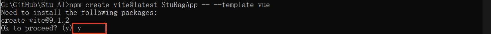
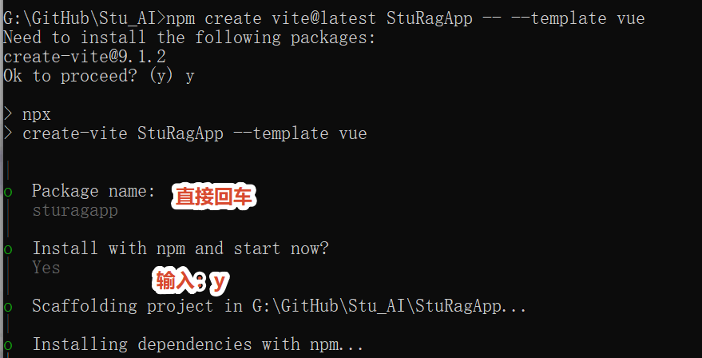
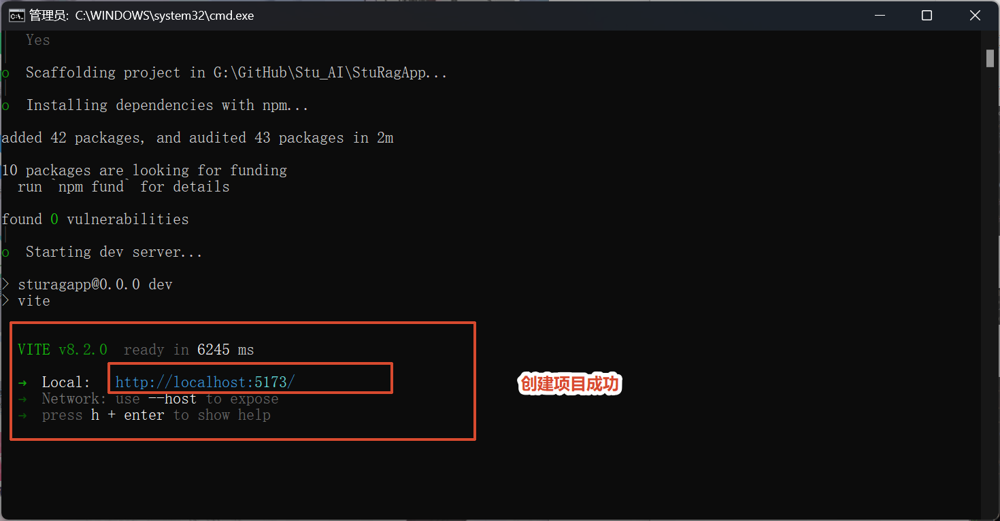
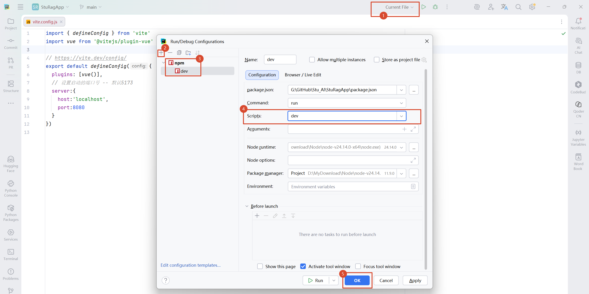
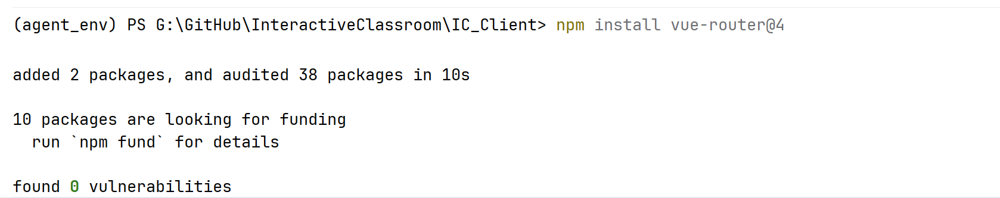
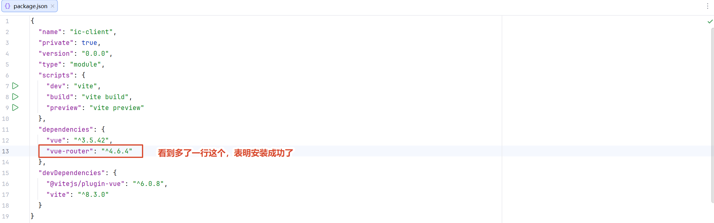
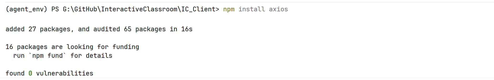
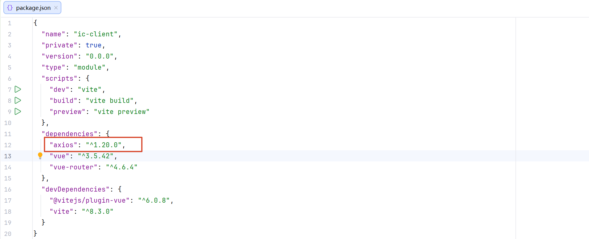
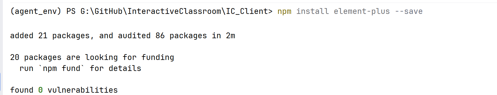
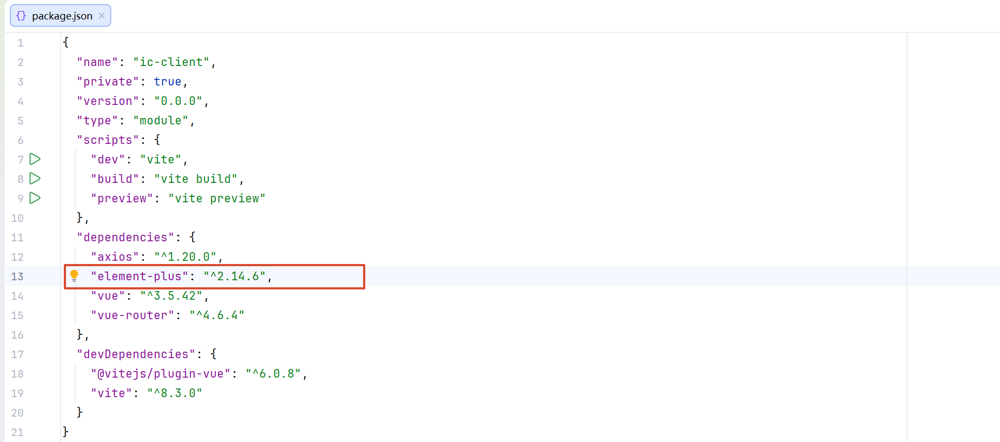

# 一、创建项目

## （一）Server


## （二）Client

### 1. 脚手架项目

**脚手架项目**是指通过预先配置好的工具快速生成项目基础结构的开发方式。

它会自动创建项目目录、配置文件以及基础代码环境，帮助开发者避免从零搭建项目。

在 Vue3 开发中，通常使用 **Vite** 作为脚手架工具，通过命令快速创建包含 Vue、JavaScript、依赖配置等内容的项目模板，使开发者可以直接进入业务功能开发阶段。

### 2. 步骤（图片仅供参考）

进入cmd（管理员）切换到存放项目的目录后再创建项目

```cmd
npm create vite@latest 项目名称 -- --template vue
```


是否安装包 -- 输入：y



确认包名 -- 直接回车G

确认安装 -- 输入：y



创建成功：项目会自动启动，通过给出的地址可以访问到内容



打开客户端项目 -- 配置启动项目




# 二、准备工作

## （一）【服务器】基础问答数据集处理

### 1. 向量化模型 -- `chromadb_model.py`

```python
import os
from dotenv import load_dotenv
load_dotenv()

from langchain_huggingface import HuggingFaceEmbeddings

class ChromaDBModel:
    def __init__(self):
        self.model_name = os.getenv("VECTORIZE_MODEL_PATH")

    def chromadb_model(self):
        return HuggingFaceEmbeddings(
            model_name=self.model_name,
            # 本地加载
            model_kwargs={
                "device": "cuda",
                "local_files_only": True,
            },
        )
```

### 2. 连接向量数据库 -- `ChromadbUtil.py`

```python
import os
from dotenv import load_dotenv
load_dotenv()

from langchain_chroma import Chroma
from model.chromadb_model import ChromaDBModel

class ChromaDB:
    def __init__(self):
        # 问答 - 向量数据库路径
        self.qa_chromadb_path = os.getenv("QA_CHROMADB_PATH")
        # 问答 - 向量数据集名称
        self.qa_vector_dataset_name = os.getenv("QA_VECTOR_DATASET_NAME")
        # 课件 - 向量数据库路径
        self.cw_courseware_chromadb_path = os.getenv("CW_CHROMADB_PATH")
        # 课件 - 向量数据集名称
        self.cw_vector_dataset_name = os.getenv("CW_VECTOR_DATASET_NAME")
        # 向量化模型
        self.chromadb_model = ChromaDBModel().chromadb_model()

    def qa_chromadb(self):
        return Chroma(
            persist_directory=self.qa_chromadb_path,
            collection_name=self.qa_vector_dataset_name,
            embedding_function=self.chromadb_model
        )

    def cw_chromadb(self):
        return Chroma(
            persist_directory=self.cw_courseware_chromadb_path,
            collection_name=self.cw_vector_dataset_name,
            embedding_function=self.chromadb_model
        )
```

### 3. 问答数据集向量化 -- `Teaching_QA.py`

```python
# 数据向量化

import os
import pandas as pd
from dotenv import load_dotenv

# 加载环境变量
load_dotenv()

# 我们把“标准问题”作为页面内容，把“答案”和其他信息作为元数据存起来
from langchain_core.documents import Document

# 连接向量数据库并写入数据
from util.ChromadbUtil import ChromaDB

class TeachingQA:
    def __init__(self):
        # 读取 Excel 数据
        self.raw_data = os.getenv("RAW_DATA_PATH")
        self.df = self.convert_dataframe()
        self.documents = self.convert_document()

    # 将 Excel 数据转换为 DataFrame 格式
    def convert_dataframe(self):
        # 把 Excel 文件里的指定工作表读取成一个 DataFrame（数据框）对象
        # pandas 本身并不直接解析 .xlsx 文件，它是通过引擎机制（openpyxl）委托第三方库来处理的
        # read_excel -- 专门用来读取 Excel 文件（.xlsx 或 .xls 格式）
        # sheet_name -- 指定要读取的 Excel 工作表名称，默认读取第一个工作表
        df = pd.read_excel(self.raw_data, sheet_name="问答初始数据")

        # 数据清洗：只保留有“标准问题”的行，防止空数据报错
        # dropna -- 删除包含缺失值的行（默认删除所有包含缺失值的行）
        # subset -- 指定要检查的列名列表，默认检查所有列
        # inplace -- 是否在原 DataFrame 上修改，默认返回一个新 DataFrame
        df.dropna(subset=["标准问题(80字以内，不能为空)"], inplace=True)

        # 测试，前10条数据
        # df = df.head(10)

        # 返回数据框
        return df

    # 转换成 LangChain 需要的 Document 格式
    def convert_document(self):
        # 转换为 Document 格式
        documents = []
        # df.iterrows() -- 每次返回一个元组 (索引, 行数据)
        for i, row in self.df.iterrows():
            # 相似问法处理
            similar_questions = []
            similar = ["相似问法1(80字以内)", "相似问法2(80字以内)","相似问法3(80字以内)", "相似问法4(80字以内)","相似问法5(80字以内)", "相似问法6(80字以内)"]
            for s in similar:
                # pd.notna(row[s]) -- 判断这个单元格的值不是空值（Not a Number / Not Available）
                if s in row.index and pd.notna(row[s]):
                    similar_questions.append(str(row[s]))

            # print(f"【测试】第 {i+1} 行的相似问法：\n -- {similar_questions}")

            # 将标准问题和相似问法拼接成一段完整的文本
            page_content = f"标准问题：{str(row['标准问题(80字以内，不能为空)'])}\n"
            if similar_questions:
                page_content += f"相似问法：{'；'.join(similar_questions)}\n"

            # 将文本转换为 Document 格式
            doc = Document(
                page_content=page_content,
                metadata={
                    "answer": str(row["答案(2000字以内，不能为空)"]),
                    "category": str(row["规则分类（30字以内，空为默认分类）"]),
                    "source": "教学问答数据集.xlsx"
                }
            )

            # 添加到列表中
            documents.append(doc)

        # 处理完成，打印，返回
        print(f"【测试】数据处理完成，共加载 {len(documents)} 条问答数据。")
        return documents

    # 将处理好的数据写入向量数据库
    def write_to_chromadb(self):
        print("【测试】正在连接数据库并写入向量...")

        try:
            # 获取数据库实例
            db = ChromaDB().qa_chromadb()

            # 将文档添加到数据库
            # 如果集合已存在，这行代码会追加数据；如果是新的，会创建新集合
            db.add_documents(self.documents)

            print("【测试】数据向量化并存储成功！")
            print(f"【测试】当前数据库中共有 {db._collection.count()} 条数据。")

        except Exception as e:
            print(f"【测试】存入数据库时出错: {e}")

if __name__ == '__main__':
    TeachingQA().write_to_chromadb()
```

## （二）【服务器】启动配置 -- `main.py`

### 1. 基础启动

```python
from fastapi import FastAPI
import uvicorn

app = FastAPI()

if __name__ == '__main__':
    uvicorn.run(app, host='localhost', port=8000)
```

### 2. 生命周期

```python
from contextlib import asynccontextmanager

# 定义异步上下文管理器
@asynccontextmanager
async def content_manager(app: FastAPI):
    # --- 启动阶段 (Startup) ---
    print("【测试】欢迎进入 -- 基于泛雅平台的AI互动智课生成与实时问答系统")

    # yield 之前的代码在服务器启动时执行
    yield

    # --- 关闭阶段 (Shutdown) ---

    # yield 之后的代码在服务器关闭时执行
    print("【测试】系统成功关闭")

app = FastAPI(lifespan=content_manager)
```

### 3. 跨域配置

```python
from fastapi.middleware.cors import CORSMiddleware

app.add_middleware(
    CORSMiddleware,
    allow_origins=["http://localhost:8080"],    # 允许的跨域访问的域名 -- 完整的客户端域名
    allow_credentials=True, # 允许携带cookie
    allow_methods=["*"],    # 允许的跨域访问请求的方法
    allow_headers=["*"],    # 允许的跨域访问请求的头部信息
)
```

## （三）【客户端】启动配置 -- `vite.config.js`

```js
import vue from '@vitejs/plugin-vue'
import { defineConfig } from 'vite'

// https://vite.dev/config/
export default defineConfig({
  plugins: [vue()],
  // 设置启动的端口号 -- 默认5173
  server:{
    host:'localhost',
    port:8080,
    open:true // 启动时自动打开浏览器
  }
})
```

## （四）【客户端】路由配置

### 1. 安装管理员

```
npm install vue-router@4
```



### 2. 验证



### 3. 配置路由 -- `index.js`

配置路由的定义文件（通常就是在： `src/router/index.js` -- 没有直接新建）：

只要客户端项目中创建了一个页面，什么都先不考虑，直接去配置路由

```js
// 引入路由配置文件
import {createRouter, createWebHistory} from 'vue-router';


// 定义路由配置对象 -- 数组
const routes = []

// 设置路由模式为 history 模式 -- 默认 hash 模式，访问路径中间有一个 # 号
const router = createRouter({
    history: createWebHistory(),
    routes
})

// 导出路由实例
export default router
```

## （五）【客户端】全局配置 -- `main.js`

### 1. 创建启动对象

```js
import { createApp } from 'vue'
import './style.css'
import App from './App.vue'

// 创建对象
const app = createApp(App)
app.mount('#app')
```

### 2. 注册路由

```js
// 注册路由
import router from './router'
app.use(router)
```

在全局配置中注册路由后，还需要修改 App.vue 中的代码：直接把 App.vue 中的代码使用一个路由切换标签`<router-view />`占位，后面通过路由访问某一个页面的时候，就能够直接替换

```vue
<script setup>
</script>

<template>
  <div>
    <router-view />
  </div>
</template>

<style scoped>
</style>
```

### 3. axios 全局配置

axios 是一个基于 Promise 的 HTTP 客户端库，用来在浏览器里方便地发送网络请求、处理响应、拦截请求和统一错误处理；

在 Vue 项目中，通常会在 main.js 里把 axios 挂载到 `app.config.globalProperties.$axios` 上，使其成为全局属性，这样所有组件都能复用同一个 axios 实例；

而在 Vue 3 的 `<script setup>` 中没有 `this`，所以需要通过 `getCurrentInstance().proxy` 获取当前组件实例的代理对象，再通过 `proxy.$axios` 访问到 main.js 里挂载的 axios，从而发送请求。

简单说：**axios 负责发请求，`$axios` 是把它挂到全局方便复用，`getCurrentInstance().proxy` 是在 Vue 3 setup 里拿到实例去访问这个全局属性。**

安装：

```
npm install axios
```



验证：



配置：

```js
// axios 全局配置
import axios from 'axios'   // 导入 axios 包
axios.defaults.baseURL = 'http://localhost:8000/'   // 服务器请求路径公共部分
axios.defaults.headers.post['Content-Type'] = 'application/json'    // post 请求发送json数据给服务器
axios.defaults.headers.put['Content-Type'] = 'application/json'     // put 请求发送json数据给服务器
app.config.globalProperties.$axios = axios      // 将 axios 对象挂载到 vue 对象上，使用 $axios 替代原生的 axios
```

### 4. 导航守卫

```js
// 导航守卫
// 固定写法 -- 每次路由要跳转时都会触发这个回调函数
// to: 要去的目标页面
// from: 从哪个页面离开
// next(): 放行函数，必须调用它才能继续跳转
router.beforeEach((to, from, next) => {
    // 判断目标页面的 meta 里 login 字段是否为 true
    if (to.meta.login){
        // 如果目标页面需要登录，就去浏览器的 sessionStorage 里查有没有存 username
        let username = sessionStorage.getItem('username')
        // 如果查到了 username，说明已登录，调用 next() 放行；
        // 如果没查到，说明未登录，调用 next('/') 强制把用户重定向到首页
        if (username){
            console.log('已登录，跳转到聊天页面')
            next()
        } else {
            console.log('未登录，跳转到登录页面')
            next('/')
        }
    // 如果目标页面不需要登录，就直接放行
    } else {
        console.log('非对话页面，直接访问')
        next()
    }
})
```

### 5. 美化页面全局配置

安装：

```python
npm install element-plus --save
```



验证：



配置：

```python
// 美化页面全局配置 -- 全局注册 Element-Plus
import ElementPlus from 'element-plus'
import 'element-plus/dist/index.css'
app.use(ElementPlus)
```

## （六）【服务器】数据库

### 1. 连接 -- `mysql_conn.py`

```python
import pymysql
import os
from dotenv import load_dotenv
load_dotenv()

class MySQLConn:
    def __init__(self):
        self.host = os.getenv("MYSQL_HOST")
        self.port = int(os.getenv("MYSQL_PORT"))
        self.user = os.getenv("MYSQL_USER")
        self.password = os.getenv("MYSQL_PASSWORD")
        self.database = os.getenv("MYSQL_DATABASE")
        self.charset = os.getenv("MYSQL_CHARSET")

    # 获取连接
    def get_mysql_conn(self):
        try:
            return pymysql.connect(
                host=self.host,
                port=self.port,
                user=self.user,
                password=self.password,
                database=self.database,
                charset=self.charset,
                # # 以 dict 的方式返回查询结果
                cursorclass=pymysql.cursors.DictCursor
            )
        except Exception as e:
            print(f"【测试】获取数据库连接失败：{e}")
            return None

    # 关闭连接
    def close_mysql_conn(self,cur,conn):
        cur.close()
        conn.close()
```

### 2. 查询 -- `mysql_select_tool.py`

```python
from app.web.util.mysql_conn import MySQLConn

class MySQLSelect:
    def __init__(self):
        # 创建全局单例数据库连接对象
        self.mysql_conn = MySQLConn()
        # 创建连接对象
        self.conn = self.mysql_conn.get_mysql_conn()
        # 创建游标对象
        self.cur = self.conn.cursor()

    def verify_account(self,sql,id):
        print("\n【测试】这里是 -- mysql_select_tool.py")
        # 执行 sql
        self.cur.execute(sql,id)
        # 获取结果
        result = self.cur.fetchone()
        print(f"【测试】数据库查询结果：{result}")
        # 关闭连接
        self.mysql_conn.close_mysql_conn(self.cur,self.conn)
        return result

    def select_curseware(self,sql):
        print("\n【测试】这里是 -- mysql_select_tool.py")
        # 执行 sql
        self.cur.execute(sql)
        # 获取结果
        result = self.cur.fetchall()
        print(f"【测试】数据库查询结果：{result}")
        # 关闭连接
        self.mysql_conn.close_mysql_conn(self.cur, self.conn)
        return result

if __name__ == '__main__':
    sql = "select id,name,email from student where id = %s"
    result = MySQLSelect().verify_account(sql,"001")
    print(result)
```

### 3. 插入 -- `mysql_insert_tool.py`

```python
from app.web.util.mysql_conn import MySQLConn

class MySQLInsert:
    def __init__(self):
        # 创建全局单例数据库连接对象
        self.mysql_conn = MySQLConn()
        # 创建连接对象
        self.conn = self.mysql_conn.get_mysql_conn()
        # 创建游标对象
        self.cur = self.conn.cursor()

    def insert_account(self,sql,id,name,email,password):
        print("\n【测试】这里是 -- mysql_insert_tool.py")
        try:
            # 执行操作
            self.cur.execute(sql,[id,name,email,password])
            # 提交事务
            self.conn.commit()
            print("【测试】注册成功")
            return {
                "code": 200,
                "message": "注册成功",
                "data": {"id": id, "name": name, "email": email}
            }
        except Exception as e:
            print(f"【测试】注册失败：{e}")
            return {"code": 500, "message": "注册失败", "data": None}
        finally:
            # 关闭连接
            self.mysql_conn.close_mysql_conn(self.cur, self.conn)

    def insert_courseware(
        self,sql,original_filename,saved_filename,file_path,course_name,chapter_name,file_size,file_type
    ):
        print("\n【测试】这里是 -- mysql_insert_tool.py")
        try:
            # 执行操作
            self.cur.execute(sql,[original_filename,saved_filename,file_path,course_name,chapter_name,file_size,file_type,2])
            # 提交事务
            self.conn.commit()
            print("【测试】数据库添加课件成功")
            return {
                "code": 200,
                "message": "数据库添加课件成功",
                "data": original_filename
            }
        except Exception as e:
            print(f"【测试】数据库添加课件失败：{e}")
            return {"code": 500, "message": "数据库添加课件失败", "data": None}
        finally:
            # 关闭连接
            self.mysql_conn.close_mysql_conn(self.cur, self.conn)
```

### 4. 更新 -- `mysql_update_tool.py`

```python
from app.web.util.mysql_conn import MySQLConn

class MySQLUpdate:
    def __init__(self):
        self.mysql_conn = MySQLConn()

    def update_parse_status(self, sql, status, courseware_id):
        print("\n【测试】这里是 -- mysql_update_tool.py")
        conn = None
        cur = None
        try:
            # 每次调用现建连接（对象可安全地被多次调用）
            conn = self.mysql_conn.get_mysql_conn()
            if conn is None:
                print("【测试】获取数据库连接失败")
                return {"code": 500, "message": "数据库连接失败"}
            cur = conn.cursor()
            cur.execute(sql, [status, courseware_id])
            conn.commit()
            print(f"【测试】课件 {courseware_id} 状态更新为 {status}")
            return {"code": 200, "message": "状态更新成功"}
        except Exception as e:
            print(f"【测试】状态更新失败: {e}")
            return {"code": 500, "message": "状态更新失败"}
        finally:
            # 关闭前判断存在性，避免重复关闭报 Already closed
            if cur is not None:
                try:
                    cur.close()
                except Exception:
                    pass
            if conn is not None:
                try:
                    conn.close()
                except Exception:
                    pass
```

### 5. 删除 -- `mysql_delete_tool.py`

```python
from app.web.util.mysql_conn import MySQLConn

class MySQLDelete:
    def __init__(self):
        self.mysql_conn = MySQLConn()

    def delete_courseware(self,sql,courseware_id):
        print("\n【测试】这里是 -- mysql_delete_tool.py")
        conn = None
        cur = None
        try:
            # 每次调用现建连接（对象可安全地被多次调用）
            conn = self.mysql_conn.get_mysql_conn()
            if conn is None:
                print("【测试】获取数据库连接失败")
                return {"code": 500, "message": "数据库连接失败"}
            cur = conn.cursor()
            cur.execute(sql, [courseware_id])
            conn.commit()
            print(f"【测试】课件 {courseware_id} 删除成功")
            return {"code": 200, "message": "删除成功"}
        except Exception as e:
            print(f"【测试】删除失败: {e}")
            return {"code": 500, "message": "删除失败"}
        finally:
            # 关闭前判断存在性，避免重复关闭报 Already closed
            if cur is not None:
                try:
                    cur.close()
                except Exception as e:
                    print(f"【测试】关闭MySQL游标失败：{e}")
            if conn is not None:
                try:
                    conn.close()
                except Exception as e:
                    print(f"【测试】关闭MySQL连接失败：{e}")
```

## （七）【服务器】redis

### 1. 连接 -- `redis_conn.py`

```python
import os
import redis
from dotenv import load_dotenv
load_dotenv()

class RedisConn:
    def __init__(self):
        self.host = os.getenv("REDIS_HOST")
        self.port = os.getenv("REDIS_PORT")
        self.password = os.getenv("REDIS_PASSWORD")
        self.db = os.getenv("REDIS_DB")

    def get_redis_conn(self):
        return redis.Redis(
            host=self.host,
            port=self.port,
            password=self.password,
            db=self.db,
            # 如果redis无法存入数据，添加下面的配置protocol=2 3 中的一个，应该是2
            # protocol=2,
        )

    def close_redis_conn(self,conn):
        conn.close()
```

## （八）【服务器】Neo4j

### 1. 安装相关库

```
pip install python-pptx
pip install pdfplumber
pip install py2neo -i https://repo.huaweicloud.com/repository/pypi/simple/
```

### 2. Neo4j连接 -- `neo4j_util.py`

```python
from py2neo import Graph
import os
from dotenv import load_dotenv
load_dotenv()

def get_neo4j_conn():
    return Graph(
        profile=os.getenv('NEO4J_HOST'),  # 连接地址
        auth=(os.getenv('NEO4J_ACCOUNT'), os.getenv('NEO4J_PASSWORD')),  # 连接账号和密码
        name=os.getenv('NEO4J_NAME'),  # 数据库名称
    )
```

## （九）【服务器】提示词

### 1. 创建 -- `bulider_prompt.py`

```python
import os
import yaml
from string import Template

class BuilderPromptYaml:
    @staticmethod
    def get_prompt(file_name: str, **kwargs) -> str:
        base_dir = os.path.dirname(os.path.abspath(__file__))
        file_path = os.path.join(base_dir, file_name)

        with open(file_path, "r", encoding="utf-8") as f:
            config = yaml.safe_load(f)

        # 模板变量替换（用 $变量名 语法，安全不冲突）
        def _substitute(value):
            if isinstance(value, str):
                if kwargs:
                    try:
                        return Template(value).safe_substitute(kwargs)
                    except KeyError:
                        return value
                return value
            elif isinstance(value, list):
                return [_substitute(item) for item in value]
            elif isinstance(value, dict):  # ← 新增：处理字典类型
                return {k: _substitute(v) for k, v in value.items()}
            return value

        config = _substitute(config)

        if "prompt" in config:
            # 自由格式
            prompt = config["prompt"]
        else:
            # 结构化
            prompt = (
                f"一 角色:{config['role']}\n"
                f"二 任务:\n{chr(10).join(config['task'])}\n"
                f"三 规则:\n{chr(10).join(config['rule'])}\n"
                f"四 输出:\n{chr(10).join(config['output'])}\n"
                # f"五 示例:\n{chr(10).join(config['example'])}\n"
            )
        return prompt.strip()
```

## （十）PostgreSQL -- `postgres_conn.py`

### 1. 导入

```python
import os
from dotenv import load_dotenv
from psycopg_pool import ConnectionPool

# 加载环境变量
load_dotenv()
```

### 2. 创建数据表

chat_history -- 对话历史（会话管理/历史记录用）

conversation_summary -- 会话摘要记忆（四层记忆的 L2 层用）

student_profile -- 学生画像（四层记忆的 L4 层用）

```python
CREATE_TABLE_SQL_LIST = [
    # 对话历史
    '''
    CREATE TABLE IF NOT EXISTS chat_history (
        id BIGSERIAL PRIMARY KEY,
        session_id VARCHAR(64) NOT NULL,
        user_id VARCHAR(64) NOT NULL,
        mode VARCHAR(16) NOT NULL,
        course_name VARCHAR(255) DEFAULT '',
        chapter_name VARCHAR(255) DEFAULT '',
        role VARCHAR(16) NOT NULL,
        content TEXT NOT NULL,
        create_time TIMESTAMP DEFAULT NOW()
    )
    ''',
    'CREATE INDEX IF NOT EXISTS idx_chat_history_session ON chat_history(session_id)',
    'CREATE INDEX IF NOT EXISTS idx_chat_history_user ON chat_history(user_id)',
    # 摘要记忆
    '''
    CREATE TABLE IF NOT EXISTS conversation_summary (
        session_id VARCHAR(64) PRIMARY KEY,
        summary TEXT,
        update_time TIMESTAMP DEFAULT NOW()
    )
    ''',
    # 人物画像
    '''
    CREATE TABLE IF NOT EXISTS student_profile (
        user_id VARCHAR(64) NOT NULL,
        course_name VARCHAR(255) NOT NULL,
        profile TEXT,
        update_time TIMESTAMP DEFAULT NOW(),
        PRIMARY KEY (user_id, course_name)
    )
    ''',
    'CREATE INDEX IF NOT EXISTS idx_student_profile_user ON student_profile(user_id)'
]
```

### 3. 连接

```python
class PostgresConn:
    # 类级共享连接池 -- 全局唯一
    _pool = None

    def __init__(self):
        # 从环境变量读取连接串
        self.conninfo = os.getenv("POSTGRESQL_URL")

    # 启动阶段：创建连接池并建表（main.py的lifespan生命周期中调用，只执行一次）
    def open_pool(self):
        if PostgresConn._pool is None:
            # autocommit=True -- 每条语句自动提交，业务代码无需手动commit
            PostgresConn._pool = ConnectionPool(
                self.conninfo,
                min_size=2,
                max_size=10,
                open=False,
                kwargs={"autocommit": True}
            )
            PostgresConn._pool.open()

            # 建表（幂等）
            self.create_tables()
            print("【测试】PostgreSQL连接池已启动，数据表已就绪")
        return PostgresConn._pool

    # 关闭阶段：销毁连接池（main.py的lifespan中调用）
    def close_pool(self):
        if PostgresConn._pool is not None:
            PostgresConn._pool.close()
            PostgresConn._pool = None
            print("【测试】PostgreSQL连接池已关闭")

    # 获取连接池（业务代码调用）
    def get_pool(self):
        if PostgresConn._pool is None:
            raise RuntimeError("PostgreSQL连接池未初始化，请检查服务启动流程")
        return PostgresConn._pool

    # 建表
    def create_tables(self):
        pool = PostgresConn._pool
        with pool.connection() as conn:
            with conn.cursor() as cur:
                for sql in CREATE_TABLE_SQL_LIST:
                    cur.execute(sql)
```

### 4. 生命周期 -- `main.py`

```python
from data.util.postgres_conn import PostgresConn

@asynccontextmanager
async def content_manager(app: FastAPI):
    print("【测试】欢迎进入 -- 基于泛雅平台的AI互动智课生成与实时问答系统")
    
    # 启动PostgreSQL连接池
    app.state.postgres_conn = PostgresConn()
    app.state.postgres_conn.open_pool()
    
    yield
    
    # 销毁对象
    app.state.postgres_conn.close_pool()
    app.state.postgres_conn = None
    
    print("【测试】系统成功关闭")
```

# 三、系统主页

## （一）客户端

### 1. 配置路由 -- `index.js`

```js
const routes = [
    {
        path: '',
        meta: {
            title: '首页',
            login: false,   //配合全局路由守卫（导航守卫）使用，表示访问这个页面不需要登录。
        },
        component: () => import('../components/Home.vue')
    },
]
```

### 2. 页面代码 -- `home.vue`

实现功能：点击按钮进入登陆界面

```vue
<template>
  <div>
    <h1>欢迎来到</h1>
    <h1>AI互动智课生成与实时问答系统</h1>
  </div>
  <div>
    请选择教师或者学生登陆<br>
    <button @click="goTeacherLogin">教师登陆</button>
    <button @click="goStudentLogin">学生登陆</button>
  </div>
</template>

<script setup>
import {useRouter} from "vue-router";

// 创建路由跳转对象
let router = useRouter();

function goTeacherLogin() {
  router.push('/login');
  sessionStorage.setItem("identity", "teacher");
}

function goStudentLogin() {
  router.push('/login');
  sessionStorage.setItem("identity", "student");
}
</script>

<style scoped>
</style>
```

# 四、登录页面

## （一）客户端

### 1. 配置路由 -- `index.js`

```js
const routes = [
    {
        path: '/login',
        meta: {
            title: '账号的登录与注册',
            login: false,
        },
        component: () => import('../components/Login.vue')
    },
]
```

### 2. 页面代码 -- `Login.vue`

实现功能：教师或学生登陆；若没有账号点击注册按钮，跳转到注册页面；单击退出按钮，可回到首页重新选择登陆身份

```vue
<template>
  <div>
    <h1>当前为 - {{identity}} - 登陆</h1>
  </div>

  <div>
    <form>
      <table>
        <tbody>
          <tr>
            <td v-show="!isShow">学号：</td>
            <td v-show="isShow">工号：</td>
            <td><input type="text" v-model="id"></td>
          </tr>
          <tr>
            <td>密码：</td>
            <td><input type="password" v-model="password"></td>
          </tr>
        </tbody>
      </table>
    </form>
  </div>

  <div>
    <button @click="goSignUp">注册</button>
    <button @click="goChat">登陆</button>
    <button @click="goHome">退出</button>
  </div>


</template>

<script setup>
import {ref, getCurrentInstance, onMounted} from "vue";
import {useRouter} from "vue-router"

// 加载页面后自动执行功能
let identity = ref("")
let isShow = ref('')
onMounted(() => {
  identity.value = sessionStorage.getItem("identity");
  if (identity.value === 'teacher'){
    isShow.value = true;
  } else {
    isShow.value = false;
  }
})

// 创建路由跳转对象
let router = useRouter();
function goSignUp(){
  router.push('/signup');
}
function goHome(){
  router.push('/');
}

// 创建当前实例对象 -- 通过这个对象才可以访问到 main.js 中定义的 $axios 变量
let proxy = getCurrentInstance().proxy

// 基本信息
let id = ref('')
let name = ref('')
let email = ref('')
let password = ref('')

// 登录
function goChat(){
  console.log("【测试】开始登录账号......")

  let accountInformation = {
    identity: identity.value,
    id: id.value,
    name: name.value,
    email: email.value,
    password: password.value
  }

  proxy.$axios({
    url:'account/login',
    method:'post',
    data:accountInformation
  }).then(res => {
    console.log("验证的返回结果：", res.data)
    let code = res.data.code
    let message = res.data.message
    let data = res.data.data
    if(code === 200){
      sessionStorage.setItem("name", data);
      ElMessage.success(message)
      setTimeout(() =>{
        router.push('/chat')
      },2000)
    } else {
      ElMessage.error(message)
    }
  })
}

</script>

<style scoped>

</style>
```

## （二）服务器

### 1. 注册 -- 验证登录路由 -- `main.py`

```python
from app.web.system_router.login_router import login_router

app.include_router(login_router,prefix="/account",tags=["account"])
```

### 2. 参数校验 -- `account_schema.py`

```python
from pydantic import BaseModel, Field

# 账号信息参数校验
class AccountSchema(BaseModel):
    identity: str = Field(..., description="当前登录身份")
    id: str = Field(..., description="学号或工号")
    name: str = Field(..., description="姓名")
    email: str = Field(..., description="邮箱")
    password: str = Field(..., description="密码")
```

### 3. 登录路由 -- `login_router.py`

```python
from fastapi import APIRouter

login_router = APIRouter()

from app.web.schema.account_schema import AccountSchema
from app.web.system_router.login_account import LoginAccount

@login_router.post(
    path="/login",
    summary="登录账号"
)
def login(account_schema:AccountSchema):
    print("\n【测试】这里是 -- login_router.py")
    print(f"【测试】接收到用户信息（注册账号）：{account_schema}")
    return LoginAccount(account_schema).verify()
```

### 4. 登录验证 -- `login_account.py`

```python
from app.web.tool.mysql_select_tool import MySQLSelect
class LoginAccount:
    def __init__(self, account_schema):
        self.id = account_schema.id
        self.password = account_schema.password
        self.identity = account_schema.identity
        self.mysql_verify = MySQLSelect()

    def verify(self):
        print("\n【测试】这里是 -- login_account.py")
        sql_verify = f"select id,name,password from {self.identity} where id = %s"
        result = self.mysql_verify.verify_account(sql_verify,self.id)
        print("\n【测试】这里是 -- login_account.py")
        if result:
            if result["password"] == self.password and result["id"] == self.id:
                return {
                    "code": 200,
                    "message": "登录成功",
                    "data": result['name']
                }
            else:
                return {
                    "code": 500,
                    "message": "账号或密码错误",
                    "data": None
                }
        else:
            return {
                "code": 500,
                "message": "账号不存在，请注册后重新登录！",
                "data": None
            }
```

# 五、注册页面

## （一）客户端

### 1. 配置路由 -- `index.js`

```js
const routes = [
    {
        path: '/signup',
        meta: {
            title: '注册',
            login: false,
        },
        component: () => import('../components/SignUp.vue')
    },
]
```

### 2. 页面代码 -- `SignUp.vue`

```vue
<template>
  <div>
    <h1>注册页面</h1>
  </div>
  <div>
    <form>
      <table>
        <tbody>
          <tr>
            <td v-show="!isShow">学号：</td>
            <td v-show="isShow">工号：</td>
            <td><input type="text" v-model="id"></td>
          </tr>
          <tr>
            <td>姓名：</td>
            <td><input type="text" v-model="name"></td>
          </tr>
          <tr>
            <td>邮箱号：</td>
            <td><input type="text" v-model="email"></td>
          </tr>
          <tr>
            <td>密码：</td>
            <td><input type="password" v-model="password"></td>
          </tr>
          <tr>
            <td>确认密码：</td>
            <td><input type="password" v-model="confirmPassword"></td>
          </tr>
          <tr>
            <td>验证码：</td>
            <td><input type="text" v-model="captcha"></td>
          </tr>
        </tbody>
      </table>
    </form>
  </div>

  <div>
    <button @click="goLogin">返回登陆页面</button>
    <button @click="signUp" v-show="!iscaptcha">注册</button>
    <button @click="sendCaptcha" v-show="iscaptcha" >发送验证码</button>
  </div>
</template>

<script setup>
import {ref, getCurrentInstance, onMounted} from "vue";
import {useRouter} from "vue-router";
import {ElMessage} from "element-plus";

// 加载页面后自动执行功能
let identity = ref("")
let isShow = ref('')
onMounted(() => {
  identity.value = sessionStorage.getItem("identity");
  if (identity.value === 'teacher'){
    isShow.value = true;
  } else {
    isShow.value = false;
  }
})

// 创建路由跳转对象
let router = useRouter();
function goLogin(){
  router.push('/login');
}

// 创建当前实例对象
let proxy = getCurrentInstance().proxy;

let id = ref('')
let name = ref('')
let email = ref('')
let password = ref('')
let confirmPassword = ref('')

let captcha = ref("")
let iscaptcha = ref(true)
let method = ref(true)


// 发送验证码 -- 向服务器发送请求，验证用户信息
function sendCaptcha(){
  console.log("【测试】开始验证账号信息......")

  let accountInformation = {
    identity: identity.value,
    id: id.value,
    name: name.value,
    email: email.value,
    password: password.value
  }

  // 验证两次密码是否一致
  if(password.value !== confirmPassword.value){
    ElMessage.error('两次密码不一致');
    return {
      "code": 500,
      "msg": "两次密码不一致"
    }
  }

  // 接收验证码
  proxy.$axios({
    url:'/account/email',
    method:'post',
    data:accountInformation
  }).then(res=>{
    console.log("【测试】邮件的发送结果：", res.data)
    let code = res.data.code
    let message = res.data.msg
    if(code === 200){
      method.value = false
      iscaptcha.value = !iscaptcha.value
      ElMessage.info(message)
    } else {
      ElMessage.error(message)
    }
  })
}

// 注册账号
function signUp(){
  console.log("【测试】开始注册账号......")

  let accountInformation = {
    identity: identity.value,
    id: id.value,
    name: name.value,
    email: email.value,
    password: password.value
  }

  proxy.$axios({
    url: '/account/signup',
    method: 'post',
    data: accountInformation
  }).then(res => {
    console.log(res.data);
    let code = res.data.code;
    if(code === 200){
      ElMessage.success('注册成功');
      router.push('/student');
    }else{
      ElMessage.error('注册失败');
    }
  })
}

</script>

<style scoped>
</style>
```

## （二）服务器

### 1. 注册 -- 注册账号路由 -- `main.py`

```python
from app.web.system_router.signup_router import signup_router

app.include_router(signup_router,prefix="/account",tags=["account"])
```

### 2. 注册 -- 发送邮件路由 -- `main.py`

```python
from app.web.system_router.email_router import email_router

app.include_router(email_router,prefix="/account",tags=["account"])
```

### 3. 参数校验 -- `account_schema.py`

```python
from pydantic import BaseModel, Field

# 账号信息参数校验
class AccountSchema(BaseModel):
    identity: str = Field(..., description="当前登录身份")
    id: str = Field(..., description="学号或工号")
    name: str = Field(..., description="姓名")
    email: str = Field(..., description="邮箱")
    password: str = Field(..., description="密码")
```

### 4. 邮件路由 -- `email_router.py`

```python
from fastapi import APIRouter

email_router = APIRouter()

from app.web.schema.account_schema import AccountSchema
from app.web.system_router.send_email import SendEmail

@email_router.post(
    path="/email",
    summary="发送验证码邮件"
)
def email(account_schema:AccountSchema):
    print("\n【测试】这里是 -- email_router.py")
    print(f"【测试】接收到用户信息（注册账号）：{account_schema}")
    return SendEmail(account_schema).captcha_email()
```

### 5. 发送验证码邮件 -- `send_email.py`

```python
import random
import os
from email.mime.text import MIMEText
from app.web.util.redis_conn import RedisConn
from app.web.tool.mysql_select_tool import MySQLSelect
import smtplib
import ssl
from dotenv import load_dotenv
load_dotenv()

class SendEmail:
    def __init__(self, account_schema):
        # 邮件
        self.sender = os.getenv("SENDER_EMAIL")
        self.sender_password = os.getenv("SENDER_EMAIL_PASSWORD")
        self.host = os.getenv("EMAIL_HOST")
        self.port = int(os.getenv("EMAIL_PORT"))
        # 账号信息
        self.identity = account_schema.identity
        self.id = account_schema.id
        self.email = account_schema.email
        # 调用
        self.mysql_verify = MySQLSelect()
        self.redis_conn = RedisConn()
        self.captcha = self.create_captcha()
        self.save_captcha = self.save_captcha_to_redis()
        self.message = self.email_message()

    # 生成验证码
    def create_captcha(self):
        captcha = ""
        for i in range(4):
            captcha += str(random.randint(0, 9))
        return captcha

    # 将验证码存储到redis中
    def save_captcha_to_redis(self):
        try:
            conn = self.redis_conn.get_redis_conn()
            conn.delete(self.id)  # 清除可能存在的旧验证码
            conn.setex(self.id, 300, self.captcha)
            self.redis_conn.close_redis_conn(conn)
            return {
                "code": 200,
                "msg": "验证码存储到redis中成功"
            }
        except Exception as e:
            return {
                "code": 500,
                "msg": f"验证码存储到redis中失败：{e}"
            }

    # 生成邮件信息
    def email_message(self):
        # 配置发送信息：发件方、授权码（从.env文件读取）、主题、邮件内容
        sender = self.sender
        subject = "主题为：发送验证码"
        content = f"验证码为：{self.captcha},请在5分钟内使用"

        # 创建邮件对象 -- 将要发送的信息写在这个对象里面
        message = MIMEText(content, "plain", "utf-8")
        print(f"【测试】创建的邮件对象为：\n{message}")

        # 添加内容在 message对象中
        message["From"] = sender  # 发件人
        message["To"] = self.email  # 收件人
        message["Subject"] = subject  # 主题
        print(f"【测试】添加内容后的邮件对象为：\n{message}")
        return message

    # 发送验证码邮件
    def captcha_email(self):
        print("\n【测试】这里是发送邮件 -- UsersService")

        # 验证用户是否存在
        sql_version = f"select id,email from {self.identity} where id = %s"
        result = self.mysql_verify.verify_account(sql_version,self.id)
        print("\n【测试】这里是发送邮件 -- UsersService")
        print(f"【测试】验证用户是否存在结果，查询数据库返回信息：{result}")

        # 如果用户存在，则返回结果
        if result:
            return {
                "code": 500,
                "msg": f"用户 {self.id} 存在，无需注册"
            }

        # 如果用户不存在，则进行以下操作

        # 生成验证码
        captcha = self.captcha
        print(f"【测试】验证码：{captcha}")

        # 将验证码存储到redis中
        save_result = self.save_captcha
        print(f"【测试】将验证码存储到redis中结果：{save_result}")
        if save_result.get("code") != 200:
            return save_result

        # 发送邮件
        sender = self.sender
        sender_pwd = self.sender_password
        print(f"【调试】程序读到的 sender(发件人) 是: [{sender}]")
        print(f"【调试】程序读到的 email(收件人) 是: [{self.email}]")
        try:
            # 创建 SSL 上下文
            context = ssl.create_default_context()

            # 创建邮件发送服务配置（465 端口必须使用 SMTP_SSL）
            smtp = smtplib.SMTP_SSL(
                host=self.host,
                port=self.port,
                context=context
            )
            print(f"【测试】通过SSL创建邮件发送服务配置：{smtp}")

            # 验证发送方和发送方的授权码是否能对上
            smtp.login(sender, sender_pwd)
            print("【测试】验证发送方和发送方的授权码成功")

            # 发送邮件 -- 方法：sendmail(发送方，接收方，邮件对象)
            message = self.message
            smtp.sendmail(sender, self.email, message.as_string())
            print(f"【测试】发送邮件成功")

            # 关闭邮件发送服务
            smtp.quit()

            # 返回结果
            return {
                "code": 200,
                "msg": f"发送邮件到 {self.email} 成功",
                "data": self.id
            }

        except Exception as e:
            print(f"【测试】发送邮件失败：{e}")
            return {
                "code": 500,
                "msg": f"发送邮件失败：{e}"
            }
```

### 6. 注册路由 -- `signup_router.py`

```python
from fastapi import APIRouter
signup_router = APIRouter()

# 账号注册接口
from app.web.schema.account_schema import AccountSchema
from app.web.system_router.add_account import AddAccount
@signup_router.post(
    path="/signup",
    summary="注册账号"
)
def sign_up(account_schema:AccountSchema):
    print("\n【测试】这里是 -- account_router.py")
    print(f"【测试】接收到用户信息（注册账号）：{account_schema}")
    return AddAccount(account_schema).sign_up()
```

### 7. 注册账号 -- `add_account.py`

```python
from app.web.tool.mysql_insert_tool import MySQLInsert
from app.web.tool.mysql_select_tool import MySQLSelect

class AddAccount:
    def __init__(self,account_schema):
        self.identity = account_schema.identity
        self.id = account_schema.id
        self.name = account_schema.name
        self.email = account_schema.email
        self.password = account_schema.password
        self.mysql_verify = MySQLSelect()
        self.mysql_insert = MySQLInsert()

    def sign_up(self):
        print("\n【测试】这里是注册账号 -- add_account.py")

        if self.identity == "student" or self.identity == "teacher":
            sql_insert = f"insert into {self.identity} values(%s, %s, %s, %s, now())"
            sql_verify = f"select id,name,email from {self.identity} where id = %s"

            # 验证账号是否存在
            result = self.mysql_verify.verify_account(sql_verify,self.id)
            print("【测试】验证账号返回的结果类型：",type(result))  # <class 'dict'> <class 'NoneType'>
            if result:
                return {
                    "code": 500,
                    "message": "账号已存在",
                    "data": result
                }
        else:
            return {
                "code": 500,
                "message": "身份错误",
                "data": None
            }
        result = self.mysql_insert.insert_account(sql_insert,self.id,self.name,self.email,self.password)
        return result
```

# 六、教师页面

## （一）客户端

### 1. 配置路由 -- `index.js`

```js
const routes = [
    {
        path: '/teacher',
        meta: {
            title: '教师上传课件页面',
            login: false,
        },
        component: () => import('../components/Teacher.vue')
    },
]
```

### 2. 页面代码 -- `Teacher.vue`

```vue
<template>
  <div>
    <h1>
      欢迎，{{tea_name}}
      <button @click="goHome" style="float: right; padding: 5px 10px; font-size: 12px;">退出登录</button>
    </h1>
  </div>

  <div style="padding: 20px;">
    <!-- 上传表单 -->
    <div style="margin-bottom: 30px;">
      <h2>课件上传与处理</h2>
      <div style="margin-bottom: 15px;">
        <label>课程名称：</label>
        <input type="text" v-model="courseName" placeholder="例如：材料力学" style="width: 300px; padding: 5px;">
      </div>

      <div style="margin-bottom: 15px;">
        <label>章节名称：</label>
        <input type="text" v-model="chapterName" placeholder="例如：第一章 绪论" style="width: 300px; padding: 5px;">
      </div>

      <div style="margin-bottom: 15px;">
        <label>上传课件：</label>
        <!--
          在文件选择器中选好文件并点击"确定"后，change 事件被触发
          对于 <input type="file"> 元素，它有一个特殊的属性叫 files
          如果 input 没有 multiple 属性（只能选一个文件），files 里最多只有 1 个文件。
          如果 input 有 multiple 属性（可以多选），files 里会有多个文件。
        -->
        <input type="file" @change="choiceFile" accept=".ppt,.pptx,.pdf">
        <div style="color: #999; font-size: 12px; margin-top: 5px;">仅支持PPT/PPTX/PDF，不超过100MB</div>
      </div>

      <!-- 上传按钮只负责上传 -->
      <button @click="uploadFile" :disabled="uploading" style="padding: 8px 20px;">
        {{ uploading ? '上传中...' : '上传' }}
      </button>
    </div>

    <!-- 已上传课件列表 -->
    <div>
      <h2>
        已上传课件
        <button @click="fetchCoursewareList" style="float: right; padding: 5px 10px; font-size: 12px;">刷新</button>
      </h2>

      <table border="1" style="width: 100%; border-collapse: collapse;">
        <thead>
          <tr style="background: #f5f5f5;">
            <th style="padding: 10px; text-align: center;">文件名</th>
            <th style="padding: 10px; text-align: center;">课程</th>
            <th style="padding: 10px; text-align: center;">章节</th>
            <th style="padding: 10px; text-align: center;">状态</th>
            <th style="padding: 10px; text-align: center;">上传时间</th>
            <!-- 修改点2：新增处理列 -->
            <th style="padding: 10px; text-align: center;">操作</th>
          </tr>
        </thead>
        <tbody>
          <tr v-for="item in coursewareList" :key="item.id">
            <td style="padding: 10px; text-align: center;">{{ item.original_filename }}</td>
            <td style="padding: 10px; text-align: center;">{{ item.course_name }}</td>
            <td style="padding: 10px; text-align: center;">{{ item.chapter_name }}</td>
            <td style="padding: 10px; text-align: center;">{{ getStatusText(item.parse_status) }}</td>
            <td style="padding: 10px; text-align: center;">{{ item.upload_time }}</td>
            <!-- 每一行添加处理按钮 -->
            <td style="padding: 10px; text-align: center;">
              <button @click="processCourseware(item)" :disabled="uploading">处理</button>
              <button @click="viewScript(item)" style="margin-left: 5px;" :disabled="item.parse_status !== 1 || generatingId === item.id">
                {{ generatingId === item.id ? '生成中...' : '查看脚本' }}
              </button>
              <button @click="deleteCourseware(item)" style="margin-left: 5px;" :disabled="uploading">删除</button>
            </td>
          </tr>
          <tr v-if="coursewareList.length === 0">
            <td colspan="6" style="padding: 20px; text-align: center; color: #999;">暂无上传记录</td>
          </tr>
        </tbody>
      </table>
    </div>
    <el-dialog v-model="scriptVisible" :title="scriptTitle" width="70%" top="5vh">
      <div style="white-space: pre-wrap; line-height: 1.8; max-height: 70vh; overflow-y: auto;">
        {{ scriptContent }}
      </div>
      <template #footer>
        <span style="float: left;">
          <button @click="regenerateScript" style="padding: 6px 14px; margin-left: 8px;"
                  :disabled="generatingId !== null">
            {{ generatingId !== null ? '生成中...' : '重新生成' }}
          </button>
        </span>
        <button @click="scriptVisible = false" style="padding: 6px 14px;">关 闭</button>
      </template>
    </el-dialog>
  </div>
</template>

<script setup>
import {ref, getCurrentInstance, onMounted, onUnmounted} from "vue";
import {useRouter} from "vue-router";
import {ElMessage} from "element-plus";

// 加载页面后自动执行功能 -- 获取已上传列表、获取当前角色名、用户名
let identity = ref("")
let tea_name = ref("")
onMounted(() => {
  identity.value = sessionStorage.getItem("identity");
  tea_name.value = sessionStorage.getItem("name");
  fetchCoursewareList();
  // 页面加载即检查轮询：若有处理中的课件，处理完成后自动刷新+提醒；没有则立即自动停止
  startPollingStatus(true);
});

// 获取当前实例和路由跳转对象
let proxy = getCurrentInstance().proxy;
let router = useRouter();
function goHome(){
  router.push('/');
}

// 表单数据
let courseName = ref(''); // 课程名称
let chapterName = ref('');  // 章节名称
let selectedFile = ref(null); // 选择文件
let uploading = ref(false); // 上传状态
let coursewareList = ref([]); // 已上传课件列表

// 文件选择变化
// event 是浏览器产生的，vue自动把浏览器生成“事件对象（event）”，作为第一个参数传递给 choiceFile 函数
function choiceFile(event) {
  // 从触发事件的 input 元素中，取出用户选中的第一个文件
  // event.target：找到触发事件的元素，指向的是触发这次事件的那个 HTML 元素 -- input
  // .files：获取文件列表 -- 这是一个类数组对象，里面存放着用户选中的所有文件
  let file = event.target.files[0];
  // 如果文件不存在，退出
  if (!file) return;
  // 拿到的 file 包含 -- name文件名、size文件大小（字节）、type文件类型
  // 从文件名里提取出文件后缀（扩展名），并统一转成小写
  // substring：截取；lastIndexOf('.')：找到最后一个.的位置；toLowerCase()：转为小写
  let ext = file.name.substring(file.name.lastIndexOf('.')).toLowerCase();

  // 判断后缀
  if (ext !== '.ppt' && ext !== '.pptx' && ext !== '.pdf') {
    ElMessage.error('仅支持PPT/PPTX/PDF文件');
    // 文件格式不合格，重置文件选择框
    event.target.value = '';
    return;
  }

  // 判断文件大小
  if (file.size > 100 * 1024 * 1024) {
    ElMessage.error('文件不能超过100MB');
    // 文件过大，重置文件选择框
    event.target.value = '';
    return;
  }

  // 将选择的文件，赋值给表单变量selectedFile
  selectedFile.value = file;
  console.log("【测试】选择文件成功！")
}

// 提交上传
function uploadFile() {
  // 判断是否选择文件，相关信息是否已输入
  if (!courseName.value || !chapterName.value || !selectedFile.value) {
    ElMessage.warning('请填写课程名称、章节名称并选择文件');
    return;
  }

  // 上传状态
  uploading.value = true;

  // 创建一个空的表单数据对象
  // 普通的 JSON 对象不能直接传文件。如果要上传文件（比如图片、PPT），必须用 FormData 来打包，它会按照 multipart/form-data 的格式组织数据，这是后端接收文件的标准格式
  let formData = new FormData();

  // 向表单中添加普通字段
  formData.append('file', selectedFile.value);
  formData.append('course_name', courseName.value);
  formData.append('chapter_name', chapterName.value);

  // 将文件传递给后端服务器
  proxy.$axios({
    url: 'courseware/upload',
    method: 'post',
    data: formData,
    headers: {
      'Content-Type': 'multipart/form-data'
    }
  }).then(res => {
    console.log("【测试】上传文件返回结果：",res.data)
    let code = res.data.code;
    let message = res.data.message;

    if (code === 200) {
      ElMessage.success(message);
      // 清空表单
      courseName.value = '';
      chapterName.value = '';
      selectedFile.value = null;
      // 刷新列表
      fetchCoursewareList();
    } else {
      ElMessage.error(message);
    }
  }).catch(err => {
    console.log("【测试】上传失败：", err);
    ElMessage.error('上传失败，请重试');
  }).finally(() => {
    // 更新上传状态
    uploading.value = false;
  });
}

// 处理函数，点击表格里的处理按钮时触发
function processCourseware(item) {
  uploading.value = true;
  console.log("【测试】处理课件中......");
  proxy.$axios({
    url: 'courseware/parse',
    method: 'post',
    data: {
      original_filename: item.original_filename,
      file_path: item.file_path,
      course_name: item.course_name,
      chapter_name: item.chapter_name,
      id: item.id
    }
  }).then(res => {
    if (res.data.code === 200) {
      ElMessage.info('课件已开始后台处理，处理完成后会自动提醒');
      startPollingStatus();
    } else {
      ElMessage.error(res.data.message);
    }
  }).catch(err => {
    console.log("【测试】处理失败：", err);
    ElMessage.error('处理失败，请重试');
  }).finally(() => {
    uploading.value = false;
  });
}

// 轮询状态，直到处理结束
// silent=true：静默模式（页面加载时的检查），发现没有处理中的课件时直接停止，不弹提示
let pollTimer = null; // 计时器
function startPollingStatus(silent = false) {
  clearInterval(pollTimer);
  pollTimer = setInterval(() => {
    fetchCoursewareList();
    // 没有状态为0（处理中）的课件时停止轮询
    if (!coursewareList.value.some(item => item.parse_status === 0)) {
      clearInterval(pollTimer);
      // 静默模式直接退出（处理中刷新/重进页面后，后台完成时由这里的轮询补上刷新，不重复打扰）
      if (silent) return;
      // 区分成功和失败：有状态为3（失败）的课件时，提示失败
      let failed = coursewareList.value.some(item => item.parse_status === 3);
      if (failed) {
        ElMessage.error('有课件处理失败，请重新处理');
      } else {
        ElMessage.success('课件处理完成');
      }
    }
  }, 5000);
}

// 获取已上传课件列表
function fetchCoursewareList() {
  proxy.$axios({
    url: 'courseware/list',
    method: 'get'
  }).then(res => {
    console.log("【测试】获取课件列表返回结果：",res.data)
    if (res.data.code === 200) {
      // 更新课件列表信息
      coursewareList.value = res.data.data;
    }
  }).catch(err => {
    console.log("获取列表失败：", err);
  });
}

function getStatusText(status) {
  if (status === 1) return '已完成';
  if (status === 0) return '处理中';
  if (status === 2) return '未处理';
  return '失败';
}

// 删除课件（级联删除该课件的所有数据）
function deleteCourseware(item){
  if (!confirm(`确定删除课件"${item.original_filename}"吗？\n将同时删除其知识点、向量数据、授课脚本、评价报告等所有内容，且不可恢复！`)) {
    return;
  }
  proxy.$axios({
    url: 'courseware/delete',
    method: 'post',
    data: {
      original_filename: item.original_filename,
      file_path: item.file_path,
      course_name: item.course_name,
      chapter_name: item.chapter_name,
      id: item.id
    }
  }).then(res => {
    if (res.data.code === 200) {
      ElMessage.success('课件及所有相关数据已删除');
      fetchCoursewareList();  // 刷新列表
    } else {
      ElMessage.error(res.data.message);
    }
  }).catch(err => {
    console.log("【测试】删除课件失败：", err);
    ElMessage.error('删除失败，请重试');
  })

}


let scriptVisible = ref(false);
let scriptContent = ref('');
let scriptTitle = ref('授课脚本');
let generatingId = ref(null); // 正在查看/生成脚本的课件id
let currentScriptItem = ref(null); // 当前查看脚本的课件（供删除/重新生成使用）


// 查看脚本
function viewScript(item) {
  generatingId.value = item.id;
  currentScriptItem.value = item;  // 记住当前课件，供弹窗按钮使用
  // 首次查看会现场生成脚本，给出提示避免用户以为卡死
  ElMessage.info('正在获取脚本，若首次查看约需1-2分钟生成，请稍候');
  console.log("【测试】查看脚本中...");
  proxy.$axios({
    url: 'courseware/script',
    method: 'get',
    params: {
      courseware_id: item.id,
      course_name: item.course_name,
      chapter_name: item.chapter_name
    },
    timeout: 180000  // 脚本不存在时会现场调用LLM生成，放宽超时到3分钟
  }).then(res => {
    if (res.data.code === 200) {
      scriptTitle.value = `授课脚本 - ${item.course_name} / ${item.chapter_name}`;
      scriptContent.value = res.data.data.content;
      scriptVisible.value = true;
      // 现场生成的（非已有文件），提示生成完成
      if (res.data.data.generated) {
        ElMessage.success('授课脚本生成完成');
      }
    } else {
      ElMessage.warning(res.data.message);
    }
  }).catch(err => {
    console.log("【测试】获取脚本失败：", err);
    ElMessage.error('获取脚本失败，请重试');
  }).finally(() => {
    generatingId.value = null;
  });
}

// // 删除脚本
// function deleteScript(){
//   if (!currentScriptItem.value) return;
//   if (!confirm('确定删除该课件的授课脚本吗？删除后可随时重新生成。')) return;
//   proxy.$axios({
//     url: "courseware/script/delete",
//     method: "post",
//     data: {
//       courseware_id: currentScriptItem.value.id,
//       course_name: currentScriptItem.value.course_name,
//       chapter_name: currentScriptItem.value.chapter_name
//     }
//   }).then(res => {
//     if (res.data.code === 200) {
//       ElMessage.success(res.data.message);
//       scriptVisible.value = false;
//     } else {
//       ElMessage.error(res.data.message);
//     }
//   }).catch(err => {
//     console.log("【测试】删除脚本失败：", err);
//     ElMessage.error('删除失败，请重试');
//   })
// }

// 重新生成脚本：先删旧文件，再走现有查看接口现场生成
function regenerateScript() {
  if (!currentScriptItem.value) return;
  if (!confirm('确定重新生成脚本吗？当前脚本将被覆盖。')) return;
  proxy.$axios({
    url: 'courseware/script/delete',
    method: 'post',
    data: {
      courseware_id: currentScriptItem.value.id,
      course_name: currentScriptItem.value.course_name,
      chapter_name: currentScriptItem.value.chapter_name
    }
  }).then(res => {
    if (res.data.code === 200) {
      // 旧文件已删，viewScript会现场生成并展示新脚本
      viewScript(currentScriptItem.value);
    }
  }).catch(err => {
    console.log("【测试】重新生成失败：", err);
    ElMessage.error('重新生成失败，请重试');
  });
}

// 组件卸载（离开页面）时清理轮询定时器
onUnmounted(() => {
  clearInterval(pollTimer);
});

</script>

<style scoped>
</style>
```

## （二）服务器

### 1. 注册 -- 课件路由 -- `main.py`

```python
from app.web.teacher_router.courseware_router import courseware_router

app.include_router(courseware_router,prefix="/courseware",tags=["teacher"])
```

### 2. 上传课件接口 -- `courseware_router.py`

```python
from fastapi import APIRouter, UploadFile, File, Form

# 路由
courseware_router = APIRouter()

# 上传课件接口
from app.web.teacher_router.courseware_upload import CoursewareUpload
@courseware_router.post(
    path="/upload",
    summary="上传课件"
)
async def upload(
    file: UploadFile = File(..., description="课件文件"),
    course_name: str = Form(..., description="课程名称"),
    chapter_name: str = Form(..., description="章节名称")
):
    form_data = {
        "course_name": course_name,
        "chapter_name": chapter_name
    }
    print("【测试】这里是 -- courseware_router.py")
    return CoursewareUpload(file,form_data).save_courseware()
```

### 3. 课件上传到服务器 -- `courseware_upload.py`

```python
from fastapi import HTTPException
from pathlib import Path
import uuid
from fastapi.responses import JSONResponse
from app.web.tool.mysql_insert_tool import MySQLInsert

class CoursewareUpload:
    def __init__(self,file,form_data):
        print("\n【测试】这里是 -- courseware_upload.py")
        # 数据库插入对象
        self.mysql_insert = MySQLInsert()

        # 获取上传的文件
        self.file = file
        self.course_name = form_data['course_name']
        self.chapter_name = form_data['chapter_name']

        # 定义文件保存路径（使用绝对路径，避免运行目录变化导致出错）
        self.base_dir = Path(__file__).resolve().parents[3]  # 获取 IC_Server 项目根目录
        self.save_dir = self.base_dir / "data" / "data_download"  # 获取课件存储目录
        self.save_dir.mkdir(parents=True, exist_ok=True)    # 如果目录不存在，自动创建

        # 定义允许上传的文件类型和最大限制（100MB）
        self.allowed_extensions = {".ppt", ".pptx", ".pdf"}  # 允许的文件类型
        self.max_size = 100 * 1024 * 1024  # 最大文件大小（100MB）

        # 测试
        print(f"【测试】上传的文件为: {self.file}")
        print(f"【测试】存储到目录: {self.save_dir}")

        # 生成唯一的文件名、保存路径、后缀
        self.only_filename,self.save_path,self.file_ext = self.get_only_name()

    def get_only_name(self):
        #  校验文件扩展名 -- 获取后缀，转为小写
        file_ext = Path(self.file.filename).suffix.lower()
        print(f"【测试】获取文件扩展名: {file_ext}")

        # 判断文件格式是否正确
        if file_ext not in self.allowed_extensions:
            # 主动抛出一个 HTTP 异常 -- 文件格式不对
            raise HTTPException(status_code=400, detail="仅支持 .ppt, .pptx, .pdf 格式的文件")

        # 生成唯一的文件名（防止重名覆盖，也方便后续数据库管理）
        only_filename = f"{uuid.uuid4().hex}{file_ext}"
        save_path = self.save_dir / only_filename

        # 返回结果
        return only_filename,save_path,file_ext

    # 分块读取并保存文件（防止大文件占满服务器内存）
    async def save_courseware(self):
        try:
            # 前置预判：如果前端传来了文件大小，先直接检查一遍
            if self.file.size is not None and self.file.size > self.max_size:
                raise HTTPException(status_code=400, detail="文件大小不能超过 100MB")

            # 然后再执行边读边写的逻辑（作为双重保险）
            total_size = 0
            with open(self.save_path, "wb") as buffer:
                # := 是“海象运算符” -- 一边读取数据赋值给变量 chunk，一边判断 chunk 是否为空
                # 如果读取到了数据，条件为真，进入循环；如果读取完毕（返回空），条件为假，自动跳出循环
                while chunk := await self.file.read(1024 * 1024):  # 每次读 1MB
                    total_size += len(chunk)
                    if total_size > self.max_size:
                        # 如果超出大小，关闭并删除临时文件
                        buffer.close()  # 手动_提前_强制关闭
                        # unlink() 会删除这个临时文件
                        # missing_ok=True 是一个容错参数，意思是：如果因为某些极端原因该路径下原本就没有文件，删除时也不会报错
                        self.save_path.unlink(missing_ok=True)
                        raise HTTPException(status_code=400, detail="文件大小不能超过 100MB")
                    # 没有异常，安全写入
                    buffer.write(chunk)
            print("【测试】文件保存成功")
            
            result_save = self.save_mysql()
            print(f"【测试】数据库保存结果：{result_save}")
            return JSONResponse({
                "code": 200,
                "message": "文件上传成功",
            })
        except HTTPException:
            raise  # 重新抛出我们手动抛出的异常
        except Exception as e:
            print(f"【测试】文件保存失败: {e}")
            # 如果发生其他IO异常（不管是文件保存失败还是数据库写入失败），都要尝试清理临时文件
            if self.save_path.exists(): # 判断存储路径是否存在，存在则删除该临时文件
                self.save_path.unlink(missing_ok=True)
            raise HTTPException(status_code=500, detail=f"文件保存失败: {str(e)}")

    def save_mysql(self):
        sql_insert = f"insert into courseware values(null,%s,%s,%s,%s,%s,now(),%s,%s,%s)"
        file_size = self.file.size if self.file.size is not None else 0
        result = self.mysql_insert.insert_courseware(sql_insert, self.file.filename,self.only_filename,self.save_path,self.course_name,self.chapter_name,file_size,self.file_ext)
        print("\n【测试】这里是 -- courseware_upload.py")
        print(f"【测试】课件存储到数据库结果：{result}")
        return result
```

### 4. 课件列表接口 -- `courseware_router.py`

```python
from app.web.teacher_router.courseware_get import CoursewareGet

@courseware_router.get(
    path='/list',
    summary="获取课件列表"
)
def get_list():
    print("\n【测试】这里是 -- courseware_router.py")
    return CoursewareGet().get_cur_list()
```

### 5. 查询课件信息 -- `courseware_get.py`

```python
from app.web.tool.mysql_select_tool import MySQLSelect

class CoursewareGet:
    def __init__(self):
        self.mysql_select = MySQLSelect()

    def get_cur_list(self):
        sql_select = "select original_filename,course_name,chapter_name,upload_time,parse_status from courseware"
        result = self.mysql_select.select_curseware(sql_select) # 字典
        return {
            "code":200,
            "message":"获取课件列表成功",
            "data":result
        }
```

### 6. 删除课件接口 -- `courseware_router.py`

```python
from app.web.teacher_router.courseware_delete import CoursewareDelete

@courseware_router.post(
    path="/delete",
    summary="删除课件（级联删除解析数据、向量、脚本等）"
)
def delete_courseware(courseware_schema: CoursewareSchema):
    print("\n【测试】这里是 -- courseware_router.py")
    return CoursewareDelete(courseware_schema).delete_courseware()
```

### 7. 删除课件相关内容 -- `courseware_delete.py`

删除课件业务

职责：级联删除该课件的所有数据（互不影响其他课件）

  1. MySQL课件记录（按id）
  2. 上传的原始文件（data/data_download/{uuid}.ext）
  3. 授课脚本（static/md/script_{id}.md）
  4. 学生评价报告（static/evaluation/evaluation_{id}.md）
  5. Chroma向量（data_courseware_chromadb，按source_file=uuid过滤，物理唯一）
  6. Neo4j知识点（按source_file=uuid过滤，DETACH DELETE；Course/Chapter共享节点不删）

```python
from pathlib import Path

from app.ai.util.neo4j_util import Neo4jConn
from app.web.schema.courseware_schema import CoursewareSchema
from app.web.tool.mysql_delete_tool import MySQLDelete
from data.util.chromadb_util import ChromaDB

# 项目根目录
base_dir = Path(__file__).resolve().parents[3]
# 脚本目录
script_dir = base_dir / "static" / "md"
# 评价目录
eval_dir = base_dir / "static" / "evaluation"

# neo4j连接
neo4j = Neo4jConn().get_neo4j_conn()

# 开始删除
class CoursewareDelete:
    def __init__(self,schema: CoursewareSchema):
        # 课件id
        self.id = schema.id
        # 课件路径
        self.file_path = schema.file_path
        self.course_name = schema.course_name
        self.chapter_name = schema.chapter_name
        # source_file = 上传时生成的uuid文件名（全局唯一，删除过滤的依据）
        self.only_filename = Path(self.file_path).name
        print(f"\n【测试】删除课件：{self.file_path} | {self.only_filename}")

    # 删除MySQL课件记录
    def _del_mysql(self):
        try:
            sql = "delete from courseware where id=%s"
            result = MySQLDelete().delete_courseware(sql,self.id)
            return result.get("code") == 200
        except Exception as e:
            print(f"【测试】MySQL删除异常: {e}")
            return False

    # 删除上传的原始文件
    def _del_file(self):
        try:
            # 课件在服务器的路径
            path = Path(self.file_path)
            path.unlink(missing_ok=True)
            print(f"【测试】原始文件已删除: {path}")
            return True
        except Exception as e:
            print(f"【测试】原始文件删除失败: {e}")
            return False

    # 删除脚本文件
    def _del_script(self):
        try:
            # 脚本文件路径
            path = script_dir / f"script_{self.id}.md"
            path.unlink(missing_ok=True)
            print(f"【测试】脚本文件已删除: {path}")
            return True
        except Exception as e:
            print(f"【测试】脚本文件删除失败: {e}")
            return False

    # 删除评价报告文件
    def _del_eval(self):
        try:
            # 评价报告文件路径
            path = eval_dir / f"evaluation_{self.id}.md"
            path.unlink(missing_ok=True)
            print(f"【测试】评价报告文件已删除: {path}")
            return True
        except Exception as e:
            print(f"【测试】评价报告文件删除失败: {e}")
            return False

    # 删除向量化数据
    def _del_chroma(self):
        try:
            cw_chroma = ChromaDB().cw_chromadb()
            cw_chroma._collection.delete(where={"source_file": {"$eq": self.only_filename}})
            print(f"【测试】Chroma向量已删除（source_file={self.only_filename}）")
            return True
        except Exception as e:
            print(f"【测试】Chroma向量删除失败: {e}")
            return False

    # 删除结构化数据
    def _del_neo4j(self):
        try:
            # 删除知识点
            neo4j.run(
                "MATCH (kp:KnowledgePoint {source_file: $source_file}) DETACH DELETE kp",
                source_file=self.only_filename
            )
            print(f"【测试】Neo4j知识点已删除（source_file={self.only_filename}）")
            return True
        except Exception as e:
            print(f"【测试】Neo4j知识点删除失败: {e}")
            return False


    # 删除课件
    def delete_courseware(self):
        print("\n【测试】这里是 -- courseware_delete.py")
        print(f"【测试】删除课件：{self.id} | {self.course_name} / {self.chapter_name}")

        # 收集返回结果
        results = []
        results.append(("MySQL记录", self._del_mysql()))
        results.append(("原始文件", self._del_file()))
        results.append(("授课脚本", self._del_script()))
        results.append(("评价报告", self._del_eval()))
        results.append(("Chroma向量", self._del_chroma()))
        results.append(("Neo4j知识点", self._del_neo4j()))
        print(f"【测试】查看收集的返回结果：{results}")

        # 汇总返回结果
        failed = []
        for name, ok in results:
            if not ok:
                failed.append(name)
        if failed:
            print(f"【测试】部分数据删除失败: {failed}")
            return {"code": 500, "message": f"部分数据删除失败: {', '.join(failed)}"}
        print("【测试】课件及所有相关数据已全部删除")
        return {"code": 200, "message": "课件及所有相关数据已删除"}
```

### 8. 删除脚本接口 -- `courseware_router.py`

```python
from app.web.schema.courseware_schema import ScriptGenerateSchema

from app.web.teacher_router.courseware_script_delete import CoursewareScriptDelete
@courseware_router.post(
    path="/script/delete",
    summary="删除授课脚本"
)
def delete_script(script_schema: ScriptGenerateSchema):
    print("\n【测试】这里是 -- courseware_router.py")
    return CoursewareScriptDelete(script_schema).del_script()
```

### 9. 删除课件脚本 -- `courseware_script_delete.py`

删除授课脚本业务

职责：删除 static/md/script_{courseware_id}.md（幂等，文件不存在也算成功）

重新生成脚本 = 先调本接口删除旧文件，再走现有 courseware/script 接口现场生成

```python
from pathlib import Path

from app.web.schema.courseware_schema import ScriptGenerateSchema

# 获取脚本目录
script_dir = Path(__file__).resolve().parents[3] / "static" / "md"

class CoursewareScriptDelete:
    def __init__(self, schema: ScriptGenerateSchema):
        self.courseware_id = schema.courseware_id

    def del_script(self):
        print("\n【测试】这里是 -- courseware_script_delete.py")

        path = script_dir / f"script_{self.courseware_id}.md"
        existed = path.exists()  # 判断文件是否存在
        path.unlink(missing_ok=True)
        if existed:
            print(f"【测试】授课脚本已删除: {path}")
            return {"code": 200, "message": "授课脚本已删除"}
        print(f"【测试】授课脚本本就不存在: {path}")
        return {"code": 200, "message": "该课件暂无授课脚本"}
```


## （三）【服务器】课件解析

### 1. 课件状态节点 -- `courseware_state.py`

```python
from typing_extensions import TypedDict

"""
课件节点状态
"""

class CoursewareState(TypedDict):
    # 课件文件在服务器上的绝对路径
    courseware_path: str

    # 课程名称（从上传表单传入）
    course_name: str

    # 章节名称（从上传表单传入）
    chapter_name: str

    # 解析状态标记：pending(待处理) / parsing(处理中) / done(已完成) / failed(失败)
    parse_status: str

    # 文件格式标记：ppt / pptx / pdf
    file_type: str

    # 提取的课件文本内容（全文合并）
    extracted_text: str

    # 按页组织的文本内容：[{"page": 1, "text": "...", "images": ["path1", "path2"]}, ...]
    slide_contents: list[dict]

    # 提取的图片路径列表
    extracted_images: list[str]

    # 临时目录路径（存放提取的图片等中间文件）
    img_temp_dir: str

    # OCR 识别后的文本内容（公式已转 LaTeX）
    ocr_text: str

    # OCR 状态标记：pending / done / failed
    ocr_status: str

    # 向量化状态标记：pending / done / failed
    vectorize_status: str

    # 课件在MySQL中的记录id（用于脚本文件命名）
    courseware_id: int

    # 授课脚本的保存路径
    script_path: str

    # 管理节点的路由决策：generate / skip
    script_mode: str

    # 流程模式标记：parse(解析课件) / script(查看/生成授课脚本)
    mode: str

    # 授课脚本状态标记：pending / exists / done / no_kp / failed
    script_status: str

    # 授课脚本文本内容（manager读文件 或 script节点生成后，放入state供接口返回）
    script_content: str
```

### 2. 智能体 -- `courseware_graph.py`

```python
"""
课件处理智能体
文件上传成功后，调用此模块启动后台解析任务
"""
from app.ai.agent.teachers.state.courseware_state import CoursewareState
from langgraph.graph import StateGraph,START,END

from app.ai.agent.teachers.node.read_node import read_node
from app.ai.agent.teachers.node.ocr_node import ocr_node
from app.ai.agent.teachers.node.parse_node import parse_node
from app.ai.agent.teachers.node.vectorize_node import vectorize_node
from app.ai.agent.teachers.node.manager_node import manager_node,route_manager
from app.ai.agent.teachers.node.script_node import script_node

class CoursewareGraph:
    def __init__(self):
        self.agent = self.courseware_agent()


    def courseware_agent(self):
        print("【测试】这里是 -- courseware_graph.py")
        graph = StateGraph(CoursewareState)

        # 添加节点（后续逐步补充）
        graph.add_node("read", read_node)
        graph.add_node("ocr", ocr_node)
        graph.add_node("parse", parse_node)
        graph.add_node("vectorize", vectorize_node)
        graph.add_node("manager", manager_node)
        graph.add_node("script", script_node)

        # 画边（后续逐步补充）
        graph.add_edge(START, "manager")
        # 管理节点条件路由：进解析流程 / 进脚本节点 / 直接结束
        graph.add_conditional_edges(
            "manager", route_manager,
            {"read": "read", "script": "script", "end": END}
        )
        graph.add_edge("read", "ocr")
        graph.add_edge("ocr", "parse")
        graph.add_edge("parse", "vectorize")
        graph.add_edge("vectorize", END)
        graph.add_edge("script", END)

        # 编译
        self.agent = graph.compile(checkpointer=None)
        return self.agent


    # 执行课件处理
    async def run(self, courseware):
        print("【测试】这里是 -- courseware_graph.py")
        print("【测试】获取课件信息：")
        courseware_name = courseware['filename']
        courseware_path = courseware['saved_path']
        course_name = courseware['course_name']
        chapter_name = courseware['chapter_name']
        courseware_ext = courseware['file_ext']
        print(f"【测试】开始处理课件: {courseware_name}")
        # 构建初始状态
        initial_state = {
            "mode": "parse",
            "courseware_path": courseware_path,
            "course_name": course_name,
            "chapter_name": chapter_name,
            "file_type": courseware_ext,
            "courseware_id": courseware.get('id', 0),
            "parse_status": "parsing",
            "vectorize_status": "pending",
            "script_status": "",
            "script_content": "",
            "script_path": "",
        }
        # 执行工作流
        result = await self.agent.ainvoke(initial_state)
        print(f"【测试】课件处理完成: {result}")
        return result

    # 画图
    def draw(self):
        data = self.agent.get_graph().draw_mermaid_png()
        with open("课件处理流程图.png", "wb") as f:
            f.write(data)

    # 查看授课脚本（文件存在则返回内容，不存在则现场生成后返回）
    async def run_script(self, course_name, chapter_name, courseware_id):
        print("【测试】这里是 -- courseware_graph.py run_script")
        initial_state = {
            "mode": "script",  # 脚本模式
            "course_name": course_name,
            "chapter_name": chapter_name,
            "courseware_id": courseware_id,
            "script_status": "",
            "script_content": "",
            "script_path": "",
        }
        result = await self.agent.ainvoke(initial_state)
        print(f"【测试】脚本流程结束: {result.get('script_status')}")
        return result

if __name__ == '__main__':
    courseware_graph = CoursewareGraph()
    courseware_graph.draw()
```

### 3. 生命周期 -- 全局共享 -- `main.py`

```python
from app.ai.agent.teachers.graph.courseware_graph import CoursewareGraph

@asynccontextmanager
async def content_manager(app: FastAPI):
    print("【测试】欢迎进入 -- 基于泛雅平台的AI互动智课生成与实时问答系统")
    
    # 启动课件处理智能体 -- app.state：全局共享命名空间
    app.state.courseware_agent = CoursewareGraph()
    
    yield
    
    # 销毁对象
    app.state.courseware_agent = None
    
    print("【测试】系统成功关闭")
```

### 4. 触发智能体解析课件 -- `courseware_parse.py`

```python
import asyncio
from pathlib import Path
from app.web.tool.mysql_update_tool import MySQLUpdate

class CourseWareParse:
    def __init__(self,request,courseware_schema):
        # 课件智能体
        self.agent = request.app.state.courseware_agent
        # 获取课件信息
        self.save_path = courseware_schema.file_path
        self.course_name = courseware_schema.course_name
        self.chapter_name = courseware_schema.chapter_name
        self.filename = courseware_schema.original_filename
        self.id = courseware_schema.id
        # 修改课件解析状态
        self.mysql_update = MySQLUpdate()
        self.sql_update = "update courseware set parse_status=%s where id=%s"

    # 查找课件信息
    def _get_file(self):
        # 获取文件在服务器上的绝对路径（供后续智能体使用）
        # .resolve() -- 把路径解析成绝对路径，同时会解析符号链接（软链接），返回一个新的 Path 对象
        abs_path = str(Path(self.save_path).resolve())
        file_ext = Path(self.save_path).suffix

        print(f"【测试】文件接收成功：{abs_path}")
        print(f"【测试】课程：{self.course_name} | 章节：{self.chapter_name}")

        return {
            "filename": self.filename,
            "saved_path": abs_path,
            "course_name": self.course_name,
            "chapter_name": self.chapter_name,
            "file_ext":file_ext,
            "id": self.id,
        }

    async def parse_courseware(self):
        result_file = self._get_file()
        print(f"【测试】获取课件信息结果：{result_file}")

        # 立即置为"处理中"
        self.mysql_update.update_parse_status(self.sql_update, 0, self.id)

        # 后台任务：跑完更新状态（成功→1，失败→3）
        asyncio.create_task(self._run_and_update(result_file))

        return {
            "code":200,
            "message":"课件开始处理",
        }

    async def _run_and_update(self, result_file):
        try:
            await self.agent.run(result_file)
            self.mysql_update.update_parse_status(self.sql_update, 1, self.id)
            print(f"【测试】课件 {self.filename} 处理完成")
        except Exception as e:
            print(f"【测试】课件处理失败: {e}")
            self.mysql_update.update_parse_status(self.sql_update, 3, self.id)
```

### 5. 触发生成课件脚本 -- `courseware_script.py`

```python
from fastapi import Request

class CoursewareScript:
    def __init__(self, request: Request, courseware_id, course_name, chapter_name):
        # 课件智能体（与解析共用同一个graph，走manager入口）
        self.agent = request.app.state.courseware_agent
        self.courseware_id = courseware_id
        self.course_name = course_name
        self.chapter_name = chapter_name

    async def get_script(self):
        print("\n【测试】这里是 -- courseware_script_get.py")

        # 走管理节点：文件已存在直接返回，不存在则现场生成
        result = await self.agent.run_script(self.course_name, self.chapter_name, self.courseware_id)

        status = result.get('script_status')
        if status in ('exists', 'done'):
            return {
                "code": 200,
                "message": "获取授课脚本成功",
                "data": {
                    "content": result.get('script_content', ''),
                    "script_path": result.get('script_path', ''),
                    # 是否现场生成（前端据此弹"生成完成"提示；exists=文件已有则不弹）??????????????
                    "generated": status == 'done'
                }
            }
        if status == 'no_kp':
            # 知识点为空：课件从未解析过（或解析失败）
            return {"code": 400,
                    "message": "该课件尚未解析，请先点击\"处理\"完成课件解析",
                    "data": None}
        return {"code": 500, "message": "授课脚本获取失败", "data": None}
```

### 6. 管理节点 -- `manager_node.py`

```python
"""
课件流程管理节点（统一入口）
根据 mode 字段决定流程走向
  - mode=parse  ：进入课件解析流程（read→ocr→parse→vectorize）
  - mode=script ：查看授课脚本——文件已存在则读出内容直接结束；
                  不存在则交给 script 节点生成
"""
from app.ai.agent.teachers.state.courseware_state import CoursewareState
from app.ai.agent.teachers.node.script_node import MD_DIR


"""条件路由：根据 mode 和 script_status 决定下一个节点"""
def route_manager(state: CoursewareState):
    mode = state.get('mode', 'parse')
    if mode == 'script':
        # 脚本已存在：manager 已读出内容，直接结束
        if state.get('script_status') == 'exists':
            return 'end'
        # 脚本不存在：进入脚本生成节点
        return 'script'
    # 解析课件：进入read节点
    return 'read'


def manager_node(state: CoursewareState):
    print('\n【测试】这里是 -- manager_node.py')
    mode = state.get('mode', 'parse')
    print(f"【测试】当前模式: {mode}")

    if mode == 'script':
        # 查看脚本：先看文件是否已生成
        courseware_id = state.get('courseware_id', 0)
        script_path = MD_DIR / f"script_{courseware_id}.md"

        if script_path.exists():
            print(f"【测试】脚本已存在，直接返回: {script_path}")
            content = script_path.read_text(encoding='utf-8')
            return {
                "script_status": "exists",
                "script_content": content,
                "script_path": str(script_path)
            }

        print("【测试】脚本不存在，进入脚本生成节点")
        return {"script_status": "pending"}

    # 解析课件模式：不需要做什么，交给路由去 read 节点
    print("【测试】进入课件解析流程")
    return {}
```

### 7. 读取节点 -- `read_node.py`

```python
import os
import pythoncom
import win32com.client
from pptx.enum.shapes import MSO_SHAPE_TYPE
from pathlib import Path
import pymupdf
from pptx import Presentation
from app.ai.agent.teachers.state.courseware_state import CoursewareState

_img_temp_dir = None
def img_temp(file_name):
    global _img_temp_dir
    if _img_temp_dir is None:
        # 创建临时目录存放提取的图片
        _img_temp_dir = Path(__file__).resolve().parents[5]  # 根目录
        _img_temp_dir = _img_temp_dir / 'static' / 'img' / f"{file_name}"
        _img_temp_dir.mkdir(parents=True, exist_ok=True)
    print(f"【测试】图片临时路径：{_img_temp_dir}")
    return _img_temp_dir

def extract_pptx(file_path, img_temp_dir):
    """提取 PPTX 文件的文本和图片（逐页）"""
    # 使用 python-pptx 库加载一个已有的 .pptx 文件，并返回一个 Presentation 对象，后续通过它来读取或修改 PPT 内容
    prs = Presentation(file_path)
    slide_contents = []
    extracted_images = []

    # prs.slides：获取 PPT 中所有幻灯片的列表 -- slide_num：当前页码；slide：当前页幻灯片对象
    for slide_num, slide in enumerate(prs.slides, 1):
        text = ""   # 当前页文本
        images = [] # 当前页图片

        # 每一个元素（文本框、图片、表格、图表等）在 python-pptx 里都叫 Shape（形状）
        # slide.shapes：获取当前页所有形状的列表 -- shape：当前形状对象
        for shape in slide.shapes:
            # 提取文本
            # .has_text_frame -- 判断这个形状是否包含文本框（文本框、标题框等才有）
            if shape.has_text_frame:
                # .paragraphs -- 获取文本框里的所有段落
                for paragraph in shape.text_frame.paragraphs:
                    # .text.strip() -- 获取段落的文本内容并去除首尾空白，过滤掉空行
                    if paragraph.text.strip():
                        # 将获取的非空文本加入 text 中
                        text += paragraph.text + "\n"

            # 提取图片 -- MSO_SHAPE_TYPE.PICTURE 是一个枚举值
            if shape.shape_type == MSO_SHAPE_TYPE.PICTURE:
                # .image -- 只有在确认是图片形状后，才能安全地获取图片对象
                image_blob = shape.image.blob
                # .content_type -- 获取图片的 MIME 类型，比如 "image/png"、"image/jpeg"
                content_type = shape.image.content_type
                # 获取图片后缀
                ext = content_type.split('/')[-1]
                # 统一后缀
                if ext == 'jpeg':
                    ext = 'jpg'

                # 生成图片文件名 -- slide_当前页面_img_图片编号.后缀
                image_filename = f"slide_{slide_num}_img_{len(images)}.{ext}"
                # 拼接完整的保存路径
                image_path = os.path.join(str(img_temp_dir), image_filename)

                # 以二进制写入模式（'wb'）打开文件，把图片的二进制数据写进去，完成图片保存
                with open(image_path, 'wb') as f:
                    f.write(image_blob)

                images.append(image_path)
                extracted_images.append(image_path)

        # 每一页幻灯片的信息
        slide_contents.append({
            'page': slide_num,
            'text': text.strip(),
            'images': images
        })

    return slide_contents, extracted_images

def extract_pdf(file_path, img_temp_dir):
    """提取 PDF 文件的文本和图片（逐页）"""
    # 使用 PyMuPDF（fitz）库打开一个 PDF 文件，并返回一个 Document 对象，后续通过它来读取 PDF 的每一页内容
    doc = pymupdf.open(file_path)
    slide_contents = []
    extracted_images = []

    # 遍历页码，从0开始
    for page_num in range(len(doc)):
        # 获取当前这一页的 Page 对象
        page = doc[page_num]

        # 提取文本，去掉首尾空格
        text = page.get_text().strip()

        # 提取图片 -- 初始化容器
        images = []

        # full=True 表示返回完整信息（包括图片尺寸、颜色空间等）
        image_list = page.get_images(full=True)

        # 遍历当前页的每一张图片
        for img_idx, img in enumerate(image_list):
            # 取元组的第一个元素，即图片的 XREF（交叉引用编号），这是 PDF 内部对图片的唯一标识
            xref = img[0]
            # 根据 XREF 从整个文档中提取图片的完整数据，返回一个字典
            base_image = doc.extract_image(xref)
            # 从字典中取出 'image' 键对应的值，即图片的原始二进制数据
            image_bytes = base_image['image']
            # 从字典中取出 'ext' 键对应的值，即图片的文件扩展名
            image_ext = base_image['ext']

            # 生成图片文件名 -- page_当前页码_img_图片编号.后缀
            image_filename = f"page_{page_num + 1}_img_{img_idx}.{image_ext}"
            # 拼接完整的图片保存路径
            image_path = os.path.join(str(img_temp_dir), image_filename)

            with open(image_path, 'wb') as f:
                f.write(image_bytes)

            images.append(image_path)
            extracted_images.append(image_path)

        slide_contents.append({
            'page': page_num + 1,
            'text': text,
            'images': images
        })

    doc.close()
    return slide_contents, extracted_images

"""使用 libreoffice 将旧版 PPT 转换为 PPTX"""


def extract_ppt(file_path):
    # 检查文件是否存在
    if not os.path.exists(file_path):
        raise FileNotFoundError(f"文件不存在: {file_path}")

    # 获取输出目录
    output_dir = os.path.dirname(file_path)
    base_name = os.path.splitext(os.path.basename(file_path))[0]
    output_path = os.path.join(output_dir, f"{base_name}.pptx")

    # 初始化 COM 线程模型，解决 -2147221008 错误
    pythoncom.CoInitialize()

    try:
        # 调用 PowerPoint 应用程序进行转换
        powerpoint = win32com.client.Dispatch("PowerPoint.Application")
        # 打开 ppt 文件
        presentation = powerpoint.Presentations.Open(file_path)
        # 24 是 PowerPoint 中代表 .pptx 格式的常量
        presentation.SaveAs(output_path, 24)
        presentation.Close()
        powerpoint.Quit()
        return output_path
    finally:
        # 确保无论是否报错，都释放 COM 资源，防止后台残留 PowerPoint 进程
        pythoncom.CoUninitialize()

def read_node(state:CoursewareState):
    print('\n【测试】这里是 -- read_node.py')
    print(f"【测试】状态：{state}")

    # 获取文件路径和基本信息
    file_path = state['courseware_path']
    file_ext = state['file_type']  # 后缀
    file_name = os.path.splitext(os.path.basename(file_path))[0]

    # 图片临时存储路径
    img_temp_dir = img_temp(file_name)

    # 根据文件格式选择提取方式
    slide_contents = []
    extracted_images = []

    if file_ext == '.pptx':
        slide_contents, extracted_images = extract_pptx(file_path, img_temp_dir)
    elif file_ext == '.ppt':
        # 旧版 PPT 先用 libreoffice 转成 PPTX，再按 PPTX 处理 -- (file_path, str(temp_dir))
        converted_path = extract_ppt(file_path)
        slide_contents, extracted_images = extract_pptx(converted_path, img_temp_dir)
    elif file_ext == '.pdf':
        slide_contents, extracted_images = extract_pdf(file_path, img_temp_dir)
    else:
        raise ValueError(f"不支持的文件格式: {file_ext}")

    # 4. 合并全文
    full_text = '\n'.join([slide['text'] for slide in slide_contents])

    print(f"【测试】提取完成: {len(slide_contents)}页, {len(extracted_images)}张图片")
    print(f"【测试】slide_contents 示例: {slide_contents[0] if slide_contents else '空'}")

    return {
        'file_type': file_ext.lstrip('.'),
        'extracted_text': full_text,
        'slide_contents': slide_contents,
        'extracted_images': extracted_images,
        'img_temp_dir': str(img_temp_dir)
    }
```

### 6. 图片识别节点 -- `ocr_node.py`

```python
import os
# 使用 PaddleOCR 替代 pix2text，彻底摆脱 pix2text 的依赖链
try:
    from paddleocr import PaddleOCR
    PADDLEOCR_AVAILABLE = True
except ImportError:
    PADDLEOCR_AVAILABLE = False
    PaddleOCR = None

from app.ai.agent.teachers.state.courseware_state import CoursewareState

# 全局OCR引擎实例（避免每次识别都重新加载模型）
_ocr_engine = None

def get_ocr_engine():
    """懒加载PaddleOCR引擎"""
    global _ocr_engine
    if _ocr_engine is None:
        if not PADDLEOCR_AVAILABLE:
            raise ImportError(
                "PaddleOCR 未安装，请执行: pip install paddleocr paddlepaddle"
            )
        # use_angle_cls=True 开启文字方向分类器（处理倾斜文字）
        # det_db_box_thresh=0.3 降低检测阈值，提高召回率
        # use_gpu=False 强制CPU模式，避免CUDA版本冲突
        _ocr_engine = PaddleOCR(
            use_angle_cls=True,
            lang='ch',
            det_db_box_thresh=0.3,
            device='CPU',
        )
    return _ocr_engine

def ocr_node(state:CoursewareState):
    print('\n【测试】这里是 -- ocr_node.py')
    print(f"【测试】状态：{state}")

    # 页面信息
    slide_contents = state.get('slide_contents', [])
    # 识别结果
    ocr_results = []

    if not slide_contents:
        print("【测试】没有课件内容，跳过 OCR")
        return {
            'ocr_status': 'done',
            'ocr_text': ""
        }

    # 获取OCR引擎
    try:
        ocr_engine = get_ocr_engine()
    except ImportError as e:
        print(f"【测试】PaddleOCR 初始化失败: {e}")
        print("【测试】请执行: pip install paddleocr paddlepaddle")
        return {
            'ocr_status': 'error',
            'ocr_text': f'PaddleOCR未安装: {e}'
        }

    for slide in slide_contents:
        page_num = slide['page']
        images = slide.get('images', [])
        if not images:
            continue

        for img_path in images:
            print(f"【测试】正在识别: 第{page_num}页 - {os.path.basename(img_path)}")
            try:
                # PaddleOCR 返回结构: [[box, (text, confidence)], ...]
                result = ocr_engine.ocr(img_path, cls=True)

                # 提取文本内容
                texts = []
                if result and result[0]:
                    for line in result[0]:
                        # line 结构: [[x1,y1],[x2,y2],[x3,y3],[x4,y4], (text, confidence)]
                        text = line[1][0]
                        texts.append(text)

                ocr_text = '\n'.join(texts) if texts else ''

                ocr_results.append({
                    'page': page_num,
                    'image_path': img_path,
                    'ocr_text': ocr_text
                })
                print(f"【测试】识别结果(前100字): {ocr_text[:100]}...")
            except Exception as e:
                print(f"【测试】识别失败: {img_path}, 错误: {e}")
                ocr_results.append({
                    'page': page_num,
                    'image_path': img_path,
                    'ocr_text': f'[OCR失败: {e}]'
                })

    print(f"【测试】OCR 完成，共识别 {len(ocr_results)} 张图片")

    return {
        'ocr_text': ocr_results,
        'ocr_status': 'done',
    }
```

### 7. 调用模型 -- `my_model.py`

```python
from langchain_openai import ChatOpenAI
from dotenv import load_dotenv
from vosk import Model
import os
load_dotenv()

"""
基于单例模式的模型封装
"""

class MyModel:
    # 定义私有属性
    _model = None
    # 定义本地模型私有属性
    _local_model = None
    # 定义语音模型
    _vosk_model = None
    # 定义静态函数，在线模型
    @staticmethod   # 静态方法，不需要实例化对象就可以调用
    def get_model():
        # 判断_model是否为空
        if MyModel._model is None:
            # 为空，创建模型
            MyModel._model = ChatOpenAI(
                model=os.getenv("MODEL_ONLINE_NAME"),
                api_key=os.getenv("DASHSCOPE_API_KEY"),
                streaming=True,
                # 是否开启思考模式
                extra_body={
                    "enable_thinking": False
                }
            )
        return MyModel._model

    # 本地模型创建
    @staticmethod
    def get_local_model():
        # 判断_local_model是否为空，为空，创建模型
        if MyModel._local_model is None:
            MyModel._local_model = ChatOpenAI(
                model=os.getenv("MODEL_LOCAL_NAME"),
                api_key="22",
                base_url=os.getenv("LOCAL_URL"),
                streaming=True,
                # 是否开启思考模式
                extra_body={
                    "enable_thinking": False
                }
            )
        return MyModel._local_model
```

### 8. 解析提示词 --`parse_node.yaml`

```yaml
role: "你是一位课件内容分析专家，擅长从课件中提取知识点并结构化为JSON格式。"
task:
  - "分析以下课件内容，提取所有知识点并结构化为JSON格式。"
  - "课程名称：$course_name"
  - "章节名称：$chapter_name"
  - "课件内容：$content"
rule:
  - "准确识别课件中的所有知识点，不要遗漏"
  - "概念定义类用type: concept"
  - "公式用type: formula，content中保留LaTeX公式"
  - "例题用type: example"
  - "定理/规则用type: theorem"
  - "章节小结用type: summary"
  - "每个知识点都要标注对应的页码"
  - "本块每一页的内容都要被至少一个知识点覆盖，小节内概念、特征、作用、运用须分别拆分为独立知识点"
output:
  - "输出标准JSON格式，不要使用markdown代码块标记（如 ```json ... ```）"
  - "只输出JSON，不要输出其他任何文字"
  - 'JSON包含一个knowledge_points数组，数组中每个元素有name、content、type、page四个字段'
```

### 9. 解析节点 -- `parse_node.py`

```python
"""
课件内容解析节点
职责：
  1. 合并每页文本（原文 + OCR识别结果）
  2. 调用LLM进行结构化解析，提取知识点
  3. 将结构化数据写入Neo4j知识图谱
"""
import os
import json
from app.ai.model.my_model import MyModel
from app.ai.util.neo4j_util import Neo4jConn
from app.ai.agent.teachers.state.courseware_state import CoursewareState

# 读取外部提示词配置文件
from app.ai.prompt.builder_prompt import BuilderPromptYaml

llm = MyModel.get_model()
neo4j = Neo4jConn().get_neo4j_conn()

"""合并每页文本：原文本 + OCR识别结果"""
def _merge_content(slide_contents,ocr_results):
    # 构建OCR结果字典：page_num -> ocr_text
    ocr_dict = {}
    # 判断 ocr 节点的返回结果 self.ocr_results 是不是列表类型
    if isinstance(ocr_results, list):
        for item in ocr_results:
            # 获取图片对应页码
            page = item.get('page')
            if page:
                # 添加字典元素 -- {页码：识别内容}
                # 一页有多个图片时，用换行符拼接，避免覆盖
                existing = ocr_dict.get(page, '')   # 判断该页面是否有图片已经添加了
                current_text = item.get('ocr_text', '') # 获取当前图片的文本
                if existing and current_text:
                    ocr_dict[page] = existing + '\n' + current_text
                elif current_text:
                    ocr_dict[page] = current_text

    # 初始化合并结果列表 -- 存储合并后的每页内容
    merged = []

    # 遍历每一页的文本
    for slide in slide_contents:
        # 获取本页信息
        page_num = slide['page']
        original_text = slide.get('text', '')
        ocr_text = ocr_dict.get(page_num, '')

        # 合并文本
        if ocr_text:
            if original_text:
                combined = original_text + '\n' + ocr_text
            else:
                combined = ocr_text
        else:
            combined = original_text

        if combined:
            lines = combined.split('\n')
            # #过滤掉LaTeX公式标记行（$$...$$）但保留有实际内容的行
            cleaned_lines = [l for l in lines if not l.strip().startswith('$$') or len(l.strip()) > 20]
            combined = '\n'.join(cleaned_lines)

        merged.append({
            'page': f"【第{page_num}页】",
            'text': combined.strip()
        })

    return merged


"""调用LLM并解析返回的JSON知识点"""
def _invoke_and_parse(llm, prompt):
    print(f'\n【调试】Prompt总长度: {len(prompt)} 字符')
    print(f'\n【测试】正在调用LLM解析课件内容...')
    response = llm.invoke(prompt)
    llm_text = response.content

    try:
        # 去除可能的markdown标记
        llm_text = llm_text.strip()
        if llm_text.startswith('```'):
            parts = llm_text.split('```')
            llm_text = parts[1]
            if llm_text.startswith('json'):
                llm_text = llm_text[4:]
        llm_text = llm_text.strip()

        result = json.loads(llm_text)
        kps = result.get('knowledge_points', [])
        print(f'【测试】本块LLM解析完成，提取 {len(kps)} 个知识点')
        return kps
    except json.JSONDecodeError as e:
        print(f'【测试】LLM返回的JSON解析失败: {e}')
        print(f'【测试】原始返回: {llm_text[:500]}')
        return []
    except Exception as e:
        print(f'【测试】LLM调用异常: {e}')
        return []

"""调用LLM进行结构化解析（分块：长课件拆成多次调用，避免LLM概括性总结导致知识点大量丢失）"""
def _parse_with_llm(llm, course_name, chapter_name, merged_pages):
    CHUNK_SIZE = 12  # 每块页数，78页约7次调用；可按效果调整
    all_kps = []
    total_chunks = (len(merged_pages) + CHUNK_SIZE - 1) // CHUNK_SIZE

    for i in range(0, len(merged_pages), CHUNK_SIZE):
        chunk = merged_pages[i:i + CHUNK_SIZE]
        chunk_text = '\n'.join([f"{p['page']}\n{p['text']}" for p in chunk])

        # 每块独立构造prompt（课件内容只包含本块）
        prompt = BuilderPromptYaml.get_prompt(
            "parse_node.yaml",
            course_name=course_name,
            chapter_name=chapter_name,
            content=chunk_text
        )

        print(f"\n【测试】===== 正在解析第 {i // CHUNK_SIZE + 1}/{total_chunks} 块"
              f"（{chunk[0]['page']} ~ {chunk[-1]['page']}）=====")

        kps = _invoke_and_parse(llm, prompt)
        all_kps.extend(kps)

    # 按name去重（不同块之间LLM可能重复提取同一概念）
    seen = set()
    unique_kps = []
    for kp in all_kps:
        name = kp.get('name', '')
        if name and name not in seen:
            seen.add(name)
            unique_kps.append(kp)

    print(f'【测试】分块解析完成，共提取 {len(all_kps)} 个，去重后 {len(unique_kps)} 个知识点')
    for kp in unique_kps:
        print(f'  - [{kp.get("type")}] {kp.get("name")} (第{kp.get("page")}页)')
    return unique_kps


"""写入Neo4j"""
def _write_to_neo4j(neo4j, knowledge_points, course_name, chapter_name, source_file):
    # 创建唯一约束（幂等操作）
    try:
        neo4j.run('CREATE CONSTRAINT course_name_unique IF NOT EXISTS FOR (c:Course) REQUIRE c.name IS UNIQUE')
        neo4j.run(
            'CREATE CONSTRAINT chapter_unique IF NOT EXISTS FOR (ch:Chapter) REQUIRE (ch.name, ch.course) IS UNIQUE')
        neo4j.run(
            'CREATE CONSTRAINT kp_unique IF NOT EXISTS '
            'FOR (kp:KnowledgePoint) REQUIRE (kp.name, kp.chapter, kp.course) IS UNIQUE')
    except Exception as e:
        print(f'【测试】创建约束时出错（可能已存在）: {e}')

    # 创建Course节点
    neo4j.run('MERGE (c:Course {name: $name})', name=course_name)

    # 创建Chapter节点并建立关系
    neo4j.run(
        'MERGE (c:Course {name: $course}) '
        'MERGE (c)-[:HAS_CHAPTER]->(ch:Chapter {name: $name, course: $course}) '
        'SET ch.course = $course',
        name=chapter_name,
        course=course_name
    )

    # 写入知识点（按 课程+章节+名称 唯一，避免不同章节同名知识点互相覆盖）
    for kp in knowledge_points:
        neo4j.run(
            'MERGE (ch:Chapter {name: $chapter, course: $course}) '
            'MERGE (kp:KnowledgePoint {name: $name, chapter: $chapter, course: $course}) '
            'MERGE (ch)-[:HAS_KNOWLEDGE_POINT]->(kp) '
            'SET kp.content = $content, kp.type = $type, kp.page = $page, kp.source_file = $source_file',
            chapter=chapter_name,
            course=course_name,
            name=kp.get('name', ''),
            content=kp.get('content', ''),
            type=kp.get('type', 'concept'),
            page=kp.get('page', 0),
            source_file=source_file
        )

    print(f'【测试】已向Neo4j写入 {len(knowledge_points)} 个知识点')

def parse_node(state:CoursewareState):
    print('\n【测试】这里是 -- parse_node.py')
    print(f"【测试】状态：{state}")
    print(f"【测试】状态keys：{list(state.keys())}")
    print(f"【测试】ocr_text是否存在：{'ocr_text' in state}")
    print(f"【测试】ocr_text值：{state.get('ocr_text', 'NOT_FOUND')}")

    # 课件内容
    slide_contents = state.get('slide_contents', [])
    # ocr_node返回的字段名是ocr_text
    ocr_results = state.get('ocr_text', '')
    course_name = state.get('course_name', '')
    chapter_name = state.get('chapter_name', '')

    # 来源文件（优先用独立字段，否则从路径提取）
    courseware_path = state.get('courseware_path', '')
    source_file = os.path.basename(courseware_path)
    print(f'【测试】来源文件: {source_file}')

    # 合并每页文本（原文 + OCR结果）
    merged_pages = _merge_content(slide_contents, ocr_results)

    # 【核心修复】将merged_pages(list[dict])转为格式化文本字符串
    # 原代码直接传merged_pages(list)给prompt模板，LLM收到的是Python对象字符串表示，无法正确解析
    formatted_content = '\n'.join([f"{p['page']}\n{p['text']}" for p in merged_pages])

    # 构造提示词
    prompt = BuilderPromptYaml.get_prompt(
        "parse_node.yaml",
        course_name=course_name,
        chapter_name=chapter_name,
        content=formatted_content
    )

    # 调用LLM结构化解析
    knowledge_points = _parse_with_llm(llm, course_name, chapter_name, merged_pages)

    # 【降级策略】如果LLM返回0个知识点，逐块用简化prompt重试
    if len(knowledge_points) == 0:
        print('\n【测试】LLM返回0个知识点，尝试简化prompt重试...')
        CHUNK_SIZE = 12
        json_template = '''{"knowledge_points":[{"name":"名称","content":"内容","type":"concept","page":页码}]}'''
        for i in range(0, len(merged_pages), CHUNK_SIZE):
            chunk = merged_pages[i:i + CHUNK_SIZE]
            chunk_text = '\n'.join([f"{p['page']}\n{p['text']}" for p in chunk])
            simple_prompt = (
                f"请从以下课件内容中提取知识点，输出JSON格式。\n"
                f"课程：{course_name}，章节：{chapter_name}\n\n"
                f"课件内容：\n{chunk_text}\n\n"
                f"输出格式：{json_template}"
            )
            knowledge_points.extend(_invoke_and_parse(llm, simple_prompt))

    # 写入Neo4j
    _write_to_neo4j(neo4j, knowledge_points, course_name, chapter_name, source_file)

    print(f'【测试】parse_node 完成，共解析 {len(knowledge_points)} 个知识点')
    return {
        'parse_status': 'done'
    }
```

### 10. 向量化节点 -- `vectorize_node.py`

```python
"""
课件向量化节点
职责：
  1. 从Neo4j查询当前章节的所有知识点
  2. 使用本地句子Transformer模型生成向量
  3. 将向量存储到ChromaDB
"""
from dotenv import load_dotenv
from app.ai.util.neo4j_util import Neo4jConn
# 连接向量数据库并写入数据
from data.util.chromadb_util import ChromaDB

from app.ai.agent.teachers.state.courseware_state import CoursewareState

load_dotenv()

neo4j = Neo4jConn().get_neo4j_conn()
# 使用已有的ChromaDB工具类（自动加载模型+连接ChromaDB）
chromadb = ChromaDB()

"""从Neo4j查询当前章节的知识点"""
def _query_knowledge_points(course_name, chapter_name):
    # 找到名为 $course_name 的课程，并顺着 HAS_CHAPTER 关系找到它包含的所有章节
    # 只保留章节名称等于 $chapter_name 的章节节点
    # 从上面找到的章节节点 ch 出发，顺着 HAS_KNOWLEDGE_POINT 关系，找到所有关联的知识点节点
    # 返回知识点的 5 个属性：name（名称）、content（内容）、type（类型）、page（页码）、source_file（来源文件）
    query = '''
        MATCH (c:Course {name: $course_name})-[:HAS_CHAPTER]->(ch:Chapter)
        WHERE ch.name = $chapter_name AND ch.course = $course_name
        MATCH (ch)-[:HAS_KNOWLEDGE_POINT]->(kp:KnowledgePoint)
        WHERE kp.course = $course_name AND kp.chapter = $chapter_name
        RETURN DISTINCT kp.name AS name, kp.content AS content, kp.type AS type,
               kp.page AS page, kp.source_file AS source_file
        '''
    # 获取所有匹配的知识点记录
    results = neo4j.run(
        query,
        course_name=course_name,
        chapter_name=chapter_name
    )

    # 将获取的所有结果，重新整理组合为列表
    knowledge_points = []
    for record in results:
        knowledge_points.append({
            'name': record['name'],
            'content': record['content'],
            'type': record['type'],
            'page': record['page'],
            'source_file': record['source_file']
        })

    print(f'【测试】从Neo4j查询到 {len(knowledge_points)} 个知识点')
    return knowledge_points


"""生成向量并存入ChromaDB"""
def _store_vectors(cw_chroma, knowledge_points, course_name, chapter_name):
    # 替换语义：先删除本章节旧向量，再写入新的（其他课件不受影响）
    cw_chroma._collection.delete(where={
        "$and": [
            {"course_name": {"$eq": course_name}},
            {"chapter_name": {"$eq": chapter_name}}
        ]
    })

    ids = []  # 每条数据的唯一标识
    documents = []  # 原始文本内容（用于向量化和检索）
    metadatas = []  # 元数据字典列表（用于后续检索时过滤，比如按课程名、章节名筛选）

    # 遍历每个知识点
    seen_ids = set()
    for kp in knowledge_points:
        # 拼接文本用于向量化
        text = f"{kp['name']}：{kp['content']}" if kp.get('content') else kp['name']
        # ChromaDB需要唯一ID
        kp_id = f"{course_name}_{kp['name']}_{kp.get('page', 0)}"

        # 跳过重复ID（ChromaDB要求upsert的ID唯一）
        if kp_id in seen_ids:
            print(f'【测试】跳过重复知识点: {kp["name"]} (第{kp.get("page", 0)}页)')
            continue
        seen_ids.add(kp_id)

        ids.append(kp_id)
        documents.append(text)
        metadatas.append({
            'course_name': course_name,
            'chapter_name': chapter_name,
            'type': kp['type'],
            'page': kp['page'],
            'source_file': kp.get('source_file', ''),
            'kp_name': kp['name']
        })

    # #调用langchain_chroma的add_texts方法，内部会自动用HuggingFaceEmbeddings生成向量
    cw_chroma.add_texts(
        texts=documents,
        metadatas=metadatas,
        ids=ids
    )

    print(f'【测试】已向ChromaDB写入 {len(ids)} 条向量')


def vectorize_node(state:CoursewareState):
    print('\n【测试】这里是 -- vectorize_node.py')
    print(f"【测试】状态：{state}")

    # 课件信息
    course_name = state.get('course_name', '')
    chapter_name = state.get('chapter_name', '')

    # 从Neo4j查询知识点
    knowledge_points = _query_knowledge_points(course_name, chapter_name)

    if not knowledge_points:
        print('【测试】没有需要向量化的知识点')
        return {
            "vectorize_status": "done"
        }

    # 获取课件ChromaDB客户端
    cw_chroma = chromadb.cw_chromadb()

    # 生成向量并存入ChromaDB
    _store_vectors(cw_chroma, knowledge_points, course_name, chapter_name)

    print(f'【测试】vectorize_node 完成，共向量化 {len(knowledge_points)} 个知识点')

    return {
        "vectorize_status": "done"
    }
```

### 11. 脚本提示词 -- `script_node.yaml`

```yaml
role: "你是一位经验丰富、讲课生动的高校教师"
task:
  - "根据知识点列表，为课程《$course_name》的「$chapter_name」撰写一份完整的授课脚本"
  - "脚本要能支撑一节完整的课，教师拿着它就能直接上台讲授"
rule:
  - "按照授课顺序组织：课程导入 → 逐个知识点讲解 → 课堂小结"
  - "知识点列表中的每一个知识点都必须讲到，不得遗漏"
  - "语言口语化、有过渡衔接，适合课堂口头讲授"
  - "在合适的位置设计课堂互动（提问、举例、讨论）"
  - "用Markdown格式书写：一级标题为章节名，每个知识点用二级标题，内部可用列表"
  - "公式用LaTeX表示（$...$），重要概念配通俗例子"
output:
  - "直接输出Markdown格式的授课脚本全文，不要输出JSON，不要额外解释"
```

### 12. 脚本节点 -- `script_node.py`

```python
"""
授课脚本生成节点
职责：
  1. 从Neo4j查询当前章节的所有知识点（没有则提示先解析）
  2. 调用LLM生成授课脚本
  3. 写入 static/md/script_{课件id}.md，内容放入state
"""
from pathlib import Path
from app.ai.model.my_model import MyModel
from app.ai.util.neo4j_util import Neo4jConn
from app.ai.prompt.builder_prompt import BuilderPromptYaml
from app.ai.agent.teachers.state.courseware_state import CoursewareState

llm = MyModel.get_model()
neo4j = Neo4jConn().get_neo4j_conn()

# 项目根目录/static/md —— script_node.py 位于 app/ai/agent/teachers/node/
MD_DIR = Path(__file__).resolve().parents[5] / "static" / "md"


"""从Neo4j查询当前章节的知识点"""
def _query_knowledge_points(course_name, chapter_name):
    query = '''
    MATCH (c:Course {name: $course_name})-[:HAS_CHAPTER]->(ch:Chapter)
    WHERE ch.name = $chapter_name AND ch.course = $course_name
    MATCH (ch)-[:HAS_KNOWLEDGE_POINT]->(kp:KnowledgePoint)
    WHERE kp.course = $course_name AND kp.chapter = $chapter_name
    RETURN DISTINCT kp.name AS name, kp.content AS content, kp.type AS type,
           kp.page AS page, kp.source_file AS source_file
    '''
    results = neo4j.run(query, course_name=course_name, chapter_name=chapter_name)
    return [
        {'name': r['name'], 'content': r['content'], 'type': r['type'],
         'page': r['page'], 'source_file': r['source_file']}
        for r in results
    ]


def script_node(state: CoursewareState):
    print('\n【测试】这里是 -- script_node.py')

    course_name = state.get('course_name', '')
    chapter_name = state.get('chapter_name', '')
    courseware_id = state.get('courseware_id', 0)

    # 1. 知识点不存在：说明课件还没解析过（或解析失败）
    knowledge_points = _query_knowledge_points(course_name, chapter_name)
    if not knowledge_points:
        print('【测试】未查询到知识点，无法生成脚本')
        return {"script_status": "no_kp", "script_content": "", "script_path": ""}

    # 2. 组装知识点清单，构造prompt
    kp_text = '\n'.join(
        f"- [{kp['type']}] {kp['name']}（第{kp['page']}页）：{kp['content']}"
        for kp in knowledge_points
    )
    prompt = BuilderPromptYaml.get_prompt(
        "script_node.yaml",
        course_name=course_name,
        chapter_name=chapter_name,
        knowledge_points=kp_text
    )

    # 3. 调LLM生成脚本
    print(f'【测试】开始生成授课脚本（{len(knowledge_points)}个知识点）...')
    response = llm.invoke(prompt)
    script_content = response.content.strip()

    # 去除LLM可能包裹的```markdown标记
    if script_content.startswith('```'):
        parts = script_content.split('```')
        script_content = parts[1]
        if script_content.startswith('markdown'):
            script_content = script_content[9:]
        script_content = script_content.strip()

    # 4. 写入md文件
    MD_DIR.mkdir(parents=True, exist_ok=True)
    script_path = MD_DIR / f"script_{courseware_id}.md"
    script_path.write_text(script_content, encoding='utf-8')
    print(f'【测试】授课脚本已生成: {script_path}')

    return {
        "script_status": "done",
        "script_content": script_content,
        "script_path": str(script_path)
    }
```

# 七、学生页面

## （一）客户端

### 1. 配置路由 -- `index.js`

```js
const routes = [
    {
        path: '/student',
        meta: {
            title: '学生学习页面',
            login: false,
        },
        component: () => import('../components/Student.vue')
    },
]
```

### 2. 页面代码 -- `Student.vue`

```vue
<template>
  <div class="student-page">
    <!-- 顶部 Header -->
    <div class="header">
      <h1>欢迎，{{ stu_name }} <span style="font-size: 12px; color: #999;">(学生)</span></h1>
      <button @click="goHome" class="btn-logout">退出登录</button>
    </div>

    <div class="main-container">
      <!-- ===== 左侧面板 ===== -->
      <div class="left-panel">

        <!-- 课程选择（最多显示2个，超出滚动） -->
        选择课程
        <div class="panel course-panel">
          <table class="table">
            <thead>
              <tr>
                <th>课程名称</th>
                <th>课件数</th>
                <th>操作</th>
              </tr>
            </thead>
            <tbody>
              <tr v-for="(course, index) in courseList" :key="course.course_name" v-show="index < 2 || courseExpanded">
                <td>{{ course.course_name }}</td>
                <td>{{ course.count }}</td>
                <td>
                  <button @click="selectCourse(course.course_name)"
                          :disabled="selectedCourse === course.course_name">
                    {{ selectedCourse === course.course_name ? '已选' : '选择' }}
                  </button>
                </td>
              </tr>
              <tr v-if="courseList.length === 0">
                <td colspan="3" style="color: #999;">暂无课程</td>
              </tr>
            </tbody>
          </table>
          <button v-if="courseList.length > 2" @click="courseExpanded = !courseExpanded" class="btn-small" style="margin-top:5px;">
            {{ courseExpanded ? '收起' : '查看更多(' + courseList.length + ')' }}
          </button>
        </div>

        <!-- 历史记录（列表流样式） -->
        历史会话
        <div class="panel history-panel-list">
          <div class="panel-header">
            <button @click="newSession" class="btn-small">开启新对话</button>
          </div>
          <div class="history-list">
            <div v-if="sessionList.length === 0" class="empty-history">暂无历史会话</div>
            <div v-for="session in sessionList" :key="session.session_id" class="history-item" @click="loadSession(session.session_id)">
              <div class="history-item-title">{{ session.title }}</div>
              <div class="history-item-sub">
                <span class="sub-date">{{ session.time }}</span>
                <span class="sub-mode">
                  {{ session.modeText }}
                  <!-- .stop阻止事件冒泡，避免点删除时触发整个条目的loadSession -->
                  <button @click.stop="deleteSession(session.session_id)" class="btn-del" title="删除该会话"><el-icon color="red"><Delete /></el-icon></button>
                </span>
              </div>
            </div>
          </div>
        </div>
      </div>

      <!-- ===== 右侧面板 ===== -->
      <div class="right-panel">
        <!-- 课件列表（紧凑） -->
        <div v-if="selectedCourse" class="panel courseware-panel">
          <h3>课程：{{ selectedCourse }}</h3>
          <table class="table table-sm">
            <thead>
              <tr>
                <th>文件名</th>
                <th>章节</th>
                <th>状态</th>
                <th>操作</th>
              </tr>
            </thead>
            <tbody>
              <tr v-for="item in currentCoursewareList" :key="item.id">
                <td style="max-width:120px;overflow:hidden;text-overflow:ellipsis;">{{ item.original_filename }}</td>
                <td>{{ item.chapter_name }}</td>
                <td>{{ getStatusText(item.parse_status) }}</td>
                <td>
                  <button @click="viewCourseware(item)" :disabled="item.parse_status !== 1" class="btn-small">脚本</button>
                  <button @click="viewEvaluation(item)" style="margin-left:3px;"
                          :disabled="evaluatingId === item.id" class="btn-small">
                    {{ evaluatingId === item.id ? '...' : '评价' }}
                  </button>
                </td>
              </tr>
              <tr v-if="currentCoursewareList.length === 0">
                <td colspan="4" style="color: #999;">该课程暂无课件</td>
              </tr>
            </tbody>
          </table>
        </div>

        <!-- 大框：左脚本 + 右对话 + 底部输入 -->
        <div class="panel big-box" :class="{ 'has-courseware': selectedCourseware }">
          <!-- 脚本展示区（左） -->
          <div class="script-area" :class="{ 'hidden': !selectedCourseware || hideScript}">
            <h3 v-if="selectedCourseware">授课脚本 - {{ selectedCourseware.chapter_name }}</h3>
            <div class="script-content">
              {{ scriptLoading ? '脚本加载中...' : (scriptContent || '请选择课件查看脚本') }}
            </div>
            <div class="script-actions">
<!--              <button @click="startQuestioning" :disabled="scriptLoading || !scriptContent">开始提问</button>-->
              <button @click="startTesting" :disabled="scriptLoading || !scriptContent || testing">
                {{ testing ? '测试中...' : '开始测试' }}
              </button>
              <!-- 退出课程/课件按钮 -->
              <button @click="exitCourseMode" class="btn-small btn-danger">退出课件</button>
            </div>

          </div>

          <!-- 对话区（右） -->
          <div class="chat-area" :class="{ 'full': !selectedCourseware }">
            <h3>
              对话
              <span class="mode-text">当前模式：{{ modeText }}</span>
              <!-- 退出测试按钮：仅测试模式显示 -->
              <button v-if="chatMode === 'test'" @click="exitTest" class="btn-small btn-danger" style="float: right; margin-top: -2px;">
                退出测试
              </button>
            </h3>
            <div class="chat-messages">
              <div v-for="(msg, index) in messages" :key="index" class="message">
                <!-- 系统提示：居中小字样式，仅本地显示、不落库 -->
                <p v-if="msg.role === 'system'" class="msg-hint">{{ msg.content }}</p>
                <p v-else>
                  <b>{{ msg.role === 'user' ? '我' : '助教' }}：</b>
                  {{ msg.content }}
                </p>
              </div>
              <div v-if="messages.length === 0" class="empty-chat">
                暂无消息，输入内容开始对话
              </div>
            </div>
            <div class="chat-input">
              <input v-model="inputText" type="text"
                     :placeholder="chatMode === 'test' ? '请输入本题答案...' : '输入你的问题...'"
                     :disabled="inputDisabled" @keyup.enter="sendMessage" />
              <button @click="sendMessage" :disabled="chatLoading">
                {{ chatLoading ? '回答中...' : '发送' }}
              </button>
            </div>
          </div>
        </div>
      </div>
    </div>

    <!-- 评价展示对话框 -->
    <el-dialog v-model="evaluationVisible" :title="evaluationTitle" width="70%" top="5vh">
      <div style="white-space: pre-wrap; line-height: 1.8; max-height: 70vh; overflow-y: auto;">
        {{ evaluationContent }}
      </div>
    </el-dialog>
  </div>
</template>

<script setup>
import {ref, computed, getCurrentInstance, onMounted} from "vue";
import {useRouter} from "vue-router";
import {ElMessage} from "element-plus";
import { fetchEventSource } from '@microsoft/fetch-event-source';
import { Delete } from '@element-plus/icons-vue'

// 加载页面后自动执行功能 -- 获取课程列表、当前角色名、用户名
let identity = ref("")
let stu_name = ref("")
onMounted(() => {
  identity.value = sessionStorage.getItem("identity");
  stu_name.value = sessionStorage.getItem("name");
  fetchCourseList();
  fetchSessionList();
});

// 获取当前实例和路由跳转对象
let proxy = getCurrentInstance().proxy;
let router = useRouter();
function goHome(){
  router.push('/');
}


// ==================== 课程与课件 ====================

// 基本变量
let courseList = ref([]);          // 课程列表（从课件数据按课程名分组）
let allCoursewareList = ref([]);   // 全部课件（courseware/list 的原始数据）
let selectedCourse = ref(null);   // 当前选中的课程名
let selectedCourseware = ref(null); // 当前选中的课件
let scriptContent = ref('');       // 当前课件的授课脚本
let scriptLoading = ref(false);    // 脚本加载状态
let courseExpanded = ref(false);   // 课程列表是否展开

// 当前课程下的课件列表变量
// computed 是 Vue 3 提供的响应式计算函数，返回值是一个计算属性对象
let currentCoursewareList = computed(() => {
  if (!selectedCourse.value) return [];
  // .filter() 遍历这个数组，筛选出 course_name 字段等于当前选中课程名的课件项
  return allCoursewareList.value.filter(item => item.course_name === selectedCourse.value);
});

// 获取课件列表并按课程分组
function fetchCourseList() {
  proxy.$axios({
    url: 'courseware/list',
    method: 'get'
  }).then(res => {
    console.log("【测试】获取课件列表返回结果：", res.data);
    if (res.data.code === 200) {
      // 将获取到的所有 课件 赋值给列表
      allCoursewareList.value = res.data.data;
      // 按课程名分组，统计每个课程的课件数
      let courseMap = {};
      // or...in 遍历的是索引/键，for...of 遍历的是值
      for (let cw of allCoursewareList.value) {
        if (!courseMap[cw.course_name]) {
          courseMap[cw.course_name] = 0;
        }
        courseMap[cw.course_name]++;
      }
      // 把映射表courseMap转为数组，赋值给 courseList
      // 遍历.key获得的纯字符串数组。它每拿到一个课程名（比如 "Python入门"），就去原来的 courseMap 里查一下这个课程对应的数量是多少，然后把它们打包成一个新的对象
      courseList.value = Object.keys(courseMap).map(name => ({
        course_name: name,
        count: courseMap[name]
      }));
    }
  }).catch(err => {
    console.log("【测试】获取课件列表失败：", err);
  });
}

function getStatusText(status) {
  if (status === 1) return '已完成';
  if (status === 0) return '处理中';
  if (status === 2) return '未处理';
  return '失败';
}

// 选择课程 -- 进入情况二（课程问答模式）；若正处于提问/测试模式则退出
function selectCourse(courseName) {
  // 如果用户点击的课程就是当前已选中的那个，直接 return 退出函数，不做任何操作
  if (selectedCourse.value === courseName) return;

  // 退出提问/测试模式 -- 情况三/四绑定在具体课件上，切换课程即退出
  if (chatMode.value === 'qa' || chatMode.value === 'test') {
    // 调用保存会话的函数，把当前 qa/test 模式下的聊天记录持久化到后端（写入 PG 的 chat_history 表）
    saveCurrentSession();
    testing.value = false;  // 控制是否处于测试进行中状态
    testIndex.value = 0;  // 当前测试进行到第几题
    testQuestions.value = []; // 存储本次测试的题目列表
    testAnswers.value = []; // 存储用户对每道题的回答
  }

  // 清空当前对话，加载新对话
  newSession()

  selectedCourse.value = courseName;
  selectedCourseware.value = null;
  scriptContent.value = '';
  chatMode.value = 'course';  // 情况二：选中课程但未开始提问/测试
  console.log("【测试】已选择课程：", courseName);
}

// 点击课件：加载授课脚本（复用教师端已有接口）
function viewCourseware(item) {
  // 新对话框
  saveCurrentSession();
  messages.value = [];
  currentSessionId.value = Date.now();
  // 基础信息
  selectedCourseware.value = item;  // 选择的课件
  scriptLoading.value = true; // 开启脚本加载状态
  scriptContent.value = ''; // 初始化脚本内容
  console.log("【测试】查看课件脚本中...");
  proxy.$axios({
    url: 'courseware/script',
    method: 'get',
    params: {
      courseware_id: item.id,
      course_name: item.course_name,
      chapter_name: item.chapter_name
    },
    timeout: 180000  // 脚本不存在时后端会现场生成，放宽超时
  }).then(res => {
    if (res.data.code === 200) {
      scriptContent.value = res.data.data.content;
      chatMode.value = 'qa';
    } else {
      ElMessage.warning(res.data.message);
    }
  }).catch(err => {
    console.log("【测试】获取脚本失败：", err);
    ElMessage.error('获取脚本失败，请重试');
  }).finally(() => {
    scriptLoading.value = false;
  });
}


// ==================== 对话状态机 ====================
// chatMode 四种取值，对应四种情况：
//   normal : 情况一 未选课程，普通对话，不使用任何数据集
//   course : 情况二 已选课程未开始提问/测试，仅用 data_qa_chromadb
//   qa     : 情况三 开始提问，双向量库+neo4j，四层记忆
//   test   : 情况四 开始测试，5题一问一答，完成后生成评价

let chatMode = ref('normal');

// 计算属性 modeText，用于根据当前聊天模式动态生成页面顶部的状态提示文字
let modeText = computed(() => {
  if (chatMode.value === 'test') {
    // testing=false 表示测试已结束（保持test模式直到退出/新对话）
    if (!testing.value) return '测试已结束';
    return `测试模式 (第 ${Math.min(testIndex.value + 1, testTotal)}/${testTotal} 题)`;
  }
  if (chatMode.value === 'qa') return '知识点提问';
  if (chatMode.value === 'course') return '课程问答';
  return '普通对话';
});

// 输入禁用：测试已结束 或 回看测试历史
let inputDisabled = computed(() => {
  if (chatMode.value === 'test' && !testing.value) return true;
  if (viewingTest.value) return true;
  return false;
});

// 初始化对话消息：[{role: 'user'|'assistant'|'system', content: '...'}]
let messages = ref([]);
let inputText = ref('');  // 输入框内容
let chatLoading = ref(false);
let hideScript = ref(false);    // 测试进行中隐藏脚本（考察真实水平），结束/退出后恢复
let viewingTest = ref(false);   // 正在回看测试历史（禁止输入）


// ==================== 会话管理与历史记录 ====================
let currentSessionId = ref(0);      // 当前会话id
let sessionList = ref([]);             // 历史会话列表

// 开启新会话（保存旧会话到历史记录）
function newSession() {
  // 测试进行中点"开启新对话" = 退出测试：本次未完成、后端未存储，直接丢弃
  if (chatMode.value === 'test' && testing.value) {
    testing.value = false;
    testIndex.value = 0;
    testQuestions.value = [];
    testAnswers.value = [];
    hideScript.value = false;
  } else {
    // 保存当前会话内容
    saveCurrentSession();
  }

  // 课程问答/知识点提问/测试模式，关闭脚本展示并切换为普通对话
  if (chatMode.value === 'course' || chatMode.value === 'qa' || chatMode.value === 'test') {
    selectedCourseware.value = null;
    scriptContent.value = '';
    chatMode.value = 'normal';
    viewingTest.value = false;
  }

  // Date.now() 返回当前时间戳
  currentSessionId.value = Date.now();
  // 清空消息列表
  messages.value = [];
  // 测试进行中新会话会中断测试
  testing.value = false;  // 退出测试模式
  testIndex.value = 0;  // 当前测试题数重置为 0，下次进入测试时从第一题开始
  testQuestions.value = [];
  testAnswers.value = [];

  // 产生新对话后，及时从后端刷新历史记录列表
  fetchSessionList();
}

// 保存当前会话到历史记录（有消息才保存）
function saveCurrentSession() {
  // 设置守卫条件 -- 存在（有会话 ID）、当前聊天窗口有消息
  if (currentSessionId.value && messages.value.length > 0) {
    // unshift 数组开头插入历史记录
    sessionList.value.unshift({
      session_id: currentSessionId.value,
      time: new Date().toLocaleString(),  // toLocaleString() 转成可读的格式
      title: selectedCourse.value
        ? `${selectedCourse.value}${selectedCourseware.value ? ' / ' + selectedCourseware.value.chapter_name : ''}`
        : '普通对话',
      mode: chatMode.value,                    // 直接使用当前模式
      modeText: getSessionModeText(chatMode.value),
      msgCount: messages.value.length,          // 保存消息数量快照
      selectedCourse: selectedCourse.value,     // 保存课程上下文
      selectedChapter: selectedCourseware.value ? selectedCourseware.value.chapter_name : null,
      messages: messages.value.map(m => ({...m})) // 把当前消息数组深拷贝一份存进去
    });
    console.log("【测试】会话已存入历史记录，session_id：", currentSessionId.value);
  }
}

// 历史记录里的模式显示文本
function getSessionModeText(mode) {
  if (mode === 'test') return '测试';
  if (mode === 'qa') return '知识点提问';
  if (mode === 'course') return '课程问答';
  return '普通对话';
}

// 查看历史会话：消息加载回对话框
function viewSession(session) {
  // 深拷贝 -- {...m} 是展开运算符，把对象 m 的所有属性"展开"到一个新对象里
  // 等价于：{ role: m.role, content: m.content, ... }
  // {...m} 会创建一个全新的对象，和原来的 m 不是同一个引用
  messages.value = session.messages.map(m => ({...m}));
  currentSessionId.value = session.session_id;

  // 恢复课程和课件上下文
  if (session.selectedCourse) {
    selectedCourse.value = session.selectedCourse;
    if (session.selectedChapter) {
      // 尝试在当前课件列表中查找对应的课件 -- matchedCw：匹配的课件
      let matchedCw = currentCoursewareList.value.find(
        item => item.chapter_name === session.selectedChapter
      );
      if (matchedCw) {
        selectedCourseware.value = matchedCw;
      }
    }
  }

  // 测试会话只回看，显示脚本，禁止输入
  viewingTest.value = session.mode === 'test';
  hideScript.value = false;

  // 如果是课程问答模式或知识点提问模式的记录，切换到普通对话，关闭脚本展示
  if (session.mode === 'qa' || session.mode === 'test') {
    // 如果已匹配到课件，加载脚本内容
    if (selectedCourseware.value) {
      scriptLoading.value = true;
      proxy.$axios({
        url: 'courseware/script',
        method: 'get',
        params: {
          courseware_id: selectedCourseware.value.id,
          course_name: selectedCourseware.value.course_name,
          chapter_name: selectedCourseware.value.chapter_name
        },
        timeout: 180000
      }).then(res => {
        if (res.data.code === 200) {
          scriptContent.value = res.data.data.content;
        }
      }).catch(err => {
        console.log("【测试】获取脚本失败：", err);
      }).finally(() => {
        scriptLoading.value = false;
      });
    }
    // 测试历史回看时以课程问答模式展示（只读）
    chatMode.value = session.mode;
  } else {
      // 非知识点提问模式：关闭脚本展示
      selectedCourseware.value = null;
      scriptContent.value = '';
      chatMode.value = mode;
  }

  // 清除测试状态
  testing.value = false;
  testIndex.value = 0;
  testQuestions.value = [];
  testAnswers.value = [];

  console.log("【测试】查看历史会话：", session.session_id, "模式：", session.mode);
}

// 删除历史会话（调用后端，删除chat_history和摘要）
function deleteSession(sessionId) {
  if (!confirm('确定要删除这条历史记录吗？删除后不可恢复！')) {
    return;
  }
  proxy.$axios({
    url: 'student/session',
    method: 'delete',
    params: { session_id: sessionId }
  }).then(res => {
    if (res.data.code === 200) {
      ElMessage.success('历史记录已删除');
      // 从列表移除
      sessionList.value = sessionList.value.filter(s => s.session_id !== sessionId);
      // 若删除的是当前打开的会话，清空聊天区
      if (sessionId === currentSessionId.value.toString()) {
        messages.value = [];
        currentSessionId.value = 0;
      }
    } else {
      ElMessage.error(res.data.message || '删除失败');
    }
  }).catch(err => {
    console.log("【测试】删除会话失败：", err);
    ElMessage.error('删除失败，请重试');
  });
}


// 获取历史会话列表（从后端数据库拉取）
function fetchSessionList() {
  const userId = stu_name.value || 'default_user';
  proxy.$axios({
    url: 'student/session/list',
    method: 'get',
    params: { user_id: userId }
  }).then(res => {
    if (res.data.code === 200) {
      sessionList.value = res.data.data;
      console.log("【测试】获取到会话列表：", sessionList.value);
    } else {
      console.log("【测试】获取会话列表失败：", res.data.message);
    }
  }).catch(err => {
    console.log("【测试】获取会话列表异常：", err);
  });
}

// 加载历史会话详情（先列表，再按ID拉消息明细）
function loadSession(sessionId) {
  proxy.$axios({
    url: 'student/session/detail',
    method: 'get',
    params: { session_id: sessionId }
  }).then(res => {
    if (res.data.code === 200) {
      const detail = res.data.data;
      // 找到会话的元信息（模式、课程等）
      const sessionInfo = sessionList.value.find(s => s.session_id == sessionId);
      console.log("【测试】获取到会话详情：", detail);
      console.log("【测试】获取到会话元信息：", sessionInfo);
      viewSession({
        session_id: detail.session_id,
        messages: detail.messages,
        mode: sessionInfo ? sessionInfo.mode : 'normal',
        selectedCourse: sessionInfo ? sessionInfo.selectedCourse : null,
        selectedChapter: sessionInfo ? sessionInfo.selectedChapter : null
      });
    } else {
      console.log("【测试】获取会话详情失败：", res.data.message);
    }
  }).catch(err => {
    console.log("【测试】获取会话详情异常：", err);
  });
}


// ==================== 退出课程/课件模式 ====================
function exitCourseMode() {
  // 退出课件时，先保存当前会话到历史记录，然后开启新会话（自动清空对话框并刷新列表）
  newSession();

  // 确保彻底退出课程和课件状态，回到普通对话
  selectedCourse.value = null;
  selectedCourseware.value = null;
  // scriptContent.value = '';
  chatMode.value = 'normal';

  // 清除测试状态
  testing.value = false;
  testIndex.value = 0;
  testQuestions.value = [];
  testAnswers.value = [];

  console.log("【测试】已退出课程模式，回到普通对话。");
}


    
// ==================== 发送消息（对话核心） ====================
function sendMessage() {
  let text = inputText.value.trim();
  if (!text) return;
  inputText.value = '';

  // 情况四：测试模式下，输入即为本题答案
  if (chatMode.value === 'test') {
    // 调用测试答案处理函数，把用户输入当作本题答案提交 （会判断对错、更新答题进度等）
    handleTestAnswer(text);
    return;
  }

  // 如果当前没有会话ID，强制生成一个时间戳作为会话ID，防止后端 422
  if (!currentSessionId.value || currentSessionId.value === 0) {
    currentSessionId.value = Date.now().toString();
  }

  // 后端待实现接口契约：POST student/chat -- 按 session_id 维护四层记忆，多轮
  //   mode=normal : 情况一，不使用任何数据集
  //   mode=course : 情况二，仅检索 data_qa_chromadb 中该课程的数据
  //   mode=qa     : 情况三，检索 data_qa_chromadb + data_courseware_chromadb + neo4j

  // 渲染用户输入消息
  messages.value.push({role: 'user', content: text});
  // 渲染初始占位消息(模拟思考中，后续会被流式文字覆盖)
  messages.value.push({role: 'assistant', content: '思考中，请耐心等待...'});

  // 设为 true 表示"AI正在思考"
  chatLoading.value = true;

  // 构造请求体
  const bodyParams = {
    session_id: currentSessionId.value.toString(),
    mode: chatMode.value,
    course_name: selectedCourse.value || '',
    chapter_name: selectedCourseware.value ? selectedCourseware.value.chapter_name : '',
    courseware_id: selectedCourseware.value ? selectedCourseware.value.id : 0,
    question: text,
    user_id: stu_name.value
  };

  console.log("【前端请求参数】", JSON.stringify(bodyParams));

  let ans = ''; // 用来拼接完整的后端回复

  // 建立 SSE 连接
  fetchEventSource('http://localhost:8000/student/chat', {
    method: 'POST',
    headers: { 'Content-Type': 'application/json' },
    body: JSON.stringify(bodyParams),
    onmessage(event) {
      let data = event.data;
      if (data === 'end_end') {
        chatLoading.value = false;
        fetchSessionList();
        return;
      }
      // 解析JSON，提取实际的文本内容
      try {
        let parsed = JSON.parse(data);
        ans += parsed.content;
      } catch (e) {
        // 如果不是 JSON (比如意外收到的其他数据)，原样拼接
        ans += data;
      }
      messages.value[messages.value.length - 1].content = ans;
    },
    onerror(err) {
      console.log("【测试】SSE获取数据失败", err);
      chatLoading.value = false;
      messages.value[messages.value.length - 1].content = '网络异常，无法获取流式回复。';
      fetchSessionList();
      throw err; // 必须抛出错误，否则库会无限重试
    }
  }).catch(err => {
    // 捕获 onerror 抛出的异常，防止未处理的 Promise rejection
    console.log("【测试】SSE连接异常:", err);
  });
}


// ==================== 情况四：开始测试 ====================
let testing = ref(false);      // 测试是否进行中
let testIndex = ref(0);        // 当前题目下标（0~9）
let testTotal = 10;             // 题目总数
let testQuestions = ref([]);  // 题目列表
let testAnswers = ref([]);     // 学生答案列表

function startTesting() {
  if (!selectedCourseware.value) {
    ElMessage.warning('请先选择要测试的具体章节/课件');
    return;
  }

  // 保存当前会话并开新会话（不用newSession -- 它会清课件，而测试依赖课件）
  saveCurrentSession();
  messages.value = [];
  currentSessionId.value = Date.now();
  viewingTest.value = false;

  // 测试进行中隐藏脚本，考察真实水平
  hideScript.value = true;

  chatMode.value = 'test';
  testing.value = true;
  testIndex.value = 0;
  testAnswers.value = [];
  chatLoading.value = true; // 展示AI正在思考

  // 基于该课程的数据集生成10道练习题，返回 {questions: ['...', ...]}
  proxy.$axios({
    url: 'student/test/start',
    method: 'post',
    data: {
      session_id: currentSessionId.value.toString(),
      courseware_id: selectedCourseware.value.id,
      course_name: selectedCourse.value,
      chapter_name: selectedCourseware.value.chapter_name,
      user_id: stu_name.value
    },
    timeout: 180000
  }).then(res => {
    if (res.data.code === 200) {
      testQuestions.value = res.data.data.questions;
      pushCurrentQuestion();
    } else {
      testing.value = false;
      hideScript.value = false;
      chatMode.value = 'course';
      messages.value.push({role: 'system', content: res.data.message});
    }
  }).catch(err => {
    console.log("【测试】测试接口启动失败：", err);
    ElMessage.error('测试启动失败，请稍后重试');
    testing.value = false;
    hideScript.value = false;
    chatMode.value = 'course';
    pushCurrentQuestion();
  }).finally(() => {
    chatLoading.value = false;
  });
}

// 把当前题目推进对话框
function pushCurrentQuestion() {
  messages.value.push({
    role: 'assistant',
    content: `【练习题 ${testIndex.value + 1}/${testTotal}】${testQuestions.value[testIndex.value]}`
  });
}

// 退出测试：未完成则不存储（后端在收卷前不落库，直接退出即无痕）
function exitTest() {
  if (testing.value) {
    if (!confirm('测试尚未完成，退出后本次作答不会保存，确定退出吗？')) return;
  }
  testing.value = false;
  hideScript.value = false;
  viewingTest.value = false;
  chatMode.value = 'course';
  testIndex.value = 0;
  testQuestions.value = [];
  testAnswers.value = [];
  messages.value = [];   // 未存储的测试内容直接清空
  fetchSessionList();
}

// 处理测试答案：记录后进入下一题或收卷
function handleTestAnswer(answer) {
  testAnswers.value.push(answer);
  // 显示学生自己的回答
  messages.value.push({role: 'user', content: answer});
  // 系统提示（仅本地显示，不落库）
  messages.value.push({role: 'system', content: '已记录你的回答...'});

  if (testIndex.value < testTotal - 1) {
    testIndex.value++;
    pushCurrentQuestion();
  } else {
    finishTest();
  }
}

// 测试收卷：通知后端生成点评报告
function finishTest() {
  // 测试结束：testing=false → 输入框关闭、模式显示"测试已结束"
  // chatMode保持'test'直到用户点"退出测试"或"开启新对话"
  testing.value = false;
  chatLoading.value = true;

  // 后端待实现接口契约：POST student/test/finish
  //   汇总5题作答，生成 .md 点评报告存储到 static/evaluation
  proxy.$axios({
    url: 'student/test/finish',
    method: 'post',
    data: {
      session_id: currentSessionId.value.toString(),
      courseware_id: selectedCourseware.value.id,
      course_name: selectedCourse.value,
      chapter_name: selectedCourseware.value.chapter_name,
      questions: testQuestions.value,
      answers: testAnswers.value,
      user_id: stu_name.value
    },
    timeout: 180000
  }).then(res => {
    let msg = res.data.code === 200
      ? '测试完成，点评报告已生成，可点击课件旁的"查看评价"按钮查看。'
      : res.data.message;
    messages.value.push({role: 'system', content: msg});
    // 恢复脚本显示；刷新历史记录（此时后端才落库测试问答）
    hideScript.value = false;
    fetchSessionList();
  }).catch(err => {
    console.log("【测试】收卷接口失败：", err);
    ElMessage.error('收卷失败，请稍后重试');
    chatLoading.value = false;
  }).finally(() => {
    chatLoading.value = false;
  });
}


// ==================== 查看评价 ====================
let evaluationVisible = ref(false); // 评价是否可见
let evaluationContent = ref('');  // 评价内容
let evaluationTitle = ref('测试点评');
let evaluatingId = ref(null);

// item -- 当前课程信息
function viewEvaluation(item) {
  evaluatingId.value = item.id;
  console.log("【测试】查看评价中...");
  // 后端待实现接口契约：GET student/evaluation/latest
  //   返回该课件最新一次测试生成的点评.md内容
  proxy.$axios({
    url: 'student/evaluation/latest',
    method: 'get',
    params: { courseware_id: item.id },
    timeout: 30000
  }).then(res => {
    if (res.data.code === 200) {
      evaluationTitle.value = `测试点评 - ${item.course_name} / ${item.chapter_name}`;
      evaluationContent.value = res.data.data.content;
      evaluationVisible.value = true;
    } else {
      ElMessage.warning(res.data.message);
    }
  }).catch(err => {
    console.log("【测试】获取评价失败：", err);
    ElMessage.error('暂无评价，请先完成测试');
  }).finally(() => {
    evaluatingId.value = null;
  });
}

</script>

<style scoped>
/* ===== 页面容器：不滚动 ===== */
.student-page {
  font-family: Arial, sans-serif;
  height: 100vh;
  display: flex;
  flex-direction: column;
  overflow: hidden;
}

/* 顶部 Header */
.header {
  background: #f0f0f0;
  padding: 8px 20px;
  border-bottom: 1px solid #ccc;
  display: flex;
  justify-content: space-between;
  align-items: center;
  flex-shrink: 0;
}
.header h1 {
  margin: 0;
  font-size: 16px;
}

/* 主容器：左右两栏，占满剩余高度 */
.main-container {
  display: flex;
  flex: 1;
  padding: 10px 15px;
  gap: 15px;
  overflow: hidden;
}

/* ===== 左侧面板 ===== */
.left-panel {
  width: 260px;
  flex-shrink: 0;
  display: flex;
  flex-direction: column;
  gap: 10px;
  overflow: hidden;
}

/* 通用面板 */
.panel {
  border: 1px solid #ccc;
  padding: 8px 10px;
  background: #fff;
}
.panel h3 {
  margin: 0 0 6px 0;
  font-size: 13px;
  border-bottom: 1px solid #eee;
  padding-bottom: 4px;
}

/* 学生信息面板（紧凑一行） */
.student-info-panel {
  display: flex;
  justify-content: space-between;
  align-items: center;
  padding: 6px 10px;
}
.student-info-panel .info-label {
  font-weight: bold;
  margin-right: 5px;
}
.student-info-panel .info-right {
  margin-left: auto;
}

/* 课程选择面板（固定高度，最多显示2行数据） */
.course-panel {
  height: 80px;
  overflow-y: auto;
}

/* ===== 历史记录面板（列表流样式） ===== */
.history-panel-list {
  flex: 1;
  display: flex;
  flex-direction: column;
  overflow: hidden;
}
.history-panel-list .panel-header {
  display: flex;
  justify-content: space-between;
  align-items: center;
  margin-bottom: 6px;
  flex-shrink: 0;
}
.history-panel-list .panel-header h3 {
  margin: 0;
  border-bottom: none;
  padding-bottom: 0;
}
.history-list {
  flex: 1;
  overflow-y: auto;
  padding-right: 5px;
}
.history-item {
  padding: 10px 5px;
  border-bottom: 1px solid #f5f5f5;
  cursor: pointer;
  transition: background 0.2s;
}
.history-item:hover {
  background: #fafafa;
}
.history-item-title {
  font-size: 14px;
  font-weight: 500;
  margin-bottom: 4px;
  color: #333;
  white-space: nowrap;
  overflow: hidden;
  text-overflow: ellipsis;
}
.history-item-sub {
  display: flex;
  justify-content: space-between;
  align-items: center;
  font-size: 11px;
  color: #888;
  white-space: nowrap;      /* 防止换行成两行 */
}
.sub-mode {
  background: #f0f0f0;
  padding: 1px 4px;
  border-radius: 2px;
  display: inline-flex;
  align-items: center;
  gap: 2px;
  flex-shrink: 0;           /* 模式标签不被压缩 */
}
.btn-del {
  border: none;
  background: transparent;
  color: #999;
  cursor: pointer;
  display: inline-flex;
  align-items: center;
  padding: 0;
  line-height: 1;
}
.btn-del:hover {
  color: #f56c6c;
}
.btn-del .el-icon {
  font-size: 11px;
  height: 11px;
}
.mode-text {
  color: #666;
  font-size: 11px;
  font-weight: normal;
  margin-left: 8px;         /* 从script-actions移到对话标题后，去掉原margin-left:auto */
}
.msg-hint {
  text-align: center;       /* 系统提示：居中小字 */
  color: #999;
  font-size: 11px;
  margin: 8px 0;
}
.empty-history {
  text-align: center;
  color: #999;
  margin-top: 20px;
  font-size: 13px;
}

/* ===== 右侧面板 ===== */
.right-panel {
  flex: 1;
  display: flex;
  flex-direction: column;
  gap: 10px;
  overflow: hidden;
  min-width: 0;
}

/* 课件面板（紧凑） */
.courseware-panel {
  flex-shrink: 0;
  max-height: 100px;
  overflow-y: auto;
}

/* 大框：左脚本 + 右对话 */
.big-box {
  flex: 1;
  display: flex;
  border: 1px solid #ccc;
  padding: 8px;
  overflow: hidden;
  gap: 10px;
  min-height: 0;
}
.big-box .script-area {
  width: 40%;
  display: flex;
  flex-direction: column;
  overflow: hidden;
}
.big-box .script-area.hidden {
  display: none;
}
.big-box .chat-area {
  flex: 1;
  display: flex;
  flex-direction: column;
  overflow: hidden;
}
.big-box .chat-area.full {
  width: 100%;
}

/* 脚本内容区 */
.script-area h3 {
  margin: 0 0 6px 0;
  font-size: 13px;
  border-bottom: 1px solid #eee;
  padding-bottom: 4px;
  flex-shrink: 0;
}
.script-content {
  border: 1px solid #ccc;
  padding: 8px;
  flex: 1;
  overflow-y: auto;
  white-space: pre-wrap;
  line-height: 1.6;
  background: #fafafa;
  font-size: 12px;
}
.script-actions {
  margin-top: 6px;
  display: flex;
  align-items: center;
  gap: 8px;
  flex-shrink: 0;
  flex-wrap: wrap;
}
.mode-text {
  color: #666;
  font-size: 11px;
  margin-left: auto;
}

/* 对话区 */
.chat-area h3 {
  margin: 0 0 6px 0;
  font-size: 13px;
  border-bottom: 1px solid #eee;
  padding-bottom: 4px;
  flex-shrink: 0;
}
.chat-messages {
  border: 1px solid #ccc;
  padding: 8px;
  flex: 1;
  overflow-y: auto;
  background: #fafafa;
  min-height: 0;
}
.message {
  margin-bottom: 6px;
  padding: 4px;
  font-size: 13px;
}
.empty-chat {
  color: #999;
  text-align: center;
  margin-top: 100px;
  font-size: 13px;
}

/* 对话输入区（位于大框底部） */
.chat-input {
  margin-top: 6px;
  display: flex;
  gap: 8px;
  flex-shrink: 0;
}
.chat-input input {
  flex: 1;
  padding: 5px 8px;
  font-size: 13px;
}

/* 表格样式 */
.table {
  width: 100%;
  border-collapse: collapse;
  font-size: 12px;
}
.table th {
  background: #f5f5f5;
  padding: 5px 6px;
  text-align: center;
  border-bottom: 1px solid #ddd;
  font-weight: normal;
  font-size: 12px;
  white-space: nowrap;
}
.table td {
  padding: 4px 6px;
  border-bottom: 1px solid #ddd;
  vertical-align: middle;
  font-size: 12px;
}
.table-sm th, .table-sm td {
  padding: 3px 5px;
  font-size: 12px;
}
.table td button {
  margin: 1px;
  padding: 2px 6px;
  font-size: 12px;
}

/* 按钮 */
.btn-small {
  padding: 2px 6px;
  font-size: 12px;
  border: 1px solid #ccc;
  background: #fff;
  cursor: pointer;
}
.btn-small:hover {
  background: #f5f5f5;
}
.btn-danger {
  color: red;
  border-color: #ffcdd2;
}
.btn-logout {
  padding: 4px 10px;
  font-size: 12px;
}

/* 滚动条美化 */
::-webkit-scrollbar {
  width: 6px;
}
::-webkit-scrollbar-thumb {
  background: #ccc;
  border-radius: 3px;
}
</style>
```

## （二）服务器

### 1. 注册 -- 学生路由 -- `mian.py`

```
from app.web.student_router.student_router import student_router

app.include_router(student_router,prefix="/student",tags=["student"])
```

### 2. 学生端路由 -- `student_router.py`

```python
from fastapi import APIRouter, Query

# 路由
student_router = APIRouter()

# 学生对话接口
from app.web.schema.student_schema import ChatSchema
from app.web.student_router.student_chat import StudentChat

@student_router.post(
    path="/chat",
    summary="学生对话(SSE流式输出)"
)
def chat(chat_schema: ChatSchema):
    print("\n【测试】这里是 -- student_router.py")
    print(f"【测试】接收到的参数: {chat_schema}")
    return StudentChat(chat_schema).chat()

# 历史会话列表接口
from app.web.student_router.student_session import StudentSession

@student_router.get(
    path="/session/list",
    summary="获取学生会话列表"
)
def session_list(user_id: str = Query(..., description="学生标识")):
    print("\n【测试】这里是 -- student_router.py")
    return StudentSession().get_session_list(user_id)

# 历史会话详情接口
@student_router.get(
    path="/session/detail",
    summary="获取会话消息明细"
)
def session_detail(session_id: str = Query(..., description="会话id")):
    print("\n【测试】这里是 -- student_router.py")
    return StudentSession().get_session_detail(session_id)
```

### 3. 参数校验 -- `student_schema.py`

```python
from pydantic import BaseModel, Field

# 学生对话参数
class ChatSchema(BaseModel):
    session_id: str = Field(..., description="会话id")
    user_id: str = Field(..., description="学生用户名")
    mode: str = Field(..., description="对话模式：normal/course/qa")
    course_name: str = Field(default="", description="课程名")
    chapter_name: str = Field(default="", description="章节名")
    question: str = Field(..., description="学生问题")
    courseware_id: int = Field(default=0, description="课件id")
```

### 4. 历史记录

#### （1）对话接口 -- `student_chat.py`

非langgraph模式

```python
"""
学生对话业务
职责：
  1. 用户消息、AI回复落库chat_history（所有模式都记录）
  2. 临时直接调用LLM生成回复（后续替换为student_chat_graph）
"""

from app.ai.model.my_model import MyModel
from app.web.util.postgres_conn import PostgresConn
from app.web.schema.student_schema import ChatSchema
from fastapi.responses import StreamingResponse

llm = MyModel.get_model()

class StudentChat:
    def __init__(self, chat_schema: ChatSchema):
        # 获取全局PostgreSQL连接池
        self.pool = PostgresConn().get_pool()
        self.session_id = chat_schema.session_id
        self.user_id = chat_schema.user_id
        self.mode = chat_schema.mode
        self.course_name = chat_schema.course_name
        self.chapter_name = chat_schema.chapter_name
        self.question = chat_schema.question
        self.courseware_id = chat_schema.courseware_id

    # 保存一条消息到PG（历史记录）
    def _save_message(self, role, content):
        sql = '''
        INSERT INTO chat_history(session_id, user_id, mode, course_name, chapter_name, role, content)
        VALUES (%s, %s, %s, %s, %s, %s, %s)
        '''
        with self.pool.connection() as conn:
            with conn.cursor() as cur:
                cur.execute(sql, (
                    self.session_id, self.user_id, self.mode,
                    self.course_name, self.chapter_name, role, content
                ))

    # 对话入口
    def chat(self):
        print("\n【测试】这里是 -- student_chat.py")
        print(f"【测试】会话：{self.session_id} | 用户：{self.user_id} | 模式：{self.mode}")

        # 用户消息落库
        self._save_message('user', self.question)

        # 生成回复（临时直连LLM，板块3换成graph调用）
        def generate():
            answer = ''
            try:
                # 强制关闭流式标志，使用同步的stream()获取生成器
                # 逐字元获取 LLM的返回
                for chunk in llm.stream(self.question):
                    content = chunk.content
                    answer += content
                    # SSE 格式要求：每段内容前加"data："，并以换行符 \n\n 结尾
                    yield f"data: {content}\n\n"
                # answer = llm.invoke(self.question).content
            except Exception as e:
                print(f"【测试】LLM调用失败: {e}")
                yield f"data：回复生成失败，请稍后重试...\n\n"

            # LLM流式输出结束后，将完整的答案存入数据库
            self._save_message('assistant', answer)
            # 发送一个结束标记，通知前端接收完毕
            yield "data: end_end\n\n"

        print(f"【测试】回复已生成并落库")
        # 返回StreamingResponse，并设置媒体类型为text/event-stream
        return StreamingResponse(
            generate(),
            media_type="text/event-stream"
        )
```

#### （2）删除历史记录接口 -- `student_router.py`

```python
@student_router.delete(
    path="/session",
    summary="删除历史会话（含全部消息和摘要）"
)
def session_delete(session_id: str):
    print("\n【测试】这里是 -- student_router.py /session DELETE")
    return StudentSession().del_session(session_id)
```

#### （3）历史会话业务 -- `student_session.py`

学生历史会话业务

职责：

- 查询PG中chat_history表，聚合出会话列表和会话消息明细
- 删除历史记录（记录和摘要）

```python
from psycopg.rows import dict_row

from app.web.util.postgres_conn import PostgresConn

# 模式显示文本 -- 前端getSessionModeText
def get_mode_text(mode):
    if mode == 'test': return '测试'
    if mode == 'qa': return '知识点提问'
    if mode == 'course': return '课程问答'
    return '普通对话'

# 会话标题 -- 前端saveCurrentSession的拼接逻辑
def get_title(course_name, chapter_name):   # 课程、章节
    if not course_name:
        return '普通对话'
    if chapter_name:
        return f"{course_name} / {chapter_name}"
    return course_name


class StudentSession:
    def __init__(self):
        # 获取全局PostgreSQL连接池
        self.pool = PostgresConn().get_pool()

    # 查询会话列表：按session_id聚合chat_history，一个会话一行
    def get_session_list(self, user_id):
        print("\n【测试】这里是 -- student_session.py")
        sql = '''
        SELECT session_id, MIN(mode) AS mode, MAX(course_name) AS course_name, MAX(chapter_name) AS chapter_name,
               COUNT(*) AS msg_count, MIN(create_time) AS start_time, MAX(create_time) AS last_time
        FROM chat_history WHERE user_id = %s GROUP BY session_id ORDER BY last_time DESC
        '''
        # 执行sql（row_factory=dict_row -- 查询结果转字典，免手动拼装）
        results = self._query_all(sql, (user_id,))

        # 组装前端需要的字段
        session_list = []
        for row in results:
            session_list.append({
                'session_id': row['session_id'],
                'time': row['last_time'].strftime('%Y-%m-%d %H:%M:%S'),
                'title': get_title(row['course_name'], row['chapter_name']),
                'mode': row['mode'],
                'modeText': get_mode_text(row['mode']),
                'msg_count': row['msg_count'],
                'selectedCourse': row['course_name'],
                'selectedChapter': row['chapter_name'],
            })

        print(f"【测试】查询到 {len(session_list)} 个会话")
        return {
            "code": 200,
            "message": "获取会话列表成功",
            "data": session_list
        }

    # 查询会话详情：按时间正序返回该会话的所有消息
    def get_session_detail(self, session_id):
        print("\n【测试】这里是 -- student_session.py")
        sql = 'SELECT role, content, create_time FROM chat_history WHERE session_id = %s ORDER BY id'
        results = self._query_all(sql, (session_id,))

        messages = []
        for row in results:
            messages.append({
                'role': row['role'],
                'content': row['content'],
                'time': row['create_time'].strftime("%Y-%m-%d %H:%M:%S")
            })

        print(f"【测试】会话 {session_id} 共 {len(messages)} 条消息")
        return {
            "code": 200,
            "message": "获取会话详情成功",
            "data": {"session_id": session_id, "messages": messages}
        }

    # 执行查询的内部通用方法
    def _query_all(self, sql, params):
        with self.pool.connection() as conn:
            with conn.cursor(row_factory=dict_row) as cur:
                cur.execute(sql, params)
                return cur.fetchall()

    # 删除会话：删除该会话的全部消息和摘要
    def del_session(self, session_id):
        print("\n【测试】这里是 -- student_session.py delete_session")
        try:
            with self.pool.connection() as conn:
                with conn.cursor() as cur:
                    cur.execute("DELETE FROM chat_history WHERE session_id = %s", (session_id,))
                # 摘要删除单独容错 -- 不是每个会话都生成过摘要，失败不影响会话删除
                try:
                    with conn.cursor() as cur:
                        cur.execute("DELETE FROM session_summary WHERE session_id = %s", (session_id,))
                except Exception as e:
                    print(f"【测试】摘要删除失败: {e}")
                conn.commit()
            print(f"【测试】会话 {session_id} 及其摘要已删除")
            return {"code": 200, "message": "删除会话成功"}
        except Exception as e:
            print(f"【测试】删除会话失败: {e}")
            return {"code": 500, "message": "删除会话失败"}
```

### 5. 对话回复

#### （1）会话状态节点 -- `student_state.py`

```python
from typing import TypedDict, List

# 学生对话图的状态
class StudentState(TypedDict):
    # 会话基础信息（由web层组装传入）
    session_id: str      # 会话id（前端生成，同一会话内不变）
    user_id: str         # 学生id
    mode: str            # 对话模式：normal普通/course课程/qa知识点
    course_name: str     # 课程名
    chapter_name: str     # 章节名
    question: str        # 学生当前提问
    courseware_id: int  # 课件id

    # 多轮上下文（web层从chat_history表取最近几轮传入，后续由四层记忆模块接管）
    history: List[dict]  # [{"role": "user"|"assistant", "content": "..."}]

    # 各节点产出
    qa_context: str      # 问答库检索内容（course/knowledge节点）
    cw_context: str     # 课件库检索内容（knowledge节点，即L3）
    graph_context: str  # Neo4j知识点结构清单（knowledge节点）
    script_context: str  # 授课脚本内容（knowledge节点，源4）
    answer: str  # 最终回答
```

#### （2）管理节点 -- `manager_node.py`

```python
from app.ai.agent.student.state.student_state import StudentState

# 管理节点：学生对话统一入口，只负责打印和路由
def manager_node(state: StudentState) -> dict:
    print("\n【测试】这里是 -- student/manager_node.py，当前模式：", state["mode"])
    return {}

# 按模式路由到对应业务节点
def router_chat(state: StudentState) -> str:
    mode = state["mode"]
    if mode == "course":
        return "course"
    if mode == "qa":
        return "knowledge"
    return "normal"
```

#### （3）普通对话提示词 -- `normal_node.yaml`

```yaml
prompt: |
  你是一名友好的AI学习助手，名叫"智课小助"。
  请用亲切自然的语气回答学生的问题，回答清晰、有条理。
  如果学生的问题与学习无关，可以正常闲聊，但请适当引导话题回到学习上。
```

#### （4）普通对话节点 -- `normal_node.py`

```python
from app.ai.agent.student.state.student_state import StudentState
from app.ai.model.my_model import MyModel
from app.ai.prompt.builder_prompt import BuilderPromptYaml
from langchain_core.messages import HumanMessage, AIMessage, SystemMessage


# 普通对话节点：不检索任何数据集，直接结合历史多轮回答
def normal_node(state:StudentState) -> dict:
    print("\n【测试】这里是 -- student/normal_node.py")

    # 提示词
    system_prompt = BuilderPromptYaml.get_prompt('normal_node.yaml')

    # 评价消息 -- system + 历史对话 + 当前问题
    # system
    messages = [SystemMessage(content=system_prompt)]
    # 历史对话
    for msg in state.get("history",[]):
        if msg["role"] == "user":
            messages.append(HumanMessage(content=msg["content"]))
        else:
            messages.append(AIMessage(content=msg["content"]))
    # 当前问题
    messages.append(HumanMessage(content=state["question"]))

    # 生成回复
    llm = MyModel.get_model()
    result = llm.invoke(messages)
    print(f"【测试】普通对话回复内容：{result}")

    return {"answer":result.content}
```

#### （5）课程问答提示词 -- `course_node.yaml`

```yaml
prompt: |
  你是一名课程问答助手。
  以下是检索到的相关内容：
  $context
  回答要求：
  1. 学生问到的"这门课程/本课程"一律指【当前课程】中声明的课程，与其它课程无关
  2. 介绍课程、回答课程相关问题，必须依据【课程知识库】和【知识点结构】组织回答
  3. 【问答库】是跨课程通用题库，其中其它课程的问答一律不得用于回答；仅当其中内容与【当前课程】相符时才可参考
  4. 如果【课程知识库】和【知识点结构】为空或与问题无关，则用你自己的知识回答，并向学生说明该回答来自通用知识
  5. 可以适当结合对话历史，保持回答的连贯性
```

#### （6）课程问答节点 -- `course_node.py`

```python
from app.ai.agent.student.state.student_state import StudentState
from app.ai.model.my_model import MyModel
from app.ai.prompt.builder_prompt import BuilderPromptYaml
from langchain_core.messages import HumanMessage, AIMessage, SystemMessage
from data.util.chromadb_util import ChromaDB

from app.ai.memory.manager.session_manager import SessionManager
from app.ai.tool.neo4j_search_tool import Neo4jSearchTool

# 课程问答节点：三源检索（问答库 + 该课程课件库 + 该课程Neo4j知识图谱）
def course_node(state:StudentState) -> dict:
    print("\n【测试】这里是 -- student/course_node.py")

    question = state["question"]
    course_name = state.get("course_name")
    chapter_name = state.get("chapter_name")

    # 检索 -- 问答库（向量，全局通用教学问答）
    chromadb = ChromaDB()
    # 打印底层 collection 的 metadata
    # print("【测试】查看计算方法",chromadb.qa_chromadb().collection.metadata)
    # 返回一个 Document 对象列表，每个对象里有 page_content（文档原文）和 metadata（元数据）
    docs = chromadb.qa_chromadb().similarity_search(
        state['question'],
        k=10,
    )
    # 将查询到的文档的原文拼成一个长字符串，作为上下文传给 LLM
    qa_context = "\n\n".join(
        f"[{i + 1}] {doc.page_content}答案：{doc.metadata.get('answer', '')}"
        for i, doc in enumerate(docs)
    )

    # 检索 -- 该课程的课件库（向量，按课程过滤；无章节则覆盖该课程全部课件）
    cw_context, _ = SessionManager.search_courseware(question, course_name, chapter_name, k=5)

    # 检索 -- 该课程的知识点结构（Neo4j；故障时内部已降级为空串）
    graph_context = Neo4jSearchTool().search_neo4j(course_name, chapter_name)

    # 三源上下文动态拼接：有值才出现对应段落，互不影响
    sections = []
    # 课程身份始终置顶声明，杜绝"这门课程"指代不明
    if course_name:
        sections.append(f"【当前课程】学生正在学习的是：{course_name}")
    if cw_context:
        sections.append(f"【课程知识库】（{course_name} 课件检索结果）\n{cw_context}")
    if graph_context:
        scope = f"{course_name} - {chapter_name}" if chapter_name else course_name
        sections.append(f"【知识点结构】（{scope}）\n{graph_context}")
    if qa_context:
        sections.append(f"【问答库】（跨课程通用问答检索结果，仅作参考）\n{qa_context}")
    context = "\n\n".join(sections)

    # 提示词
    system_prompt = BuilderPromptYaml.get_prompt('course_node.yaml', context=context)

    # 拼接消息 -- system + 历史对话 + 当前问题
    # system
    messages = [SystemMessage(content=system_prompt)]
    # 历史对话
    for msg in state.get('history',[]):
        if msg["role"] == "user":
            messages.append(HumanMessage(content=msg["content"]))
        else:
            messages.append(AIMessage(content=msg["content"]))
    # 当前问题
    messages.append(HumanMessage(content=state["question"]))

    # 生成回复
    llm = MyModel.get_model()
    result = llm.invoke(messages)
    print(f"【测试】课程问答回复内容：{result}")

    # 返回
    return {
        "qa_context": qa_context,
        "cw_context": cw_context,
        "graph_context": graph_context,
        "answer": result.content
    }
```

#### （5）知识点提问节点 -- `knowledge_node.py`

```python
from app.ai.agent.student.state.student_state import StudentState

# 知识点提问节点：四源检索（问答库+课件库+Neo4j+脚本）+四层记忆
def knowledge_node(state: StudentState) -> dict:
    print("\n【测试】这里是 -- student/knowledge_node.py（占位，后续接入三源检索）")
    return {"answer": "知识点提问模式正在建设中（后续接入三源检索与四层记忆），请先使用普通对话或课程问答模式。"}
```

#### （6）智能体 -- `student_chat_graph.py`

```python
from langgraph.graph import StateGraph, START, END
from app.ai.agent.student.state.student_state import StudentState
from app.ai.agent.student.node.manager_node import manager_node, route_chat
from app.ai.agent.student.node.normal_node import normal_node
from app.ai.agent.student.node.course_node import course_node
from app.ai.agent.student.node.knowledge_node import knowledge_node

# 学生对话图：manager统一入口 → 按mode路由 → 业务节点 → END
class StudentChatGraph:
    def __init__(self):
        self.agent = self.chat_agent()


    def chat_agent(self):
        print("【测试】这里是 -- student_chat_graph.py")

        graph = StateGraph(StudentState)

        # 注册节点
        graph.add_node("manager", manager_node)
        graph.add_node("normal", normal_node)
        graph.add_node("course", course_node)
        graph.add_node("knowledge", knowledge_node)

        # 画边
        graph.add_edge(START, "manager")
        graph.add_conditional_edges(
            "manager",
            route_chat,
            {"normal": "normal", "course": "course", "knowledge": "knowledge"}
        )
        graph.add_edge("normal", END)
        graph.add_edge("course", END)
        graph.add_edge("knowledge", END)

        self.agent = graph.compile()
        return self.agent

    # 画图
    def draw(self):
        data = self.agent.get_graph().draw_mermaid_png()
        with open("对话流程图.png", "wb") as f:
            f.write(data)
```

#### （7）对话接口 -- `student_chat.py`

```python
"""
学生对话业务
职责：
  1. 用户消息、AI回复落库chat_history（所有模式都记录）
  2. 临时直接调用LLM生成回复（板块3替换为student_chat_graph）
"""
import json

from app.ai.model.my_model import MyModel
from app.web.util.postgres_conn import PostgresConn
from app.web.schema.student_schema import ChatSchema
from fastapi.responses import StreamingResponse
from fastapi import Request

llm = MyModel.get_model()

class StudentChat:
    def __init__(self, request: Request, chat_schema: ChatSchema):
        # 学生对话智能体（main.py启动时创建，全项目共用一个）
        self.agent = request.app.state.student_agent    # 等价于 -- StudentChatGraph()
        # 获取全局PostgreSQL连接池
        self.pool = PostgresConn().get_pool()
        self.session_id = chat_schema.session_id
        self.user_id = chat_schema.user_id
        self.mode = chat_schema.mode
        self.course_name = chat_schema.course_name
        self.chapter_name = chat_schema.chapter_name
        self.question = chat_schema.question
        self.courseware_id = chat_schema.courseware_id

    # 保存一条消息到PG（历史记录）
    def _save_message(self, role, content):
        # 插入语句
        sql = '''
        INSERT INTO chat_history(session_id, user_id, mode, course_name, chapter_name, role, content)
        VALUES (%s, %s, %s, %s, %s, %s, %s)
        '''
        # 执行插入
        try:
            with self.pool.connection() as conn:
                with conn.cursor() as cur:
                    cur.execute(
                        sql,
                        (self.session_id, self.user_id, self.mode,self.course_name, self.chapter_name, role, content)
                    )
        except Exception as e:
            print(f"【测试】保存消息失败: {e}")
            raise

    # 取本会话最近的历史对话作为多轮上下文
    # 注意：必须在保存用户消息之前查，否则会把当前这轮也查进去
    def _get_history(self,limit=10):
        # 查询语句 -- 某个会话最近的 N 条消息
        sql = "SELECT role, content FROM chat_history WHERE session_id = %s ORDER BY id DESC LIMIT %s"
        # 执行查询
        try:
            with self.pool.connection() as conn:
                with conn.cursor() as cur:
                    cur.execute(
                        sql,
                        (self.session_id, limit)
                    )
                    rows = cur.fetchall()   # 提取出查询返回的所有结果行，列表
            conn.commit()   # 提交事务
            # 查出来是倒序，翻转回时间正序
            return [{"role": r[0], "content": r[1]} for r in reversed(rows)]
        except Exception as e:
            print(f"【测试】查询消息失败: {e}")
            raise


    # 对话入口
    def chat(self):
        print("\n【测试】这里是 -- student_chat.py")
        print(f"【测试】会话：{self.session_id} | 用户：{self.user_id} | 模式：{self.mode}")

        # 获取历史上下文
        history = self._get_history()

        # 将当前问题存入库中
        self._save_message("user",self.question)

        # 拼接图的状态 -- 状态初始化
        state = {
            "session_id": self.session_id,
            "user_id": self.user_id,
            "mode": self.mode,
            "course_name": self.course_name,
            "chapter_name": self.chapter_name,
            "courseware_id": self.courseware_id,
            "question": self.question,
            "history": history,
            "qa_context": "",
            "answer": ""
        }

        # 返回结果
        return StreamingResponse(
            self.generate(state),
            media_type="text/event-stream"
        )

    # 流式执行graph：
    #   messages模式 —— 节点内LLM的token实时吐给前端（真流式）
    #   values模式   —— 每个节点执行后的完整state，用于拿到最终answer落库（占位节点没有LLM输出也能拿到）

    def generate(self,state):
        answer = ""

        # 只把这些业务节点里LLM产生的token推给前端（过滤manager等）
        all_nodes = ("normal", "course", "knowledge")

        # "messages" 模式：
        #   -- 拦截图里所有 LLM 调用，把模型生成的 token 逐个流出来。
        #   -- 每个 chunk 是 (消息对象, 元数据)，元数据里包含 langgraph_node 字段，告诉 token 是哪个节点产生的
        #   -- 专门用来做聊天逐字输出
        # "values" 模式：
        #   -- 每执行完一个节点，返回完整的状态快照（包含 session_id、question、answer、qa_context 等所有字段）
        #   -- 用来观察节点执行进度和状态变化。
        result = self.agent.agent.stream(state,stream_mode=["messages", "values"])
        print(f'【测试】大模型输出结果：{result}')

        # 获取流式结果
        for stream_mode, data in result:
            if stream_mode == "messages":
                chunk, meta = data
                text = chunk.content
                if text and meta.get("langgraph_node") in all_nodes:
                    yield f"data: {json.dumps({'content': text}, ensure_ascii=False)}\n\n"
            else:
                # values：取最新一次的answer作为完整回复
                if data.get("answer"):
                    answer = data["answer"]

        # 流式输出结束，落库AI回复
        self._save_message("assistant", answer)
        print(f"【测试】回复已生成并落库")
        yield "data: end_end\n\n"
```

#### （8）修改学生端 对话路由 -- `student_router.py`

```python
from fastapi import Request
from app.web.schema.student_schema import ChatSchema
from app.web.student_router.student_chat import StudentChat

@student_router.post(
    path="/chat",
    summary="学生对话(SSE流式输出)"
)
def chat(request: Request, chat_schema: ChatSchema):
    print("\n【测试】这里是 -- student_router.py")
    print(f"【测试】接收到的参数: {chat_schema}")
    return StudentChat(request, chat_schema).chat()
```

#### （9）生命周期 -- `main.py`

```python
from app.ai.agent.student.graph.student_chat_graph import StudentChatGraph

# 定义异步上下文管理器
@asynccontextmanager
async def content_manager(app: FastAPI):
    # --- 启动阶段 (Startup) ---
    print("【测试】欢迎进入 -- 基于泛雅平台的AI互动智课生成与实时问答系统")
    
    # 学生对话智能体
    app.state.student_agent = StudentChatGraph()
    print("学生对话智能体初始化完成")
    
    yield
    
    app.state.student_agent = None
    print("【测试】系统成功关闭")
```

### 6. 四层记忆

#### （1）摘要提示词 -- `summary_agent.yaml`

```yaml
prompt: |
  你是一名会话摘要助手，负责把会话历史压缩为简洁的结构化摘要。

  原摘要（可能为空）：
  $old_summary

  最近对话历史：
  $recent_messages

  请输出更新后的摘要（控制在200 字以内），覆盖以下要点：
  1. 学生当前关注的核心知识点
  2. 学生已经理解 / 还需巩固的内容
  3. 尚未解答或值得后续追问的问题

  只输出摘要正文，不要任何前缀解释。
```

#### （2）画像提示词 -- `profile_agent.yaml`

```yaml
prompt: |
  你是一名学生学习画像分析师，负责根据对话历史更新学生的长期学习画像。

  原画像（可能为空）：
  $old_profile

  最近对话历史：
  $recent_messages

  请输出更新后的画像（严格按以下 JSON 格式，不要任何额外文字）：
  {
    "weak_points": ["学生反复出错或理解薄弱的知识点，最多5个"],
    "strong_points": ["学生已熟练掌握或反复提及的知识点，最多5个"],
    "learning_style": "用一句话描述学生的学习偏好（如：喜欢举例、不喜欢公式推导等）",
    "interests": ["学生表现出兴趣的方向，最多5个"]
  }
```

#### （3）L1：窗口记忆 -- `window_memory.py`

L1 当前轮上下文（会话窗口）

读取本会话最近的若干条消息，供多轮对话使用

数据来源：chat_history 表（student_chat.py._save_message 写入）

本模块只读，不写

```python
from app.web.util.postgres_conn import PostgresConn

def read(session_id: str, limit: int = 10) -> list:
    """
    取本会话最近 limit 条消息，按时间正序返回
    返回：[{"role": "user"|"assistant", "content": "..."}, ...]
    """
    # 连接池
    pool = PostgresConn().get_pool()
    # 查询语句 --  -- 某个会话最近的 N 条消息
    sql = "SELECT role, content FROM chat_history WHERE session_id = %s ORDER BY id DESC LIMIT %s"
    # 执行查询
    try:
        with pool.connection() as conn:
            with conn.cursor() as cur:
                cur.execute(sql,(session_id, limit))
                # 提取出查询返回的所有结果行，列表
                rows = cur.fetchall()
        print(f"【测试】L1 -- 查询到 {limit}条 历史上下文：{rows}")
        # 查出来是倒序，翻转回时间正序
        return [{"role": r[0], "content": r[1]} for r in reversed(rows)]
    except Exception as e:
        print(f"【测试】L1 -- 查询历史上下文失败: {e}")
        raise
```

#### （4）L2：会话摘要记忆 -- `summary_memory.py`

L2 会话摘要

存储会话的长期压缩摘要，由 summary_agent 周期性生成

存储于 conversation_summary 表

```python
from app.web.util.postgres_conn import PostgresConn


# 读取摘要 -- 取本会话已有摘要，无则空串
def read(session_id:str) -> str:
    # 连接池
    pool = PostgresConn().get_pool()
    # 查询语句
    sql = "SELECT summary FROM conversation_summary WHERE session_id = %s"
    # 执行查询
    try:
        with pool.connection() as conn:
            with conn.cursor() as cur:
                cur.execute(sql,(session_id,))
                # 提取出查询结果的一行，列表
                row = cur.fetchone()
        print(f"【测试】L2 -- 读取摘要结果：{row}")
        # 返回结果
        return row[0] if row and row[0] else ""
    except Exception as e:
        print(f"【测试】L2 -- 读取摘要失败: {e}")
        raise

# 写入摘要 -- 覆盖写入本会话摘要（upsert）
def write(session_id: str, summary: str) -> None:
    # 连接池
    pool = PostgresConn().get_pool()
    # 插入语句
    sql = """
          INSERT INTO conversation_summary (session_id, summary, update_time)
          VALUES (%s, %s, NOW()) ON CONFLICT (session_id) DO UPDATE
          SET summary = EXCLUDED.summary, update_time = NOW()
          """
    # 执行插入
    try:
        with pool.connection() as conn:
            with conn.cursor() as cur:
                cur.execute(sql,(session_id,summary))
        print("【测试】L2 -- 插入摘要成功")
    except Exception as e:
        print(f"【测试】L2 -- 插入摘要失败: {e}")
        raise


# 统计摘要 -- 统计本会话累计消息条数（用于判断是否触发摘要更新）
def count(session_id: str) -> int:
    # 连接池
    pool = PostgresConn().get_pool()
    # 查询语句
    sql = "SELECT COUNT(*) FROM chat_history WHERE session_id = %s"
    # 执行查询
    try:
        with pool.connection() as conn:
            with conn.cursor() as cur:
                cur.execute(sql, (session_id,))
                # 提取出查询结果
                row = cur.fetchone()
        print(f"【测试】L2 -- 获取本会话累计消息条数：{row}")
        # 返回结果
        return row[0] if row else 0
    except Exception as e:
        print(f"【测试】L2 -- 查询本会话累计消息条数失败: {e}")
        raise
```

#### （5）L3：长期记忆 -- `long_memory.py`

L3 课程知识库

从 data_courseware_chromadb 中检索与当前问题相关的课程内容

数据由教师端 vectorize_node 写入，本模块只读

```python
from data.util.chromadb_util import ChromaDB

chromadb = ChromaDB().cw_chromadb()

# 检索
def search(
        question: str,
        course_name: str = None,
        chapter_name: str = None,
        k: int = 5
):
    # 按问题检索课件库，可选按 course_name/chapter_name 过滤
    # 返回：(拼接文本, docs列表) — 板块5 的 knowledge_node 取拼接文本注入 prompt

    # 拼接 metadata 过滤 -- （若库内 metadata 有这些字段则生效，否则会抛错 → 降级全库）
    where = {}
    if course_name:
        where["course_name"] = course_name
    if chapter_name:
        where["chapter_name"] = chapter_name

    # 筛选课件知识点
    try:
        if where:
            docs = chromadb.similarity_search(question, k=k, filter=where)
        else:
            docs = chromadb.similarity_search(question, k=k)
    except Exception as e:
        # 降级策略 -- metadata 字段不匹配时降级为全库检索（与 course_node 全库检索 qa 库一致）
        print(f"【测试】L3 -- 按 metadata 过滤失败，降级全库检索: {e}")
        docs = chromadb.similarity_search(question, k=k)

    # 拼接检索文本
    qa_text = "\n\n".join(f"[{i + 1}] {doc.page_content}" for i, doc in enumerate(docs))
    print(f"【测试】L3 -- 获取到检索文本（长期记忆）：{qa_text}")
    return qa_text,docs
```

#### （6）L4：画像记忆 -- `profile_memory.py`

L4 学生画像

每个学生每门课程独立的长期学习画像，由 profile_agent 周期性生成

存储于 student_profile 表

```python
from app.web.util.postgres_conn import PostgresConn

# 读取画像 -- 取该学生该课程已有画像，无则空串
def read(user_id:str, course_name: str) -> str:
    # 连接池
    pool = PostgresConn().get_pool()
    # 查询语句
    sql = "SELECT profile FROM student_profile WHERE user_id = %s AND course_name = %s"
    # 执行查询
    try:
        with pool.connection() as conn:
            with conn.cursor() as cur:
                cur.execute(sql, (user_id, course_name))
                # 提取出查询结果
                row = cur.fetchone()
        print(f"【测试】L4 -- 获取查询到的数据集结果：{row}")
        # 返回结果
        return row[0] if row and row[0] else ""
    except Exception as e:
        print(f"【测试】L4 -- 查询消息失败: {e}")
        raise

# 写入画像 -- 覆盖写入该学生该课程的画像（upsert）
def write(user_id: str, course_name:str, profile:str) -> None:
    # 连接池
    pool = PostgresConn().get_pool()
    # 插入语句
    sql = """
          INSERT INTO student_profile (user_id, course_name, profile, update_time)
          VALUES (%s, %s, %s, NOW()) ON CONFLICT (user_id, course_name) DO UPDATE
          SET profile = EXCLUDED.profile, update_time = NOW()
          """
    # 执行插入
    try:
        with pool.connection() as conn:
            with conn.cursor() as cur:
                cur.execute(sql, (user_id, course_name, profile))
        print("【测试】L4 -- 插入画像成功")
    except Exception as e:
        print(f"【测试】L4 -- 插入画像失败: {e}")
        raise
```

#### （7）创建提示词 -- `builder_prompt.py`

```python
def prompt_messages(messages: list) -> str:
    """
    把消息列表格式化为提示词可读的字符串
    messages: [{"role": "user"|"assistant", "content": "..."}, ...]
    """
    return "\n".join(f"[{m['role']}] {m['content']}" for m in messages)
```

#### （8）L2：生成摘要 -- `summary_agent.py`

L2 摘要生成器

根据对话历史 + 原摘要，生成新的会话摘要

```python
from app.ai.model.my_model import MyModel
from app.ai.prompt.builder_prompt import BuilderPromptYaml
from app.ai.memory.manager.builder_prompt import format_messages

# 生成新摘要，覆盖旧摘要
def regenerate(old_summary: str, recent_messages: list) -> str:
    # 组装 prompt
    prompt = BuilderPromptYaml.get_prompt(
        "summary_agent.yaml",
        old_summary=old_summary or "（无）",
        recent_messages=format_messages(recent_messages)
    )
    # 调用LLM生成新摘要
    result = MyModel.get_model().invoke(prompt)
    return result.content.strip()
```

#### （9）L4：画像更新 -- `profile_agent.py`

L4 画像更新器

根据对话历史 + 原画像，由 LLM 生成更新后的学生画像（JSON 格式）

```python
from app.ai.model.my_model import MyModel
from app.ai.prompt.builder_prompt import BuilderPromptYaml
from app.ai.memory.manager.builder_prompt import format_messages

def regenerate(old_profile: str, recent_messages: list) -> str:
    # 组装 prompt
    prompt = BuilderPromptYaml.get_prompt(
        "profile_agent.yaml",
        old_profile=old_profile or "（无）",
        recent_messages=format_messages(recent_messages)
    )
    # 调用LLM生成新画像
    result = MyModel.get_model().invoke(prompt)
    return result.content.strip()
```

#### （10）L3：检索封装 -- `long_agent.py`

L3 课程知识库检索

纯向量检索，无需 LLM 决策；本文件仅为保持 retrieval目录结构对称

```python
from app.ai.memory.save import long_memory

# 检索课件库，返回 (拼接文本, docs列表)
def retrieve(
        question: str,
        course_name: str = None,
        chapter_name: str = None,
        k: int = 5
):
    return long_memory.search(question, course_name, chapter_name, k)
```

#### （11）记忆管理 -- `memory_manager.py`

记忆更新调度器

每轮对话结束后被调用，按策略决定是否触发摘要/画像更新

```python
from app.ai.memory.save import window_memory, summary_memory, profile_memory
from app.ai.memory.retrieval import summary_agent, profile_agent

def after_round(
        session_id: str,
        user_id: str,
        mode: str,
        course_name: str,
        chapter_name: str,
        question: str,
        answer: str
) -> None:
    """
        每轮结束后异步调用
        策略：
          - 每累计 10 条消息（5 轮对话）→ 重新生成会话摘要（L2）
          - 每累计 5 条消息（2~3 轮对话）→ 重新生成学生画像（L4）
        异常一律吞掉，记忆失败不能让对话崩
    """
    try:
        # 获取当前会话累计消息数
        count = summary_memory.count(session_id)    # 摘要

        # 如果累计消息数小于等于0，则不进行摘要更新
        if count <=0:
            return

        # L2 摘要：每 10 条更新一次
        if count % 10 == 0:
            # 获取当前会话摘要
            old_summary = summary_memory.read(session_id)
            # 获取当前会话最近 20 条消息
            recent_messages = window_memory.read(session_id, 20)
            # 生成新的摘要
            new_summary = summary_agent.regenerate(old_summary, recent_messages)
            # 写入新的摘要
            summary_memory.write(session_id, new_summary)
            print(f"【测试】L2 摘要已更新（session={session_id}, count={count}）")

        # L4 画像：每 5 条更新一次（normal 模式无 course_name 时跳过）
        if count % 5 == 0 and course_name:
            # 获取当前画像
            old_profile = profile_memory.read(user_id, course_name)
            # 获取当前会话最近 10 条消息
            recent_messages = window_memory.read(session_id, 10)
            # 生成新的画像
            new_profile = profile_agent.regenerate(old_profile, recent_messages)
            # 写入新的画像
            profile_memory.write(user_id, course_name, new_profile)
            print(f"【测试】L4 画像已更新（user={user_id}, course={course_name}, count={count}）")
    except Exception as e:
        print(f"【测试】记忆更新失败（不影响对话）: {e}")
```

#### （12）会话管理 -- `session_manager.py`

会话记忆门面

web 层和后续 knowledge_node 都从这里进

```python
from app.ai.memory.save import window_memory, summary_memory, long_memory, profile_memory
from app.ai.memory.retrieval import long_agent
from app.ai.memory.manager import memory_manager

# 对外暴露的四层记忆统一入口 -- 静态方法
class SessionManager:
    # L1 -- 当前轮上下文
    @staticmethod
    def get_window(session_id: str, n: int = 10) -> list:
        try:
            return window_memory.read(session_id,n)
        except Exception as e:
            # 失败降级为空列表，等价于首轮对话
            print(f"【测试】L1 -- 读取失败，降级为空上下文: {e}")
            return []

    # L2 -- 会话摘要
    @staticmethod
    def get_summary(session_id: str) -> str:
        try:
            return summary_memory.read(session_id)
        except Exception as e:
            # 失败降级为空串，等价于本会话无摘要
            print(f"【测试】L2 -- 读取失败，降级为无摘要: {e}")
            return ""

    # L3 -- 课程知识库检索
    @staticmethod
    def search_courseware(
            question: str,
            course_name: str = None,
            chapter_name: str = None,
            k: int = 5
    ):
        try:
            return long_agent.retrieve(question, course_name, chapter_name, k)
        except Exception as e:
            # long_memory 内部已有过滤降级，这里兜连接级故障
            print(f"【测试】L3 -- 检索失败，降级为空内容: {e}")
            return "", []

    # L4 -- 学生画像
    @staticmethod
    def get_profile(user_id: str, course_name: str) -> str:
        print("\n【调试】L4 -- 开始获取画像")
        try:
            return profile_memory.read(user_id, course_name)
        except Exception as e:
            # 失败降级为空串，等价于无画像
            print(f"【测试】L4 -- 读取失败，降级为无画像: {e}")
            return ""

    # 调度 -- 每轮结束后后台调用，开始写入与更新记忆
    # memory_manager.after_round 内部已有整体 try/except，记忆更新失败不影响对话
    @staticmethod
    def after_round(
            session_id: str,
            user_id: str,
            mode: str,
            course_name: str,
            chapter_name: str,
            question: str,
            answer: str
    ) -> None:
        memory_manager.after_round(
            session_id, user_id, mode,
            course_name, chapter_name,
            question, answer
        )
```

#### （13）统一导出 -- `__init__.py`

`app/ai/memory/save/__init__.py`

```python
from app.ai.memory.save import (
    window_memory, summary_memory, long_memory, profile_memory
)
```

`app/ai/memory/retrieval/__init__.py`

```python
from app.ai.memory.retrieval import (
    summary_agent, profile_agent, long_agent
)
```

`app/ai/memory/manager/__init__.py`

```python
from app.ai.memory.manager import (
    session_manager, memory_manager, builder_prompt
)
```

#### （14）更新对话接口 -- `student_chat.py`

```python
import json
# 多线程模块，用来让程序里同时跑多个任务
import threading

from app.web.util.postgres_conn import PostgresConn
from app.web.schema.student_schema import ChatSchema
from app.ai.memory.manager.session_manager import SessionManager

from fastapi.responses import StreamingResponse
from fastapi import Request

class StudentChat:
    def __init__(self, request: Request, chat_schema: ChatSchema):
        # 学生对话智能体（main.py启动时创建，全项目共用一个）
        self.agent = request.app.state.student_agent    # 等价于 -- StudentChatGraph()
        # 获取全局PostgreSQL连接池
        self.pool = PostgresConn().get_pool()
        self.session_id = chat_schema.session_id
        self.user_id = chat_schema.user_id
        self.mode = chat_schema.mode
        self.course_name = chat_schema.course_name
        self.chapter_name = chat_schema.chapter_name
        self.question = chat_schema.question

    # 保存一条消息到PG（历史记录）
    def _save_message(self, role, content):
        # 插入语句
        sql = '''
        INSERT INTO chat_history(session_id, user_id, mode, course_name, chapter_name, role, content)
        VALUES (%s, %s, %s, %s, %s, %s, %s)
        '''
        # 执行插入
        try:
            with self.pool.connection() as conn:
                with conn.cursor() as cur:
                    cur.execute(
                        sql,
                        (self.session_id, self.user_id, self.mode,self.course_name, self.chapter_name, role, content)
                    )
            print("【测试】插入数据成功")
        except Exception as e:
            print(f"【测试】保存消息失败: {e}")
            raise

    # 对话入口
    def chat(self):
        print("\n【测试】这里是 -- student_chat.py")
        print(f"【测试】会话：{self.session_id} | 用户：{self.user_id} | 模式：{self.mode}")

        # 获取历史上下文
        history = SessionManager.get_window(self.session_id)
        print(f"【测试】获取历史上下文：{history}")

        # 将当前问题存入库中
        self._save_message("user",self.question)

        # 拼接图的状态 -- 状态初始化
        state = {
            "session_id": self.session_id,
            "user_id": self.user_id,
            "mode": self.mode,
            "course_name": self.course_name,
            "chapter_name": self.chapter_name,
            "question": self.question,
            "history": history,
            "qa_context": "",
            "answer": ""
        }

        # 返回结果
        return StreamingResponse(
            self.generate(state),
            media_type="text/event-stream"
        )

    # 流式执行graph：
    #   messages模式 —— 节点内LLM的token实时吐给前端（真流式）
    #   values模式   —— 每个节点执行后的完整state，用于拿到最终answer落库（占位节点没有LLM输出也能拿到）

    def generate(self,state):
        answer = ""

        # 只把这些业务节点里LLM产生的token推给前端（过滤manager等）
        all_nodes = ("normal", "course", "knowledge")

        # "messages" 模式：
        #   -- 拦截图里所有 LLM 调用，把模型生成的 token 逐个流出来。
        #   -- 每个 chunk 是 (消息对象, 元数据)，元数据里包含 langgraph_node 字段，告诉你这个 token 是哪个节点产生的
        #   -- 专门用来做聊天逐字输出
        # "values" 模式：
        #   -- 每执行完一个节点，返回完整的状态快照（包含 session_id、question、answer、qa_context 等所有字段）
        #   -- 用来观察节点执行进度和状态变化。
        result = self.agent.agent.stream(state,stream_mode=["messages", "values"])
        print(f'【测试】大模型输出结果：{result}')

        # 获取流式结果
        for stream_mode, data in result:
            if stream_mode == "messages":
                chunk, meta = data
                text = chunk.content
                if text and meta.get("langgraph_node") in all_nodes:
                    yield f"data: {json.dumps({'content': text}, ensure_ascii=False)}\n\n"
            else:
                # values：取最新一次的answer作为完整回复
                if data.get("answer"):
                    answer = data["answer"]

        # 流式输出结束，落库AI回复
        self._save_message("assistant", answer)
        print(f"【测试】回复已生成并落库")

        # 触发四层记忆更新
        try:
            # 创建后台线程
            threading.Thread(
                # 指定小助手的任务
                target=SessionManager.after_round,
                # 给小助手递参数
                args=(self.session_id, self.user_id, self.mode,
                      self.course_name, self.chapter_name,
                      state["question"], answer),
                # 设置为守护线程 -- 用户退出或主程序崩坏，“后台小助手”会立刻无条件跟着死掉
                daemon=True
            ).start()
            print("【测试】记忆更新任务已后台调度")
        except Exception as e:
            print(f"【测试】记忆调度启动失败: {e}")

        yield "data: end_end\n\n"
```

### 7. 四源检索（还差脚本）

#### （1）更新状态节点 -- `student_state.py`

```python
cw_context: str     # 课件库检索内容（knowledge节点，即L3）
graph_context: str  # Neo4j知识点结构清单（knowledge节点）
```

#### （2）获取知识点文本 -- `neo4j_search_tool.py`

```python
from app.ai.util.neo4j_util import Neo4jConn

class Neo4jSearchTool:
    def __init__(self):
        # Neo4j连接
        self.neo4j = Neo4jConn().get_neo4j_conn()

    def search_neo4j(self,course_name: str, chapter_name: str) -> str:
        try:
            # 按照章节查找
            # 降级策略 -- 若没有章节按课程查找
            if chapter_name:
                # 查找语句
                query = """
                    MATCH (c:Course {name: $course})-[:HAS_CHAPTER]->(ch:Chapter)
                    WHERE ch.name = $chapter AND ch.course = $course
                    MATCH (ch)-[:HAS_KNOWLEDGE_POINT]->(kp:KnowledgePoint)
                    WHERE kp.course = $course AND kp.chapter = $chapter
                    RETURN DISTINCT kp.name AS name, kp.type AS type, kp.page AS page
                    LIMIT 30
                """
                # 执行查找
                records = self.neo4j.run(query, course=course_name, chapter=chapter_name)
            else:
                # 查找语句
                query = """
                    MATCH (c:Course {name: $course})-[:HAS_CHAPTER]->(ch:Chapter)
                    MATCH (ch)-[:HAS_KNOWLEDGE_POINT]->(kp:KnowledgePoint)
                    WHERE kp.course = $course
                    RETURN DISTINCT kp.name AS name, kp.type AS type, kp.page AS page
                    LIMIT 30
                """
                # 执行查找
                records = self.neo4j.run(query, course=course_name)

            # 拼接知识点
            kn_points = []
            for record in records:
                if record['page'] is not None:
                    page = record['page']
                else:
                    page = "xxx"
                kn_points.append(f"- {record['name']} （{record['type']}，第{page}页）")

            # 返回查询结果
            print(f"【测试】Neo4j -- 查询到 {len(kn_points)} 个知识点")
            return "\n".join(kn_points)
        except Exception as e:
            # 降级策略 -- Neo4j 故障时返回空串，只丢知识点结构这一源，对话/出题继续
            print(f"【测试】Neo4j -- 查询失败，降级为空知识点清单: {e}")
            return ""
```

#### （3）知识点提问节点 -- `knowledge_node.py`

四源检索：data_qa_chromadb（问答库） + data_courseware_chromadb（课件库） + Neo4j（知识图谱） + 授课脚本（static/md/script_{courseware_id}.md）

四层记忆：L1历史（state传入） + L2会话摘要 + L3课件库（与源二复用） + L4学生画像

```python
from pathlib import Path
from app.ai.agent.student.state.student_state import StudentState
from langchain_core.messages import HumanMessage, AIMessage, SystemMessage
from app.ai.model.my_model import MyModel
from app.ai.memory.manager.session_manager import SessionManager
from app.ai.tool.neo4j_search_tool import Neo4jSearchTool
from data.util.chromadb_util import ChromaDB

# 授课脚本目录（与教师端script_node的MD_DIR同层）
script_dir = Path(__file__).resolve().parents[5] / "static" / "md"
# 脚本注入上限（字符），防止提示词过长
script_max_len = 8000

# 读取对应课件的授课脚本
def _get_script(courseware_id: int) -> str:
    # 没有选择课件 或 id无效 -- 返回空串，提示词自动跳过这一步
    if not courseware_id:
        print("【测试】脚本 -- 没有选择课件，id无效，跳过脚本检索")
        return ""
    try:
        script_path = script_dir / f"script_{courseware_id}.md"
        if not script_path.exists():
            print(f"【测试】脚本 -- 该课件未生成脚本，脚本不存在，跳过：{script_path}")
            return ""
        # 读取脚本内容
        content = script_path.read_text(encoding="utf-8").strip()
        print(f"【测试】脚本 -- 读取脚本内容：{content}")
        # 超长截断
        if len(content) > script_max_len:
            content = content[:script_max_len] + "\n...（脚本过长，已截断）"
        print(f"【测试】脚本 -- 读取成功，长度 {len(content)} 字符")
        return content
    except Exception as e:
        # 降级策略 -- 脚本读取失败不影响其他源
        print(f"【测试】脚本 -- 读取失败，返回空：{e}")
        return ""

# 知识点提问节点：四源检索（问答库+课件库+Neo4j+脚本）+四层记忆
def knowledge_node(state: StudentState) -> dict:
    print("\n【测试】这里是 -- student/knowledge_node.py")
    print(f"【测试】课程：{state['course_name']} | 章节：{state['chapter_name']}")

    # 获取基本信息
    question = state["question"]
    course_name = state["course_name"]
    chapter_name = state["chapter_name"]

    # 记忆读取
    # -- 摘要
    summary = SessionManager.get_summary(state["session_id"])
    # -- 画像
    profile = SessionManager.get_profile(state["user_id"], course_name)

    # 检索
    # -- 向量问答库
    docs = ChromaDB().qa_chromadb().similarity_search(question, k=5)
    qa_context = "\n\n".join(f"[{i + 1}] {doc.page_content}" for i, doc in enumerate(docs))
    # -- 向量课件库
    cw_context, _ = SessionManager.search_courseware(question, course_name, chapter_name, k=5)
    # -- neo4j 知识点
    graph_context = Neo4jSearchTool().search_neo4j(course_name, chapter_name)
    # -- 脚本
    script_context = _get_script(state.get("courseware_id",0))

    # 拼接系统提示词
    sys_prompt = []

    sys_prompt.append(
        "你是一名知识点答疑助手，负责解答学生关于当前章节知识点的疑问。\n"
        "回答要求：\n"
        "1. 优先依据【授课脚本】和【课程知识库】回答，与老师讲课口径保持一致，准确、有条理\n"
        "2. 可参考【知识点结构】和【问答库】内容作为补充\n"
        "3. 适当结合【对话摘要】和【学生画像】调整讲解的深浅与侧重\n"
        "4. 回答末尾可提示相关的其他知识点，引导学生拓展学习"
    )

    if script_context:
        sys_prompt.append(f"【授课脚本】（老师本节课的讲稿）\n{script_context}")

    if cw_context:
        sys_prompt.append(f"【课程知识库】（课件知识点检索结果）\n{cw_context}")

    if graph_context:
        scope = f"{course_name} - {chapter_name}" if chapter_name else course_name
        sys_prompt.append(f"【知识点结构】（{scope}）\n{graph_context}")

    if qa_context:
        sys_prompt.append(f"【问答库】（检索结果）\n{qa_context}")

    if summary:
        sys_prompt.append(f"【对话摘要】（本会话此前的讨论要点）\n{summary}")

    if profile:
        sys_prompt.append(f"【学生画像】（该学生的学习特点）\n{profile}")

    system_prompt = "\n\n".join(sys_prompt)

    # 拼接消息 -- system + L1历史 + 当前问题
    # -- system
    messages = [SystemMessage(content=system_prompt)]
    # -- 历史上下文
    for msg in state.get("history", []):
        if msg["role"] == "user":
            messages.append(HumanMessage(content=msg["content"]))
        else:
            messages.append(AIMessage(content=msg["content"]))
    # 当前问题
    messages.append(HumanMessage(content=question))

    # 生成回复
    llm = MyModel.get_model()
    result = llm.invoke(messages)
    print(f"【测试】知识点提问回复内容：{result}")

    # 更新状态
    return {
        "qa_context": qa_context,
        "cw_context": cw_context,
        "graph_context": graph_context,
        "script_context": script_context,
        "answer": result.content
    }
```

#### （4）更新对话接口 -- `student_chat.py`

```python
state = {
    "session_id": self.session_id,
    "user_id": self.user_id,
    "mode": self.mode,
    "course_name": self.course_name,
    "chapter_name": self.chapter_name,
    "courseware_id": self.courseware_id,
    "question": self.question,
    "history": history,
    "qa_context": "",
    "cw_context": "",
    "graph_context": "",
    "answer": ""
}
```

### 8. 知识测试

#### （1）测试状态节点 -- `test_state.py`

```python
from typing import TypedDict, List

class TestState(TypedDict):
    # 基础上下文
    session_id: str # 会话id
    user_id: str    # 用户标识（名称）
    courseware_id: int  # 课件id
    course_name: str    # 课程名
    chapter_name: str   # 章节名

    # mode 分流 -- start 出题 / finish 收卷
    mode: str

    # start 阶段输出
    questions: List[dict]   # [{"qno":1, "content":"..."}, ...] 共5题

    # finish 阶段输入/输出
    qa_pairs: List[dict]  # [{"qno":1, "question":"...", "answer":"..."}, ...]
    evaluation_md: str  # 最终点评报告内容（Markdown）
    evaluation_path: str  # 落盘路径（前端不可见，便于调试）
```

#### （2）测试管理节点 -- `test_manager_node.py`

测试图管理节点：按 state.mode 路由到出题 / 收卷分支

```python
from app.ai.agent.student.state.test_state import TestState


def test_manager_node(state: TestState) -> dict:
    print("\n【测试】这里是 -- student/test_manager_node.py，模式：", state["mode"])
    return {}


def route_test(state: TestState) -> str:
    if state["mode"] == "finish":
        return "finish"
    return "start"
```

#### （3）提问提示词 -- `question_node.yaml`

```yaml
prompt: |
  你是一名出题老师，需要为学生生成针对某门课程某个章节的练习题。

  课程：$course_name
  章节：$chapter_name

  【课程内容】（课件知识库检索片段）
  $cw_context

  【知识点结构】（Neo4j 知识图谱提取）
  $points

  要求：
  1. 严格基于上述【课程内容】和【知识点结构】出题，不超出章节范围
  2. 5 道题要多样化，覆盖：概念理解 / 方法辨析 / 应用举例 / 知识联系 / 总结反思
  3. 题干清晰、用语规范、有一定思考深度（不是简单的是非题）
```

#### （4）提问节点 -- `question_node.py`

```python
import json

from app.ai.agent.student.state.test_state import TestState
from app.ai.memory.manager.session_manager import SessionManager
from app.ai.model.my_model import MyModel
from app.ai.prompt.builder_prompt import BuilderPromptYaml
from app.ai.tool.neo4j_search_tool import Neo4jSearchTool

def question_node(state: TestState) -> dict:
    print("\n【测试】这里是 -- student/question_node.py")

    course_name = state["course_name"]
    chapter_name = state["chapter_name"]
    print(f"【测试】课程：{state['course_name']} | 章节：{state['chapter_name']}")

    # 向量课件库
    cw_context, _ = SessionManager.search_courseware(
        question=f"{course_name} - {chapter_name} 核心考点",
        course_name=course_name,
        chapter_name=chapter_name,
        k=5
    )

    # neo4j 知识点
    kn_points = Neo4jSearchTool().search_neo4j(course_name, chapter_name)

    # 拼接提示词
    sys_prompt = BuilderPromptYaml.get_prompt(
        "question_node.yaml",
        course_name=course_name,
        chapter_name=chapter_name or "（不限定章节）",
        cw_context=cw_context or "（暂无）",
        points=kn_points or "（暂无）",
    )

    user_prompt = (
        "请严格输出 10 道练习题的 JSON 数组，"
        "键名固定为 qno（1~10 的整数）和 content（题目的完整陈述）。"
        "题型覆盖：概念理解 / 方法辨析 / 应用举例 / 知识联系 / 总结反思。"
        "题目应基于以上【课程内容】与【知识点结构】出，不要超出范围。"
        "只输出 JSON 数组本身，不要任何额外文字。"
    )

    # 调用大模型生成问题
    llm = MyModel.get_model()
    result = llm.invoke(
        [
            ("system", sys_prompt),
            ("user", user_prompt)
        ]
    )

    # 解析回复的JSON格式的结果
    r = result.content.strip()  # 去掉两端的空白字符

    # 去除 Markdown 代码块标记（如 \``json ... ```）并提取纯内容
    if r.startswith("```"):
        r = r.split("```", 2)[1]
        if r.startswith("json"):
            r = r[4:]
        r = r.strip().rstrip("`").strip()

    # 将清洗好的字符串 r 解析成 Python 对象
    ques = json.loads(r)

    # 返回结果
    print(f"【测试】出题成功：{ques}")
    return {"questions": ques}
```

#### （5）获取知识点工具 -- `neo4j_search_tool.py`

```python
from app.ai.util.neo4j_util import Neo4jConn

class Neo4jSearchTool:
    def __init__(self):
        # Neo4j连接
        self.neo4j = Neo4jConn().get_neo4j_conn()

    def get_knowledge_points(self,course_name: str, chapter_name: str) -> str:
        try:
            # 按照章节查找
            # 降级策略 -- 若没有章节按课程查找
            if chapter_name:
                # 查找语句
                query = """
                    MATCH (c:Course {name: $course})-[:HAS_CHAPTER]->(ch:Chapter)
                    WHERE ch.name = $chapter AND ch.course = $course
                    MATCH (ch)-[:HAS_KNOWLEDGE_POINT]->(kp:KnowledgePoint)
                    WHERE kp.course = $course AND kp.chapter = $chapter
                    RETURN DISTINCT kp.name AS name
                    LIMIT 30
                """
                # 执行查找
                records = self.neo4j.run(query, course=course_name, chapter=chapter_name)
            else:
                # 查找语句
                query = """
                    MATCH (c:Course {name: $course})-[:HAS_CHAPTER]->(ch:Chapter)
                    MATCH (ch)-[:HAS_KNOWLEDGE_POINT]->(kp:KnowledgePoint)
                    WHERE kp.course = $course
                    RETURN DISTINCT kp.name AS name
                    LIMIT 30
                """
                # 执行查找
                records = self.neo4j.run(query, course=course_name)

            # 返回查询结果
            return "\n".join(f"- {r['name']}" for r in records)
        except Exception as e:
            # 降级策略 -- Neo4j 故障时返回空串，只丢知识点结构这一源，对话/出题继续
            print(f"【测试】Neo4j -- 查询失败，降级为空知识点清单: {e}")
            return ""
```

#### （6）评价提示词 -- `evaluation_node.yaml`

```python
prompt: |
  你是一名教学评估老师，请根据学生 5 道练习题的作答给出结构化点评。

  课程：$course_name章节：$chapter_name

  【本章知识点】（参照评价）
  $points

  【题目与学生作答】
  $qa_table

  请按以下 Markdown 结构输出点评（不要任何额外说明，严格按下列层级）：

  # 测试点评报告  ## 一、整体表现
  （用 100 字左右评价学生本次作答的整体水平，包括优点与薄弱点）

  ## 二、逐题点评

  ### 第1题：<原题摘要>
  - **回答要点**：<学生回答中的关键点>
  - **评价**：<具体评价，含改进建议>
  - **关联知识点**：<涉及的知识点名>

  （按此模板覆盖第2~5题，每题 80~120 字）

  ## 三、知识点掌握雷达  |知识点 | 掌握程度 | 备注 |
  | --- | --- | --- |
  （用 Markdown 表格列出每个知识点的掌握程度：熟练 / 一般 / 待巩固）

  ## 四、学习建议
  （给出 3~5 条具体的后续学习建议）

  ## 五、鼓励语
  （用一段温暖的话鼓励学生继续努力）
```

#### （7）收卷节点 -- `finish_node.py`

收卷节点：把 10 题 10 答案 + 知识点拼给评价 LLM

产出 Markdown 点评报告；落盘由 evaluation_node 完成

```python
from app.ai.agent.student.state.test_state import TestState
from app.ai.model.my_model import MyModel
from app.ai.prompt.builder_prompt import BuilderPromptYaml
from app.ai.tool.neo4j_search_tool import Neo4jSearchTool


def finish_node(state:TestState) -> dict:
    print("\n【测试】这里是 -- student/finish_node.py")

    course_name = state["course_name"]
    chapter_name = state["chapter_name"]
    # neo4j 知识点
    points = Neo4jSearchTool().get_knowledge_points(course_name, chapter_name)

    # 拼接 -- 题目+答案 对照表
    qa_table = ""
    for i, pair in enumerate(state['qa_pairs'],1):
        qa_table += (
            f"\n### 第{i}题：{pair['question']}\n"
            f"**学生回答**：{pair['answer']}\n"
        )

    # 提示词
    sys_prompt = BuilderPromptYaml.get_prompt(
        "evaluation_node.yaml",
        course_name=course_name,
        chapter_name=chapter_name or "（不限定章节）",
        points=points or "（暂无）",
        qa_table=qa_table
    )

    # 调用大模型生成点评
    llm = MyModel.get_model()
    result = llm.invoke(sys_prompt)

    # 更新状态
    return {
        "evaluation_md": result.content
    }
```

#### （8）评价节点 -- `evaluation_node.py`

评价节点：

把 finish_node 生成的 Markdown 落盘到 static/evaluation/evaluation_{courseware_id}.md

与教师端 script_node 的路径常量计算风格一致

```python
from pathlib import Path

from app.ai.agent.student.state.test_state import TestState

# 评价文档保存目录
eval_dir = Path(__file__).resolve().parents[5] / "static" / 'evaluation'

def evaluation_node(state:TestState) -> dict:
    print("\n【测试】这里是 -- student/evaluation_node.py")

    # 确定目录真实存在
    eval_dir.mkdir(parents=True,exist_ok=True)

    # 基本信息
    courseware_id = state["courseware_id"]
    md_path = eval_dir / f"evaluation_{courseware_id}.md"

    # 写入报告（覆盖，只取最新的一版）
    md_path.write_text(state["evaluation_md"], encoding="utf-8")
    print(f"【测试】点评报告已落盘: {md_path}")

    # 更新状态
    return {
        "evaluation_path": str(md_path)
    }
```

#### （9）智能体 -- `student_test_graph.py`

学生测试图：

manager 统一入口 → start 出题 / finish 收卷 + 评价 → END

```python
from langgraph.graph import StateGraph, START, END

from app.ai.agent.student.state.test_state import TestState
from app.ai.agent.student.node.test_manager_node import test_manager_node, route_test
from app.ai.agent.student.node.question_node import question_node
from app.ai.agent.student.node.finish_node import finish_node
from app.ai.agent.student.node.evaluation_node import evaluation_node


class StudentTestGraph:
    def __init__(self):
        self.agent = self.test_agent()

    def test_agent(self):
        print("\n【测试】这里是 -- student_test_graph.py")

        graph = StateGraph(TestState)

        # 注册节点
        graph.add_node("manager", test_manager_node)
        graph.add_node("start", question_node)
        graph.add_node("finish", finish_node)
        graph.add_node("evaluation", evaluation_node)

        # 画边
        graph.add_edge(START, "manager")
        graph.add_conditional_edges(
            "manager",
            route_test,
            {"start": "start", "finish": "finish"}
        )
        graph.add_edge("start", END)
        # finish 链路：finish → evaluation → END
        graph.add_edge("finish", "evaluation")
        graph.add_edge("evaluation", END)

        self.agent = graph.compile(debug=True)
        return self.agent

    # 画图
    def draw(self):
        data = self.agent.get_graph().draw_mermaid_png()
        with open("测试评价流程图.png", "wb") as f:
            f.write(data)
```

#### （10）测试接口 -- `student_test.py`

学生测试业务：

start 出题、finish 收卷（生成点评报告）

```python
from fastapi import Request

from app.web.util.postgres_conn import PostgresConn

class StudentTest:
    def __init__(self, request: Request, schema):
        # 学生测试智能体
        self.agent = request.app.state.student_test_agent
        # 连接池
        self.pool = PostgresConn().get_pool()
        # 基本信息
        self.session_id = schema.session_id
        self.user_id = schema.user_id
        self.courseware_id = schema.courseware_id
        self.course_name = schema.course_name
        self.chapter_name = schema.chapter_name
        self.questions = getattr(schema, "questions", None)
        self.answers = getattr(schema, "answers", None)

    # 存储测试消息
    def _save_msg(self, role:str, content:str, course_name:str = "") -> None:
        # 插入语句
        sql = "INSERT INTO chat_history(session_id, user_id, mode, course_name, chapter_name, role, content) VALUES (%s, %s, %s, %s, %s, %s, %s)"
        # 执行插入
        try:
            with self.pool.connection() as conn:
                with conn.cursor() as cur:
                    cur.execute(sql, (
                        self.session_id, self.user_id, "test",
                        course_name, self.chapter_name, role, content
                    ))
        except Exception as e:
            print(f"【测试】保存测试消息失败: {e}")

    # 同步执行 graph
    def _run_graph(self, state: dict) -> dict:
        return self.agent.agent.invoke(state)

    # 开始测试，返回10道题
    # 注意：开始时不落库 -- 中途退出测试则完全无痕（未完成不存储）
    def start(self):
        print("\n【测试】这里是 -- student_test.py start")

        # 测试状态初始化
        state = {
            "session_id": self.session_id,
            "user_id": self.user_id,
            "courseware_id": self.courseware_id,
            "course_name": self.course_name,
            "chapter_name": self.chapter_name,
            "mode": "start",
            "questions": [],
            "qa_pairs": [],
            "evaluation_md": "",
            "evaluation_path": ""
        }

        # 获取结果
        result = self._run_graph(state)
        print(f"【测试】出题结果: {result}")

        # 返回结果
        return {
            "code": 200,
            "message": "测试开始，题目已全部生成",
            "data": {
                "questions": [q["content"] for q in result["questions"]]
            }
        }

    def finish(self):
        print("\n【测试】这里是 -- student_test.py finish")

        # 拼接题目和答案
        qa_pairs = []
        for q,a in zip(self.questions or [], self.answers or []):
            qa_pairs.append({"num":len(qa_pairs)+1, "question":q, "answer":a})

        # 把测试中每道题的答案，以“用户消息”的形式写入数据库
        # 交错落库：按一问一答的顺序存储，保证回看时顺序正确
        # 收卷即存储，测试中途退出则完全无痕
        total = len(qa_pairs)
        for pair in qa_pairs:
            self._save_msg("assistant", f"【练习题 {pair['num']}/{total}】{pair['question']}", course_name=self.course_name)
            self._save_msg("user", f"作答：{pair['answer']}", course_name=self.course_name)

        # 初始化状态
        state = {
            "session_id": self.session_id,
            "user_id": self.user_id,
            "courseware_id": self.courseware_id,
            "course_name": self.course_name,
            "chapter_name": self.chapter_name,
            "mode": "finish",
            "questions": [],
            "qa_pairs": qa_pairs,
            "evaluation_md": "",
            "evaluation_path": ""
        }

        # 获取结果
        result = self._run_graph(state)
        print(f"【测试】点评已落盘: {result.get('evaluation_path')}")

        # 返回结果
        return {
            "code": 200,
            "message": "测试完成，点评报告已生成",
            "data": {
                "evaluation_path": result.get("evaluation_path", "")
            }
        }
```

#### （11）查看评价接口 -- `student_evaluation.py`

```python
from pathlib import Path
from fastapi import Request

# 评价文档保存目录
eval_dir = Path(__file__).resolve().parents[3] / "static" / 'evaluation'

class StudentEvaluation:
    def __init__(self, request:Request):
        self.request = request

    # 读取最新评价
    def eval_last(self, courseware_id:int):
        print(f"\n【测试】这里是 -- student_evaluation.py latest，课件：{courseware_id}")

        md_path = eval_dir / f"evaluation_{courseware_id}.md"

        if not md_path.exists():
            return {
                "code": 500,
                "message": "暂无评价，请先完成测试",
                "data": {"content": ""}
            }
        
        content = md_path.read_text(encoding="utf-8")
        return {
            "code": 200,
            "message": "获取评价成功",
            "data": {"content": content}
        }
```

#### （12）新增请求体 -- `student_schema.py`

```python
from typing import List

# 开始测试请求体
class TestStartSchema(BaseModel):
    session_id: str = Field(..., description="会话id")
    user_id: str = Field(..., description="学生标识（用户名）")
    courseware_id: int = Field(..., description="课件id")
    course_name: str = Field(default="", description="课程名")
    chapter_name: str = Field(default="", description="章节名")

# 收卷请求体
class TestFinishSchema(BaseModel):
    session_id: str = Field(..., description="会话id")
    user_id: str = Field(..., description="学生标识（用户名）")
    courseware_id: int = Field(..., description="课件id")
    course_name: str = Field(default="", description="课程名")
    chapter_name: str = Field(default="", description="章节名")
    questions: List[str] = []
    answers: List[str] = []
```

#### （13）添加路由 -- `student_router.py`

```python
# 开始测试接口 -- 返回10道题
from app.web.schema.student_schema import TestStartSchema
from app.web.student_router.student_test import StudentTest
@student_router.post(
    path="/test/start",
    summary="开始测试：返回5道练习题"
)
def test_start(request: Request, schema: TestStartSchema):
    print("\n【测试】这里是 -- student_router.py /test/start")
    return StudentTest(request, schema).start()

# 测试完成接口，生成评价报告
from app.web.schema.student_schema import TestFinishSchema
@student_router.post(
    path="/test/finish",
    summary="测试收卷：生成点评报告并落盘"
)
def test_finish(request: Request, schema: TestFinishSchema):
    print("\n【测试】这里是 -- student_router.py /test/finish")
    return StudentTest(request, schema).finish()

# 查看评价报告接口
from app.web.student_router.student_evaluation import StudentEvaluation
@student_router.get(
    path="/evaluation/latest",
    summary="查看该课件最新测试点评"
)
def evaluation_latest(request: Request, courseware_id: int):
    print("\n【测试】这里是 -- student_router.py /evaluation/latest")
    return StudentEvaluation(request).eval_last(courseware_id)
```

#### （14）生命周期 -- `main.py`

```python
from app.ai.agent.student.graph.student_test_graph import StudentTestGraph

@asynccontextmanager
async def content_manager(app: FastAPI):
    # --- 启动阶段 (Startup) ---
    print("【测试】欢迎进入 -- 基于泛雅平台的AI互动智课生成与实时问答系统")
    
    # 学生测试智能体
    app.state.student_test_agent = StudentTestGraph()
    print("【测试】学生测试智能体初始化完成")
    
    yield
    
    app.state.student_test_agent = None
    print("【测试】系统成功关闭")
```

# 八、项目优化

## （一）密码哈希工具

### 1. 密码加密和验证 -- `password_util.py`

```python
from passlib.context import CryptContext

# 创建密码加密上下文对象 -- bcrypt 算法
bcrypt_context = CryptContext(schemes=["bcrypt"], deprecated="auto")

# 加密 -- 注册调用
def hash_password(password) -> str:
    hash_pwd = bcrypt_context.hash(password)
    # print(type(hash_pwd))
    return hash_pwd

# 验证 -- 登录调用
def verify_password(password, hash_pwd) -> bool:
    try:
        ver_result = bcrypt_context.verify(password, hash_pwd)
        return ver_result
    except Exception as e:
        print(f'【测试】密码验证失败：{e}')
        return False
```

## （二）JWT工具

### 1. 安装依赖

```pip
pip install python-jose[cryptography] passlib[bcrypt] bcrypt==4.0.1 passlib==1.7.4 python-multipart
```

### 2. 生成密钥 -- `secret_key_util.py`

**JWT 本身不加密数据，它的安全全靠签名；而签名的安全，全靠密钥。密钥就是 JWT 体系的"根信任"——丢了密钥，就等于丢了整个认证系统。**

生成token之前必须拿到密钥，否则会报错，也不安全

```python
import secrets

security_key = secrets.token_urlsafe(32)
print(security_key)
```

### 3. JWT 的 token -- `jwt_util.py`

**生成 token：**

- 浅拷贝 payload 也就是用户信息，然后**计算到期时间**（当前时间+保质期）
- 将**到期时间**和 **token 生成时间**也添加到浅拷贝后的 payload 中
- 调用 jwt 生成 token 的方法，传入的参数为**有到期时间的 payload** 、**密钥**、**算法**
- 将 token 存储到 redis 中
- 最后返回 token 给客户端

```python
from datetime import datetime, timezone, timedelta
import os

from dotenv import load_dotenv
from fastapi import HTTPException, status
from jose import JWTError,jwt

load_dotenv()

# 生成token
def create_token(payload:dict) -> str:
    # payload：用户需要封装进入payload的数据内容，字典格式{k:v}
    copy_payload = payload.copy()
    # 保质期 -- 访问令牌过期时间
    shelf_life = int(os.getenv('ACCESS_TOKEN_EXPIRE_MINUTES'))
    # 到期时间 = 当前时间 + 保质期
    stop_time = datetime.now(timezone.utc)+timedelta(minutes=shelf_life)
    # 将到期时间和token生成时间放入payload中
    copy_payload.update({'exp':stop_time, 'iat':datetime.now(timezone.utc)})
    # 生成token
    token = jwt.encode(
        claims = copy_payload,
        key = os.getenv('SECRET_KEY'),
        algorithm = os.getenv('ALGORITHM')
    )
    # 返回token
    return token

# 验证token
def verify_token(token:str) -> dict:
    try:
        # 解码token -- 验证通过后返回原始的 Pay1oad数据，字典类型
        payload = jwt.decode(
            token = token,
            key = os.getenv('SECRET_KEY'),
            algorithms = [os.getenv('ALGORITHM')]
        )
        return payload
    except JWTError:
        raise HTTPException(
            status_code=status.HTTP_401_UNAUTHORIZED,
            detail="token错误或已过期，验证失败"
        )
```

### 4. token 黑名单 -- `token_blacklist.py`

JWT黑名单：

退出登录时将token加入黑名单，TTL=token剩余有效期，过期后键自动清理（零维护）

```python
from app.web.util.redis_conn import RedisConn

class TokenBlacklist:
    def __init__(self):
        self.redis_conn = RedisConn()

    # 未过期，退出登录 -- 添加token到黑名单
    def add_token_to_blacklist(self, token: str, remaining_seconds: int) -> bool:
        try:
            conn = self.redis_conn.get_redis_conn()
            conn.setex(f"token_blacklist:{token}", remaining_seconds, "1")
            self.redis_conn.close_redis_conn(conn)
            return True
        except Exception as e:
            print(f"【测试】添加token到黑名单失败：{e}")
            return False

    # 验证token是否在黑名单里面
    def verify_token_in_blacklist(self, token: str) -> bool:
        try:
            conn = self.redis_conn.get_redis_conn()
            result = conn.exists(f"token_blacklist:{token}")
            self.redis_conn.close_redis_conn(conn)
            return bool(result)
        except Exception as e:
            print(f"【测试】验证token是否在黑名单，查询异常，降级放行：{e}")
            return False
```

### 5. OAuth2 +  解码 -- `jwt_decode.py`

**答疑：**

`Authorization: Bearer xxx` 请求头在 Swagger UI 中自动生成，在前端或客户端代码中必须手动编写。

`OAuth2PasswordBearer` 全局只需定义一次，通过 `Depends` 在各接口中复用，无需每个接口重复配置。

`tokenUrl` 参数仅用于 Swagger UI 文档展示，运行时不参与任何逻辑，生产环境可省略不写。

登录接口生成并返回 token 是独立的业务逻辑，与 `OAuth2PasswordBearer` 无关。

`OAuth2PasswordBearer` 是提取 token 的工具对象，必须通过 `Depends` 启用才会在请求时执行提取操作。

服务端认证流程为：`Depends` 触发提取 token → 验证 token → 验证成功注入用户信息，失败返回 401。

```python
from typing import Annotated

from fastapi import Depends, HTTPException, status
from fastapi.security import OAuth2PasswordBearer

from app.web.util.jwt_util import verify_token
from app.web.util.token_blacklist import TokenBlacklist

# 定义 OAuth2 令牌获取端点 -- 创建从请求头获取 token 的对象工具
# FastAPI 自动从请求头 Authorization: Bearer <token> 中提取令牌，缺失/格式错直接401
oauth2_scheme = OAuth2PasswordBearer(tokenUrl="account/login")

# 解码 -- 获取用户信息
# Depends：在进入目标方法之前先执行此拦截，验证token合法性
def get_current_user(token: Annotated[str, Depends(oauth2_scheme)]) -> dict:
    print("【测试】进入方法之前进行验证：")
    # 验证成功：返回原始的 Pay1oad数据；验签失败/已过期：抛出异常 401
    payload = verify_token(token)

    # 黑名单校验
    if TokenBlacklist().verify_token_in_blacklist(token):
        raise HTTPException(
            status_code=status.HTTP_401_UNAUTHORIZED,
            detail="token已失效（已登出），请重新登录",
            headers={"WWW-Authenticate": "Bearer"}
        )

    print(f"【测试】当前用户信息：{payload}")
    return payload

# 判断角色是否被允许访问接口
def is_roles(*allow_roles: list):
    print(f"【测试】被允许的角色：{allow_roles}")
    def user(now_user: dict = Depends(get_current_user)):
        # 判断用户身份是否在被允许访问该接口的角色列表中
        if now_user.get('identity') in allow_roles[0]:
            return now_user
        else:
            raise HTTPException(
                status_code=403,
                detail="用户身份不被允许访问该接口",
            )
    return user
```

## （三）登录

### 1. 解析完整密码 -- `login_account.py`

```python
from app.web.tool.mysql_select_tool import MySQLSelect
from app.web.util.password_util import verify_password
from app.web.util.jwt_util import create_token

class LoginAccount:
    def __init__(self, account_schema):
        self.id = account_schema.id # 学号或工号
        self.password = account_schema.password
        self.identity = account_schema.identity
        self.mysql_verify = MySQLSelect()

    # 验证登录信息
    def verify(self):
        print("\n【测试】这里是 -- login_account.py")
        sql_verify = f"select id,name,password from {self.identity} where id = %s"
        result = self.mysql_verify.verify_account(sql_verify,self.id)
        print("\n【测试】这里是 -- login_account.py")
        if result:
            # 密码对比 -- 明文 vs 数据库bcrypt密文
            if result["id"] == self.id and verify_password(self.password, result["password"]):
                # 登录成功，生成JWT令牌（payload封装学号/工号、姓名、身份角色）
                token = create_token({
                    "id": self.id,
                    "name": result["name"],
                    "identity": self.identity
                })
                return {
                    "code": 200,
                    "message": "登录成功",
                    "data": result['name'],
                    "token": token
                }
            else:
                return {
                    "code": 500,
                    "message": "账号或密码错误",
                    "data": None
                }
        else:
            return {
                "code": 500,
                "message": "账号不存在，请注册后重新登录！",
                "data": None
            }
```

## （四）注册

### 1. 密码加密-- `add_account.py`

```python
from app.web.tool.mysql_insert_tool import MySQLInsert
from app.web.tool.mysql_select_tool import MySQLSelect
from app.web.util.password_util import hash_password

class AddAccount:
    def __init__(self,account_schema):
        self.identity = account_schema.identity
        self.id = account_schema.id
        self.name = account_schema.name
        self.email = account_schema.email
        # 密码加密后入库（数据库只存bcrypt密文，不存明文）
        self.password = hash_password(account_schema.password)
        self.mysql_verify = MySQLSelect()
        self.mysql_insert = MySQLInsert()

    def sign_up(self):
        print("\n【测试】这里是注册账号 -- add_account.py")

        if self.identity == "student" or self.identity == "teacher":
            sql_insert = f"insert into {self.identity} values(%s, %s, %s, %s, now())"
            sql_verify = f"select id,name,email from {self.identity} where id = %s"

            # 验证账号是否存在
            result = self.mysql_verify.verify_account(sql_verify,self.id)
            print("【测试】验证账号返回的结果类型：",type(result))  # <class 'dict'> <class 'NoneType'>
            if result:
                return {
                    "code": 500,
                    "message": "账号已存在",
                    "data": result
                }
        else:
            return {
                "code": 500,
                "message": "身份错误",
                "data": None
            }
        result = self.mysql_insert.insert_account(sql_insert,self.id,self.name,self.email,self.password)
        return result
```

## （五）登出

### 1. 退出账号 -- `logout_account.py`

```python
from datetime import datetime, timezone
from fastapi import HTTPException
from app.web.util.jwt_util import verify_token
from app.web.util.token_blacklist import TokenBlacklist

class LogoutAccount:
    def __init__(self, token: str):
        self.token = token
        self.token_blacklist = TokenBlacklist()

    def logout(self):
        print("\n【测试】这里是 -- logout_account.py")
        try:
            payload = verify_token(self.token)
        except HTTPException:
            # token已过期或非法：本身就无法再使用，无需加黑名单
            return {
                "code": 200,
                "message": "token已失效，直接退出",
                "data": None
            }
        # 剩余有效期（秒）= 到期时间 - 当前时间；至少1秒保证键能写入
        remaining = int(payload.get("exp") - datetime.now(timezone.utc).timestamp())
        remaining = max(remaining, 1)
        # 加入黑名单，TTL=剩余有效期，token过期后黑名单键随之消失
        if self.token_blacklist.add_token_to_blacklist(self.token, remaining):
            return {
                "code": 200,
                "message": "退出登录成功",
                "data": None
            }
        else:
            return {
                "code": 500,
                "message": "退出登录失败，请稍后重试",
                "data": None
            }
```

## （六）路由

### 1. 添加退出登录路由 -- `login_router.py`

```python
from typing import Annotated
from fastapi import APIRouter, Depends

login_router = APIRouter()

from app.web.schema.account_schema import AccountSchema
from app.web.system_router.login_account import LoginAccount

@login_router.post(
    path="/login",
    summary="登录账号"
)
def login(account_schema:AccountSchema):
    print("\n【测试】这里是 -- login_router.py")
    print(f"【测试】接收到用户信息（注册账号）：{account_schema}")
    return LoginAccount(account_schema).verify()


# 退出登录接口 -- token加入Redis黑名单，立即失效
from app.web.util.jwt_decode import oauth2_scheme
from app.web.system_router.logout_account import LogoutAccount

@login_router.post(
    path="/logout",
    summary="退出登录（token加入黑名单）"
)
def logout(token: Annotated[str, Depends(oauth2_scheme)]):
    print("\n【测试】这里是 -- login_router.py /logout")
    return LogoutAccount(token).logout()
```

### 2. 学生路由，添加角色 -- `student_router.py`

7个接口全部加 -- `is_roles(["student"])`

```python
from fastapi import APIRouter, Query, Depends

# 路由
student_router = APIRouter()

# 学生角色权限中间件
from app.web.util.jwt_decode import is_roles

# 学生对话接口
from fastapi import Request
from app.web.schema.student_schema import ChatSchema
from app.web.student_router.student_chat import StudentChat

@student_router.post(
    path="/chat",
    summary="学生对话(SSE流式输出)"
)
def chat(request: Request, chat_schema: ChatSchema, now_user: dict = Depends(is_roles(["student"]))):
    print("\n【测试】这里是 -- student_router.py")
    print(f"【测试】接收到的参数: {chat_schema}")
    return StudentChat(request, chat_schema).chat()

# 历史会话列表接口
from app.web.student_router.student_session import StudentSession

@student_router.get(
    path="/session/list",
    summary="获取学生会话列表"
)
def session_list(user_id: str = Query(..., description="学生标识"), now_user: dict = Depends(is_roles(["student"]))):
    print("\n【测试】这里是 -- student_router.py")
    return StudentSession().get_session_list(user_id)

# 历史会话详情接口
@student_router.get(
    path="/session/detail",
    summary="获取会话消息明细"
)
def session_detail(session_id: str = Query(..., description="会话id"), now_user: dict = Depends(is_roles(["student"]))):
    print("\n【测试】这里是 -- student_router.py")
    return StudentSession().get_session_detail(session_id)


# 开始测试接口 -- 返回10道题
from app.web.schema.student_schema import TestStartSchema
from app.web.student_router.student_test import StudentTest
@student_router.post(
    path="/test/start",
    summary="开始测试：返回10道练习题"
)
def test_start(request: Request, schema: TestStartSchema, now_user: dict = Depends(is_roles(["student"]))):
    print("\n【测试】这里是 -- student_router.py /test/start")
    return StudentTest(request, schema).start()

# 测试完成接口，生成评价报告
from app.web.schema.student_schema import TestFinishSchema
@student_router.post(
    path="/test/finish",
    summary="测试收卷：生成点评报告并落盘"
)
def test_finish(request: Request, schema: TestFinishSchema, now_user: dict = Depends(is_roles(["student"]))):
    print("\n【测试】这里是 -- student_router.py /test/finish")
    return StudentTest(request, schema).finish()

# 查看评价报告接口
from app.web.student_router.student_evaluation import StudentEvaluation
@student_router.get(
    path="/evaluation/latest",
    summary="查看该课件最新测试点评"
)
def evaluation_latest(request: Request, courseware_id: int, now_user: dict = Depends(is_roles(["student"]))):
    print("\n【测试】这里是 -- student_router.py /evaluation/latest")
    return StudentEvaluation(request).eval_last(courseware_id)

# 删除历史会话接口
@student_router.delete(
    path="/session",
    summary="删除历史会话（含全部消息和摘要）"
)
def session_delete(session_id: str, now_user: dict = Depends(is_roles(["student"]))):
    print("\n【测试】这里是 -- student_router.py /session DELETE")
    return StudentSession().del_session(session_id)
```

### 3. 课件路由，添加角色 -- `courseware_router.py`

```python
from fastapi import APIRouter, UploadFile, File, Form, Query, Request, Depends

# 路由
courseware_router = APIRouter()

# 角色权限中间件
from app.web.util.jwt_decode import is_roles

# 上传课件接口 -- 仅教师
from app.web.teacher_router.courseware_upload import CoursewareUpload

@courseware_router.post(
    path="/upload",
    summary="上传课件"
)
async def upload(
        file: UploadFile = File(..., description="课件文件"),
        course_name: str = Form(..., description="课程名称"),
        chapter_name: str = Form(..., description="章节名称"),
        now_user: dict = Depends(is_roles(["teacher"]))
):
    print("\n【测试】这里是 -- courseware_router.py")
    form_data = {
        "course_name": course_name,
        "chapter_name": chapter_name
    }
    return await CoursewareUpload(file,form_data).save_courseware()


# 获取课件信息列表接口 -- 共用
from app.web.teacher_router.courseware_get import CoursewareGet

@courseware_router.get(
    path='/list',
    summary="获取课件列表"
)
def get_list(now_user: dict = Depends(is_roles(["teacher", "student"]))):
    print("\n【测试】这里是 -- courseware_router.py")
    return CoursewareGet().get_cur_list()


# 解析课件接口 -- 仅教师
from fastapi import Request
from app.web.schema.courseware_schema import CoursewareSchema
from app.web.teacher_router.courseware_parse import CourseWareParse

@courseware_router.post(
    path="/parse",
    summary="解析课件"
)
async def parse(request: Request,courseware_schema:CoursewareSchema,now_user: dict = Depends(is_roles(["teacher"]))):
    print("\n【测试】这里是 -- courseware_router.py")
    return await CourseWareParse(request,courseware_schema).parse_courseware()

# 生成脚本接口 -- 共用
from fastapi import Query
from app.web.teacher_router.courseware_script import CoursewareScript

@courseware_router.get(
    path="/script",
    summary="获取授课脚本")
async def get_script(
        request: Request,
        courseware_id: int = Query(..., description="课件id"),
        course_name: str = Query(..., description="课程名"),
        chapter_name: str = Query(..., description="章节名"),
        now_user: dict = Depends(is_roles(["teacher", "student"]))
):
    print("\n【测试】这里是 -- courseware_router.py")
    return await CoursewareScript(request, courseware_id, course_name, chapter_name).get_script()


# 删除课件接口（级联删除该课件所有数据） -- 仅教师
from app.web.teacher_router.courseware_delete import CoursewareDelete
@courseware_router.post(
    path="/delete",
    summary="删除课件（级联删除解析数据、向量、脚本等）"
)
def delete_courseware(courseware_schema: CoursewareSchema, now_user: dict = Depends(is_roles(["teacher"]))):
    print("\n【测试】这里是 -- courseware_router.py")
    return CoursewareDelete(courseware_schema).delete_courseware()


# 删除授课脚本接口（幂等；重新生成=先删后调script接口） -- 仅教师
from app.web.schema.courseware_schema import ScriptGenerateSchema
from app.web.teacher_router.courseware_script_delete import CoursewareScriptDelete
@courseware_router.post(
    path="/script/delete",
    summary="删除授课脚本"
)
def delete_script(script_schema: ScriptGenerateSchema, now_user: dict = Depends(is_roles(["teacher"]))):
    print("\n【测试】这里是 -- courseware_router.py")
    return CoursewareScriptDelete(script_schema).del_script()
```

## （七）前端

### 1. 全局配置 -- `main.js`

添加axios的请求和响应拦截器，导航守卫改为验证token

```js
import { createApp } from 'vue'
import './style.css'
import App from './App.vue'

// 创建对象
const app = createApp(App)

// 注册路由
import router from './router'
app.use(router)

// axios 全局配置
import axios from 'axios'   // 导入 axios 包
axios.defaults.baseURL = 'http://localhost:8000/'   // 服务器请求路径公共部分
axios.defaults.headers.post['Content-Type'] = 'application/json'    // post 请求发送json数据给服务器
axios.defaults.headers.put['Content-Type'] = 'application/json'     // put 请求发送json数据给服务器
app.config.globalProperties.$axios = axios      // 将 axios 对象挂载到 vue 对象上，使用 $axios 替代原生的 axios


// axios 请求拦截器：登录后所有请求自动携带JWT令牌
axios.interceptors.request.use(config => {
    const token = sessionStorage.getItem('token')
    if (token) {
        config.headers.Authorization = `Bearer ${token}`
    }
    return config
})

// axios 响应拦截器：
//   401 = token无效/已过期/已登出，清除登录态并跳回登录页
//   403 = 角色无权访问该接口
import { ElMessage } from 'element-plus'
axios.interceptors.response.use(res => res, err => {
    if (err.response) {
        if (err.response.status === 401) {
            sessionStorage.clear()
            ElMessage.error('登录已过期或已退出，请重新登录')
            router.push('/login')
        } else if (err.response.status === 403) {
            ElMessage.error('当前身份无权访问该功能')
        }
    }
    return Promise.reject(err)
})


// 导航守卫
// 固定写法 -- 每次路由要跳转时都会触发这个回调函数
// to: 要去的目标页面
// from: 从哪个页面离开
// next(): 放行函数，必须调用它才能继续跳转
router.beforeEach((to, from, next) => {
    // 判断目标页面的 meta 里 login 字段是否为 true
    if (to.meta.login){
        // 需要登录的页面：去 sessionStorage 里查有没有存 token
        let token = sessionStorage.getItem('token')
        // 如果查到了 token，说明已登录，调用 next() 放行；
        // 如果没查到，说明未登录，调用 next('/') 强制把用户重定向到首页
        if (!token){
            console.log('未登录，跳转到主页面')
            next('/')
            return
        }
        // 需要登录的页面还校验身份匹配：学生token进不了教师页，反之亦然
        if (to.meta.identity && to.meta.identity !== sessionStorage.getItem('identity')) {
            console.log('身份不符，跳转到首页')
            next('/')
            return
        }
        console.log('已登录，放行')
        next()
    // 如果目标页面不需要登录，就直接放行
    } else {
        console.log('非登录保护页面，直接访问')
        next()
    }
})

// 美化页面全局配置 -- 全局注册 Element-Plus
import ElementPlus from 'element-plus'
import 'element-plus/dist/index.css'
app.use(ElementPlus)

// 挂载到页面
app.mount('#app')
```

### 2. 修改路由 -- `index.js`

```js
// 引入路由配置文件
import {createRouter, createWebHistory} from 'vue-router';


// 定义路由配置对象 -- 数组
const routes = [
    {
        path: '',
        meta: {
            title: '首页',
            login: false,   //配合全局路由守卫（导航守卫）使用，表示访问这个页面不需要登录。
            identity: null,
        },
        component: () => import('../components/Home.vue')
    },
    {
        path: '/login',
        meta: {
            title: '账号的登录与注册',
            login: false,
            identity: null,
        },
        component: () => import('../components/Login.vue')
    },
    {
        path: '/signup',
        meta: {
            title: '注册',
            login: false,
            identity: null,
        },
        component: () => import('../components/SignUp.vue')
    },
    {
        path: '/teacher',
        meta: {
            title: '教师上传课件页面',
            login: true,
            identity: 'teacher',
        },
        component: () => import('../components/Teacher.vue')
    },
    {
        path: '/student',
        meta: {
            title: '学生学习页面',
            login: true,
            identity: 'student',
        },
        component: () => import('../components/Student.vue')
    },
]

// 设置路由模式为 history 模式 -- 默认 hash 模式，访问路径中间有一个 # 号
const router = createRouter({
    history: createWebHistory(),
    routes
})

// 导出路由实例
export default router
```

### 3. 登录存储JWT令牌 -- `login.vue`

```js
function goChat(){
  console.log("【测试】开始登录账号......")

  let accountInformation = {
    identity: identity.value,
    id: id.value,
    name: name.value,
    email: email.value,
    password: password.value
  }

  proxy.$axios({
    url:'account/login',
    method:'post',
    data:accountInformation
  }).then(res => {
    console.log("【测试】验证的返回结果：", res.data)
    let code = res.data.code
    let message = res.data.message
    let data = res.data.data
    if(code === 200){
      sessionStorage.setItem("name", data);
      // 存储JWT令牌：此后请求由 main.js 的axios拦截器自动携带
      sessionStorage.setItem("token", res.data.token);
      ElMessage.success(message)
      if(identity.value === "student"){
        setTimeout(() =>{
          router.push('/student')
        },2000)
      } else {
        setTimeout(() =>{
          router.push('/teacher')
        },2000)
      }

    } else {
      ElMessage.error(message)
    }
  })
}
```

### 4. 学生页面 -- `student.vue`

修改退出登录绑定函数名

```vue
<button @click="logout" class="btn-logout">退出登录</button>
```

函数 goHome 替换为真正的登出函数 logout（token加黑名单 + 清登录态）

```js
function logout(){
  proxy.$axios({
    url: 'account/logout',
    method: 'post'
  }).finally(() => {
    sessionStorage.clear();
    router.push('/');
  });
}
```

函数 sendMessage 里的 fetchEventSource，因为SSE不走axios拦截器，所以需要手动携带token

```js
  fetchEventSource('http://localhost:8000/student/chat', {
    method: 'POST',
    headers: {
      'Content-Type': 'application/json',
      // SSE不走axios拦截器，JWT令牌需手动携带
      'Authorization': 'Bearer ' + sessionStorage.getItem('token')
    },
    body: JSON.stringify(bodyParams),
    onmessage(event) {
      let data = event.data;
      if (data === 'end_end') {
        chatLoading.value = false;
        fetchSessionList();
        return;
      }
      // 解析JSON，提取实际的文本内容
      try {
        let parsed = JSON.parse(data);
        ans += parsed.content;
      } catch (e) {
        // 如果不是 JSON (比如意外收到的其他数据)，原样拼接
        ans += data;
      }
      messages.value[messages.value.length - 1].content = ans;
    },
    onerror(err) {
      console.log("【测试】SSE获取数据失败", err);
      chatLoading.value = false;
      messages.value[messages.value.length - 1].content = '网络异常，无法获取流式回复。';
      fetchSessionList();
      throw err; // 必须抛出错误，否则库会无限重试
    }
  }).catch(err => {
    // 捕获 onerror 抛出的异常，防止未处理的 Promise rejection
    console.log("【测试】SSE连接异常:", err);
  });
```

### 5. 教师页面 -- `teacher.vue`

修改退出登录绑定函数名

```vue
<button @click="logout" class="btn-logout">退出登录</button>
```

函数 goHome 替换为真正的登出函数 logout（token加黑名单 + 清登录态）

```js
function logout(){
  proxy.$axios({
    url: 'account/logout',
    method: 'post'
  }).finally(() => {
    sessionStorage.clear();
    router.push('/');
  });
}
```

## （八）异常处理 -- 递归超限 + 兜底降级

### 1. 对话业务 -- `student_chat.py`

```python
    def generate(self,state):
        answer = ""

        # 只把这些业务节点里LLM产生的token推给前端（过滤manager等）
        all_nodes = ("normal", "course", "knowledge")

        # "messages" 模式：
        #   -- 拦截图里所有 LLM 调用，把模型生成的 token 逐个流出来。
        #   -- 每个 chunk 是 (消息对象, 元数据)，元数据里包含 langgraph_node 字段，告诉你这个 token 是哪个节点产生的
        #   -- 专门用来做聊天逐字输出
        # "values" 模式：
        #   -- 每执行完一个节点，返回完整的状态快照（包含 session_id、question、answer、qa_context 等所有字段）
        #   -- 用来观察节点执行进度和状态变化。

        # recursion_limit=10 -- 递归超限保护（chat图最长链路为manager->业务节点共2步，10余量充足）

        try:
            result = self.agent.agent.stream(
                state,
                config={"recursion_limit": 10},
                stream_mode=["messages", "values"],
            )
            print(f'【测试】大模型输出结果：{result}')

            # 获取流式结果
            for stream_mode, data in result:
                if stream_mode == "messages":
                    chunk, meta = data
                    text = chunk.content
                    if text and meta.get("langgraph_node") in all_nodes:
                        yield f"data: {json.dumps({'content': text}, ensure_ascii=False)}\n\n"
                else:
                    # values：取最新一次的answer作为完整回复
                    if data.get("answer"):
                        answer = data["answer"]
        except GraphRecursionError:
            # 递归超限 -- 图执行次数超过recursion_limit，降级为友好提示语
            print("【测试】graph递归超限，已降级为提示语")
            answer = "抱歉，本轮对话处理异常，请稍后重试或换个说法。"
            yield f"data: {json.dumps({'content': answer}, ensure_ascii=False)}\n\n"
        except Exception as e:
            # 兜底异常 -- 图内LLM调用失败、节点执行异常等，降级为友好提示语
            print(f"【测试】graph执行异常，已降级为提示语: {e}")
            answer = "抱歉，AI回复生成失败，请稍后重试。"
            yield f"data: {json.dumps({'content': answer}, ensure_ascii=False)}\n\n"

        # 流式输出结束，落库AI回复
        self._save_message("assistant", answer)
        print(f"【测试】回复已生成并落库")

        # 触发四层记忆更新
        # 在对话的主线程之外，悄悄开启一个“后台小助手”，让记忆写入和更新的操作在后台默默运行，绝不拖慢给用户返回回答的速度
        try:
            # 创建后台线程
            threading.Thread(
                # 指定小助手的任务
                target=SessionManager.after_round,
                # 给小助手递参数
                args=(self.session_id, self.user_id, self.mode,
                      self.course_name, self.chapter_name,
                      state["question"], answer),
                # 设置为守护线程 -- 用户退出或主程序崩坏，“后台小助手”会立刻无条件跟着死掉
                daemon=True
            ).start()
            print("【测试】记忆更新任务已后台调度")
        except Exception as e:
            print(f"【测试】记忆调度启动失败: {e}")

        yield "data: end_end\n\n"
```

### 2. 测试业务 -- `student_test.py`

```python
from fastapi import Request
from langgraph.errors import GraphRecursionError

from app.web.util.postgres_conn import PostgresConn

class StudentTest:
    def __init__(self, request: Request, schema):
        # 学生测试智能体
        self.agent = request.app.state.student_test_agent
        # 连接池
        self.pool = PostgresConn().get_pool()
        # 基本信息
        self.session_id = schema.session_id
        self.user_id = schema.user_id
        self.courseware_id = schema.courseware_id
        self.course_name = schema.course_name
        self.chapter_name = schema.chapter_name
        self.questions = getattr(schema, "questions", None)
        self.answers = getattr(schema, "answers", None)

    # 存储测试消息
    def _save_msg(self, role:str, content:str, course_name:str = "") -> None:
        # 插入语句
        sql = "INSERT INTO chat_history(session_id, user_id, mode, course_name, chapter_name, role, content) VALUES (%s, %s, %s, %s, %s, %s, %s)"
        # 执行插入
        try:
            with self.pool.connection() as conn:
                with conn.cursor() as cur:
                    cur.execute(sql, (
                        self.session_id, self.user_id, "test",
                        course_name, self.chapter_name, role, content
                    ))
        except Exception as e:
            print(f"【测试】保存测试消息失败: {e}")

    # 同步执行 graph
    # recursion_limit=10 -- 递归超限保护（test图最长链路为manager->finish->evaluation共3步）
    # 异常统一降级返回{}，由调用方判断空结果并给出友好提示
    def _run_graph(self, state: dict) -> dict:
        try:
            return self.agent.agent.invoke(state, config={"recursion_limit": 10})
        except GraphRecursionError as e:
            print(f"【测试】graph递归超限: {e}")
            return {}
        except Exception as e:
            print(f"【测试】graph执行异常: {e}")
            return {}

    # 开始测试，返回10道题
    # 注意：开始时不落库 -- 中途退出测试则完全无痕（未完成不存储）
    def start(self):
        print("\n【测试】这里是 -- student_test.py start")

        # 测试状态初始化
        state = {
            "session_id": self.session_id,
            "user_id": self.user_id,
            "courseware_id": self.courseware_id,
            "course_name": self.course_name,
            "chapter_name": self.chapter_name,
            "mode": "start",
            "questions": [],
            "qa_pairs": [],
            "evaluation_md": "",
            "evaluation_path": ""
        }

        # 获取结果
        result = self._run_graph(state)
        print(f"【测试】出题结果: {result}")

        # 降级处理：图执行失败（返回空）时给出友好提示
        if not result or not result.get("questions"):
            return {
                "code": 500,
                "message": "出题失败，请稍后重试",
                "data": {"questions": []}
            }

        # 返回结果
        return {
            "code": 200,
            "message": "测试开始，题目已全部生成",
            "data": {
                "questions": [q["content"] for q in result["questions"]]
            }
        }

    # 收卷：交错落库 + 生成点评报告
    def finish(self):
        print("\n【测试】这里是 -- student_test.py finish")

        # 拼接题目和答案
        qa_pairs = []
        for q,a in zip(self.questions or [], self.answers or []):
            qa_pairs.append({"num":len(qa_pairs)+1, "question":q, "answer":a})

        # 把测试中每道题的答案，以“用户消息”的形式写入数据库
        # 交错落库：按一问一答的顺序存储，保证回看时顺序正确
        # 收卷即存储，测试中途退出则完全无痕
        total = len(qa_pairs)
        for pair in qa_pairs:
            self._save_msg("assistant", f"【练习题 {pair['num']}/{total}】{pair['question']}", course_name=self.course_name)
            self._save_msg("user", f"作答：{pair['answer']}", course_name=self.course_name)

        # 初始化状态
        state = {
            "session_id": self.session_id,
            "user_id": self.user_id,
            "courseware_id": self.courseware_id,
            "course_name": self.course_name,
            "chapter_name": self.chapter_name,
            "mode": "finish",
            "questions": [],
            "qa_pairs": qa_pairs,
            "evaluation_md": "",
            "evaluation_path": ""
        }

        # 获取结果
        result = self._run_graph(state)
        print(f"【测试】点评已落盘: {result.get('evaluation_path')}")

        # 降级判断：题目答案已落库，仅点评报告生成失败时如实提示
        if not result or not result.get("evaluation_path"):
            print("【测试】点评报告生成失败")
            return {
                "code": 500,
                "message": "测试已提交，但点评报告生成失败，请稍后重试",
                "data": {"evaluation_path": ""}
            }

        print(f"【测试】点评已落盘: {result.get('evaluation_path')}")

        # 返回结果
        return {
            "code": 200,
            "message": "测试完成，点评报告已生成",
            "data": {
                "evaluation_path": result.get("evaluation_path", "")
            }
        }
```

