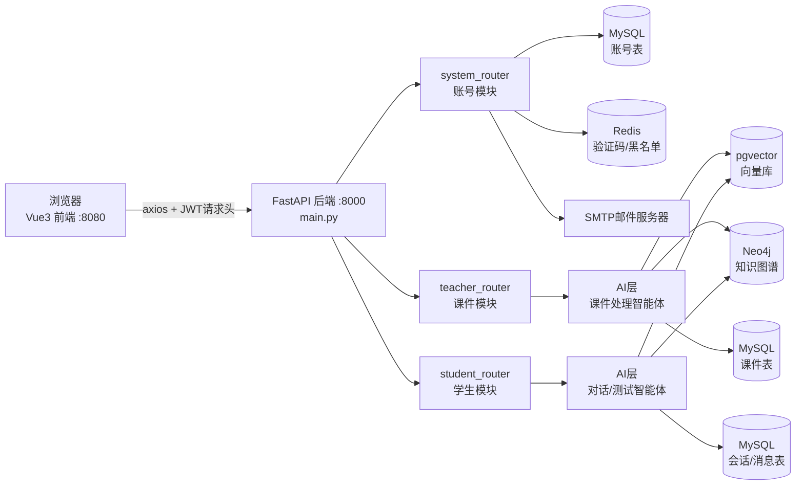
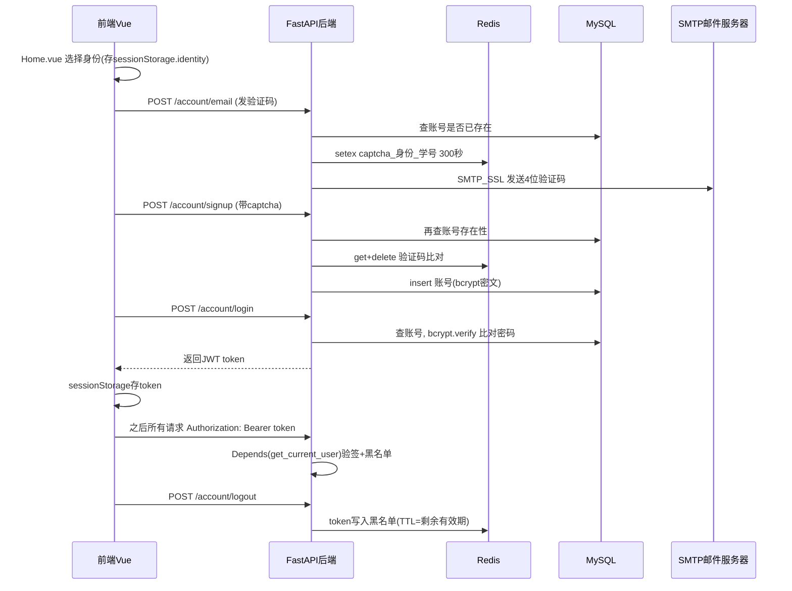
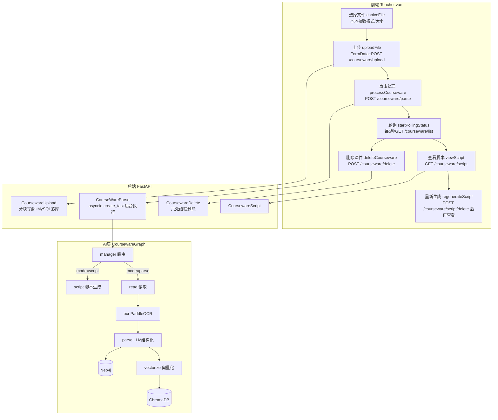
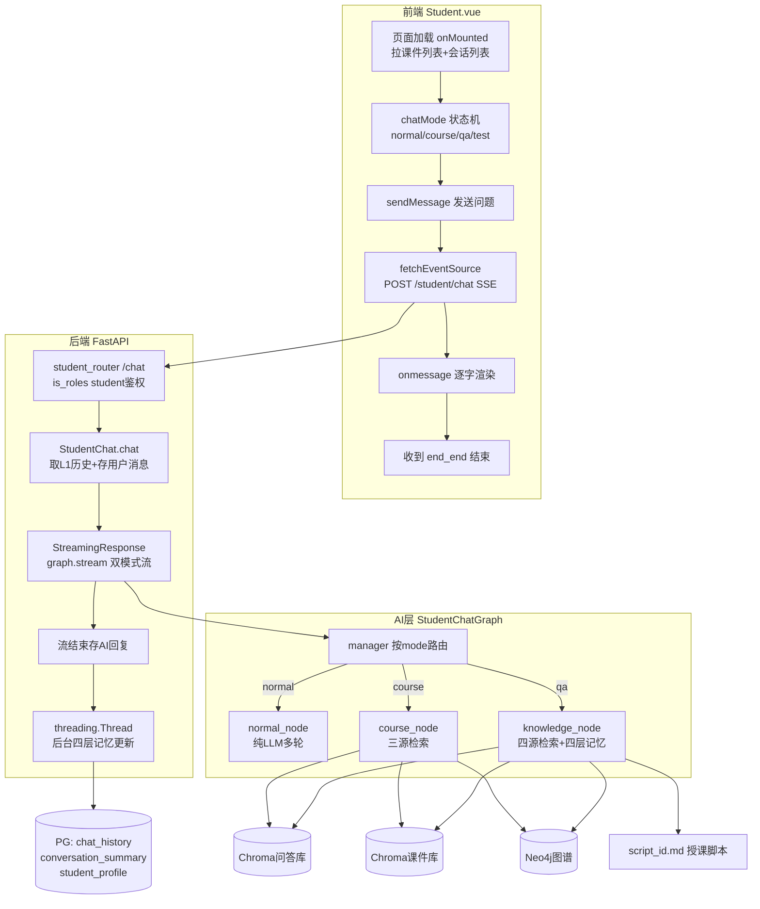
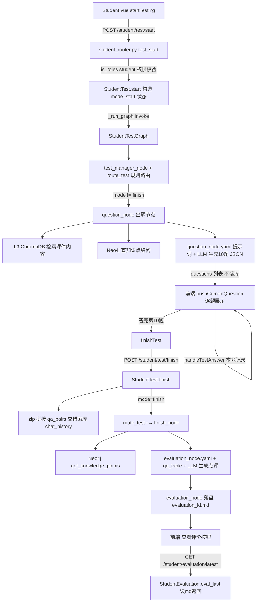
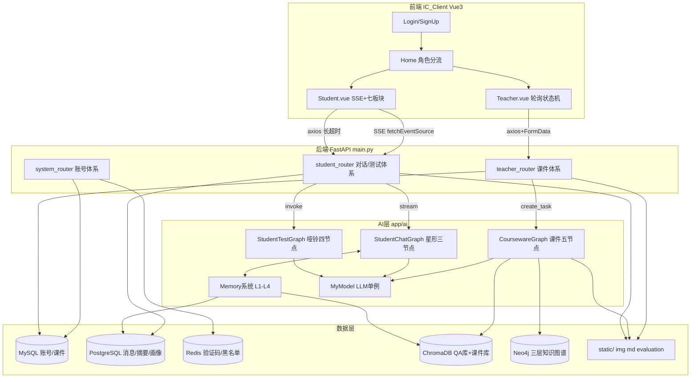

# 第一部分：整体架构 + 前端骨架 + 账号系统

## 0. 项目整体架构总览

### 0.1 技术栈与分工

| 端          | 技术                                                         | 位置                                            |
| ----------- | ------------------------------------------------------------ | ----------------------------------------------- |
| 前端        | Vue 3（组合式 API）+ Vue Router + axios + Element Plus       | `IC_Client/src/`                                |
| 后端 Web 层 | FastAPI（Python 异步 Web 框架）+ uvicorn 服务器              | `IC_Server/main.py`、`IC_Server/app/web/`       |
| 后端 AI 层  | LangGraph（智能体编排）+ LangChain + 通义千问（DashScope）   | `IC_Server/app/ai/`                             |
| 业务数据库  | MySQL（pymysql 驱动）—— 存账号、课件元数据、会话/消息/测试记录 | `IC_Server/app/web/util/mysql_conn.py`          |
| 缓存/黑名单 | Redis —— 存邮箱验证码、JWT 黑名单                            | `IC_Server/app/web/util/redis_conn.py`          |
| 向量库      | PostgreSQL + pgvector —— 存课件向量、长期记忆向量            | `IC_Server/app/web/util/postgres_conn.py`       |
| 知识图谱    | Neo4j（py2neo）—— 存课件知识点图谱                           | `IC_Server/app/ai/util/neo4j_util.py`           |
| 邮件        | smtplib + ssl + MIMEText（QQ 邮箱 SMTP_SSL 465 端口）        | `IC_Server/app/web/system_router/send_email.py` |

### 0.2 整体请求流程图



### 0.3 后端入口：`IC_Server/main.py`

这是整个后端的启动文件，做了四件关键事情：

**① lifespan 异步上下文管理器（应用启动/关闭钩子）**

```14:40:g:/GitHub/InteractiveClassroom/IC_Server/main.py
@asynccontextmanager
async def content_manager(app: FastAPI):
    # --- 启动阶段 (Startup) ---
    print("【测试】欢迎进入 -- 基于泛雅平台的AI互动智课生成与实时问答系统")
    # 启动课件处理智能体 -- app.state：全局共享命名空间
    app.state.courseware_agent = CoursewareGraph()
    print("【测试】课件处理智能体初始化完成")
    # 学生对话智能体
    app.state.student_agent = StudentChatGraph()
    print("【测试】学生对话智能体初始化完成")
    # 学生测试智能体
    app.state.student_test_agent = StudentTestGraph()
    ...
```

- `@asynccontextmanager`：**异步上下文管理器装饰器**，把一个带 `yield` 的异步函数变成“启动时执行 yield 之前的代码、关闭时执行 yield 之后的代码”的生命周期钩子。
- **为什么要这样做**：三个 LangGraph 智能体（`CoursewareGraph` 课件处理、`StudentChatGraph` 学生对话、`StudentTestGraph` 学生测试）的初始化要加载大模型客户端、嵌入模型等**重量级资源**，如果在每个请求里临时创建，延迟会非常高（加载嵌入模型可能要数秒）。所以在**服务启动时创建一次**，挂到 `app.state`（FastAPI 的**全局共享命名空间**，所有请求处理函数都能通过 `request.app.state.xxx` 拿到同一份对象），请求时直接复用。PostgreSQL 连接池同理（`app.state.postgres_conn`）。
- **为什么是 async**：lifespan 钩子本身由 uvicorn 事件循环调度，用 `async def` 保证启动阶段不阻塞主事件循环。

**② 跨域配置（CORS）**

```45:52:g:/GitHub/InteractiveClassroom/IC_Server/main.py
app.add_middleware(
    CORSMiddleware,
    allow_origins=["http://localhost:8080"],    # 允许的跨域访问的域名 -- 完整的客户端域名
    allow_credentials=True, # 允许携带cookie
    allow_methods=["*"],    # 允许的跨域访问请求的方法
    allow_headers=["*"],    # 允许的跨域访问请求的头部信息
)
```

- **CORS（Cross-Origin Resource Sharing，跨域资源共享）**：浏览器安全策略规定，前端页面（`http://localhost:8080`）默认不能请求不同源（不同端口即不同源）的后端（`http://localhost:8000`）。后端必须通过响应头明确“允许这个来源访问”，浏览器才会放行。
- `CORSMiddleware`：FastAPI 内置的跨域中间件，**中间件**是所有请求进出都经过的处理层。
- **为什么只允许 `http://localhost:8080`**：最小授权原则，避免任意网站都能调你的接口（防止 CSRF 类跨站滥用）。

**③ 路由注册**

```55:73:g:/GitHub/InteractiveClassroom/IC_Server/main.py
# 注册 -- 注册账号路由
from app.web.system_router.signup_router import signup_router
app.include_router(signup_router,prefix="/account",tags=["account"])
...
# 注册 -- 学生端路由
from app.web.student_router.student_router import student_router
app.include_router(student_router,prefix="/student",tags=["student"])
```

- `APIRouter` + `app.include_router(router, prefix=..., tags=...)`：FastAPI 的**子路由挂载**机制。`prefix`（前缀）给该路由下所有接口统一加路径前缀，比如 signup_router 里的 `path="/signup"` 最终 URL 是 `POST /account/signup`；`tags` 用于 Swagger 文档（`http://localhost:8000/docs` 自动生成的接口文档）分组。
- **为什么要拆成多个 router 文件**：单一职责，账号/教师/学生三个模块各自独立成 `system_router/`、`teacher_router/`、`student_router/` 目录，避免 main.py 膨胀成几千行。

**④ uvicorn 启动**

```76:77:g:/GitHub/InteractiveClassroom/IC_Server/main.py
if __name__ == '__main__':
    uvicorn.run(app, host='localhost', port=8000)
```

- `uvicorn`：**ASGI 服务器**（Asynchronous Server Gateway Interface，异步服务器网关接口）。FastAPI 本身只是应用框架，需要 uvicorn 来监听 8000 端口、接收 HTTP 请求、转交给 FastAPI 处理。**为什么选异步服务器**：AI 接口耗时可达几十秒，异步模型在等待大模型响应时不占用线程，可以同时服务多个学生提问。

### 0.4 前端骨架：`IC_Client/src/main.js`

**① 全局 axios 配置**

```12:17:g:/GitHub/InteractiveClassroom/IC_Client/src/main.js
// axios 全局配置
import axios from 'axios'   // 导入 axios 包
axios.defaults.baseURL = 'http://localhost:8000/'   // 服务器请求路径公共部分
axios.defaults.headers.post['Content-Type'] = 'application/json'    // post 请求发送json数据给服务器
axios.defaults.headers.put['Content-Type'] = 'application/json'     // put 请求发送json数据给服务器
app.config.globalProperties.$axios = axios      // 将 axios 对象挂载到 vue 对象上，使用 $axios 替代原生的 axios
```

- `axios`：**基于 Promise 的 HTTP 请求库**，是浏览器 `fetch/XMLHttpRequest` 的封装。
- `axios.defaults.baseURL`：全局默认请求根地址。之后任何 `proxy.$axios({url:'account/login'})` 实际请求的是 `http://localhost:8000/account/login`，组件里就只写相对路径。
- `Content-Type: application/json`：声明请求体是 JSON 格式，与后端 Pydantic 模型自动解析 JSON 对应。
- `app.config.globalProperties.$axios = axios`：把 axios 挂到 Vue **全局属性**上，任何组件用 `getCurrentInstance().proxy.$axios` 就能拿到它，不必每个文件都 `import axios`。**为什么这么写**：统一请求出口，方便全局拦截。

**② axios 请求拦截器（JWT 自动携带）**

```20:27:g:/GitHub/InteractiveClassroom/IC_Client/src/main.js
axios.interceptors.request.use(config => {
    const token = sessionStorage.getItem('token')
    if (token) {
        config.headers.Authorization = `Bearer ${token}`
    }
    return config
})
```

- **拦截器（interceptor）**：axios 在每个请求**真正发出之前**统一执行的回调。`config` 是本次请求的配置对象。
- `sessionStorage`：**会话级浏览器存储**，关闭标签页即清空，比 `localStorage` 更适合存登录凭证。
- `Authorization: Bearer <token>`：HTTP 标准认证头，`Bearer`（持有者）意思是“持有此令牌者即为该用户”。后端 `OAuth2PasswordBearer` 就是从这个头里取 token。
- **为什么要用拦截器而不是每个请求手动加**：登录之后的**每一个**接口都需要带 token，写在拦截器里一处配置、全局生效，业务组件零侵入。

**③ axios 响应拦截器（401/403 全局兜底）**

```32:44:g:/GitHub/InteractiveClassroom/IC_Client/src/main.js
axios.interceptors.response.use(res => res, err => {
    if (err.response) {
        if (err.response.status === 401) {
            sessionStorage.clear()
            ElMessage.error('登录已过期或已退出，请重新登录')
            router.push('/login')
        } else if (err.response.status === 403) {
            ElMessage.error('当前身份无权访问该功能')
        }
    }
    return Promise.reject(err)
})
```

- 响应拦截器的第二个参数是**请求失败时的统一回调**。
- `401 Unauthorized`（未认证：token 缺失/过期/已拉黑）→ 清空 `sessionStorage`、弹错误提示、强制跳回登录页 —— 这是**权限处理的前端兜底**。
- `403 Forbidden`（已认证但角色不符，比如学生 token 调教师接口）→ 只提示不跳转。
- `return Promise.reject(err)`：把错误继续抛给调用方的 `.catch`，防止吞异常。

**④ 导航守卫（前端路由级权限）**

```52:77:g:/GitHub/InteractiveClassroom/IC_Client/src/main.js
router.beforeEach((to, from, next) => {
    if (to.meta.login){
        let token = sessionStorage.getItem('token')
        if (!token){
            console.log('未登录，跳转到主页面')
            next('/')
            return
        }
        if (to.meta.identity && to.meta.identity !== sessionStorage.getItem('identity')) {
            console.log('身份不符，跳转到首页')
            next('/')
            return
        }
        console.log('已登录，放行')
        next()
    } else {
        console.log('非登录保护页面，直接访问')
        next()
    }
})
```

- `router.beforeEach`：**全局前置导航守卫**，每次路由跳转前必经的回调。`to`（目标路由）、`from`（来源路由）、`next()`（放行函数，必须调用否则页面卡住）。
- `to.meta.login`：路由元信息字段（在 `router/index.js` 中定义），标记该页面是否需要登录。
- 这里实现了**两级前端权限**：① 未登录访问 `/teacher`、`/student` → 踢回首页；② 已登录但身份不符（学生 token 访问教师页）→ 踢回首页。
- **为什么前端做了权限还要后端再做**：前端权限只是**用户体验优化**（避免白跑一趟），浏览器里 JS 可被随意篡改，真正的安全防线在后端 JWT 验签 + 角色校验（见 1.6）。

### 0.5 前端路由表：`IC_Client/src/router/index.js`

```6:52:g:/GitHub/InteractiveClassroom/IC_Client/src/router/index.js
const routes = [
    {
        path: '',
        meta: { title: '首页', login: false, identity: null },
        component: () => import('../components/Home.vue')
    },
    {
        path: '/login',
        meta: { title: '账号的登录与注册', login: false, identity: null },
        component: () => import('../components/Login.vue')
    },
    {
        path: '/signup',
        meta: { title: '注册', login: false, identity: null },
        component: () => import('../components/SignUp.vue')
    },
    {
        path: '/teacher',
        meta: { title: '教师上传课件页面', login: true, identity: 'teacher' },
        component: () => import('../components/Teacher.vue')
    },
    {
        path: '/student',
        meta: { title: '学生学习页面', login: true, identity: 'student' },
        component: () => import('../components/Student.vue')
    },
]
```

- `component: () => import(...)`：**路由懒加载**写法——组件代码只在第一次访问该路由时才下载。**为什么**：`Student.vue` 有 1536 行，如果全部打包进首屏 JS，首页加载会明显变慢。
- `meta`（元信息）：给路由附加的自定义字段，供导航守卫读取。
- `createWebHistory()`：history 路由模式，URL 中没有 `#` 号，比默认 hash 模式美观。

---

## 1. 功能一：账号系统（注册 → 验证码 → 登录 → 登出 → JWT 鉴权）

### 1.1 流程总图



### 1.2 入口：首页选择身份 —— `IC_Client/src/components/Home.vue`

```79:87:g:/GitHub/InteractiveClassroom/IC_Client/src/components/Home.vue
function goTeacherLogin() {
  router.push('/login');
  sessionStorage.setItem("identity", "teacher");
}

function goStudentLogin() {
  router.push('/login');
  sessionStorage.setItem("identity", "student");
}
```

- `router.push('/login')`：编程式导航，等价于点击了指向 `/login` 的链接。
- `sessionStorage.setItem("identity", "teacher")`：把**身份标识**写入会话存储。整个前后端的“教师/学生双端”就靠这一个变量贯穿：登录页据此显示“工号/学号”，登录后据此决定跳 `/teacher` 还是 `/student`，导航守卫据此做身份校验。
- **为什么用 sessionStorage 而不是路由参数**：刷新页面后参数可能丢失，而 sessionStorage 在整个标签页生命周期内都在。

### 1.3 注册第一步：发送验证码 —— 前端 `IC_Client/src/components/SignUp.vue`

```63:78:g:/GitHub/InteractiveClassroom/IC_Client/src/components/SignUp.vue
import {ref, getCurrentInstance, onMounted} from "vue";
...
onMounted(() => {
  identity.value = sessionStorage.getItem("identity");
  if (identity.value === 'teacher'){
    isShow.value = true;
  } else {
    isShow.value = false;
  }
})
```

- `ref()`：Vue 3 **响应式引用**，把普通变量变成“值变化会自动触发页面更新”的响应式数据，模板里用 `identity`、脚本里用 `identity.value` 访问。
- `onMounted()`：**生命周期钩子**，组件挂载（渲染）到页面后自动执行一次。这里在页面加载时从 sessionStorage 读取身份，决定输入框标签显示“工号”（教师）还是“学号”（学生）。
- `getCurrentInstance().proxy`：获取**当前组件实例的代理对象**，通过它可以访问 `main.js` 里挂载的全局属性 `$axios`（第 87 行 `let proxy = getCurrentInstance().proxy`）。

点“发送验证码”按钮，触发 `sendCaptcha()`：

```102:139:g:/GitHub/InteractiveClassroom/IC_Client/src/components/SignUp.vue
function sendCaptcha(){
  console.log("【测试】开始验证账号信息......")

  let accountInformation = {
    identity: identity.value,
    id: id.value,
    name: name.value,
    email: email.value,
    password: password.value
  }

  // 验证两次密码是否一致
  if(password.value !== confirmPassword.value){
    ElMessage.error('两次密码不一致');
    return { "code": 500, "msg": "两次密码不一致" }
  }

  // 接收验证码
  proxy.$axios({
    url:'account/email',
    method:'post',
    data:accountInformation
  }).then(res=>{
    console.log("【测试】邮件的发送结果：", res.data)
    let code = res.data.code
    let message = res.data.msg
    if(code === 200){
      method.value = false
      iscaptcha.value = !iscaptcha.value
      ElMessage.info(message)
    } else {
      ElMessage.error(message)
    }
  })
}
```

逐点解释：

1. **`proxy.$axios({url:'account/email', method:'post', data:accountInformation})` 是什么**：通过全局挂载的 axios 发送一个 **POST 请求**到 `http://localhost:8000/account/email`（baseURL 拼接），请求体 `data` 是 JSON（`Content-Type: application/json` 由 main.js 全局默认头指定），内容为 `{identity, id, name, email, password}` 五个字段。
2. **前端先校验两次密码一致**（`password.value !== confirmPassword.value`）：能在不发请求的情况下拦截低级错误，减少无效网络往返。
3. `.then(res => {...})`：axios 基于 **Promise（承诺）**，`then` 注册**异步成功回调**——请求发出后 JS 主线程不等待，响应回来后才执行。**为什么必须异步**：SMTP 发邮件要几秒，若同步阻塞，整个页面会卡死无法操作。
4. `ElMessage`：Element Plus 的**全局消息提示**组件（右上角弹出的成功/错误气泡）。
5. `iscaptcha.value = !iscaptcha.value`：控制按钮从“发送验证码”切换为“注册”（模板第 52-53 行的 `v-show` 二选一显示）。**`v-show` 是通过 CSS display 控制显隐，不销毁 DOM**。

> 注意：这里用的是 `then` 而没有 `catch`，网络层错误由 main.js 的**响应拦截器**统一兜底提示——这就是全局异常处理的意义。

### 1.4 注册第一步：发送验证码 —— 后端

**路由层 `IC_Server/app/web/system_router/email_router.py`**：

```8:15:g:/GitHub/InteractiveClassroom/IC_Server/app/web/system_router/email_router.py
@email_router.post(
    path="/email",
    summary="发送验证码邮件"
)
def email(account_schema:AccountSchema):
    print("\n【测试】这里是 -- email_router.py")
    print(f"【测试】接收到用户信息（注册账号）：{account_schema}")
    return SendEmail(account_schema).captcha_email()
```

- 参数 `account_schema: AccountSchema`：FastAPI 的**自动参数解析与校验**。请求体 JSON 会被 Pydantic 转成 `AccountSchema` 对象，字段缺失/类型不对时 FastAPI **自动返回 422 错误**，不需要手写任何校验代码。
- **为什么路由函数只写一行调用**：路由层只负责“接协议、转业务”，具体逻辑全部下沉到 `SendEmail` 业务类，这就是**分层架构**（Router → Service → Tool/Conn），方便单测和复用。
- 注意该函数是 **def（同步）而非 async def**：`SendEmail.captcha_email()` 内部全是同步阻塞调用（pymysql、redis-py 同步客户端、smtplib）。**为什么不用 async def**：在 FastAPI 中，`def` 路由会被自动丢进**线程池**执行，不阻塞事件循环；如果写成 `async def` 却在内部调用同步阻塞库，反而会**卡死整个事件循环**，让所有用户的请求都排队。所以“同步库配 def、异步库配 async def”是本项目的通用选择原则（下同，不再重复解释）。

**数据模式 `IC_Server/app/web/schema/account_schema.py`**：

```5:12:g:/GitHub/InteractiveClassroom/IC_Server/app/web/schema/account_schema.py
class AccountSchema(BaseModel):
    identity: str = Field(..., description="当前登录身份")
    id: str = Field(..., description="学号或工号")
    name: str = Field(..., description="姓名")
    email: str = Field(..., description="邮箱")
    password: str = Field(..., description="密码")
    # 可选
    captcha: Optional[str] = Field(default=None, description="验证码")
```

- `BaseModel`：Pydantic（**数据验证库**）的基类，声明式定义“接口接收哪些字段、什么类型、是否必填”。
- `Field(...)`：`...` 表示**必填**；`Optional[str] = Field(default=None)` 表示可选——因为发验证码时不传 captcha，只有注册时才传，**一个 Schema 复用两个接口**。

**业务层 `IC_Server/app/web/system_router/send_email.py`**，`captcha_email()` 的执行顺序：

**(1) 查重**：

```75:85:g:/GitHub/InteractiveClassroom/IC_Server/app/web/system_router/send_email.py
sql_version = f"select id,email from {self.identity} where id = %s"
result = self.mysql_verify.verify_account(sql_version,self.id)
...
if result:
    return {
        "code": 500,
        "msg": f"用户 {self.id} 存在，无需注册"
    }
```

- `f"select ... from {self.identity}"`：用 f-string 拼接**表名**（student 表 / teacher 表），而**值一律用 `%s` 占位符**。
- **为什么表名能拼、值不能拼**：SQL 注入（SQL Injection）风险来自**用户输入的值**直接进 SQL。这里表名只可能是 "student"/"teacher"（受控枚举），而学号是用户输入，必须走 `%s` 参数化查询——由 pymysql 驱动负责转义，从根上杜绝注入。

**(2) 生成 4 位随机验证码**（第 28-32 行 `create_captcha`：循环 4 次拼 `random.randint(0,9)`）。

**(3) 存入 Redis，5 分钟过期**：

```35:50:g:/GitHub/InteractiveClassroom/IC_Server/app/web/system_router/send_email.py
def save_captcha_to_redis(self,captcha) -> dict:
    try:
        conn = self.redis_conn.get_redis_conn()
        key = f"captcha_{self.identity}_{self.id}"
        conn.delete(key)  # 清除可能存在的旧验证码
        conn.setex(key, 300, captcha)
        self.redis_conn.close_redis_conn(conn)
        return { "code": 200, "msg": "验证码存储到redis中成功" }
    except Exception as e:
        return { "code": 500, "msg": f"验证码存储到redis中失败：{e}" }
```

- **Redis**：内存键值数据库。**为什么验证码存 Redis 而不是 MySQL**：验证码是**典型的临时数据**（读一次、5 分钟自动作废），Redis 的 `SETEX key 300 value`（设置键值并 300 秒后**自动删除**）天然匹配这个需求，读写微秒级且无需定时清理任务。
- `key = f"captcha_{identity}_{id}"`：键的设计包含身份+学号，保证教师/学生、不同人的验证码互不干扰。
- `conn.delete(key)` 再 `setex`：先删旧码再存新码，防止用户连点两次“发送验证码”后新旧两个码都能通过。
- **异常处理**：整个方法包 `try/except`，Redis 挂了返回 500 字典而不是让程序崩溃，前端能收到明确错误信息。

**(4) 通过 SMTP_SSL 发邮件**：

```104:126:g:/GitHub/InteractiveClassroom/IC_Server/app/web/system_router/send_email.py
try:
    # 创建 SSL 上下文
    context = ssl.create_default_context()
    # 创建邮件发送服务配置（465 端口必须使用 SMTP_SSL）
    smtp = smtplib.SMTP_SSL(host=self.host, port=self.port, context=context)
    ...
    smtp.login(sender, sender_pwd)
    message = self.email_message(captcha)
    smtp.sendmail(sender, self.email, message.as_string())
    smtp.quit()
    return { "code": 200, "msg": f"发送邮件到 {self.email} 成功", "data": self.id }
except Exception as e:
    print(f"【测试】发送邮件失败：{e}")
    return { "code": 500, "msg": f"发送邮件失败：{e}" }
```

- `smtplib`：Python 标准库的 **SMTP（Simple Mail Transfer Protocol，简单邮件传输协议）客户端**。
- `ssl.create_default_context()`：创建默认安全策略的 **SSL 上下文**（加密通道配置）。465 端口是 SMTP over SSL（全程加密），所以必须用 `SMTP_SSL` 而不是普通 `SMTP`（25/587 端口 STARTTLS）——**为什么**：验证码是敏感信息，明文传输会被网络中间人截获。
- `smtp.login(sender, sender_pwd)`：`sender_pwd` 不是邮箱登录密码，而是 QQ 邮箱的**授权码**（在邮箱设置里生成的专用码），都来自 `.env` 文件（`load_dotenv()` 把 `.env` 里的键值对加载进环境变量，`os.getenv()` 读取）。**为什么要 .env**：密钥、数据库密码等敏感信息**绝不能硬编码进代码**（会随 git 泄露），环境变量文件加入 `.gitignore` 即可隔离。
- `MIMEText`（`email_message` 方法，第 53-68 行）：**多用途互联网邮件扩展**文本对象，把“验证码为：xxxx，请在5分钟内使用”包装成标准邮件格式，并设置 From（发件人）、To（收件人）、Subject（主题）三个头字段。
- 整段 `try/except`：SMTP 登录失败/网络超时等异常被捕获并转成 500 返回值，**不让一次发信失败拖垮整个接口**。

### 1.5 注册第二步：正式注册 —— 前后端串联

**前端 `SignUp.vue` 的 `signUp()`**：

```142:168:g:/GitHub/InteractiveClassroom/IC_Client/src/components/SignUp.vue
function signUp(){
  let accountInformation = {
    identity: identity.value,
    id: id.value,
    name: name.value,
    email: email.value,
    password: password.value,
    captcha: captcha.value
  }

  proxy.$axios({
    url: 'account/signup',
    method: 'post',
    data: accountInformation
  }).then(res => {
    let code = res.data.code;
    if(code === 200){
      ElMessage.success('注册成功');
      router.push('/login');
    }else{
      ElMessage.error('注册失败');
    }
  })
}
```

- 这次比发码多了 `captcha` 字段（用户从邮箱抄的 4 位验证码）。
- 成功后 `router.push('/login')` 跳登录页。

**后端路由 `IC_Server/app/web/system_router/signup_router.py`**：

```7:14:g:/GitHub/InteractiveClassroom/IC_Server/app/web/system_router/signup_router.py
@signup_router.post(
    path="/signup",
    summary="注册账号"
)
def sign_up(account_schema:AccountSchema):
    print("\n【测试】这里是 -- account_router.py")
    print(f"【测试】接收到用户信息（注册账号）：{account_schema}")
    return AddAccount(account_schema).sign_up()
```

- 最终 URL：`POST /account/signup`（prefix 拼接）。

**后端业务 `IC_Server/app/web/system_router/add_account.py`**，`AddAccount` 类构造函数先把密码加密：

```8:18:g:/GitHub/InteractiveClassroom/IC_Server/app/web/system_router/add_account.py
def __init__(self,account_schema: AccountSchema) -> None:
    self.identity = account_schema.identity
    self.id = account_schema.id
    self.name = account_schema.name
    self.email = account_schema.email
    # 密码加密后入库（数据库只存bcrypt密文，不存明文）
    self.password = hash_password(account_schema.password)
    self.captcha = account_schema.captcha
```

- `hash_password()` 来自 `app/web/util/password_util.py`：

```3:19:g:/GitHub/InteractiveClassroom/IC_Server/app/web/util/password_util.py
bcrypt_context = CryptContext(schemes=["bcrypt"], deprecated="auto")

# 加密 -- 注册调用
def hash_password(password) -> str:
    hash_pwd = bcrypt_context.hash(password)
    return hash_pwd

# 验证 -- 登录调用
def verify_password(password, hash_pwd) -> bool:
    try:
        ver_result = bcrypt_context.verify(password, hash_pwd)
        return ver_result
    except Exception as e:
        print(f'【测试】密码验证失败：{e}')
        return False
```

- **passlib + bcrypt**：`CryptContext` 是 passlib 库的加密上下文；**bcrypt 是带随机盐的单向哈希算法**。**为什么不用 MD5/SHA256**：普通哈希可被彩虹表（预计算的哈希-明文对照表）破解，bcrypt 自带随机盐（同一密码每次哈希结果都不同）且可调计算成本，是目前口令存储的行业标配。数据库里只存形如 `$2b$12$...` 的密文，即便拖库也拿不到明文。
- **为什么在 `__init__` 里就加密**：进入业务类的瞬间明文密码就“变形”，后续任何代码路径都不再接触明文，缩小敏感数据暴露面。

`sign_up()` 主流程（第 51-79 行）做三重校验后入库：

```51:79:g:/GitHub/InteractiveClassroom/IC_Server/app/web/system_router/add_account.py
def sign_up(self) -> dict:
    if self.identity == "student" or self.identity == "teacher":
        sql_insert = f"insert into {self.identity} values(%s, %s, %s, %s, now())"
        sql_verify = f"select id,name,email from {self.identity} where id = %s"

        # 验证账号是否存在
        result = self.mysql_verify.verify_account(sql_verify,self.id)
        if result:
            return { "code": 500, "message": "账号已存在", "data": result }

        # 验证验证码是否正确
        verify_result = self._verify_code(self.captcha)
        if verify_result.get("code") != 200:
            return verify_result
    else:
        return { "code": 500, "message": "身份错误", "data": None }
    result = self.mysql_insert.insert_account(sql_insert,self.id,self.name,self.email,self.password)
    return result
```

- `now()`：MySQL 函数，注册时间由**数据库服务器时间**填写（比应用服务器时间更可信、多实例部署时不一致）。
- 校验顺序：身份合法性 → 账号是否已存在 → 验证码是否正确。**为什么先查账号再验验证码**：账号已存在时没必要消耗 Redis 校验和一次性的验证码。
- `_verify_code()`（第 20-48 行）从 Redis 取 `captcha_{identity}_{id}` 与用户提交值比对：`real_captcha == captcha.encode("utf-8")`（redis-py 返回 bytes，所以要编码成同类型比较）；**比对成功立即 `conn.delete(key)`**——验证码一次性使用，防止重放；`real_captcha is None` 说明过期/未发，给出不同提示；整体 `try/except` 兜底。
- 最终 `insert_account`：

```12:30:g:/GitHub/InteractiveClassroom/IC_Server/app/web/tool/mysql_insert_tool.py
def insert_account(self,sql,id,name,email,password) -> dict:
    try:
        self.cur.execute(sql,[id,name,email,password])
        # 提交事务
        self.conn.commit()
        return { "code": 200, "message": "注册成功", "data": {"id": id, "name": name, "email": email} }
    except Exception as e:
        return {"code": 500, "message": "注册失败", "data": None}
    finally:
        self.mysql_conn.close_mysql_conn(self.cur, self.conn)
```

- **事务（Transaction）**：`execute` 后数据只进入未提交状态，`commit()` 才真正落盘。若中间出错，可通过回滚保证不会写半条数据。
- `finally`：**无论成功失败都关闭游标和连接**——连接是珍贵资源，不关会导致连接泄漏、数据库连接数耗尽。

**连接层 `IC_Server/app/web/util/mysql_conn.py`**：

```17:31:g:/GitHub/InteractiveClassroom/IC_Server/app/web/util/mysql_conn.py
def get_mysql_conn(self) -> Optional[pymysql.connections.Connection]:
    try:
        return pymysql.connect(
            host=self.host,
            port=self.port,
            user=self.user,
            password=self.password,
            database=self.database,
            charset=self.charset,
            # 以 dict 的方式返回查询结果
            cursorclass=pymysql.cursors.DictCursor
        )
    except Exception as e:
        print(f"【测试】获取数据库连接失败：{e}")
        return None
```

- **pymysql**：Python 连接 MySQL 的纯 Python 驱动。
- `cursorclass=DictCursor`：让查询结果返回**字典**（`{"id": "001", "name": "张三"}`）而非默认元组，业务代码用键名取值，可读性强且不怕列顺序变化。
- `close_mysql_conn`（第 34-44 行）对 cursor 和 conn 分别 `try/except` 关闭——**连“关连接”本身都可能抛异常**，也要兜住。
- Redis 同理：`redis_conn.py` 的 `RedisConn.get_redis_conn()` 返回 `redis.Redis` 客户端对象，用完 `close_redis_conn()` 释放。

### 1.6 登录 —— 前后端串联

**前端 `IC_Client/src/components/Login.vue` 的 `goChat()`**：

```85:124:g:/GitHub/InteractiveClassroom/IC_Client/src/components/Login.vue
function goChat(){
  let accountInformation = {
    identity: identity.value,
    id: id.value,
    name: name.value,
    email: email.value,
    password: password.value
  }

  proxy.$axios({
    url:'account/login',
    method:'post',
    data:accountInformation
  }).then(res => {
    let code = res.data.code
    let message = res.data.message
    let data = res.data.data
    if(code === 200){
      sessionStorage.setItem("name", data);
      // 存储JWT令牌：此后请求由 main.js 的axios拦截器自动携带
      sessionStorage.setItem("token", res.data.token);
      ElMessage.success(message)
      if(identity.value === "student"){
        setTimeout(() =>{ router.push('/student') },2000)
      } else {
        setTimeout(() =>{ router.push('/teacher') },2000)
      }
    } else {
      ElMessage.error(message)
    }
  })
}
```

- `sessionStorage.setItem("token", res.data.token)`：**这是 JWT 机制在前端的落点**——后端返回的令牌存进会话存储，此后 main.js 的请求拦截器会自动把它放进每个请求的 `Authorization` 头。
- `setTimeout(..., 2000)`：延迟 2 秒再跳转，让用户看清“登录成功”的提示动画。
- 表单上 `@submit.prevent="goChat"`（模板第 21 行）：`.prevent` 是 Vue 的事件修饰符，**阻止浏览器表单默认提交行为**（刷新页面），改走 axios 异步请求；按钮 `type="submit"` 让输入框里按回车也能登录。

**后端路由 `IC_Server/app/web/system_router/login_router.py`**：

```9:16:g:/GitHub/InteractiveClassroom/IC_Server/app/web/system_router/login_router.py
@login_router.post(
    path="/login",
    summary="登录账号"
)
def login(account_schema:AccountSchema):
    print("\n【测试】这里是 -- login_router.py")
    print(f"【测试】接收到用户信息（注册账号）：{account_schema}")
    return LoginAccount(account_schema).verify()
```

**后端业务 `IC_Server/app/web/system_router/login_account.py`**：

```14:45:g:/GitHub/InteractiveClassroom/IC_Server/app/web/system_router/login_account.py
def verify(self) -> dict:
    sql_verify = f"select id,name,password from {self.identity} where id = %s"
    result = self.mysql_verify.verify_account(sql_verify,self.id)
    if result:
        # 密码对比 -- 明文 vs 数据库bcrypt密文
        if result["id"] == self.id and verify_password(self.password, result["password"]):
            # 登录成功，生成JWT令牌（payload封装学号/工号、姓名、身份角色）
            token = create_token({
                "id": self.id,
                "name": result["name"],
                "identity": self.identity
            })
            return {
                "code": 200,
                "message": "登录成功",
                "data": result['name'],
                "token": token
            }
        else:
            return { "code": 500, "message": "账号或密码错误", "data": None }
    else:
        return { "code": 500, "message": "账号不存在，请注册后重新登录！", "data": None }
```

- `verify_password(明文, 密文)`：bcrypt 的验证方向是“把明文按同样盐再哈希一次对比”，因为**哈希不可逆**，永远无法“解密”密文。
- **JWT（JSON Web Token）**：一种**自包含令牌**——用户身份（学号/姓名/角色）+ 过期时间被签名后编码成一个字符串。**为什么用 JWT 而不是 Session**：无状态，后端不需要为每个在线用户存会话；令牌本身带身份和过期时间，一次签发处处可用（分布式友好）。代价是无法主动作废，所以本项目补了 Redis 黑名单（见 1.7）。

**令牌工具 `IC_Server/app/web/util/jwt_util.py`**：

```11:43:g:/GitHub/InteractiveClassroom/IC_Server/app/web/util/jwt_util.py
def create_token(payload:dict) -> str:
    copy_payload = payload.copy()
    # 保质期 -- 访问令牌过期时间
    shelf_life = int(os.getenv('ACCESS_TOKEN_EXPIRE_MINUTES'))
    stop_time = datetime.now(timezone.utc)+timedelta(minutes=shelf_life)
    copy_payload.update({'exp':stop_time, 'iat':datetime.now(timezone.utc)})
    token = jwt.encode(
        claims = copy_payload,
        key = os.getenv('SECRET_KEY'),
        algorithm = os.getenv('ALGORITHM')
    )
    return token

def verify_token(token:str) -> dict:
    try:
        payload = jwt.decode(
            token = token,
            key = os.getenv('SECRET_KEY'),
            algorithms = [os.getenv('ALGORITHM')]
        )
        return payload
    except JWTError:
        raise HTTPException(
            status_code=status.HTTP_401_UNAUTHORIZED,
            detail="token错误或已过期，验证失败"
        )
```

- **python-jose 库的 `jwt.encode/decode`**：`encode` 用 `SECRET_KEY`（服务端私钥，存 .env）对 payload 做 HMAC 签名；`decode` 验签 + 自动检查 `exp` 过期时间，任何一项不过就抛 `JWTError`。
- `payload.copy()`：不污染调用方传入的字典（防御式编程）。
- `exp`（expire，过期时间）/`iat`（issued at，签发时间）：JWT 标准声明字段，使用 **UTC 时区**避免服务器时区不一致导致提前/延后过期。
- **异常处理**：验签失败不是返回字典而是 `raise HTTPException(401)`——**为什么这里抛 HTTP 异常而不是返回 200+code:500**：token 属于**协议层鉴权**问题，应该用标准 HTTP 状态码，这样前端 axios 响应拦截器才能统一按 `err.response.status === 401` 处理（跳登录页）。而业务层错误（如密码错）保持 200 + 业务码，由组件自己弹提示。**两层错误两种通道，是本项目的统一约定。**

### 1.7 登出 + JWT 鉴权闭环（权限处理的核心）

**后端登出路由 `login_router.py`**：

```21:30:g:/GitHub/InteractiveClassroom/IC_Server/app/web/system_router/login_router.py
from app.web.util.jwt_decode import oauth2_scheme
from app.web.system_router.logout_account import LogoutAccount

@login_router.post(
    path="/logout",
    summary="退出登录（token加入黑名单）"
)
def logout(token: Annotated[str, Depends(oauth2_scheme)]):
    print("\n【测试】这里是 -- login_router.py /logout")
    return LogoutAccount(token).logout()
```

- `Depends(oauth2_scheme)`：FastAPI 的**依赖注入（Dependency Injection）**机制——进入函数体之前，先执行 `oauth2_scheme` 把请求头 `Authorization: Bearer xxx` 里的 token 抽出来作为参数传入。`Annotated[str, Depends(...)]` 是类型注解 + 依赖的组合写法。
- `OAuth2PasswordBearer`（定义在 `app/web/util/jwt_decode.py` 第 11 行）：FastAPI security 模块的**令牌提取器**，请求头缺失或格式不对直接返回 401。

**鉴权工具 `IC_Server/app/web/util/jwt_decode.py`**——全后端权限体系的枢纽：

```15:43:g:/GitHub/InteractiveClassroom/IC_Server/app/web/util/jwt_decode.py
def get_current_user(token: Annotated[str, Depends(oauth2_scheme)]) -> dict:
    payload = verify_token(token)

    # 黑名单校验
    if TokenBlacklist().verify_token_in_blacklist(token):
        raise HTTPException(
            status_code=status.HTTP_401_UNAUTHORIZED,
            detail="token已失效（已登出），请重新登录",
            headers={"WWW-Authenticate": "Bearer"}
        )
    return payload

# 判断角色是否被允许访问接口
def is_roles(*allow_roles: list):
    def user(now_user: dict = Depends(get_current_user)):
        if now_user.get('identity') in allow_roles[0]:
            return now_user
        else:
            raise HTTPException(status_code=403, detail="用户身份不被允许访问该接口")
    return user
```

- `get_current_user`：**登录鉴权依赖**。链式依赖：`oauth2_scheme`（取 token）→ `verify_token`（验签+过期检查，失败抛 401）→ 黑名单校验（已登出的 token 抛 401）→ 返回 payload（含 id/name/identity）。
- `is_roles(*allow_roles)`：**角色鉴权工厂**。它返回一个内层依赖函数，业务路由写 `Depends(is_roles("teacher"))` 即可限定“仅教师可访问”；写 `Depends(is_roles("student"))` 限定学生。**为什么要做成工厂（返回函数的函数）**：FastAPI 依赖需要的是“函数”，而允许角色是配置参数，用闭包把参数固化进依赖函数，一处定义、处处复用——这是**装饰器/工厂模式**在依赖注入里的典型应用。
- 教师端所有课件接口、学生端所有接口都用这个机制做**后端权限硬校验**（教师端文件里是 `is_roles("teacher")`，学生端是 `is_roles("student")`），前端的导航守卫只是锦上添花。
- **黑名单校验的降级策略**（`token_blacklist.py` 第 19-27 行）：Redis 查询异常时 `return False`（放行）。**为什么放行**：验签已通过说明 token 本身合法，Redis 临时故障不应导致所有用户掉线——**可用性优先**的取舍（代价是极小概率已登出 token 短暂可用）。

**登出业务 `IC_Server/app/web/system_router/logout_account.py`**：

```11:37:g:/GitHub/InteractiveClassroom/IC_Server/app/web/system_router/logout_account.py
def logout(self) -> dict:
    try:
        payload = verify_token(self.token)
    except HTTPException:
        # token已过期或非法：本身就无法再使用，无需加黑名单
        return { "code": 200, "message": "token已失效，直接退出", "data": None }
    # 剩余有效期（秒）= 到期时间 - 当前时间；至少1秒保证键能写入
    remaining = int(payload.get("exp") - datetime.now(timezone.utc).timestamp())
    remaining = max(remaining, 1)
    # 加入黑名单，TTL=剩余有效期，token过期后黑名单键随之消失
    if self.token_blacklist.add_token_to_blacklist(self.token, remaining):
        return { "code": 200, "message": "退出登录成功", "data": None }
```

- **黑名单本质**：`conn.setex(f"token_blacklist:{token}", remaining_seconds, "1")`——把整个 token 字符串作为键写入 Redis，TTL（存活时间）精确等于该 token 的**剩余有效期**。**为什么 TTL 要等于剩余有效期**：token 过期后本来就不能用了，黑名单条目也没必要留——设成同步过期，黑名单永远只存“还有效但被作废”的令牌，不会无限膨胀。
- **幂等性处理**：token 已过期时登出仍返回成功（本来就失效了），不会报错——用户点登出永远得到成功体验。
- 前端 `Teacher.vue`/`Student.vue` 里的退出按钮调 `POST /account/logout` 后 `sessionStorage.clear()` 并跳首页；此后即使有人截获旧 token，`get_current_user` 的黑名单检查也会挡下（401 → 前端拦截器再兜底跳登录）。

### 1.8 账号系统同步/异步设计小结

| 环节                   | 同步/异步                 | 原因                                                         |
| ---------------------- | ------------------------- | ------------------------------------------------------------ |
| 前端所有 axios 调用    | 异步（Promise + then）    | 网络耗时不定，不能冻结 UI                                    |
| 后端账号路由（def）    | 同步函数 + FastAPI 线程池 | pymysql/redis-py/smtplib 都是同步阻塞库，def 自动入线程池不阻塞事件循环 |
| 后端 lifespan（async） | 异步                      | 由 uvicorn 事件循环调度启动钩子                              |
| `setTimeout` 跳转      | 异步定时                  | 等 2 秒提示动画，非阻塞                                      |

---

## 2. 本部分涉及的代码文件功能总结

| 文件                                                | 功能总结                                                     |
| --------------------------------------------------- | ------------------------------------------------------------ |
| `IC_Server/main.py`                                 | 后端唯一入口：lifespan 钩子预初始化三个智能体与 PG 连接池（避免请求期重复加载重资源）；CORS 放行前端 8080；挂载 account/courseware/student 三组子路由；uvicorn 监听 8000 |
| `IC_Server/app/web/system_router/signup_router.py`  | 注册路由：`POST /account/signup`，接收 AccountSchema，一行转调 AddAccount 业务类 |
| `IC_Server/app/web/system_router/email_router.py`   | 发码路由：`POST /account/email`，转调 SendEmail 发送验证码邮件 |
| `IC_Server/app/web/system_router/login_router.py`   | 登录/登出路由：`POST /account/login` 转调 LoginAccount；`POST /account/logout` 用 Depends(oauth2_scheme) 取 token 后转调 LogoutAccount 拉黑 |
| `IC_Server/app/web/system_router/add_account.py`    | 注册业务类：构造时 bcrypt 加密密码；sign_up 依次校验身份枚举→账号查重→Redis 验证码一次性比对，全过则插入 MySQL |
| `IC_Server/app/web/system_router/send_email.py`     | 发码业务类：MySQL 查重→生成 4 位随机码→Redis setex 存 300 秒（先删旧码）→SMTP_SSL 加密通道经 QQ 邮箱 465 端口发 MIMEText 邮件；全程 try/except |
| `IC_Server/app/web/system_router/login_account.py`  | 登录业务类：按身份查表→bcrypt 验证密码→成功则 create_token 生成含 id/name/identity 的 JWT 返回 |
| `IC_Server/app/web/system_router/logout_account.py` | 登出业务类：验签（已失效则幂等成功）→计算剩余有效期→token 写入 Redis 黑名单（TTL=剩余秒数） |
| `IC_Server/app/web/schema/account_schema.py`        | Pydantic 账号数据模型：identity/id/name/email/password 必填，captcha 可选，一个 Schema 供注册/发码/登录三接口复用 |
| `IC_Server/app/web/util/jwt_util.py`                | JWT 工具：create_token 签发（payload 注入 exp/iat，UTC 时间）；verify_token 验签，失败抛 HTTP 401 |
| `IC_Server/app/web/util/jwt_decode.py`              | 鉴权依赖枢纽：oauth2_scheme 从 Authorization 头提 token；get_current_user=验签+黑名单；is_roles 角色工厂（403）——全后端接口的权限硬校验都靠它 |
| `IC_Server/app/web/util/token_blacklist.py`         | Redis 黑名单：add_token_to_blacklist 按 TTL 写入；verify_token_in_blacklist 查询，Redis 异常时降级放行保可用性 |
| `IC_Server/app/web/util/password_util.py`           | passlib/bcrypt 密码工具：hash_password 注册加密；verify_password 登录校验（单向哈希，异常返回 False） |
| `IC_Server/app/web/util/mysql_conn.py`              | MySQL 连接工具：从 .env 读配置，pymysql 建连（DictCursor 返回字典），close 双重 try/except 安全关闭 |
| `IC_Server/app/web/util/redis_conn.py`              | Redis 连接工具：按 .env 配置创建 redis.Redis 客户端并提供关闭方法 |
| `IC_Server/app/web/tool/mysql_select_tool.py`       | 查询工具类：verify_account（单条，参数化 %s 防注入）、select_courseware（多条），用完即关连接 |
| `IC_Server/app/web/tool/mysql_insert_tool.py`       | 插入工具类：insert_account、insert_courseware，execute+commit 事务提交，finally 关连接 |
| `IC_Client/src/main.js`                             | 前端入口：挂载 axios 到全局（baseURL 指向 8000）；请求拦截器自动带 Bearer token；响应拦截器 401 清登录态跳登录/403 提示无权；导航守卫做登录+身份双校验；全局注册 Element Plus |
| `IC_Client/src/router/index.js`                     | 路由表：5 个懒加载页面，meta 声明 login/identity 供守卫消费；history 模式 |
| `IC_Client/src/components/Home.vue`                 | 首页：教师/学生双入口按钮，点击时把 identity 写入 sessionStorage 并跳登录页——全系统身份分流的起点 |
| `IC_Client/src/components/SignUp.vue`               | 注册页：onMounted 读身份切换工号/学号标签；sendCaptcha（先本地校验两次密码一致再 POST account/email）；signUp（带验证码 POST account/signup，成功跳登录）；按钮由 v-show 切换“发码/注册”两态 |
| `IC_Client/src/components/Login.vue`                | 登录页：表单 submit.prevent 触发 goChat → POST account/login；成功后把 name 和 JWT token 存 sessionStorage，2 秒后按身份跳 /student 或 /teacher |

# 第二部分：教师端课件流程（上传 → 解析 → 向量化 → 授课脚本 → 删除）

## 2.0 流程总图



**教师端一个核心理念：解析是“长任务”，上传是“短任务”。** 上传接口同步完成（几秒），解析接口**秒回**然后转后台异步执行，前端靠**轮询**感知进度——这就是整个教师端同步/异步设计的骨架。

---

## 2.1 功能二：上传课件

### 2.1.1 前端：`IC_Client/src/components/Teacher.vue`

**① 页面加载即拉数据（onMounted 钩子）**

```131:137:g:/GitHub/InteractiveClassroom/IC_Client/src/components/Teacher.vue
onMounted(() => {
  identity.value = sessionStorage.getItem("identity");
  tea_name.value = sessionStorage.getItem("name");
  fetchCoursewareList();
  // 页面加载即检查轮询：若有处理中的课件，处理完成后自动刷新+提醒；没有则立即自动停止
  startPollingStatus(true);
});
```

- `onMounted`：组件挂载后执行一次。登录后进入教师页，立即做四件事：读身份、读姓名（顶栏显示）、拉课件列表、**静默启动一次轮询**（防止用户在解析中途刷新页面导致“处理完成提醒”丢失）。
- `startPollingStatus(true)` 的 `silent=true` 参数：静默模式——发现没有处理中的课件直接停轮询且不弹提示。**为什么要静默参数**：同一个函数被“页面加载”和“用户点处理”两个场景复用，前者不该打扰用户，后者需要弹“处理完成”。

**② 选择文件 `choiceFile(event)`**

```162:193:g:/GitHub/InteractiveClassroom/IC_Client/src/components/Teacher.vue
function choiceFile(event) {
  let file = event.target.files[0];
  if (!file) return;
  let ext = file.name.substring(file.name.lastIndexOf('.')).toLowerCase();
  if (ext !== '.ppt' && ext !== '.pptx' && ext !== '.pdf') {
    ElMessage.error('仅支持PPT/PPTX/PDF文件');
    event.target.value = '';
    return;
  }
  if (file.size > 100 * 1024 * 1024) {
    ElMessage.error('文件不能超过100MB');
    event.target.value = '';
    return;
  }
  selectedFile.value = file;
}
```

- `event.target.files[0]`：原生 `<input type="file">` 触发 change 事件时，`event.target` 指向该 input，`.files` 是**文件列表类数组**，`[0]` 取第一个（未开多选）。`file` 对象自带 `name`（文件名）、`size`（字节）、`type`（MIME 类型）。
- `file.name.substring(file.name.lastIndexOf('.'))`：截取最后一个 `.` 之后的部分即扩展名，`toLowerCase()` 统一小写防止 `.PPT` 漏判。
- **为什么前端先校验格式和大小**：100MB 的文件传到后端才发现格式不对，浪费用户几分钟上传时间；前端毫秒级拦截是**用户体验优化**。但后端**还会再校验一遍**（见 2.1.2）——因为前端校验可被绕过（直接用 curl 发请求），后端才是安全底线。这叫**前后端双重校验**。
- `event.target.value = ''`：清空 input 的已选文件，让用户能重新选同一个文件。

**③ 提交上传 `uploadFile()`**

```196:246:g:/GitHub/InteractiveClassroom/IC_Client/src/components/Teacher.vue
function uploadFile() {
  if (!courseName.value || !chapterName.value || !selectedFile.value) {
    ElMessage.warning('请填写课程名称、章节名称并选择文件');
    return;
  }
  uploading.value = true;
  let formData = new FormData();
  formData.append('file', selectedFile.value);
  formData.append('course_name', courseName.value);
  formData.append('chapter_name', chapterName.value);
  proxy.$axios({
    url: 'courseware/upload',
    method: 'post',
    data: formData,
    ...
  }).then(res => {
    ...
  }).finally(() => {
    uploading.value = false;
  });
}
```

- **`FormData` 是什么**：浏览器原生的**表单数据构造器**。普通 JSON 没法携带二进制文件，`FormData` 会把数据组织成 `multipart/form-data`（多部分表单）格式——HTTP 传输文件的**标准格式**，每一段有边界分隔，文件段是原始字节流。axios 检测到 `data` 是 FormData 时会自动设置该 Content-Type（且**不能手动预设 JSON 头**，所以这里没走 main.js 里的 JSON 默认头逻辑，axios 会对 FormData 做特判）。
- `formData.append('file', selectedFile.value)`：`append(字段名, 值)` 逐项添加，字段名 `file`、`course_name`、`chapter_name` 与后端参数名**一一对应**。
- `uploading.value`：控制按钮的 loading 态（`finally` 里复位），**防止用户在上传中重复点击**造成重复提交——这是前端防重手段之一。
- 实际请求：`POST http://localhost:8000/courseware/upload`（路由前缀 `/courseware` 见 main.py 第 63-64 行），请求体是 multipart 表单，请求头自动带 `Authorization: Bearer token`（main.js 拦截器）。

### 2.1.2 后端：路由层 `IC_Server/app/web/teacher_router/courseware_router.py`

```16:27:g:/GitHub/InteractiveClassroom/IC_Server/app/web/teacher_router/courseware_router.py
async def upload(
        file: UploadFile = File(..., description="课件文件"),
        course_name: str = Form(..., description="课程名称"),
        chapter_name: str = Form(..., description="章节名称"),
        now_user: dict = Depends(is_roles(["teacher"]))
):
    print("\n【测试】这里是 -- courseware_router.py")
    form_data = {
        "course_name": course_name,
        "chapter_name": chapter_name
    }
    return await CoursewareUpload(file,form_data).save_courseware()
```

- **`UploadFile = File(...)`**：FastAPI 的文件参数声明。`UploadFile` 是 FastAPI 对上传文件的封装对象（有 `.filename` 文件名、`.size` 大小、`.read()` 异步读内容等方法）；`File(...)` 声明“这个参数来自 multipart 表单的 file 字段且必填”。
- **`str = Form(...)`**：声明参数来自**表单字段**（不是 JSON body）——与前端 FormData 的字段名精确对应。这是 multipart/form-data 在 FastAPI 里的标准接法（JSON 用 Pydantic 模型、表单用 Form/File）。
- **`Depends(is_roles(["teacher"]))`**：权限处理的**后端硬校验**。`is_roles` 是第一部分讲过的角色工厂（`app/web/util/jwt_decode.py` 第 28-35 行），这里限定**仅教师**可上传。执行链：`oauth2_scheme` 取 token → `verify_token` 验签（假/过期抛 401）→ 黑名单检查（已登出抛 401）→ 角色不在 `["teacher"]` 抛 403。**学生 token 调这个接口会被 403 挡下**，前端 main.js 响应拦截器会弹“当前身份无权访问该功能”。
- **`async def` + `await`**：`save_courseware()` 内部用 `await self.file.read()` 异步读文件，所以整条链必须是 async——**异步库配 async def**，不阻塞事件循环，上传大文件时其他用户照常请求。
- `now_user`：接住依赖的返回值（当前用户 payload），本接口没用到但**保留了参数位**，是接口签名的统一风格。

### 2.1.3 后端：业务层 `courseware_upload.py`

**① 构造函数：路径与规则的定义**

```19:33:g:/GitHub/InteractiveClassroom/IC_Server/app/web/teacher_router/courseware_upload.py
self.base_dir = Path(__file__).resolve().parents[3]  # 获取 IC_Server 项目根目录
self.save_dir = self.base_dir / "data" / "data_download"  # 获取课件存储目录
self.save_dir.mkdir(parents=True, exist_ok=True)    # 如果目录不存在，自动创建
self.allowed_extensions = {".ppt", ".pptx", ".pdf"}  # 允许的文件类型
self.max_size = 100 * 1024 * 1024  # 最大文件大小（100MB）
```

- **`Path(__file__).resolve().parents[3]`**：`pathlib`（面向对象路径库）。`__file__` 是当前源码文件路径，`.resolve()` 转绝对路径并解析符号链接，`.parents[3]` 往上数第 3 层父目录（`app/web/teacher_router/` → `app/web/` → `app/` → 项目根 `IC_Server/`）。**为什么用绝对路径**：若用相对路径，服务器从不同工作目录启动时，`data/data_download` 会定位到错误位置。**为什么不用 `os.getcwd()`**：工作目录是运行时状态不可控，代码文件位置才是稳定的锚点。
- `mkdir(parents=True, exist_ok=True)`：递归创建目录且已存在不报错——**自愈式初始化**，新环境部署无需手工建目录。
- `allowed_extensions` 用 **set（集合）** 而非 list：后续 `in` 判断，集合是 O(1) 哈希查找（虽然只有 3 个元素差别不大，但这是数据结构选型的习惯）。

**② 文件名唯一化 `get_only_name()`**

```35:50:g:/GitHub/InteractiveClassroom/IC_Server/app/web/teacher_router/courseware_upload.py
def get_only_name(self) -> tuple:
    file_ext = Path(self.file.filename).suffix.lower()
    if file_ext not in self.allowed_extensions:
        raise HTTPException(status_code=400, detail="仅支持 .ppt, .pptx, .pdf 格式的文件")
    only_filename = f"{uuid.uuid4().hex}{file_ext}"
    save_path = self.save_dir / only_filename
    return only_filename,save_path,file_ext
```

- **`uuid.uuid4().hex`**：UUID（Universally Unique Identifier，通用唯一识别码）版本 4——基于**随机数**的 128 位唯一标识，`.hex` 转 32 位十六进制字符串。**为什么不用原始文件名**：① 两个教师都传“第一章.pptx”会互相覆盖；② 用户文件名可能含中文、空格、特殊字符，处理麻烦；③ **uuid 文件名后来成为整个系统“级联删除”的过滤键**（Neo4j 和 ChromaDB 的 `source_file` 字段存的就是它，见 2.6）。原始文件名另存数据库 `original_filename` 字段供展示。
- **`raise HTTPException(400)`**：后端的**二次格式校验**（前端已校验过一次），伪造请求也绕不过。

**③ 分块落盘 `save_courseware()`**

```52:75:g:/GitHub/InteractiveClassroom/IC_Server/app/web/teacher_router/courseware_upload.py
async def save_courseware(self) -> JSONResponse:
    try:
        if self.file.size is not None and self.file.size > self.max_size:
            raise HTTPException(status_code=400, detail="文件大小不能超过 100MB")
        total_size = 0
        with open(self.save_path, "wb") as buffer:
            while chunk := await self.file.read(1024 * 1024):  # 每次读 1MB
                total_size += len(chunk)
                if total_size > self.max_size:
                    buffer.close()
                    self.save_path.unlink(missing_ok=True)
                    raise HTTPException(status_code=400, detail="文件大小不能超过 100MB")
                buffer.write(chunk)
        ...
        result_save = self.save_mysql()
```

- **`while chunk := await self.file.read(1024*1024)`**：**海象运算符 `:=`**（Python 3.8+）——赋值与判断合一：把读到的 1MB 块赋给 `chunk` 同时判断非空。`await self.file.read(n)` 每次最多读 n 字节，读完返回空 bytes（条件为假）自动退出循环。
- **为什么分块（chunked）读而不是一次 `read()` 全读**：一次 read 会把 100MB 全部载入内存，若并发多个大文件上传，服务器内存会被瞬间打爆；分块每次只占 1MB 缓冲，**内存占用恒定**。这是大文件处理的通用范式（流式处理）。
- **双重大小校验**：先看 `self.file.size`（表单头里声明的大小，可能缺失或被伪造），再边写边数实际字节数——**信任实际数据而非声明值**，伪造 Content-Length 也骗不过。
- 超限时的**清理逻辑**：`buffer.close()` 提前关闭、`unlink(missing_ok=True)` 删半成品文件（`missing_ok=True` 表示文件不存在也不报错）。不留垃圾文件是**失败路径的资源回收**。
- **异常处理的分层**（第 84-91 行）：`except HTTPException: raise` 单独放行自己抛的业务异常（让 FastAPI 转成对应状态码响应），`except Exception` 兜底其他 IO 异常——同样删临时文件、抛 500。**为什么不能一个 except 全包**：如果把 HTTPException 也转成 500，前端就收不到精确的 400 提示了。

**④ 落库 `save_mysql()` + `mysql_insert_tool.py`**

```93:99:g:/GitHub/InteractiveClassroom/IC_Server/app/web/teacher_router/courseware_upload.py
def save_mysql(self) -> dict:
    sql_insert = f"insert into courseware values(null,%s,%s,%s,%s,%s,%s,now(),%s,%s,%s)"
    file_size = self.file.size if self.file.size is not None else 0
    result = self.mysql_insert.insert_courseware(sql_insert, self.file.filename,self.only_filename,self.save_path,self.course_name,self.chapter_name,file_size,self.file_ext)
```

```32:44:g:/GitHub/InteractiveClassroom/IC_Server/app/web/tool/mysql_insert_tool.py
def insert_courseware(self,sql,original_filename,saved_filename,file_path,course_name,chapter_name,file_size,file_type) -> dict:
    try:
        self.cur.execute(sql,[original_filename,saved_filename,file_path,course_name,chapter_name,file_size,file_type,2])
        self.conn.commit()
        return { "code": 200, "message": "数据库添加课件成功", "data": original_filename }
    ...
    finally:
        self.mysql_conn.close_mysql_conn(self.cur, self.conn)
```

- SQL 十列对应 `courseware` 表：id（null 自增）、original_filename、saved_filename（uuid 名）、file_path（服务器绝对路径）、course_name、chapter_name、file_size、上传时间（`now()` 数据库时间）、file_type、**parse_status 固定填 2**。
- **parse_status 状态机**：`2=未处理`（刚上传）→ `0=处理中`（点“处理”瞬间置 0）→ `1=已完成` / `3=失败`（后台任务结束置终态）。前端 `getStatusText()`（Teacher.vue 第 319-324 行）把这个数字翻译成中文徽章。**为什么用整型而不是字符串**：整型比较快、占空间小、且轮询判断 `item.parse_status === 0` 直接数值比较。
- 参数化 `%s` + `commit` 事务 + `finally` 关连接，同第一部分的规范。

---

## 2.2 功能三：解析课件（整个系统最重的异步链路）

### 2.2.1 前端：`processCourseware(item)` + 轮询

```249:301:g:/GitHub/InteractiveClassroom/IC_Client/src/components/Teacher.vue
function processCourseware(item) {
  uploading.value = true;
  proxy.$axios({
    url: 'courseware/parse',
    method: 'post',
    data: {
      original_filename: item.original_filename,
      file_path: item.file_path,
      course_name: item.course_name,
      chapter_name: item.chapter_name,
      id: item.id
    }
  }).then(res => {
    if (res.data.code === 200) {
      ElMessage.info('课件已开始后台处理，处理完成后会自动提醒');
      fetchCoursewareList();
      startPollingStatus();
    } else {
      ElMessage.error(res.data.message);
    }
  })
  ...
}

let pollTimer = null;
function startPollingStatus(silent = false) {
  clearInterval(pollTimer);
  pollTimer = setInterval(() => {
    fetchCoursewareList().then(() => {
      if (!coursewareList.value.some(item => item.parse_status === 0)) {
        clearInterval(pollTimer);
        if (silent) return;
        let failed = coursewareList.value.some(item => item.parse_status === 3);
        if (failed) {
          ElMessage.error('有课件处理失败，请重新处理');
        } else {
          ElMessage.success('课件处理完成');
        }
      }
    });
  }, 5000);
}
```

- `data` 直接传**表格行对象 `item` 的五个字段**（列表接口返回的原始数据原样回传），后端用 `CoursewareSchema`（Pydantic 模型，`app/web/schema/courseware_schema.py` 第 4-9 行：original_filename/file_path/course_name/chapter_name/id 五个必填字段）接收。
- **`setInterval(fn, 5000)`**：每 5 秒执行一次的**定时器**（返回 timer id）。**为什么用轮询而不是 WebSocket/SSE**：解析进度只需“完成/未完成”一个比特信息，5 秒粒度足够；WebSocket 要维护长连接、心跳、断线重连，复杂度远超收益。**轮询退避策略**：一旦列表里没有 `parse_status===0` 的课件就 `clearInterval` 停止——**不做无意义的空转请求**，减轻服务器压力。
- `fetchCoursewareList()` 返回 Promise（第 305 行 `return proxy.$axios(...)`），`.then()` 里再判断——**先等数据回来再决策**，避免用旧列表误判。
- **`Array.prototype.some(fn)`**：数组方法，“至少一个元素满足条件则返回 true”。判“有没有处理中/失败的课件”语义精确。
- 失败提示区分 `parse_status===3`：成功与失败给不同的 ElMessage，用户无需自己看表格排查。

### 2.2.2 后端：`courseware_parse.py` —— 异步后台任务的发起

```41:63:g:/GitHub/InteractiveClassroom/IC_Server/app/web/teacher_router/courseware_parse.py
async def parse_courseware(self) -> dict:
    result_file = self._get_file()
    # 立即置为"处理中"
    self.mysql_update.update_parse_status(self.sql_update, 0, self.id)
    # 后台任务：跑完更新状态（成功→1，失败→3）
    asyncio.create_task(self._run_and_update(result_file))
    return {
        "code":200,
        "message":"课件开始处理",
    }

async def _run_and_update(self, result_file) -> None:
    try:
        await self.agent.run(result_file)
        self.mysql_update.update_parse_status(self.sql_update, 1, self.id)
    except Exception as e:
        print(f"【测试】课件处理失败: {e}")
        self.mysql_update.update_parse_status(self.sql_update, 3, self.id)
```

- `self.agent = request.app.state.courseware_agent`（构造函数第 11 行）：从 **FastAPI 全局命名空间**取 main.py lifespan 里初始化好的 `CoursewareGraph` 实例——**重量级对象全局单例复用**，不在请求里重建。
- **`asyncio.create_task(...)`**：本次输出的**核心异步原语**。它把协程注册到事件循环**立即返回**，不等待完成——所以 `parse_courseware` 毫秒级就返回“课件开始处理”，而真正的解析（可能几分钟）在后台继续跑。**为什么必须这样**：若同步执行，HTTP 连接会挂起几分钟，前端 axios 超时、用户看到“卡死”，nginx/浏览器还会掐断连接。**异步后台任务 = 接口秒回 + 工作照做**。
- **先置 0 再create_task 的顺序**：状态先落库（0=处理中）再启动任务——这样即使任务刚启动就崩，前端轮询也能看到“处理中”而非“未处理”，状态不会跳变。
- `_run_and_update` 的 **try/except 包裹整个智能体执行**：无论哪个节点崩，最终都把状态置 3（失败）——**状态机永远收敛到终态**，前端轮询不会永远转下去。这正是轮询方案可靠性的前提。
- `update_parse_status`（`mysql_update_tool.py`）：`execute + commit` 更新 `courseware.parse_status`，其 finally 里对 cur/conn **先判 None 再关**且关闭本身再套 try——防止重复关闭抛 `Already closed` 二次异常。**为什么 update 工具每次现建连接而 insert/select 在构造函数建**：update 会被后台任务在不同线程时刻反复调用，构造期连接可能早已失效；现建现用虽慢一点但**绝对正确**（也是一种可用性取舍）。

### 2.2.3 AI 层编排：`CoursewareGraph`（`app/ai/agent/teachers/graph/courseware_graph.py`）

**① 图的搭建（编译期）**

```20:47:g:/GitHub/InteractiveClassroom/IC_Server/app/ai/agent/teachers/graph/courseware_graph.py
graph = StateGraph(CoursewareState)
graph.add_node("read", read_node)
graph.add_node("ocr", ocr_node)
graph.add_node("parse", parse_node)
graph.add_node("vectorize", vectorize_node)
graph.add_node("manager", manager_node)
graph.add_node("script", script_node)
graph.add_edge(START, "manager")
graph.add_conditional_edges(
    "manager", route_manager,
    {"read": "read", "script": "script", "end": END}
)
graph.add_edge("read", "ocr")
graph.add_edge("ocr", "parse")
graph.add_edge("parse", "vectorize")
graph.add_edge("vectorize", END)
graph.add_edge("script", END)
self.agent = graph.compile(checkpointer=None)
```

- **LangGraph + `StateGraph`**：LangChain 团出的**智能体工作流编排框架**。`StateGraph(状态类型)` 建图，`add_node(名字, 函数)` 加节点（每个节点是“接收 state、返回 state 增量”的函数），`add_edge` 画固定边，`add_conditional_edges(来源, 路由函数, {返回值: 目标节点})` 画**条件边**（路由函数根据 state 返回字符串 key 决定走向），`compile()` 编译成可执行体，`ainvoke(初始state)` 异步执行。
- **为什么用图而不是普通函数调用链**：① `manager` 的**条件路由**让同一张图既能干“解析”又能干“查脚本”，两个接口共用一套编排（`run()` 与 `run_script()` 只差初始 state 的 `mode` 字段）；② 节点是独立文件，**单一职责**，替换 OCR 引擎只改 `ocr_node.py`；③ `draw()` 方法（第 80-83 行）能直接 `get_graph().draw_mermaid_png()` 导出流程图 PNG——图结构自带可解释性。
- `checkpointer=None`：不启用 LangGraph 的状态持久化（状态本身已经落到 MySQL/Neo4j/Chroma，无需框架级快照）。
- **`CoursewareState`（`app/ai/agent/teachers/state/courseware_state.py`）**：`TypedDict` 定义的**共享状态**——19 个字段的“数据总线”（courseware_path、course_name、chapter_name、parse_status、slide_contents、extracted_images、img_temp_dir、ocr_text、courseware_id、script_path、script_mode、mode、script_status、script_content 等）。**LangGraph 的节点通信机制**：每个节点返回的 dict 会**合并（merge）**进全局 state，下游节点按键读取。**为什么用 TypedDict 而非 Pydantic**：LangGraph 原生支持 TypedDict 增量合并，且字段都是过程数据无需运行时校验。

**② 两个入口：`run()` 与 `run_script()`**

```51:77:g:/GitHub/InteractiveClassroom/IC_Server/app/ai/agent/teachers/graph/courseware_graph.py
async def run(self, courseware):
    ...
    initial_state = {
        "mode": "parse",
        "courseware_path": courseware_path,
        ...
        "parse_status": "parsing",
        ...
    }
    result = await self.agent.ainvoke(initial_state)
    return result
```

```86:99:g:/GitHub/InteractiveClassroom/IC_Server/app/ai/agent/teachers/graph/courseware_graph.py
async def run_script(self, course_name, chapter_name, courseware_id):
    initial_state = {
        "mode": "script",  # 脚本模式
        ...
    }
    result = await self.agent.ainvoke(initial_state)
    return result
```

- **`ainvoke` 是异步执行**：LangGraph 会把同步节点丢进线程池调度，`await` 等整个图跑完。**为什么图入口是 async**：图挂在 FastAPI 的 async 链路上（`await self.agent.run(...)`），同步节点（OCR/LLM 调用）由框架内部转线程池，**外层异步、内层同步节点不阻塞事件循环**——这是 LangGraph 与 FastAPI 组合的标准姿势。

**③ 管理节点 `manager_node.py` —— 图的“交通警察”**

```13:49:g:/GitHub/InteractiveClassroom/IC_Server/app/ai/agent/teachers/node/manager_node.py
def route_manager(state: CoursewareState):
    mode = state.get('mode', 'parse')
    if mode == 'script':
        if state.get('script_status') == 'exists':
            return 'end'
        return 'script'
    return 'read'

def manager_node(state: CoursewareState):
    if mode == 'script':
        courseware_id = state.get('courseware_id', 0)
        script_path = MD_DIR / f"script_{courseware_id}.md"
        if script_path.exists():
            content = script_path.read_text(encoding='utf-8')
            return {
                "script_status": "exists",
                "script_content": content,
                "script_path": str(script_path)
            }
        return {"script_status": "pending"}
    return {}
```

- **`mode` 字段是流程开关**：`mode=parse` 走 read→ocr→parse→vectorize 流水线；`mode=script` 做脚本查询/生成。**为什么要一个 manager 统一分流**：把“判断走哪条路”的逻辑集中在一处，避免每个接口各自为政——策略模式的朴素实现。
- script 模式下的**读缓存优化**：脚本文件已存在（`static/md/script_{id}.md`）就直接 `read_text` 返回 `script_status='exists'`，路由函数据此返回 `'end'` **提前结束整张图**，不进 script 节点调 LLM——**已有产物绝不重复生成**，这是性能上最重要的分支。
- `return {}`：解析模式下 manager 无事可做，返回空 dict（state 不变），纯粹作为路由的载体。

### 2.2.4 节点一：`read_node.py` —— 课件内容提取（三种格式三条路）

```161:200:g:/GitHub/InteractiveClassroom/IC_Server/app/ai/agent/teachers/node/read_node.py
def read_node(state:CoursewareState):
    file_path = state['courseware_path']
    file_ext = state['file_type']
    file_name = os.path.splitext(os.path.basename(file_path))[0]
    img_temp_dir = img_temp(file_name)
    if file_ext == '.pptx':
        slide_contents, extracted_images = extract_pptx(file_path, img_temp_dir)
    elif file_ext == '.ppt':
        converted_path = extract_ppt(file_path)
        slide_contents, extracted_images = extract_pptx(converted_path, img_temp_dir)
    elif file_ext == '.pdf':
        slide_contents, extracted_images = extract_pdf(file_path, img_temp_dir)
    else:
        raise ValueError(f"不支持的文件格式: {file_ext}")
    full_text = '\n'.join([slide['text'] for slide in slide_contents])
    return {
        'file_type': file_ext.lstrip('.'),
        'extracted_text': full_text,
        'slide_contents': slide_contents,
        'extracted_images': extracted_images,
        'img_temp_dir': str(img_temp_dir)
    }
```

**技术 ① —— python-pptx（`.pptx` 路线，第 21-77 行）**：
- `Presentation(file_path)`：python-pptx 库打开 PPT 得到演示对象；`prs.slides` 枚举幻灯片。
- **Shape（形状）模型**：PPT 里每个元素（文本框/图片/表格）都是 Shape。`shape.has_text_frame` 判断是否含文本 → `text_frame.paragraphs` 逐段取 `paragraph.text`；`shape.shape_type == MSO_SHAPE_TYPE.PICTURE` 判断是图片（**枚举比较**，先判类型再取 `shape.image.blob` 二进制数据才安全）→ 从 `content_type`（MIME 类型如 `image/png`）切出后缀，`'wb'` 二进制写盘存到 `static/img/{文件名}/slide_页码_img_序号.png`。
- **为什么每张图片落盘**：下一步 OCR 需要文件路径输入；且图片长期保存在 static 下可供前端展示。
- 产出结构 `slide_contents = [{"page": 1, "text": "...", "images": [...]}, ...]` —— **按页组织**，页码贯穿后续 OCR 合并、LLM 标注、Neo4j page 属性。

**技术 ② —— PyMuPDF（`.pdf` 路线，第 79-129 行）**：
- `pymupdf.open(file_path)`：PyMuPDF（曾名 fitz）打开 PDF 为 Document；`page.get_text()` 提取文本层。
- `page.get_images(full=True)` 列出页内图片，`img[0]` 取 **XREF**（PDF 内部交叉引用编号，图片在文档对象表中的唯一 ID），`doc.extract_image(xref)` 返回 `{'image': 二进制, 'ext': 后缀}` 字典再落盘。
- **为什么 PPTX 和 PDF 要用两个库**：文件格式本质不同——pptx 是 OOXML 压缩包（结构化 XML），PDF 是排版流式格式，各有最合适的解析器，**没有万能库**。
- `doc.close()`：显式释放 PDF 句柄。

**技术 ③ —— win32com + PowerPoint COM（`.ppt` 路线，第 134-159 行）**：
- 旧版 `.ppt` 是二进制格式，python-pptx 打不开。这里的方案是 **COM 自动化**：`win32com.client.Dispatch("PowerPoint.Application")` 启动本机真实 PowerPoint 程序，`Presentations.Open` 打开文件，`SaveAs(output_path, 24)` 另存为 pptx（**24 是 PowerPoint 的 ppSaveAsOpenXMLPresentation 常量**），再按 pptx 路线处理。
- `pythoncom.CoInitialize()` / `CoUninitialize()`：**初始化/释放 COM 线程模型**。COM 要求每个使用它的线程先声明套间模型，不初始化会报 `-2147221008` 错误；`finally` 里释放**防止后台残留 PowerPoint 进程**。
- **为什么 `try/finally` 而非 `try/except`**：这里的原则是“**无论成败必须清理 COM**”，异常本身继续向上抛给 `_run_and_update` 置失败状态——finally 保证清理，except 才管吞错，二者语义不同。
- **该方案的代价**：只在 Windows 且装有 PowerPoint 时可用（本项目部署环境是 win32，成立）；换 Linux 服务器需改用 LibreOffice 命令行转换（代码注释里也提到了 libreoffice 方案）。

**技术 ④ —— 模块级缓存 `img_temp()`（第 10-19 行）**：`global _img_temp_dir` 首次调用创建 `static/img/{file_name}` 目录后缓存，**全局单例目录**，同一课件的图片都归拢在一起。

### 2.2.5 节点二：`ocr_node.py` —— PaddleOCR 图片识别

```3:32:g:/GitHub/InteractiveClassroom/IC_Server/app/ai/agent/teachers/node/ocr_node.py
try:
    from paddleocr import PaddleOCR
    PADDLEOCR_AVAILABLE = True
except ImportError:
    PADDLEOCR_AVAILABLE = False
    PaddleOCR = None

_ocr_engine = None

def get_ocr_engine():
    global _ocr_engine
    if _ocr_engine is None:
        ...
        _ocr_engine = PaddleOCR(
            use_angle_cls=True,
            lang='ch',
            det_db_box_thresh=0.3,
            device='CPU',
        )
    return _ocr_engine
```

- **`try/except ImportError` 包 import**：**优雅降级（graceful degradation）**——OCR 依赖庞大利，机器上没装 paddleocr 时项目仍能启动，只是 OCR 节点返回错误标记而不是整个服务崩溃。**为什么**：课件纯文字（无图片）时根本用不到 OCR，不应因缺依赖而全盘不可用。
- **懒加载单例 `_ocr_engine`**：PaddleOCR 初始化要加载检测/识别/方向三个模型（数秒、上 GB 内存），**模块级全局变量 + 首次调用才创建**，之后所有请求复用。**为什么不学 MyModel 用类而用函数级 global**：节点是函数不是类，函数级单例是 LangGraph 节点最自然的写法；效果等价。
- 参数解释：`use_angle_cls=True` 开**文字方向分类器**（处理旋转 90°/180° 的文字，PPT 截图常有横排公式旋转）；`lang='ch'` 中英文模型；`det_db_box_thresh=0.3` **降低文本框检测阈值**——默认 0.6 会漏掉模糊的小字（如公式上标），0.3 提高**召回率**（宁可多识别一些再过滤，不要漏）；`device='CPU'` 强制 CPU（避免 GPU 版本冲突，代价是慢，但 OCR 在后台任务里不赶时间）。

```61:95:g:/GitHub/InteractiveClassroom/IC_Server/app/ai/agent/teachers/node/ocr_node.py
for slide in slide_contents:
    page_num = slide['page']
    images = slide.get('images', [])
    if not images:
        continue
    for img_path in images:
        try:
            result = ocr_engine.ocr(img_path, cls=True)
            texts = []
            if result and result[0]:
                for line in result[0]:
                    text = line[1][0]
                    texts.append(text)
            ocr_text = '\n'.join(texts) if texts else ''
            ocr_results.append({'page': page_num, 'image_path': img_path, 'ocr_text': ocr_text})
        except Exception as e:
            ocr_results.append({
                'page': page_num,
                'image_path': img_path,
                'ocr_text': f'[OCR失败: {e}]'
            })
```

- `ocr_engine.ocr(img_path, cls=True)` 返回嵌套结构 `[[坐标四点, (文本, 置信度)], ...]`，`line[1][0]` 取文本。
- **逐图 try/except**：**单张图片识别失败不影响其他图片**——失败结果带 `[OCR失败: ...]` 标记继续流程，而不是整份课件报废。**粒度最细的异常隔离**。
- 无图片的页 `continue` 跳过；无内容时直接返回空（第 43-48 行），**空输入短路**。
- 返回 `'ocr_text': ocr_results`（**列表**）进 state。

### 2.2.6 节点三：`parse_node.py` —— LLM 结构化 + 写 Neo4j（全流程技术密度最高处）

**① 合并文本 `_merge_content`（第 21-69 行）**：把 OCR 结果按 `page`（页码）建字典 `ocr_dict`，一页多图用 `\n` 拼接（**避免覆盖**）；再遍历每页把 `原文 + '\n' + OCR文本` 合并，并过滤 `$$` 开头且过短的 LaTeX 标记行（`not l.strip().startswith('$$') or len(l.strip()) > 20`——**保留长内容行，剔除纯标记行**）。**为什么要合并**：PPT 里的文字在文本框，公式/图表在图片里，两路提取互补才凑齐完整页内容。

**② 分块调用 LLM `_parse_with_llm`（第 102-137 行）**

```102:123:g:/GitHub/InteractiveClassroom/IC_Server/app/ai/agent/teachers/node/parse_node.py
def _parse_with_llm(llm, course_name, chapter_name, merged_pages):
    CHUNK_SIZE = 12  # 每块页数，78页约7次调用；可按效果调整
    all_kps = []
    total_chunks = (len(merged_pages) + CHUNK_SIZE - 1) // CHUNK_SIZE
    for i in range(0, len(merged_pages), CHUNK_SIZE):
        chunk = merged_pages[i:i + CHUNK_SIZE]
        chunk_text = '\n'.join([f"{p['page']}\n{p['text']}" for p in chunk])
        prompt = BuilderPromptYaml.get_prompt(
            "parse_node.yaml",
            course_name=course_name,
            chapter_name=chapter_name,
            content=chunk_text
        )
        kps = _invoke_and_parse(llm, prompt)
        all_kps.extend(kps)
```

- **为什么分块**：LLM 有**上下文窗口限制**（过长直接截断报错），更重要的是**长文本会导致“概括性总结”**——模型对 80 页一次性提取会偷懒合并知识点，大量细粒度知识点丢失。**12 页一块**强制模型逐页细看，78 页课件约 7 次调用换知识点完整性。这是**质量换调用次数**的主动决策。
- **`(len + CHUNK_SIZE - 1) // CHUNK_SIZE`**：向上取整的整数技巧（77 页 → 7 块）。
- **跨块去重**（第 125-133 行）：不同块可能提取出同名概念（如“导数定义”在两页都出现），用 `seen` set 按 name 去重保首个——**LLM 输出的不确定性必须在代码层消毒**。

**③ LLM 调用与输出消毒 `_invoke_and_parse`（第 73-99 行）**

```76:96:g:/GitHub/InteractiveClassroom/IC_Server/app/ai/agent/teachers/node/parse_node.py
response = llm.invoke(prompt)
llm_text = response.content
try:
    llm_text = llm_text.strip()
    if llm_text.startswith('```'):
        parts = llm_text.split('```')
        llm_text = parts[1]
        if llm_text.startswith('json'):
            llm_text = llm_text[4:]
    result = json.loads(llm_text)
    kps = result.get('knowledge_points', [])
    return kps
except json.JSONDecodeError as e:
    return []
```

- `llm.invoke(prompt)` → `response.content`：LangChain 的 **ChatOpenAI 模型同步调用**，返回消息对象，`.content` 取文本。
- **markdown 围栏剥离**：LLM 常无视“不要用```包裹”的指令，输出 \`\`\`json ... \`\`\`，代码里 `split('```')` 取中段再剥 `json` 前缀——**对模型输出永远做防御性解析**（Prompt 要求 + 代码兜底双保险）。
- `json.JSONDecodeError` 捕获后返回**空列表**而非抛异常——让外层“降级重试”逻辑接管（见下）。

**④ 降级重试策略（第 220-234 行）**：分块解析返回 0 个知识点时，**换简化 prompt**（直接内联 JSON 模板示例的简单提示词）逐块再试一遍。**为什么要两级 prompt**：Yaml 大 prompt 效果好但偶发让模型困惑返回空，简化 prompt 粗暴但稳定；**先精后粗的降级链**保证鲁棒性。

**⑤ 写入 Neo4j `_write_to_neo4j`（第 141-181 行）**

```141:179:g:/GitHub/InteractiveClassroom/IC_Server/app/ai/agent/teachers/node/parse_node.py
def _write_to_neo4j(neo4j, knowledge_points, course_name, chapter_name, source_file):
    try:
        neo4j.run('CREATE CONSTRAINT course_name_unique IF NOT EXISTS FOR (c:Course) REQUIRE c.name IS UNIQUE')
        neo4j.run('CREATE CONSTRAINT chapter_unique IF NOT EXISTS FOR (ch:Chapter) REQUIRE (ch.name, ch.course) IS UNIQUE')
        neo4j.run('CREATE CONSTRAINT kp_unique IF NOT EXISTS FOR (kp:KnowledgePoint) REQUIRE (kp.name, kp.chapter, kp.course) IS UNIQUE')
    except Exception as e:
        print(f'【测试】创建约束时出错（可能已存在）: {e}')
    neo4j.run('MERGE (c:Course {name: $name})', name=course_name)
    neo4j.run(
        'MERGE (c:Course {name: $course}) '
        'MERGE (c)-[:HAS_CHAPTER]->(ch:Chapter {name: $name, course: $course}) '
        'SET ch.course = $course', ...
    )
    for kp in knowledge_points:
        neo4j.run(
            'MERGE (ch:Chapter {name: $chapter, course: $course}) '
            'MERGE (kp:KnowledgePoint {name: $name, chapter: $chapter, course: $course}) '
            'MERGE (ch)-[:HAS_KNOWLEDGE_POINT]->(kp) '
            'SET kp.content = $content, kp.type = $type, kp.page = $page, kp.source_file = $source_file',
            ...
        )
```

- **Cypher 查询语言**（Neo4j 的声明式图查询语言）。**`MERGE` 语义**：“存在则匹配，不存在则创建”——**幂等写入**，同一课件解析两次不会产生重复节点。**为什么用 MERGE 而非 CREATE**：CREATE 无条件新建，重复处理课件会让图谱节点翻倍。
- **唯一性约束（`CREATE CONSTRAINT ... IF NOT EXISTS`）**：给 Course.name、(Chapter.name, course)、(KnowledgePoint.name, chapter, course) 建数据库级唯一约束——MERGE 在并发下有竞态窗口，**约束是数据完整性的最后防线**；`IF NOT EXISTS` 让重复执行不报错（幂等建约束）。
- **三层图谱结构**：`Course 课程 --HAS_CHAPTER--> Chapter 章节 --HAS_KNOWLEDGE_POINT--> KnowledgePoint 知识点`。**为什么知识入图而不只入向量库**：图存**结构**（课程→章节→知识点的层级、知识点间可扩展关系），向量库存**语义**（按相似度检索），二者互补——这正是学生端“四源检索”中“图谱检索”的来源。
- **`kp.source_file = uuid文件名`**：每个知识点打上**来源课件标记**——后续删除课件时 `MATCH (kp:KnowledgePoint {source_file: $x}) DETACH DELETE kp` 精确清除本课件的知识点，**互不误伤其他课件**（共享的 Course/Chapter 节点不删）。
- **参数化查询**：Cypher 同样用 `$参数` 占位（`neo4j.run(query, course_name=...)`），防注入原理同 MySQL 的 `%s`。

**⑥ 顶部模块级单例（第 17-18 行）**：`llm = MyModel.get_model()`、`neo4j = Neo4jConn().get_neo4j_conn()` 在**模块导入时创建一次**，进程内所有请求共享。`MyModel.get_model()`（`app/ai/model/my_model.py` 第 19-33 行）是**单例模式（Singleton）**：类属性 `_model` 为空才创建 `ChatOpenAI(model=MODEL_ONLINE_NAME, api_key=DASHSCOPE_API_KEY, streaming=True, extra_body={"enable_thinking": False})`——通义千问的 OpenAI 兼容接口，`streaming=True` 开启**流式输出**（学生端聊天逐字推送用），`enable_thinking=False` 关闭思考模式（**降低延迟**，结构化提取不需要长推理）。**为什么单例**：模型客户端无状态，重复创建浪费连接资源。

### 2.2.7 节点四：`vectorize_node.py` —— 图谱 → 向量库

```22:54:g:/GitHub/InteractiveClassroom/IC_Server/app/ai/agent/teachers/node/vectorize_node.py
def _query_knowledge_points(course_name, chapter_name):
    query = '''
        MATCH (c:Course {name: $course_name})-[:HAS_CHAPTER]->(ch:Chapter)
        WHERE ch.name = $chapter_name AND ch.course = $course_name
        MATCH (ch)-[:HAS_KNOWLEDGE_POINT]->(kp:KnowledgePoint)
        WHERE kp.course = $course_name AND kp.chapter = $chapter_name
        RETURN DISTINCT kp.name AS name, kp.content AS content, kp.type AS type,
               kp.page AS page, kp.source_file AS source_file
        '''
    results = neo4j.run(query, course_name=course_name, chapter_name=chapter_name)
```

- Cypher 的 **`MATCH ... -[:关系]-> ...` 模式匹配**：先按关系链定位章节，再取其下所有知识点。**为什么 vectorize 节点要回头查 Neo4j 而不直接用 parse 节点内存里的知识点**：图的状态传递虽然可以带过来，但**以数据库为唯一事实来源（single source of truth）**——从库里读回的数据天然经过 MERGE 去重与约束修正，且 graph 内 state 类型较松散，二次确认更稳。

```58:103:g:/GitHub/InteractiveClassroom/IC_Server/app/ai/agent/teachers/node/vectorize_node.py
def _store_vectors(cw_chroma, knowledge_points, course_name, chapter_name):
    cw_chroma._collection.delete(where={
        "$and": [
            {"course_name": {"$eq": course_name}},
            {"chapter_name": {"$eq": chapter_name}}
        ]
    })
    ids = []; documents = []; metadatas = []
    seen_ids = set()
    for kp in knowledge_points:
        text = f"{kp['name']}：{kp['content']}" if kp.get('content') else kp['name']
        kp_id = f"{course_name}_{kp['name']}_{kp.get('page', 0)}"
        if kp_id in seen_ids:
            continue
        seen_ids.add(kp_id)
        ids.append(kp_id)
        documents.append(text)
        metadatas.append({
            'course_name': course_name, 'chapter_name': chapter_name,
            'type': kp['type'], 'page': kp['page'],
            'source_file': kp.get('source_file', ''), 'kp_name': kp['name']
        })
    cw_chroma.add_texts(texts=documents, metadatas=metadatas, ids=ids)
```

- **先删后写（replace 语义）**：`_collection.delete(where={course+chapter 过滤})` 清掉本章旧向量再写入新的——同一课件**重复处理**时旧向量不残留（注意：这里按课程+章节删，与删除课件按 `source_file` 删是**两套不同的过滤口径**，前者服务于“重新解析”，后者服务于“删除课件”）。
- **ChromaDB 三元组**：`ids`（唯一标识，`课程_知识点名_页码`，`add_texts` 是 upsert 语义，同 id 覆盖）、`documents`（**被向量化的原文**，`"名称：内容"` 拼接——名称单独成词强化语义信号）、`metadatas`（**过滤元数据**：检索时可按课程/章节/来源过滤，也是删除接口 `where={"source_file": ...}` 的依据）。`add_texts` 内部自动调用 embedding 模型把文本转成向量。
- **为什么向量库选 ChromaDB + HuggingFaceEmbeddings 本地模型**（`data/util/chromadb_util.py` + `data/model/chromadb_model.py`）：`Chroma(persist_directory=..., collection_name=..., embedding_function=..., collection_metadata={"hnsw:space": "cosine"})`——`langchain_chroma` 的 Chroma 封装，`persist_directory` 落盘路径（重启不丢），`embedding_function` 指定 `HuggingFaceEmbeddings(model_name=本地路径, model_kwargs={"device":"cuda", "local_files_only": True})`（**本地 sentence-transformer 模型，离线运行、不花 API 费、数据不出服务器**），`hnsw:space: cosine` 显式指定**余弦相似度**（文本语义相似度的标准度量）。**qa_chromadb / cw_chromadb 两个集合**：问答库与课件库分离，互不污染。
- `if not knowledge_points: return done`（第 117-121 行）：空知识点的**短路返回**，依然标记 done 让流水线收敛。

---

## 2.3 功能四：课件列表（共用接口）

**前端** `fetchCoursewareList()`（Teacher.vue 第 304-317 行）：`GET courseware/list`，无参数，`then` 里把 `res.data.data` 灌进 `coursewareList.value` 驱动表格渲染；函数 `return` 了 Promise 供轮询 `.then()` 链用。**为什么 return**：不 return 的话轮询回调拿不到完成时机。

**后端路由**（`courseware_router.py` 第 34-40 行）：

```34:40:g:/GitHub/InteractiveClassroom/IC_Server/app/web/teacher_router/courseware_router.py
@courseware_router.get(
    path='/list',
    summary="获取课件列表"
)
def get_list(now_user: dict = Depends(is_roles(["teacher", "student"]))):
    return CoursewareGet().get_cur_list()
```

- **`Depends(is_roles(["teacher", "student"]))`**：注意这是**教师和学生共用**的接口——学生端的课程选择面板也要拉课件列表（学生要选课件来学习/提问）。**一个接口、两个角色白名单**，体现 `is_roles` 工厂参数化的价值。
- **def（同步）**：纯 MySQL 查询无异步库，FastAPI 自动入线程池。

**业务** `CoursewareGet.get_cur_list()`（`courseware_get.py` 第 7-14 行）：`select * from courseware` → `MySQLSelect.select_courseware`（`fetchall()` 取**全部行**，区别于账号查询的 `fetchone()`）→ 原样返回。DictCursor 让每行是字典，直接对应前端表格列。

---

## 2.4 功能五：授课脚本（查看 / 现场生成 / 重新生成）

### 2.4.1 前端 `viewScript(item)`

```364:397:g:/GitHub/InteractiveClassroom/IC_Client/src/components/Teacher.vue
function viewScript(item) {
  generatingId.value = item.id;
  currentScriptItem.value = item;
  ElMessage.info('正在获取脚本，若首次查看约需1-2分钟生成，请稍候');
  proxy.$axios({
    url: 'courseware/script',
    method: 'get',
    params: {
      courseware_id: item.id,
      course_name: item.course_name,
      chapter_name: item.chapter_name
    },
    timeout: 180000  // 脚本不存在时会现场调用LLM生成，放宽超时到3分钟
  }).then(res => {
    if (res.data.code === 200) {
      scriptTitle.value = `授课脚本 - ${item.course_name} / ${item.chapter_name}`;
      scriptContent.value = res.data.data.content;
      scriptVisible.value = true;
      if (res.data.data.generated) {
        ElMessage.success('授课脚本生成完成');
      }
    } else {
      ElMessage.warning(res.data.message);
    }
  }).finally(() => {
    generatingId.value = null;
  });
}
```

- **`params` 与 `data` 的区别**：GET 请求没有请求体，`params` 会把键值对拼到 URL 查询串上（`?courseware_id=1&course_name=...`），对应后端 `courseware_id: int = Query(...)`（`Query` 是 FastAPI 的查询参数声明器，与 `Form`/`File`/Pydantic body 同族）。
- **`timeout: 180000`**：单请求超时覆盖（axios 默认无超时或较短）。**为什么放宽到 3 分钟**：脚本不存在时后端要**现场调 LLM 生成全文**（分钟级），默认超时会在生成完成前掐断请求。**为什么这接口不像解析那样转后台**：脚本是用户点开弹窗**当场要看**的内容，转后台+轮询的交互复杂度不值得；直接长等待+提示“约需1-2分钟”更符合直觉——**异步方案按交互需求选型，不是无脑全异步**。
- `res.data.data.generated`：后端区分 `exists`（读缓存文件，秒回）/`done`（现场生成），前端据此决定要不要弹“生成完成”。
- `generatingId`：记录正在处理的课件 id，弹窗“重新生成”按钮的 `:disabled="generatingId !== null"` 据此禁用——**防连点**。

### 2.4.2 后端串联

**路由**（`courseware_router.py` 第 61-72 行）：`GET /courseware/script`，参数 `Query(...)` 三个，`Depends(is_roles(["teacher","student"]))` ——**学生也可以看授课脚本**（学习参考）。`async def` 因为业务层要走 `await agent.run_script(...)`。

**业务** `CoursewareScript.get_script()`（`courseware_script.py` 第 11-34 行）：

```11:34:g:/GitHub/InteractiveClassroom/IC_Server/app/web/teacher_router/courseware_script.py
async def get_script(self) -> dict:
    result = await self.agent.run_script(self.course_name, self.chapter_name, self.courseware_id)
    status = result.get('script_status')
    if status in ('exists', 'done'):
        return {
            "code": 200,
            "message": "获取授课脚本成功",
            "data": {
                "content": result.get('script_content', ''),
                "script_path": result.get('script_path', ''),
                "generated": status == 'done'
            }
        }
    if status == 'no_kp':
        return {"code": 400,
                "message": "该课件尚未解析，请先点击\"处理\"完成课件解析",
                "data": None}
    return {"code": 500, "message": "授课脚本获取失败", "data": None}
```

- **按 graph 终态分发响应**：`exists/done`→200（带内容），`no_kp`→400（明确指引“先去解析”——**错误信息要告诉用户下一步做什么**，这是异常处理的体验设计），其他→500。
- 走的是与解析**同一个 CoursewareGraph 实例**，只是初始 `mode="script"`——manager 先查 `static/md/script_{id}.md` 是否存在，存在直接读文件返回（`script_status='exists'`，路由返回 `end`，**全图两跳结束，不碰 LLM**）；不存在则进 `script_node`。

**生成节点 `script_node.py`**：

```39:87:g:/GitHub/InteractiveClassroom/IC_Server/app/ai/agent/teachers/node/script_node.py
def script_node(state: CoursewareState):
    knowledge_points = _query_knowledge_points(course_name, chapter_name)
    if not knowledge_points:
        return {"script_status": "no_kp", "script_content": "", "script_path": ""}
    kp_text = '\n'.join(
        f"- [{kp['type']}] {kp['name']}（第{kp['page']}页）：{kp['content']}"
        for kp in knowledge_points
    )
    prompt = BuilderPromptYaml.get_prompt(
        "script_node.yaml",
        course_name=course_name,
        chapter_name=chapter_name,
        knowledge_points=kp_text
    )
    response = llm.invoke(prompt)
    script_content = response.content.strip()
    if script_content.startswith('```'):
        parts = script_content.split('```')
        script_content = parts[1]
        if script_content.startswith('markdown'):
            script_content = script_content[9:]
    MD_DIR.mkdir(parents=True, exist_ok=True)
    script_path = MD_DIR / f"script_{courseware_id}.md"
    script_path.write_text(script_content, encoding='utf-8')
    return {
        "script_status": "done",
        "script_content": script_content,
        "script_path": str(script_path)
    }
```

- **知识点为空 → `no_kp`**：课件从未解析（或解析失败）时 Neo4j 里没有数据，返回明确状态而非硬生成——**依赖未就绪时的前置条件检查**。
- **`script_node.yaml` 提示词**（`app/ai/prompt/script_node.yaml`）：role“经验丰富讲课生动的高校教师”+ task+rule（按授课顺序组织、每个知识点必须讲到、口语化、设计课堂互动、Markdown 格式、公式用 LaTeX）+output。**为什么提示词放 YAML 文件**（`BuilderPromptYaml.get_prompt`，`app/ai/prompt/builder_prompt.py`）：① 提示词是**需要反复调试的“配置”**而非代码，改词不动代码；② `string.Template($变量名).safe_substitute(kwargs)` 做**安全模板替换**——`safe_substitute` 缺变量不报错保留原样（**容错**），且 `$` 语法不会与 LaTeX 公式里的 `{}` 冲突（若用 str.format 会撞车，这是选 Template 的关键原因）；③ 结构化分段（role/task/rule/output）拼成中文段落提示词，**分段约束比一大段自然语言更可控**。
- **markdown 围栏剥离**（同 parse_node 的防御性解析套路，此处剥 \`\`\`markdown）。
- **`script_{courseware_id}.md` 文件命名**：以课件 **id**（数据库自增主键）命名——id 稳定唯一，且与“删除课件删脚本”“重新生成删旧文件”的路径规则天然对齐。`MD_DIR.mkdir(exist_ok=True)` 自愈建目录，`write_text(encoding='utf-8')` 显式 UTF-8（**Windows 默认 GBK，不显式指定中文必乱码**——这是 Windows 部署的经典坑）。
- **为什么脚本落盘而不落库**：脚本是**整篇 Markdown 文档**（几 KB～几十 KB），文件系统天然适合存文档；且教师端查看、学生端查看（第一部分提到的共用）、删除都走文件路径操作，无需数据库序列化开销。

### 2.4.3 重新生成 `regenerateScript()`（Teacher.vue 第 401-419 行）

前端：`confirm('确定重新生成脚本吗？...')` 二次确认 → `POST courseware/script/delete`（带 courseware_id 等）→ 成功后**调 `viewScript(currentScriptItem.value)`**。**为什么“重新生成”拆成“删+查”两个接口**：查看接口里已有“不存在则现场生成”的分支（manager 查文件不存在→script 节点生成），复用这个分支比单独写一个“覆盖生成”接口**少一份重复逻辑**——用组合实现再生成。

**脚本删除接口**（`courseware_script_delete.py` 第 12-22 行）：

```12:22:g:/GitHub/InteractiveClassroom/IC_Server/app/web/teacher_router/courseware_script_delete.py
def del_script(self) -> dict:
    path = script_dir / f"script_{self.courseware_id}.md"
    existed = path.exists()
    path.unlink(missing_ok=True)
    if existed:
        return {"code": 200, "message": "授课脚本已删除"}
    return {"code": 200, "message": "该课件暂无授课脚本"}
```

- **幂等（Idempotent）设计**：文件本就不存在也返回 200（只是消息不同）——删一个不存在的东西不算失败。**为什么幂等重要**：网络重试、双击、并发场景下，第二次调用不应报错，客户端无需区分“删过”和“没删过”。路由层权限 `is_roles(["teacher"])`（仅教师可删脚本）。

---

## 2.5 功能六：删除课件（六处级联删除）

**前端** `deleteCourseware(item)`（Teacher.vue 第 327-353 行）：原生 `confirm()` 弹窗**明确告知后果**（“将同时删除其知识点、向量数据、授课脚本、评价报告等所有内容，且不可恢复！”）——**破坏性操作必须二次确认并说明影响范围**；确认后 `POST courseware/delete` 带五个字段，成功后刷新列表。

**后端路由**（`courseware_router.py` 第 77-83 行）：`is_roles(["teacher"])` 仅教师。

**业务 `CoursewareDelete.delete_courseware()`**（`courseware_delete.py`）——最典型的**级联删除编排**：

```116:139:g:/GitHub/InteractiveClassroom/IC_Server/app/web/teacher_router/courseware_delete.py
def delete_courseware(self) -> dict:
    results = []
    results.append(("MySQL记录", self._del_mysql()))
    results.append(("原始文件", self._del_file()))
    results.append(("授课脚本", self._del_script()))
    results.append(("评价报告", self._del_eval()))
    results.append(("Chroma向量", self._del_chroma()))
    results.append(("Neo4j知识点", self._del_neo4j()))
    failed = []
    for name, ok in results:
        if not ok:
            failed.append(name)
    if failed:
        return {"code": 500, "message": f"部分数据删除失败: {', '.join(failed)}"}
    return {"code": 200, "message": "课件及所有相关数据已删除"}
```

六个子删除方法，每个**独立 try/except 返回 bool**（部分成功不整体回滚，但要**精确报告哪几处失败**——`"部分数据删除失败: Chroma向量, Neo4j知识点"`，运维可据此补救）：

| 方法          | 目标                                   | 技术要点                                                     |
| ------------- | -------------------------------------- | ------------------------------------------------------------ |
| `_del_mysql`  | `delete from courseware where id=%s`   | 参数化删除，MySQLDelete 工具类                               |
| `_del_file`   | `data/data_download/{uuid}.ext`        | `Path.unlink(missing_ok=True)` 文件不存在不报错              |
| `_del_script` | `static/md/script_{id}.md`             | 同上幂等删除                                                 |
| `_del_eval`   | `static/evaluation/evaluation_{id}.md` | 学生学习评估报告（第四部分详述其生成），删课件时一并清       |
| `_del_chroma` | Chroma 向量                            | `cw_chroma._collection.delete(where={"source_file": {"$eq": uuid名}})` —— **ChromaDB 的 metadata 过滤删除**，`$eq` 是其查询操作符语法；**只删本课件的向量，不动同章节其他课件** |
| `_del_neo4j`  | 图谱知识点                             | `MATCH (kp:KnowledgePoint {source_file: $source_file}) DETACH DELETE kp` —— **DETACH DELETE** 先删关系再删节点（普通 DELETE 遇到有关系的节点会报错）；**共享的 Course/Chapter 节点不删**（其他课件还在用） |

- **为什么 `source_file`（uuid 文件名）是删除的锚点**：Chroma 和 Neo4j 没有 MySQL 那样的主键外键关联，**uuid 文件名是横跨三库的天然外键**——上传时生成（2.1.3），解析时写入 Neo4j 节点属性和 Chroma metadata（2.2.6/2.2.7），删除时反查。这解释了“为什么文件名要 uuid 唯一化”的深层原因。
- **为什么不用数据库事务整体回滚**：三个异构存储（MySQL/Neo4j/Chroma）**没有跨库分布式事务**；采用“尽力删+报告失败项”的**最终一致**策略，比强行造两阶段提交务实得多。

---

## 2.6 教师端同步/异步设计总结

| 环节                                          | 方式                                   | 理由                                                         |
| --------------------------------------------- | -------------------------------------- | ------------------------------------------------------------ |
| 上传接口（async def + await read）            | 异步                                   | 文件 IO 分块 await，不阻塞事件循环，多用户并发上传互不卡     |
| 解析接口（asyncio.create_task）               | **后台异步任务**                       | 分钟级长任务，接口秒回防超时；状态机 + 前端轮询感知进度      |
| 脚本接口（await agent.run_script）            | 前台长等待（3 分钟超时）               | 用户当场要看结果，同步等待体验更直接；靠 timeout 放宽 + 提示语兜底 |
| 列表/删除接口（def）                          | 同步（线程池）                         | 纯 MySQL/文件操作，同步库配 def 由 FastAPI 线程池托管        |
| read/ocr/parse/vectorize 节点                 | 同步函数（LangGraph 内部转线程池执行） | python-pptx/PyMuPDF/PaddleOCR/neo4j 全是同步库               |
| OCR 引擎 / LLM 客户端 / Neo4j 连接 / 嵌入模型 | 模块级或全局单例                       | 初始化昂贵（模型加载秒级），进程内复用；**已知瓶颈**：`ChromaDB()` 每次构造都重建 HuggingFaceEmbeddings，向量库相关节点是性能优化点 |

---

## 2.7 本部分涉及的代码文件功能总结

| 文件                                                         | 功能总结                                                     |
| ------------------------------------------------------------ | ------------------------------------------------------------ |
| `IC_Client/src/components/Teacher.vue`                       | 教师端唯一页面：onMounted 拉列表+静默轮询；choiceFile 本地校验格式/大小（双重校验第一重）；uploadFile 用 FormData 上传；processCourseware 触发后台解析并启动 5 秒轮询（无处理中课件自动停止、区分成功失败提示）；viewScript 带 3 分钟超时获取脚本并弹窗展示；regenerateScript=删旧脚本+再查看；deleteCourseware 二次确认级联删除；logout 调黑名单接口 |
| `IC_Server/app/web/teacher_router/courseware_router.py`      | 教师端路由中枢：六个接口（upload 仅教师、list 师生共用、parse 仅教师、script 师生共用、delete 仅教师、script/delete 仅教师），File/Form/Query/Pydantic 四种参数声明方式 + is_roles 角色白名单齐活 |
| `IC_Server/app/web/teacher_router/courseware_upload.py`      | 上传业务：uuid 唯一化文件名（级联删除的锚点）、格式/大小双重校验、海象运算符 1MB 分块流式落盘（内存恒定）、超限删临时文件、落库 parse_status=2 |
| `IC_Server/app/web/teacher_router/courseware_parse.py`       | 解析业务：先置 parse_status=0，asyncio.create_task 把智能体执行丢后台，成功置 1 失败置 3——状态机保证轮询必然收敛 |
| `IC_Server/app/web/teacher_router/courseware_get.py`         | 列表业务：select * from courseware 全量返回                  |
| `IC_Server/app/web/teacher_router/courseware_script.py`      | 脚本业务：await graph 的 run_script 入口，按 script_status（exists/done/no_kp/其他）分发 200/400/500 响应 |
| `IC_Server/app/web/teacher_router/courseware_delete.py`      | 级联删除业务：六处子删除（MySQL/原始文件/脚本/评价报告/Chroma 按 source_file 过滤/Neo4j DETACH DELETE）各自容错，汇总报告失败项——跨异构存储的最终一致删除 |
| `IC_Server/app/web/teacher_router/courseware_script_delete.py` | 脚本删除业务：幂等删除（不存在也 200），支撑"重新生成=先删后查"的组合逻辑 |
| `IC_Server/app/web/schema/courseware_schema.py`              | Pydantic 模型：CoursewareSchema（解析/删除接口五字段）、ScriptGenerateSchema（脚本生成三字段） |
| `IC_Server/app/web/tool/mysql_insert_tool.py`                | 插入工具：insert_account、insert_courseware（parse_status 固定 2），事务提交+finally 关连接 |
| `IC_Server/app/web/tool/mysql_update_tool.py`                | 更新工具：update_parse_status，每次现建连接（适配后台任务跨时刻调用），判 None 再关的双保险清理 |
| `IC_Server/app/web/tool/mysql_delete_tool.py`                | 删除工具：delete_courseware，同规范                          |
| `IC_Server/app/web/tool/mysql_select_tool.py`                | 查询工具：verify_account（fetchone 单行）、select_courseware（fetchall 多行） |
| `IC_Server/app/ai/agent/teachers/graph/courseware_graph.py`  | LangGraph 编排：六节点（manager/read/ocr/parse/vectorize/script）+ manager 条件路由；run（mode=parse 解析流水线）与 run_script（mode=script）双入口共用一图；draw 可导出流程图 |
| `IC_Server/app/ai/agent/teachers/state/courseware_state.py`  | TypedDict 共享状态：19 个字段的数据总线（路径/课程章节/各阶段状态标记/文本内容/脚本产物），节点间以增量合并方式通信 |
| `IC_Server/app/ai/agent/teachers/node/manager_node.py`       | 管理节点：route_manager 按 mode+script_status 三路分流（read/script/end）；script 模式先查文件存在则直接读出（缓存命中不走 LLM） |
| `IC_Server/app/ai/agent/teachers/node/read_node.py`          | 读取节点：python-pptx 提取 pptx 文本与图片（Shape 模型）、PyMuPDF 提取 pdf（XREF 抽图）、win32com COM 调真实 PowerPoint 把旧版 ppt 转 pptx（CoInitialize 线程模型），产出按页组织的 slide_contents |
| `IC_Server/app/ai/agent/teachers/node/ocr_node.py`           | OCR 节点：PaddleOCR 懒加载单例（use_angle_cls 方向分类、低阈值高召回、CPU 模式），ImportError 优雅降级，逐图独立 try/except 单点失败不影响全局 |
| `IC_Server/app/ai/agent/teachers/node/parse_node.py`         | 解析节点：合并原文+OCR、12 页分块调 LLM 提取知识点（防长文概括丢点）、markdown 围栏剥离+JSON 消毒、按 name 去重、空结果换简化 prompt 降级重试、MERGE 幂等写入 Neo4j 三层图谱（含唯一约束与 source_file 标记） |
| `IC_Server/app/ai/agent/teachers/node/vectorize_node.py`     | 向量化节点：回查 Neo4j 知识点（库为事实源）、先删后写替换本章旧向量、组装 ids/documents/metadatas 三元组 add_texts 入 ChromaDB |
| `IC_Server/app/ai/agent/teachers/node/script_node.py`        | 脚本节点：查知识点为空返回 no_kp；组装知识点清单+script_node.yaml 提示词调 LLM 生成授课脚本；剥围栏后写 static/md/script_{id}.md（UTF-8 显式编码） |
| `IC_Server/app/ai/model/my_model.py`                         | LLM 单例封装：ChatOpenAI 指向通义千问 DashScope（streaming=True、enable_thinking=False），另有 get_local_model 本地模型入口 |
| `IC_Server/app/ai/util/neo4j_util.py`                        | Neo4j 连接工具：py2neo Graph，配置读 .env                    |
| `IC_Server/app/ai/prompt/builder_prompt.py`                  | 提示词构建器：读 yaml → string.Template 的 safe_substitute 做变量替换（与 LaTeX 不冲突）→ 结构化拼装 role/task/rule/output 四段中文提示词 |
| `IC_Server/app/ai/prompt/parse_node.yaml`                    | 知识点提取提示词：要求输出纯 JSON 的 knowledge_points 数组（name/content/type/page 四字段，type 分 concept/formula/example/theorem/summary），逐页覆盖不遗漏 |
| `IC_Server/app/ai/prompt/script_node.yaml`                   | 授课脚本提示词：按导入→逐知识点→小结的顺序，口语化、含课堂互动、Markdown+LaTeX 输出 |
| `IC_Server/data/util/chromadb_util.py`                       | 向量库连接工具：qa/cw 两套 Chroma 集合（各自 persist 路径与 collection），余弦相似度，共用 HuggingFaceEmbeddings |
| `IC_Server/data/model/chromadb_model.py`                     | 嵌入模型封装：HuggingFaceEmbeddings 本地模型（cuda、local_files_only 离线加载） |

# 第三部分：学生端对话流程（发问 → SSE 流式回答 → 四层记忆 → 会话管理）

## 3.0 流程总图



学生端与教师端最大的区别：**对话是“逐字流式”的长连接交互**，且引入了**记忆系统**（会话内多轮 + 跨会话摘要 + 学生画像）。

---

## 3.1 前端骨架：`IC_Client/src/components/Student.vue`

### 3.1.1 页面初始化

```188:197:g:/GitHub/InteractiveClassroom/IC_Client/src/components/Student.vue
// 加载页面后自动执行功能 -- 获取课程列表、当前角色名、用户名
let identity = ref("")
let stu_name = ref("")
onMounted(() => {
  identity.value = sessionStorage.getItem("identity");
  stu_name.value = sessionStorage.getItem("name");
  fetchCourseList();
  fetchSessionList();
});
```

- `stu_name.value = sessionStorage.getItem("name")`：登录时存的名字。**注意它身兼两职**：顶栏显示用户名 + 作为 `user_id` 传给后端（记忆系统的 L4 画像以 `user_id + course_name` 为键）。
- `fetchCourseList()` + `fetchSessionList()`：进页面立刻拉**课件**（组装课程列表）和**历史会话**两份数据。

### 3.1.2 课程列表的“前端聚合” —— `fetchCourseList()`

```238:266:g:/GitHub/InteractiveClassroom/IC_Client/src/components/Student.vue
function fetchCourseList() {
  proxy.$axios({
    url: 'courseware/list',
    method: 'get'
  }).then(res => {
    if (res.data.code === 200) {
      allCoursewareList.value = res.data.data;
      // 按课程名分组，统计每个课程的课件数
      let courseMap = {};
      for (let cw of allCoursewareList.value) {
        if (!courseMap[cw.course_name]) {
          courseMap[cw.course_name] = 0;
        }
        courseMap[cw.course_name]++;
      }
      courseList.value = Object.keys(courseMap).map(name => ({
        course_name: name,
        count: courseMap[name]
      }));
    }
  }).catch(err => {
    console.log("【测试】获取课件列表失败：", err);
  });
}
```

- **`GET courseware/list`**：复用教师端的列表接口（第二部分讲过，该接口 `is_roles(["teacher","student"])` 师生共用）——**后端只暴露“全部课件”一份原始数据，教师端渲染成管理表格、学生端聚合成课程导航**，一份接口两种消费方式，避免重复开发。
- `courseMap[cw.course_name]++`：用**对象做哈希计数器**（JS 对象的键天然去重），一遍循环完成“按课程名分组计数”。
- `Object.keys(courseMap).map(...)`：把 `{ "高数": 3, "线代": 2 }` 转成 `[{course_name:"高数", count:3}, ...]`——**对象转数组**的标准套路，因为 Vue 的 `v-for` 对数组渲染最自然。
- **为什么在前端聚合而不在后端做 SQL 分组**：数据量小（课件几十条），前端聚合零后端改动、零新接口；若列表涨到千级再下沉到后端 `GROUP BY` 不迟——**按当前规模做最简单的设计**。

### 3.1.3 `chatMode` 状态机 —— 学生端七板块的“总开关”

Student.vue 用一个 `chatMode` 变量 + 若干布尔值（`testing`、`hideScript`、`viewingTest`）驱动整个页面的形态切换：

| chatMode | 进入方式                             | 后端走向              | 检索范围                              |
| -------- | ------------------------------------ | --------------------- | ------------------------------------- |
| `normal` | 默认 / 开新会话 / 退出课程           | normal_node           | 无检索，纯多轮对话                    |
| `course` | 点左侧某门课程                       | course_node           | 问答库 + 课件库 + Neo4j（按课程过滤） |
| `qa`     | 点某门课下的某个课件（加载授课脚本） | knowledge_node        | 四源检索 + 四层记忆                   |
| `test`   | 课件详情里点“开始测试”               | test 接口（第四部分） | 出题/判分/评估                        |

```275:298:g:/GitHub/InteractiveClassroom/IC_Client/src/components/Student.vue
// 选择课程 -- 进入情况二（课程问答模式）；若正处于提问/测试模式则退出
function selectCourse(courseName) {
  if (selectedCourse.value === courseName) return;
  if (chatMode.value === 'qa' || chatMode.value === 'test') {
    saveCurrentSession();
    testing.value = false;
    testIndex.value = 0;
    testQuestions.value = [];
    testAnswers.value = [];
  }
  newSession()
  selectedCourse.value = courseName;
  selectedCourseware.value = null;
  scriptContent.value = '';
  chatMode.value = 'course';
}
```

- **切换模式必先“存档”**：`saveCurrentSession()` 把当前对话存入历史，再 `newSession()` 清空开新会话——**状态切换与数据持久化绑定**，任何路径离开都不会丢对话。
- `if (selectedCourse.value === courseName) return`：点同一门课不重复切换（**幂等的前端版**）。

```300:333:g:/GitHub/InteractiveClassroom/IC_Client/src/components/Student.vue
// 点击课件：加载授课脚本（复用教师端已有接口）
function viewCourseware(item) {
  saveCurrentSession();
  messages.value = [];
  currentSessionId.value = Date.now();
  selectedCourseware.value = item;
  scriptLoading.value = true;
  scriptContent.value = '';
  proxy.$axios({
    url: 'courseware/script',
    method: 'get',
    params: {
      courseware_id: item.id,
      course_name: item.course_name,
      chapter_name: item.chapter_name
    },
    timeout: 180000  // 脚本不存在时后端会现场生成，放宽超时
  }).then(res => {
    if (res.data.code === 200) {
      scriptContent.value = res.data.data.content;
      chatMode.value = 'qa';
    } else {
      ElMessage.warning(res.data.message);
    }
  }).catch(err => {
    console.log("【测试】获取脚本失败：", err);
    ElMessage.error('获取脚本失败，请重试');
  }).finally(() => {
    scriptLoading.value = false;
  });
}
```

- **`currentSessionId.value = Date.now()`**：会话 id 由**前端用时间戳生成**——毫秒级时间戳天然唯一、单调递增，且无需先请求后端拿 id（发第一条消息前就能确定会话身份）。后端 `ChatSchema.session_id` 收到的就是它。
- 复用 `courseware/script` 接口拉脚本（`is_roles(["teacher","student"])`），`timeout: 180000` 同教师端的理由（脚本可能现场生成）。**只有拉到脚本才切 `qa` 模式**——失败时停留在 course 模式，用户仍可课程问答，**降级不阻断**。
- `.catch` 显式兜底（此请求失败不该走全局 401 逻辑，而是局部提示重试）。

### 3.1.4 聊天区自动滚底 —— `watch` + `nextTick`

```369:377:g:/GitHub/InteractiveClassroom/IC_Client/src/components/Student.vue
let chatMessagesRef = ref(null);
function scrollToBottom() {
  nextTick(() => {
    const el = chatMessagesRef.value;
    if (el) el.scrollTop = el.scrollHeight;
  });
}
watch(messages, scrollToBottom, { deep: true, flush: 'post' });
```

- **`watch(数据源, 回调, {deep:true})`**：Vue 的**深度侦听器**——`messages` 数组里任何一条的 `content` 变化（流式文字每到一个 token 都变一次）都触发回调。
- **`nextTick`**：把操作推迟到 **DOM 更新之后**执行。若直接设置 `scrollTop`，此时 Vue 还没把新文字渲染进 DOM，`scrollHeight` 是旧值，滚不到底。**这是 Vue 修改数据后操作 DOM 的标准姿势**。
- `flush: 'post'`：声明回调在**组件更新之后**而非默认的之前触发，与 nextTick 语义呼应（双保险）。
- **为什么需要它**：流式输出时内容不停增长，不自动滚底用户就得手动往下拖。

---

## 3.2 功能七：发送消息与 SSE 流式回答（前后端核心链路）

### 3.2.1 前端 `sendMessage()`

```641:686:g:/GitHub/InteractiveClassroom/IC_Client/src/components/Student.vue
function sendMessage() {
  let text = inputText.value.trim();
  if (!text) return;
  inputText.value = '';

  // 情况四：测试模式下，输入即为本题答案
  if (chatMode.value === 'test') {
    handleTestAnswer(text);
    return;
  }

  // 如果当前没有会话ID，强制生成一个时间戳作为会话ID，防止后端 422
  if (!currentSessionId.value || currentSessionId.value === 0) {
    currentSessionId.value = Date.now().toString();
  }

  // 渲染用户输入消息
  messages.value.push({role: 'user', content: text});
  // 渲染初始占位消息(模拟思考中，后续会被流式文字覆盖)
  messages.value.push({role: 'assistant', content: '思考中，请耐心等待...'});

  chatLoading.value = true;

  const bodyParams = {
    session_id: currentSessionId.value.toString(),
    mode: chatMode.value,
    course_name: selectedCourse.value || '',
    chapter_name: selectedCourseware.value ? selectedCourseware.value.chapter_name : '',
    courseware_id: selectedCourseware.value ? selectedCourseware.value.id : 0,
    question: text,
    user_id: stu_name.value
  };
  let ans = '';
```

- `inputText.value.trim()`：去掉首尾空白；空消息直接 return（**前端哨兵校验**，空字符串发给后端毫无意义）。
- **测试模式分流**：`chatMode==='test'` 时输入框变成“答题框”，文字交给 `handleTestAnswer`（第四部分详述）而不发对话请求——**一个输入框按模式复用**。
- **两条消息先入列**：用户消息 + “思考中...”占位消息。占位消息的 `content` 之后会被流式文字**原地覆盖**（见 3.2.2 的 `messages.value[...].content = ans`）——用户立刻看到自己的话和“AI 在想”的反馈，**感知延迟归零**。
- `bodyParams` 七个字段与后端 `ChatSchema`（`student_schema.py` 第 5-12 行：session_id/user_id/mode 必填，course_name/chapter_name 默认空串、courseware_id 默认 0）**一一对应**；`selectedCourse.value || ''` 是 JS 的**短路默认值**写法（null/undefined 时取空串，防 422）。

### 3.2.2 前端 SSE 连接 —— `fetchEventSource`

```686:723:g:/GitHub/InteractiveClassroom/IC_Client/src/components/Student.vue
  // 建立 SSE 连接
  fetchEventSource('http://localhost:8000/student/chat', {
    method: 'POST',
    headers: {
      'Content-Type': 'application/json',
      // SSE不走axios拦截器，JWT令牌需手动携带
      'Authorization': 'Bearer ' + sessionStorage.getItem('token')
    },
    body: JSON.stringify(bodyParams),
    onmessage(event) {
      let data = event.data;
      if (data === 'end_end') {
        chatLoading.value = false;
        fetchSessionList();
        return;
      }
      // 解析JSON，提取实际的文本内容
      try {
        let parsed = JSON.parse(data);
        ans += parsed.content;
      } catch (e) {
        ans += data;
      }
      messages.value[messages.value.length - 1].content = ans;
    },
    onerror(err) {
      chatLoading.value = false;
      messages.value[messages.value.length - 1].content = '网络异常，无法获取流式回复。';
      fetchSessionList();
      throw err; // 必须抛出错误，否则库会无限重试
    }
  }).catch(err => {
    console.log("【测试】SSE连接异常:", err);
  });
}
```

逐点解释（这是本部分的**技术核心**）：

1. **SSE（Server-Sent Events，服务器推送事件）是什么**：HTTP 长连接上服务器**单向持续推送**文本事件流的协议。响应头 `Content-Type: text/event-stream`，每个事件格式为 `data: xxx\n\n`（两行结束）。浏览器原生 `EventSource` 只支持 GET，**`@microsoft/fetch-event-source` 库（第 186 行 import）扩展了 POST + 自定义请求头 + JSON 体的 SSE**——这是本项目选它的直接原因。
2. **为什么用 SSE 而不是 WebSocket**：对话场景只需**服务器→客户端单向**流（用户的问题一发完就不再传），WebSocket 的双向能力用不上却要付出握手协议升级、心跳维护、状态管理的成本；SSE 就是最朴素的 HTTP 响应，**后端一个普通接口即可、过代理防火墙都无障碍**。**选型原则：能单向不双向，能简单不复杂**。
3. `'Authorization': 'Bearer ' + sessionStorage.getItem('token')`：**必须手动带 token**——这条请求绕过了 axios（不走 `proxy.$axios`），main.js 的请求拦截器管不到它，所以从 sessionStorage 手动取出令牌拼进头。**权限处理在“绕过统一通道”的请求上最容易遗漏，这里做对了**。
4. `JSON.stringify(bodyParams)`：把 JS 对象序列化为 JSON 字符串作为请求体（axios 会自动做，原生 fetch 系 API 要手动做）。
5. **`onmessage(event)`**：每收到一个 `data:` 事件回调一次。协议约定：普通事件是 `{"content":"一个token片段"}` 的 JSON，**结束信号是字面量 `end_end`**——用一个极简哨兵值做流终止标记（它不是合法 JSON，也不会与内容混淆）。
6. `ans += parsed.content`：**累加拼接**出完整回答；`messages.value[...].content = ans` 整体覆写最后一条消息——配合 3.1.4 的深度侦听，页面上就是“逐字打字机”效果。
7. **`try/catch` 包 JSON.parse**：防御性解析——万一后端某帧不是合法 JSON（如代理注入的提示），原样拼接而不是让整个流崩掉。
8. **`onerror` 里 `throw err` 的注释非常关键**：`fetch-event-source` 库默认**出错自动重连**（无限重发 POST 会导致问题被重复计费/重复落库），抛出异常才会终止重连；外层 `.catch` 接住它防止“未处理的 Promise 拒绝”污染控制台。**这是使用该库的已知陷阱，代码注释点明了它**。
9. 收到 `end_end` 后 `fetchSessionList()`：**刷新历史列表**——因为后端此刻已把本轮对话落库（见 3.2.4），列表里的消息数/最后时间变了。

### 3.2.3 后端路由：`IC_Server/app/web/student_router/student_router.py`

```14:21:g:/GitHub/InteractiveClassroom/IC_Server/app/web/student_router/student_router.py
@student_router.post(
    path="/chat",
    summary="学生对话(SSE流式输出)"
)
def chat(request: Request, chat_schema: ChatSchema, now_user: dict = Depends(is_roles(["student"]))):
    print("\n【测试】这里是 -- student_router.py")
    print(f"【测试】接收到的参数: {chat_schema}")
    return StudentChat(request, chat_schema).chat()
```

- 参数三种来源并存：`request: Request`（**FastAPI 原生请求对象**，用来取 `request.app.state.student_agent` 全局智能体）、`chat_schema: ChatSchema`（Pydantic 解析 JSON 体）、`Depends(is_roles(["student"]))`（**仅学生可调**——教师 token 打这个接口直接 403）。
- **`def` 而非 `async def`**：`StudentChat.chat()` 返回的是 `StreamingResponse`（不是协程），生成器内部跑同步 LangGraph 调用。FastAPI 对同步路由函数整体丢线程池执行，`StreamingResponse` 的迭代由 Starlette 适配——**同步生成器配 def 路由是本项目 SSE 的组合姿势**，避免把同步图执行塞进事件循环。

### 3.2.4 后端业务：`IC_Server/app/web/student_router/student_chat.py`（对话总指挥）

**① 构造与入口 `chat()`**：

```22:33:g:/GitHub/InteractiveClassroom/IC_Server/app/web/student_router/student_chat.py
class StudentChat:
    def __init__(self, request: Request, chat_schema: ChatSchema):
        # 学生对话智能体（main.py启动时创建，全项目共用一个）
        self.agent = request.app.state.student_agent    # 等价于 -- StudentChatGraph()
        # 获取全局PostgreSQL连接池
        self.pool = PostgresConn().get_pool()
```

```56:88:g:/GitHub/InteractiveClassroom/IC_Server/app/web/student_router/student_chat.py
def chat(self):
    # 获取历史上下文
    history = SessionManager.get_window(self.session_id)
    # 将当前问题存入库中
    self._save_message("user",self.question)
    # 拼接图的状态 -- 状态初始化
    state = {
        "session_id": self.session_id,
        "user_id": self.user_id,
        "mode": self.mode,
        ...
        "question": self.question,
        "history": history,
        "qa_context": "",
        "cw_context": "",
        "graph_context": "",
        "answer": ""
    }
    return StreamingResponse(
        self.generate(state),
        media_type="text/event-stream"
    )
```

- 执行顺序有讲究：**先取历史（L1）再存当前问题**——如果先存后取，历史里会包含“刚才这条问题”，拼进 prompt 就重复了一遍。**先读后写**保证 history 是“本轮之前”的对话。
- **`StreamingResponse(self.generate(state), media_type="text/event-stream")`**：FastAPI/Starlette 的**流式响应**类。第一个参数是**生成器**（Python `yield` 函数），框架边迭代边把每个 `yield` 的字节发给浏览器；`media_type="text/event-stream"` 就是 SSE 协议头。**这就是“逐字输出”的后端半边**：生成器每 `yield` 一个 token，客户端 `onmessage` 就触发一次。
- `state` 显式初始化所有字段（包括空串占位）——**LangGraph 的 TypedDict state 需要“从完整初始态开始”**，节点按需覆写。

**② 消息落库 `_save_message`**：

```37:54:g:/GitHub/InteractiveClassroom/IC_Server/app/web/student_router/student_chat.py
def _save_message(self, role, content):
    sql = '''
    INSERT INTO chat_history(session_id, user_id, mode, course_name, chapter_name, role, content)
    VALUES (%s, %s, %s, %s, %s, %s, %s)
    '''
    try:
        with self.pool.connection() as conn:
            with conn.cursor() as cur:
                cur.execute(sql,(self.session_id, self.user_id, self.mode,self.course_name, self.chapter_name, role, content))
    except Exception as e:
        print(f"【测试】保存消息失败: {e}")
        raise
```

- **`with pool.connection() as conn`**：psycopg_pool 的**连接池上下文管理器**——借出连接、用完自动归还（不是真断开，回池复用）。**为什么用连接池**：对话高频落库（每轮 2 次 insert + 多次读），每次新建 TCP 连接 + PostgreSQL 认证要几十毫秒，池化后借还近乎零成本；`min_size=2, max_size=10`（`postgres_conn.py` 第 77-83 行）保证并发上限，防止打爆数据库。
- 双层 `with`（连接 + 游标）自动清理；异常 `raise` 向上抛——**消息落库失败应该让本轮对话失败**（用户消息都丢了，后续记忆和历史全是错的），这是“该失败就失败”的正确取舍。
- **`chat_history` 表**（`postgres_conn.py` 第 29-39 行建表语句）：`id BIGSERIAL PRIMARY KEY` 自增主键（BIGSERIAL = PostgreSQL 的 64 位自增序列）+ `session_id/user_id/mode/course_name/chapter_name/role/content` + 索引 `idx_chat_history_session`、`idx_chat_history_user`——**索引建在最常用的两个查询条件上**（按会话查消息、按用户查会话），无索引时全表扫描会话多了就慢。
- **为什么对话数据放 PostgreSQL 而账号放 MySQL**：历史设计沿用——账号等强事务结构化数据在 MySQL；对话记录是**追加型海量文本**（TEXT 字段 + 聚合查询），PG 处理大文本与 `GROUP BY` 聚合更从容，且后续可在 PG 内启用 pgvector 做记忆向量。**异构数据库按数据特性分工**。

**③ 流式执行 `generate(state)` —— 双模式流（最精巧的设计）**：

```94:128:g:/GitHub/InteractiveClassroom/IC_Server/app/web/student_router/student_chat.py
def generate(self,state):
    answer = ""
    # 只把这些业务节点里LLM产生的token推给前端（过滤manager等）
    all_nodes = ("normal", "course", "knowledge")
    try:
        result = self.agent.agent.stream(
            state,
            config={"recursion_limit": 10},
            stream_mode=["messages", "values"],
        )
        for stream_mode, data in result:
            if stream_mode == "messages":
                chunk, meta = data
                text = chunk.content
                if text and meta.get("langgraph_node") in all_nodes:
                    yield f"data: {json.dumps({'content': text}, ensure_ascii=False)}\n\n"
            else:
                # values：取最新一次的answer作为完整回复
                if data.get("answer"):
                    answer = data["answer"]
```

- **`agent.stream(state, stream_mode=["messages","values"])`**：LangGraph 的**双模式流式 API**，一次调用同时拿到两种事件流（所以循环里要按 `stream_mode` 分流）：
  - **`messages` 模式**：拦截图内**每一次 LLM 调用的 token 级输出**。每个 `chunk` 是 LangChain 的 AIMessageChunk（增量消息块），`meta["langgraph_node"]` 标明 token 出自哪个节点。**`all_nodes` 过滤**：manager 这种无 LLM 的节点不产 token，而记忆更新等若将来引入 LLM 调用也不该推给用户——白名单机制保证**只把面向用户的回答**流出去。
  - **`values` 模式**：每**执行完一个节点**推一次完整 state 快照。用它拿最终 `answer`——**为什么不用 messages 累加**：万一某节点对 answer 做后处理（拼接/裁剪），累加的 token 就和最终 answer 不一致了；**以节点产物为准，token 流只负责“显示”**。
- **`yield f"data: {json.dumps(...)}\n\n"`**：严格按 SSE 协议格式化帧。`json.dumps({'content': text}, ensure_ascii=False)` 把 token 包成 JSON 且**中文不转义**（`ensure_ascii=False`，否则 `\uXXXX` 乱码且体积膨胀）。
- **`recursion_limit: 10`**：图的**递归步数上限**——防止条件边配置错误导致节点间死循环（manager↔业务节点互相跳），超限抛 `GraphRecursionError`。当前最长链路 2 步（manager→业务节点），10 是充裕的保险丝。**这是“图编排”特有的护栏**。

**④ 异常分级降级 + 收尾**：

```129:141:g:/GitHub/InteractiveClassroom/IC_Server/app/web/student_router/student_chat.py
except GraphRecursionError:
    # 递归超限 -- 图执行次数超过recursion_limit，降级为友好提示语
    answer = "抱歉，本轮对话处理异常，请稍后重试或换个说法。"
    yield f"data: {json.dumps({'content': answer}, ensure_ascii=False)}\n\n"
except Exception as e:
    # 兜底异常 -- 图内LLM调用失败、节点执行异常等，降级为友好提示语
    answer = "抱歉，AI回复生成失败，请稍后重试。"
    yield f"data: {json.dumps({'content': answer}, ensure_ascii=False)}\n\n"

# 流式输出结束，落库AI回复
self._save_message("assistant", answer)
```

- **两级 except**：`GraphRecursionError`（框架特定错误，可精确归因）与 `Exception`（兜底）分开，但都**降级为友好提示语**而非 500——**流式响应中途崩了无法改状态码**（头都发过了），唯一能做的就是“把错误包装成一句人话流给用户”。这是 SSE 异常处理与普通接口的根本差异。
- `_save_message("assistant", answer)`：**降级路径也会落库**（answer 已被赋成提示语）——保证 chat_history 里 user/assistant **成对出现**，L1 窗口读出来不会“有问无答”。

**⑤ 后台记忆更新（同步/异步决策的典范）**：

```144:160:g:/GitHub/InteractiveClassroom/IC_Server/app/web/student_router/student_chat.py
# 触发四层记忆更新
# 在对话的主线程之外，悄悄开启一个"后台小助手"，让记忆写入和更新的操作在后台默默运行，绝不拖慢给用户返回回答的速度
try:
    # 创建后台线程
    threading.Thread(
        target=SessionManager.after_round,
        args=(self.session_id, self.user_id, self.mode,
              self.course_name, self.chapter_name,
              state["question"], answer),
        daemon=True
    ).start()
except Exception as e:
    print(f"【测试】记忆调度启动失败: {e}")
```

- **`threading.Thread(target=..., args=..., daemon=True).start()`**：Python 的**多线程**。`target` 是线程要执行的函数，`args` 是参数元组，`.start()` 立即返回（新线程并发执行）。
- **为什么用线程而不是 asyncio.create_task**（对比第二部分的课件解析）：① 记忆更新里调的是**同步**的 LLM `invoke` 与 psycopg 同步池——线程里跑同步代码天经地义；② SSE 生成器本身在**线程池的线程里**被迭代，它内部再起 `create_task` 会挂错事件循环；③ **`daemon=True`（守护线程）**：主进程退出时该线程被强杀不阻塞关服——记忆更新属于“锦上添花”，宁可丢一次更新也不拖垮停机。
- **为什么记忆更新必须异步于响应流**：摘要在第 10 条消息时要调一次 LLM（秒级），画像同样——若同步做，用户在“第 5、10 轮”会莫名卡顿数秒。**让用户先拿到回答，记忆慢慢写**，是记忆系统的第一设计原则。
- 最后 `yield "data: end_end\n\n"`（第 162 行）：与前端约定的流终止哨兵。

### 3.2.5 AI 层编排：`StudentChatGraph`（`app/ai/agent/student/graph/student_chat_graph.py`）

```18:37:g:/GitHub/InteractiveClassroom/IC_Server/app/ai/agent/student/graph/student_chat_graph.py
graph = StateGraph(StudentState)
# 注册节点
graph.add_node("manager", manager_node)
graph.add_node("normal", normal_node)
graph.add_node("course", course_node)
graph.add_node("knowledge", knowledge_node)
# 画边
graph.add_edge(START, "manager")
graph.add_conditional_edges(
    "manager",
    route_chat,
    {"normal": "normal", "course": "course", "knowledge": "knowledge"}
)
graph.add_edge("normal", END)
graph.add_edge("course", END)
graph.add_edge("knowledge", END)
self.agent = graph.compile(debug=True)
```

- 结构是**星形**：manager 居中，三个业务节点各自直达 END——与教师端的“流水线”形（read→ocr→parse→vectorize）不同，学生端是**分发型**图。`compile(debug=True)` 打开调试日志。
- **`StudentState`**（`app/ai/agent/student/state/student_state.py`）：13 个字段的 TypedDict，注释里明确标注了**四源检索**（qa_context 问答库 / cw_context 课件库 / graph_context 图谱 / script_context 脚本）与**四层记忆**的分工。

```1:15:g:/GitHub/InteractiveClassroom/IC_Server/app/ai/agent/student/node/manager_node.py
# 管理节点：学生对话统一入口，只负责打印和路由
def manager_node(state: StudentState) -> dict:
    print("\n【测试】这里是 -- student/manager_node.py，当前模式：", state["mode"])
    return {}

# 按模式路由到对应业务节点
def route_chat(state: StudentState) -> str:
    mode = state["mode"]
    if mode == "course":
        return "course"
    if mode == "qa":
        return "knowledge"
    return "normal"
```

- **路由不靠 LLM 靠 `mode` 字段**：前端按钮决定模式（点课程=course、点课件=qa），后端照单分发。**为什么不做“LLM 意图识别”**：模式由用户显式选择、语义明确，规则路由**零成本零延迟零误判**；LLM 意图分类留给了真正模糊的场景。**能确定的逻辑绝不用概率模型**。
- 注意 `mode === 'qa'` 映射到 `knowledge` 节点（前端叫“知识点提问/qa”，后端节点叫 knowledge——**命名不对齐是历史遗留**，路由函数做了翻译）。

### 3.2.6 节点一：`normal_node.py` —— 普通对话

```7:32:g:/GitHub/InteractiveClassroom/IC_Server/app/ai/agent/student/node/normal_node.py
def normal_node(state:StudentState) -> dict:
    system_prompt = BuilderPromptYaml.get_prompt('normal_node.yaml')
    # system + 历史对话 + 当前问题
    messages = [SystemMessage(content=system_prompt)]
    for msg in state.get("history",[]):
        if msg["role"] == "user":
            messages.append(HumanMessage(content=msg["content"]))
        else:
            messages.append(AIMessage(content=msg["content"]))
    messages.append(HumanMessage(content=state["question"]))
    # 生成回复
    llm = MyModel.get_model()
    result = llm.invoke(messages)
    return {"answer":result.content}
```

- **LangChain 消息类型三件套**：`SystemMessage`（系统设定，角色人设）、`HumanMessage`（用户话）、`AIMessage`（模型话）——LLM 的多轮对话本质就是这个**消息列表**，模型按角色交替理解上下文。
- `normal_node.yaml`（`app/ai/prompt/normal_node.yaml`）：人设是“友好的AI学习助手智课小助……闲聊但引导回学习”——**无需变量替换，get_prompt 直接取整段**。
- `llm.invoke(messages)`：**传消息列表而非字符串**——多轮对话的标准调用方式（与教师端 parse_node 传字符串 prompt 单轮调用形成对照）。
- **`streaming=True` 在 MyModel 里的作用在此显现**：`invoke` 请求时模型按流式生成，LangGraph 的 `messages` 流模式才能逐 token 捕获——`student_chat.py` 的逐字输出链路末端就是这里。

### 3.2.7 节点二：`course_node.py` —— 课程问答（三源检索）

```18:37:g:/GitHub/InteractiveClassroom/IC_Server/app/ai/agent/student/node/course_node.py
# 检索 -- 问答库（向量，全局通用教学问答）
chromadb = ChromaDB()
docs = chromadb.qa_chromadb().similarity_search(
    state['question'],
    k=5,
)
qa_context = "\n\n".join(
    f"[{i + 1}] {doc.page_content}答案：{doc.metadata.get('answer', '')}"
    for i, doc in enumerate(docs)
)
# 检索 -- 该课程的课件库（向量，按课程过滤；无章节则覆盖该课程全部课件）
cw_context, _ = SessionManager.search_courseware(question, course_name, chapter_name, k=5)
# 检索 -- 该课程的知识点结构（Neo4j；故障时内部已降级为空串）
graph_context = Neo4jSearchTool().search_neo4j(course_name, chapter_name)
```

- **`similarity_search(question, k=5)`**：LangChain 向量库的**相似度检索**接口——把 question 用嵌入模型转成向量，在 ChromaDB 的 HNSW 索引里找**余弦相似度最高的 5 条**文档。**为什么 k=5**：上下文够用且不撑爆 prompt；检索片段多了反而“噪声淹没信号”（LLM 注意力被稀释）。
- 返回的每个 `doc` 是 LangChain `Document` 对象：`page_content`（入库时的原文）+ `metadata`（入库时的元数据）。问答库的 metadata 里带 `answer` 字段，所以拼接格式是 `问题 答案：xxx`——**QA 对的整体召回**。
- **三源**各取所长：问答库（通用教学问答，跨课程）、课件库（本课程知识点向量，L3 记忆）、图谱（知识点结构清单，给 LLM“这门课有什么”的全局视野）。

```39:51:g:/GitHub/InteractiveClassroom/IC_Server/app/ai/agent/student/node/course_node.py
# 三源上下文动态拼接：有值才出现对应段落，互不影响
sections = []
if course_name:
    sections.append(f"【当前课程】学生正在学习的是：{course_name}")
if cw_context:
    sections.append(f"【课程知识库】（{course_name} 课件检索结果）\n{cw_context}")
if graph_context:
    scope = f"{course_name} - {chapter_name}" if chapter_name else course_name
    sections.append(f"【知识点结构】（{scope}）\n{graph_context}")
if qa_context:
    sections.append(f"【问答库】（跨课程通用问答检索结果，仅作参考）\n{qa_context}")
context = "\n\n".join(sections)
```

- **动态拼接**：某源故障降级为空串时，对应段落整段消失——**提示词里不会出现“空空如也的段落”误导模型**；`【当前课程】` 置顶声明解决“这门课程指代不明”的幻觉问题。**检索增强（RAG，Retrieval-Augmented Generation，检索增强生成）的提示词工程细节**。
- 之后与 normal_node 相同的“system(yaml 注入 $context)+历史+问题”三段式消息拼装 → `invoke` → 返回四个字段更新 state。

### 3.2.8 节点三：`knowledge_node.py` —— 知识点提问（四源 + 四层记忆的全汇合点）

**① 授课脚本源（源四）`_get_script()`**：

```22:43:g:/GitHub/InteractiveClassroom/IC_Server/app/ai/agent/student/node/knowledge_node.py
def _get_script(courseware_id: int) -> str:
    # 没有选择课件 或 id无效 -- 返回空串，提示词自动跳过这一步
    if not courseware_id:
        return ""
    try:
        script_path = script_dir / f"script_{courseware_id}.md"
        if not script_path.exists():
            return ""
        content = script_path.read_text(encoding="utf-8").strip()
        # 超长截断
        if len(content) > script_max_len:
            content = content[:script_max_len] + "\n...（脚本过长，已截断）"
        return content
    except Exception as e:
        print(f"【测试】脚本 -- 读取失败，返回空：{e}")
        return ""
```

- 直接读教师端生成的 `static/md/script_{courseware_id}.md`——**前端拉脚本展示用的那份文件，同时是 AI 回答的语料**，一份产物两处复用。
- **`script_max_len = 8000` 截断**：脚本是全文注入（非检索），动辄上万字会挤占上下文窗口并推高费用/延迟；截断保头部（导入和前几个知识点最有价值）+ 尾注声明“已截断”——**注入式上下文的长度预算管理**。
- 三重降级：无课件/无脚本/读取异常都返回空串，**该源缺失只降级不报错**。

**② 四层记忆读取 + 四源检索**：

```55:70:g:/GitHub/InteractiveClassroom/IC_Server/app/ai/agent/student/node/knowledge_node.py
# 记忆读取
# -- 摘要
summary = SessionManager.get_summary(state["session_id"])
# -- 画像
profile = SessionManager.get_profile(state["user_id"], course_name)
# 检索
# -- 向量问答库
docs = ChromaDB().qa_chromadb().similarity_search(question, k=5)
qa_context = "\n\n".join(f"[{i + 1}] {doc.page_content}" for i, doc in enumerate(docs))
# -- 向量课件库
cw_context, _ = SessionManager.search_courseware(question, course_name, chapter_name, k=5)
# -- neo4j 知识点
graph_context = Neo4jSearchTool().search_neo4j(course_name, chapter_name)
# -- 脚本
script_context = _get_script(state.get("courseware_id",0))
```

**③ 六段式提示词拼装**：

```72:97:g:/GitHub/InteractiveClassroom/IC_Server/app/ai/agent/student/node/knowledge_node.py
sys_prompt = []
# 主体提示词（角色+回答要求） -- 从yaml读取；六个检索段落按有值动态拼接
sys_prompt.append(BuilderPromptYaml.get_prompt('knowledge_node.yaml'))
if script_context:
    sys_prompt.append(f"【授课脚本】（老师本节课的讲稿）\n{script_context}")
if cw_context:
    sys_prompt.append(f"【课程知识库】（课件知识点检索结果）\n{cw_context}")
if graph_context:
    sys_prompt.append(f"【知识点结构】（{scope}）\n{graph_context}")
if qa_context:
    sys_prompt.append(f"【问答库】（检索结果）\n{qa_context}")
if summary:
    sys_prompt.append(f"【对话摘要】（本会话此前的讨论要点）\n{summary}")
if profile:
    sys_prompt.append(f"【学生画像】（该学生的学习特点）\n{profile}")
system_prompt = "\n\n".join(sys_prompt)
```

- `knowledge_node.yaml` 的回答要求（`app/ai/prompt/knowledge_node.yaml`）明确了**六段的优先级**：“优先依据【授课脚本】和【课程知识库】回答，与老师讲课口径保持一致”——**提示词里写明信源优先级，模型才会按“老师的讲法”而非网络知识作答**，这是教学场景答案权威性的关键。
- **四层记忆与四源检索在此合流**：L1（history 进消息列表）、L2 摘要、L4 画像（进 system）、L3（与源二同库）——**知识与记忆双通道喂给同一个 LLM**。

---

## 3.3 功能八：四层记忆系统（写入与更新）

### 3.3.1 架构：`SessionManager` 门面（`app/ai/memory/manager/session_manager.py`）

```11:56:g:/GitHub/InteractiveClassroom/IC_Server/app/ai/memory/manager/session_manager.py
# 对外暴露的四层记忆统一入口 -- 静态方法
class SessionManager:
    # L1 -- 当前轮上下文
    @staticmethod
    def get_window(session_id: str, n: int = 10) -> list:
        try:
            return window_memory.read(session_id,n)
        except Exception as e:
            # 失败降级为空列表，等价于首轮对话
            print(f"【测试】L1 -- 读取失败，降级为空上下文: {e}")
            return []
    ...
```

- **门面模式（Facade）**：四层记忆分散在 `save/`（读窗口/摘要/画像 + 课件检索）和 `retrieval/`（LLM 生成器）十来个模块里，`SessionManager` 用四个**静态方法**（`@staticmethod`：不依赖实例、类名直接调用）把读入口收拢——**web 层和 knowledge_node 只认识这一个类**，底层怎么存怎么算全被隐藏。
- **每层都自带降级**：L1 失败→空列表（当首轮对话）、L2 失败→空串（当无摘要）、L3 失败→空内容、L4 失败→空串。**记忆系统的容错哲学：记忆是增益不是依赖，任何一层挂了对话照常**。

### 3.3.2 L1 窗口记忆（`save/window_memory.py`）—— 只读不写

```9:30:g:/GitHub/InteractiveClassroom/IC_Server/app/ai/memory/save/window_memory.py
def read(session_id: str, limit: int = 10) -> list:
    pool = PostgresConn().get_pool()
    sql = "SELECT role, content FROM chat_history WHERE session_id = %s ORDER BY id DESC LIMIT %s"
    try:
        with pool.connection() as conn:
            with conn.cursor() as cur:
                cur.execute(sql,(session_id, limit))
                rows = cur.fetchall()
        # 查出来是倒序，翻转回时间正序
        return [{"role": r[0], "content": r[1]} for r in reversed(rows)]
    except Exception as e:
        print(f"【测试】L1 -- 查询历史上下文失败: {e}")
        raise
```

- **`ORDER BY id DESC LIMIT 10` 再 `reversed()`**：SQL 先取**最新 10 条**（倒序截断），Python 再翻转回时间正序——**“取最近 N 条且保持原顺序”的经典两步**（一条 SQL 做不到，除非子查询）。
- **为什么窗口是 10 条（5 轮）**：上下文窗口与成本的平衡；更早的内容由 L2 摘要兜住——“窗口管近期细节，摘要管远期脉络”。
- 模块级注释点明：**本模块只读不写**——写入方是 `student_chat.py._save_message`（职责分离）。

### 3.3.3 L2 摘要记忆（`save/summary_memory.py` + `retrieval/summary_agent.py`）

```33:51:g:/GitHub/InteractiveClassroom/IC_Server/app/ai/memory/save/summary_memory.py
# 写入摘要 -- 覆盖写入本会话摘要（upsert）
def write(session_id: str, summary: str) -> None:
    sql = """
          INSERT INTO conversation_summary (session_id, summary, update_time)
          VALUES (%s, %s, NOW()) ON CONFLICT (session_id) DO UPDATE
          SET summary = EXCLUDED.summary, update_time = NOW()
          """
```

- **`ON CONFLICT (session_id) DO UPDATE SET ...`**：PostgreSQL 的 **UPSERT**（存在则更新、不存在则插入）语法——摘要表以 session_id 为主键，每轮覆盖写一条，天然幂等。**比 MySQL 的 `ON DUPLICATE KEY UPDATE`** 语义更明确（PG 允许指定冲突列）。`EXCLUDED` 指代“本次想插入的那行”。
- **为什么摘要覆盖而非追加**：摘要始终是“全会话的压缩版”，旧摘要会被并入新摘要（见下），存历史版本没有意义。

```13:22:g:/GitHub/InteractiveClassroom/IC_Server/app/ai/memory/retrieval/summary_agent.py
def regenerate(old_summary: str, recent_messages: list) -> str:
    prompt = BuilderPromptYaml.get_prompt(
        "summary_agent.yaml",
        old_summary=old_summary or "（无）",
        recent_messages=format_messages(recent_messages)
    )
    result = MyModel.get_model().invoke(prompt)
    return result.content.strip()
```

- **增量摘要**：把“旧摘要 + 最近 20 条消息”一起喂给 LLM 生成**新摘要**——不是每次全文重摘（会话几百条时又贵又慢），而是“**滚动压缩**”。`old_summary or "（无）"`：JS/Python 通用的空值兜底写法。
- `format_messages`（`app/ai/memory/manager/builder_prompt.py`）：把消息列表格式化成 `[user] xxx` / `[assistant] xxx` 的可读行——**给 LLM 看的数据要先“人味化”**。

### 3.3.4 L4 学生画像（`save/profile_memory.py` + `retrieval/profile_agent.py`）

- 存储键是 **`(user_id, course_name)` 联合主键**（`postgres_conn.py` 第 53-59 行建表）——**一个学生每门课一份画像**：不同课程学习状态独立（高数学得好不代表线代也好）。
- 同样是 UPSERT 覆盖写；`regenerate` 与摘要同构（旧画像+最近消息→新画像），`profile_agent.yaml` 要求输出 JSON 格式的画像（学习风格/薄弱点/偏好等）。
- **为什么画像每 5 条更新而摘要是每 10 条**（见下节调度策略）：画像变化慢（人的特点相对稳定）、摘要变化快（话题推进快）——**按数据变化频率定更新节奏**。

### 3.3.5 L3 课件知识库（`save/long_memory.py`）—— 只读教师端的库

```11:44:g:/GitHub/InteractiveClassroom/IC_Server/app/ai/memory/save/long_memory.py
chromadb = ChromaDB().cw_chromadb()

def search(question, course_name=None, chapter_name=None, k=5):
    where = {}
    if course_name:
        where["course_name"] = course_name
    if chapter_name:
        where["chapter_name"] = chapter_name
    try:
        if where:
            docs = chromadb.similarity_search(question, k=k, filter=where)
        else:
            docs = chromadb.similarity_search(question, k=k)
    except Exception as e:
        # 降级策略 -- metadata 字段不匹配时降级为全库检索
        print(f"【测试】L3 -- 按 metadata 过滤失败，降级全库检索: {e}")
        docs = chromadb.similarity_search(question, k=k)
    qa_text = "\n\n".join(f"[{i + 1}] {doc.page_content}" for i, doc in enumerate(docs))
    return qa_text,docs
```

- **`filter=where`**：ChromaDB 的 **metadata 过滤检索**——向量相似度计算**只在满足条件的文档子集**上进行（先过滤后搜索）。course_node 无章节时只按课程过滤（覆盖该课全部课件），knowledge_node 精确到章节。
- **降级链**：过滤检索抛异常（如 metadata 字段缺失）→ **退化为全库检索**——宁可检索范围大一点，不能一票否决整个回答。`retrieval/long_agent.py` 是它的薄包装（仅为目录结构对称）。
- **数据闭环**：教师端 `vectorize_node` 写入（第二部分）→ 学生端 `long_memory.search` 读出——**“教师上传的知识，学生提问时被检索”就是全项目最核心的数据流**。
- **注意**：`chromadb = ChromaDB().cw_chromadb()` 在**模块导入时**就建好（进程级单例）——但 `course_node.py` 里每次 `ChromaDB()` 新建对象、`qa_chromadb()` 再建 Chroma + 重载嵌入模型，这是记忆里记录过的**性能瓶颈**（已在 3.3.5 与 3.2.7 两处出现，重复技术、不同位置、不同后果）。

### 3.3.6 调度器 `memory_manager.after_round`（更新策略的唯一决策点）

```27:59:g:/GitHub/InteractiveClassroom/IC_Server/app/ai/memory/manager/memory_manager.py
try:
    # 获取当前会话累计消息数
    count = summary_memory.count(session_id)
    if count <=0:
        return
    # L2 摘要：每 10 条更新一次
    if count % 10 == 0:
        old_summary = summary_memory.read(session_id)
        recent_messages = window_memory.read(session_id, 20)
        new_summary = summary_agent.regenerate(old_summary, recent_messages)
        summary_memory.write(session_id, new_summary)
    # L4 画像：每 5 条更新一次（normal 模式无 course_name 时跳过）
    if count % 5 == 0 and course_name:
        old_profile = profile_memory.read(user_id, course_name)
        recent_messages = window_memory.read(session_id, 10)
        new_profile = profile_agent.regenerate(old_profile, recent_messages)
        profile_memory.write(user_id, course_name, new_profile)
except Exception as e:
    print(f"【测试】记忆更新失败（不影响对话）: {e}")
```

- **`count % 10 == 0` 触发式更新**：不每轮都摘要（浪费 LLM 调用），攒够 10 条（5 轮）才压一次——**批处理摊薄成本**。`count` 来自 `summary_memory.count()`（`SELECT COUNT(*) FROM chat_history WHERE session_id=%s`）。
- **`and course_name` 的前置条件**：normal 闲聊模式无课程上下文，产不出学科画像——**条件的存在性检查先于动作**。
- **最外层 try/except 吞掉一切**：记忆更新跑在**后台守护线程**里，异常没人接会静默杀死线程并打印难看的 traceback 到服务端日志——包住后“记忆更新失败（不影响对话）”一句话了事。**后台任务的异常必须有兜底，否则连失败了都不知道**。

---

## 3.4 功能九：历史会话管理（列表 / 详情 / 回看 / 删除）

### 3.4.1 前端：会话本地缓存 + 后端真数据双轨

- **`saveCurrentSession()`**（Student.vue 第 433-453 行）：把当前对话 `unshift` 进本地 `sessionList`（**数组头插**，最新在最上）——切换模式时的“即时存档”。`messages.value.map(m => ({...m}))` 展开运算符**浅拷贝**每条消息：历史列表与聊天区从此是两份独立数据，一边改动不串扰另一边（**引用隔离**）。
- **`fetchSessionList()`**（第 565-582 行）：`GET student/session/list?user_id=xxx` 从 PG 拉真数据——**本地缓存是“切换瞬间的即时反馈”，后端列表是“刷新/重连后的权威”**，每轮对话结束（`end_end`）与开新会话时都会重新拉取以同步。
- **`loadSession(sessionId)`**（第 584-610 行）：**两段式加载**——先 `session/detail` 拉消息明细，再从本地列表 `find` 出该会话的元信息（模式/课程/章节），拼成对象喂给 `viewSession`。**为什么要两段**：detail 接口按会话查 `chat_history`（只返回消息），而模式/课程属于“会话级聚合信息”（在 list 接口的 `GROUP BY` 里），两个接口职责不同各查各的。
- **`viewSession(session)`**（第 463-534 行）：回看历史的核心——消息灌回聊天区；按 `selectedCourse/selectedChapter` 在 `currentCoursewareList` 里 `find` 匹配课件并重新拉脚本；**测试会话设 `viewingTest=true` 禁止输入（只读回看）**；`chatMode.value = session.mode` **恢复当时的模式**（修复记录中的 viewSession 模式恢复）。`find` 匹配不到时保持 `selectedCourseware=null`——课件被删了历史仍可回看消息（**软降级**）。
- **`deleteSession(sessionId)`**（第 536-562 行）：`confirm` 二次确认 → **`method: 'delete'` + `params`**（axios 的 DELETE 请求参数走 URL 查询串）→ 成功后本地 `filter` 移除；**若删的是当前打开的会话，连聊天区一起清空**（`sessionId === currentSessionId.value.toString()`——注意类型比较：一个可能是数字一个是字符串，`toString()` 归一化）。

### 3.4.2 后端：`student_session.py` —— SQL 聚合的教科书案例

```30:60:g:/GitHub/InteractiveClassroom/IC_Server/app/web/student_router/student_session.py
# 查询会话列表：按session_id聚合chat_history，一个会话一行
def get_session_list(self, user_id) -> dict:
    sql = '''
    SELECT session_id, MIN(mode) AS mode, MAX(course_name) AS course_name, MAX(chapter_name) AS chapter_name,
           COUNT(*) AS msg_count, MIN(create_time) AS start_time, MAX(create_time) AS last_time
    FROM chat_history WHERE user_id = %s GROUP BY session_id ORDER BY last_time DESC
    '''
    results = self._query_all(sql, (user_id,))
```

- **`GROUP BY session_id` + 聚合函数**：会话表不存在！**会话是 chat_history 的“虚拟视图”**——同一个 session_id 的所有消息聚合成一行：`COUNT(*)` 消息数、`MAX(create_time)` 最后活跃时间、`MIN(create_time)` 开始时间、`MAX(course_name)` 取课程名（同会话内值相同，MAX 只是聚合语法要求）。
- **为什么不用单独的 session 表**：会话由前端时间戳生成、属性随消息变化——**从消息表聚合**天然免去“建会话/更新会话”两套维护逻辑，且不会出现“会话表与消息表不一致”的脏数据。**用聚合替代状态表是简化数据模型的常用手法**。
- `row['last_time'].strftime('%Y-%m-%d %H:%M:%S')`：Python datetime 的**格式化**——直接 str(datetime) 会带毫秒和时区不符合预期；转成前端拿来即显的字符串，**序列化在前端边界做完**。
- **`_query_all` 的 `row_factory=dict_row`**（第 84-88 行）：psycopg 的**行工厂**——查询结果自动转字典（`{'session_id': ...}`），等价于 MySQL 端 DictCursor 的作用，两库殊途同归。

```90:108:g:/GitHub/InteractiveClassroom/IC_Server/app/web/student_router/student_session.py
# 删除会话：删除该会话的全部消息和摘要
def del_session(self, session_id) -> dict:
    try:
        with self.pool.connection() as conn:
            with conn.cursor() as cur:
                cur.execute("DELETE FROM chat_history WHERE session_id = %s", (session_id,))
            # 摘要删除单独容错 -- 不是每个会话都生成过摘要，失败不影响会话删除
            try:
                with conn.cursor() as cur:
                    cur.execute("DELETE FROM conversation_summary WHERE session_id = %s", (session_id,))
            except Exception as e:
                print(f"【测试】摘要删除失败: {e}")
            conn.commit()
        return {"code": 200, "message": "删除会话成功"}
    except Exception as e:
        return {"code": 500, "message": "删除会话失败"}
```

- **`conn.commit()` 显式提交**：注意 PG 池配置了 `autocommit=True`（`postgres_conn.py` 第 82 行），但**两个 DELETE 之间希望“同生共死”**——这里显式 commit 意味着两个删除在**同一事务**里：消息删成功而摘要删除崩了时……实际上 psycopg 的 autocommit 连接里每条语句立即生效，所以此处的 commit 更多是**意图声明**（并提示一个改进点：若要严格原子，需要关 autocommit 用显式事务包两个删除）。
- **摘要删除单独 try**：有的会话没生成过摘要（不足 10 条消息），**次级数据的失败不能连累主删除**——分层容错再次出现。
- 路由层（`student_router.py` 第 76-82 行）：`@student_router.delete(path="/session")` ——FastAPI 完整支持 REST 风格的 **DELETE 动词**（查询参数 `session_id`），`is_roles(["student"])` 仅学生可删自己的会话。

---

## 3.5 本部分同步/异步设计总结

| 环节                   | 方式                              | 理由                                                         |
| ---------------------- | --------------------------------- | ------------------------------------------------------------ |
| 前端 fetchEventSource  | 异步流式（SSE）                   | 逐字渲染，等待首 token 数秒也不卡 UI                         |
| 后端 /chat 路由        | def（同步）+ StreamingResponse    | 同步生成器配同步路由，线程池托管不阻塞事件循环               |
| graph 执行             | `agent.stream` 同步流             | 节点内全是同步调用（LLM invoke/Chroma/Neo4j）                |
| 用户/AI 消息落库       | 同步（在生成器内）                | 必须在流推进的时序点上完成，失败即中断本轮                   |
| 记忆更新               | **threading.Thread 后台守护线程** | LLM 生成摘要/画像是秒级操作，绝不能挂在本轮响应尾部让用户等；同步代码只能用线程异步化 |
| 摘要/画像更新频率      | 攒批触发（10 条/5 条）            | 摊薄 LLM 调用成本，按数据变化速率定节奏                      |
| L1/L2/L4 读取          | 同步直查（毫秒级）                | 快到不值得异步化                                             |
| onerror 抛异常终止重连 | 异常控制流                        | 防止库默认无限重发 POST 造成重复计费/重复落库                |

---

## 3.6 本部分涉及的代码文件功能总结

| 文件                                                         | 功能总结                                                     |
| ------------------------------------------------------------ | ------------------------------------------------------------ |
| `IC_Client/src/components/Student.vue`（本部分涉及的段落）   | 学生端巨型页面：onMounted 双拉数据；fetchCourseList 前端聚合课程导航；chatMode 状态机驱动 normal/course/qa/test 四形态；sendMessage 组装七字段请求体；fetchEventSource 走 POST SSE（手动带 Bearer、end_end 哨兵、onmessage 逐字覆写、onerror 抛错防重连）；watch+nextTick 自动滚底；会话双轨管理（本地即时存档 + 后端权威列表）；viewSession 恢复模式与课件上下文；deleteSession 二次确认删除 |
| `IC_Server/app/web/student_router/student_router.py`         | 学生端路由中枢：七个接口全挂 `is_roles(["student"])`——/chat（SSE 对话）、/session/list、/session/detail、/session DELETE、/test/start、/test/finish、/evaluation/latest（后三组归第四部分） |
| `IC_Server/app/web/student_router/student_chat.py`           | 对话总指挥：先读 L1 历史再存用户消息（防重复注入）；StreamingResponse 包 generate 生成器；graph.stream 双模式流（messages 白名单节点推 token、values 取最终 answer）；GraphRecursionError 与兜底异常双级降级为友好提示语且照常落库；threading.Thread(daemon) 后台触发四层记忆更新；end_end 哨兵收尾 |
| `IC_Server/app/web/schema/student_schema.py`                 | Pydantic 模型三件套：ChatSchema（对话七字段）、TestStartSchema、TestFinishSchema（含 questions/answers 列表） |
| `IC_Server/app/ai/agent/student/graph/student_chat_graph.py` | LangGraph 星形编排：manager 条件路由到 normal/course/knowledge 三业务节点，各自直达 END；compile(debug=True) |
| `IC_Server/app/ai/agent/student/state/student_state.py`      | TypedDict 状态：13 字段，注释标明四源（qa/cw/graph/script context）与历史上下文的分工 |
| `IC_Server/app/ai/agent/student/node/manager_node.py`        | 管理节点：纯路由（mode→normal/course/knowledge），规则分发不用 LLM；qa 到 knowledge 的命名翻译 |
| `IC_Server/app/ai/agent/student/node/normal_node.py`         | 普通对话节点：SystemMessage(yaml 人设“智课小助”)+历史+当前问题的消息列表调 LLM，无任何检索 |
| `IC_Server/app/ai/agent/student/node/course_node.py`         | 课程问答节点：三源检索（问答库 similarity_search k=5 / 课件库 L3 过滤检索 / Neo4j 结构清单），六段落动态拼接防指代不明，注入 course_node.yaml 的 $context |
| `IC_Server/app/ai/agent/student/node/knowledge_node.py`      | 知识点提问节点（全系统汇合点）：四源（+授课脚本 8000 字截断注入）+四层记忆（L2 摘要、L4 画像进 system，L1 进消息列表）；三重降级保每源独立可用 |
| `IC_Server/app/ai/memory/manager/session_manager.py`         | 记忆门面：L1 get_window / L2 get_summary / L3 search_courseware / L4 get_profile / after_round 五个静态入口，每层独立降级（空列表/空串） |
| `IC_Server/app/ai/memory/manager/memory_manager.py`          | 记忆调度器：count%10 触发 L2 增量摘要、count%5 且有课程触发 L4 画像更新；最外层吞异常保证记忆失败不影响对话 |
| `IC_Server/app/ai/memory/manager/builder_prompt.py`          | 消息格式化工具：format_messages 把 role/content 列表转成 [role] content 的可读行供提示词注入 |
| `IC_Server/app/ai/memory/save/window_memory.py`              | L1 窗口：ORDER BY id DESC LIMIT n + reversed 取最近 n 条并保正序；只读不写（写入方是 student_chat） |
| `IC_Server/app/ai/memory/save/summary_memory.py`             | L2 摘要存储：read/count（chat_history 计数）/write（PG UPSERT ON CONFLICT 覆盖写 conversation_summary） |
| `IC_Server/app/ai/memory/save/profile_memory.py`             | L4 画像存储：按 (user_id, course_name) 联合主键 UPSERT 覆盖写 student_profile，每生每课一份画像 |
| `IC_Server/app/ai/memory/save/long_memory.py`                | L3 课件知识库检索：Chroma filter 按 course/chapter 过滤的 similarity_search，过滤失败降级全库检索；模块导入时建立 Chroma 单例 |
| `IC_Server/app/ai/memory/retrieval/long_agent.py`            | L3 的薄包装（保持 retrieval 目录结构对称），直接转调 long_memory.search |
| `IC_Server/app/ai/memory/retrieval/summary_agent.py`         | L2 生成器：旧摘要+最近 20 条消息 → summary_agent.yaml 提示词 → LLM 滚动压缩出新摘要 |
| `IC_Server/app/ai/memory/retrieval/profile_agent.py`         | L4 生成器：旧画像+最近 10 条消息 → profile_agent.yaml → LLM 生成 JSON 格式新画像 |
| `IC_Server/app/ai/tool/neo4j_search_tool.py`                 | 图谱检索工具：search_neo4j（带章节/不带章节两版 Cypher，LIMIT 30，拼 "- 名称（类型，第x页）" 清单）/ get_knowledge_points（仅名称，出题用）；故障降级空串 |
| `IC_Server/app/web/student_router/student_session.py`        | 会话业务：GROUP BY session_id 从消息表聚合出会话列表（COUNT/MAX/MIN）；detail 按 id 正序拉明细；del_session 删消息+摘要（摘要删除单独容错），dict_row 行工厂 |
| `IC_Server/app/web/util/postgres_conn.py`                    | PG 连接池：类级单例 ConnectionPool（min 2/max 10/autocommit），lifespan 里 open 时幂等建三张表+三个索引；未初始化 get_pool 抛 RuntimeError 快速失败 |
| `IC_Server/data/util/chromadb_util.py`                       | 向量库工厂：qa_chromadb()/cw_chromadb() 两个集合（各自路径与 collection 名、余弦相似度），**每次调用都新建 Chroma+重载嵌入模型（性能瓶颈点）** |
| `IC_Server/app/ai/prompt/normal_node.yaml`                   | 普通对话人设：智课小助，亲切自然、闲聊引导回学习             |
| `IC_Server/app/ai/prompt/course_node.yaml`                   | 课程问答提示词：含 $context 占位，要求依据检索上下文回答     |
| `IC_Server/app/ai/prompt/knowledge_node.yaml`                | 知识点答疑提示词：规定六段信源优先级（脚本/课件库优先，与老师口径一致），结合摘要画像调整深浅 |
| `IC_Server/app/ai/prompt/summary_agent.yaml` / `profile_agent.yaml` | 记忆生成提示词：$old_summary/$old_profile + $recent_messages 模板，分别产出压缩摘要与 JSON 画像 |

# 第四部分：学生端测试与评估流程

## 4.0 功能总览（Mermaid 流程图）



**核心设计一句话**：测试流程与对话流程共享同一套“规则路由”哲学——不调 LLM 判断意图，而是靠请求体里的 `mode` 字段直接分流（`"start"` 出题 / `"finish"` 收卷），保证路由零延迟、零误判；出题阶段**不落库**（中途退出无痕），收卷阶段才**交错落库**（回看时题目与答案按一问一答顺序排列）。

---

## 4.1 前端：测试板块（`IC_Client/src/components/Student.vue`）

### 4.1.1 `startTesting()` — 发起测试（第 740-792 行）

```740:792:IC_Client/src/components/Student.vue
function startTesting() {
  if (!selectedCourseware.value) {
    ElMessage.warning('请先选择要测试的具体章节/课件');
    return;
  }

  // 保存当前会话并开新会话（不用newSession -- 它会清课件，而测试依赖课件）
  saveCurrentSession();
  messages.value = [];
  currentSessionId.value = Date.now();
  viewingTest.value = false;

  // 测试进行中隐藏脚本，考察真实水平
  hideScript.value = true;

  chatMode.value = 'test';
  testing.value = true;
  testIndex.value = 0;
  testAnswers.value = [];
  chatLoading.value = true; // 展示AI正在思考

  // 基于该课程的数据集生成10道练习题，返回 {questions: ['...', ...]}
  proxy.$axios({
    url: 'student/test/start',
    method: 'post',
    data: {
      session_id: currentSessionId.value.toString(),
      courseware_id: selectedCourseware.value.id,
      course_name: selectedCourse.value,
      chapter_name: selectedCourseware.value.chapter_name,
      user_id: stu_name.value
    },
    timeout: 180000
  }).then(res => {
    if (res.data.code === 200) {
      testQuestions.value = res.data.data.questions;
      pushCurrentQuestion();
    } else {
      testing.value = false;
      hideScript.value = false;
      chatMode.value = 'course';
      messages.value.push({role: 'system', content: res.data.message});
    }
  }).catch(err => {
    console.log("【测试】测试接口启动失败：", err);
    ElMessage.error('测试启动失败，请稍后重试');
    testing.value = false;
    hideScript.value = false;
    chatMode.value = 'course';
  }).finally(() => {
    chatLoading.value = false;
  });
}
```

**逐段解释**：

| 代码                                  | 中文解释                                                     |
| ------------------------------------- | ------------------------------------------------------------ |
| `if (!selectedCourseware.value)`      | 没选中具体课件（章节）时用 `ElMessage.warning`（Element Plus 的警告消息弹条）拦截——测试必须限定到某一章，否则后端 `question_node` 的 ChromaDB `where` 过滤条件无章节可过滤 |
| `saveCurrentSession()`                | 先把**当前聊天会话**存入 sessionStorage 双轨管理（第三部分讲过），因为测试要用一个**全新会话 id** 单独承载 |
| `currentSessionId.value = Date.now()` | 用毫秒时间戳当新会话 id（与对话板块同一手法），保证测试消息与聊天消息在 PG 的 `chat_history` 表里 session_id 互不混淆 |
| `hideScript.value = true`             | **防作弊设计**：测试期间隐藏 AI 讲课脚本（`viewCourseware` 拉回来的讲稿），只准看题不准看答案素材 |
| `chatMode.value = 'test'`             | 状态机切换到 test 模式——模板区据此把普通聊天输入框换成测试作答输入框（`handleTestAnswer` 接管提交） |
| `testing.value = true`                | 测试进行中标志，控制模板上的“退出测试”按钮显隐               |
| `chatLoading.value = true`            | 模拟“AI 正在思考”的加载动画                                  |
| `proxy.$axios({...})`                 | **`proxy`** 是 Vue 3 组合式 API 中 `getCurrentInstance().proxy` 的返回值（当前组件实例的代理对象，能访问 `app.config.globalProperties` 上挂载的东西）；**`$axios`** 是在 `main.js` 里 `app.config.globalProperties.$axios = axios` 全局挂载的 HTTP 客户端（基于 XMLHttpRequest/Promise 封装的库）。整句即“发起一个 HTTP 请求” |
| `timeout: 180000`                     | 请求超时 180 秒（3 分钟）——出题要跑“向量检索 + Neo4j 查询 + LLM 生成 10 题”三步，默认 axios 超时（不设或很短）根本不够，所以**必须手动放大** |
| `data: {...}`                         | 请求体，与后端 `TestStartSchema` 一一对应（见 4.3）          |
| `res.data.code === 200`               | 注意这里是**双错误通道**里的“业务通道”（HTTP 200 + body 里 code 200/500），与响应拦截器处理的 HTTP 401/403 通道互补 |
| `else` 分支失败回滚                   | 业务失败时把 `testing/hideScript/chatMode` 三状态全部**回滚到测试前**，保证 UI 不卡死在 test 模式 |
| `.catch(err)`                         | HTTP 层失败（超时/网络断/500）时 `ElMessage.error` 弹错并同样回滚三状态。**此处已核实**：catch 里不再调用 `pushCurrentQuestion()`（此前版本会推一条“【练习题 1/10】undefined”，现已修复） |
| `.finally()`                          | 无论成败都关掉 `chatLoading` 加载态                          |

### 4.1.2 `pushCurrentQuestion()` — 推题进对话流（第 795-800 行）

```795:800:IC_Client/src/components/Student.vue
function pushCurrentQuestion() {
  messages.value.push({
    role: 'assistant',
    content: `【练习题 ${testIndex.value + 1}/${testTotal}】${testQuestions.value[testIndex.value]}`
  });
}
```

把第 `testIndex` 题（0 起）包成 `role: 'assistant'` 的消息推入 `messages` 数组——**复用对话界面的气泡渲染**，题目看起来就是“AI 老师发来的消息”，测试板块不需要独立的题目 UI。`testTotal` 是常量 10。

### 4.1.3 `handleTestAnswer(answer)` — 逐题作答（第 819-832 行）

```819:832:IC_Client/src/components/Student.vue
function handleTestAnswer(answer) {
  testAnswers.value.push(answer);
  // 显示学生自己的回答
  messages.value.push({role: 'user', content: answer});
  // 系统提示（仅本地显示，不落库）
  messages.value.push({role: 'system', content: '已记录你的回答...'});

  if (testIndex.value < testTotal - 1) {
    testIndex.value++;
    pushCurrentQuestion();
  } else {
    finishTest();
  }
}
```

**关键设计**：作答期间**完全不发请求**——答案只 push 进本地数组 `testAnswers`，一次网络都不走，界面零延迟。这也意味着“中途退出 = 作答丢失”，与后端“start 不落库”策略首尾呼应。答完第 10 题（`testIndex === testTotal - 1`）自动触发收卷。

### 4.1.4 `exitTest()` — 无痕退出（第 803-816 行）

```803:816:IC_Client/src/components/Student.vue
function exitTest() {
  if (testing.value) {
    if (!confirm('测试尚未完成，退出后本次作答不会保存，确定退出吗？') return;
  }
  testing.value = false;
  hideScript.value = false;
  viewingTest.value = false;
  chatMode.value = 'course';
  testIndex.value = 0;
  testQuestions.value = [];
  testAnswers.value = [];
  messages.value = [];   // 未存储的测试内容直接清空
  fetchSessionList();
}
```

`confirm()` 是浏览器原生确认对话框（返回 true/false）。未完成时二次确认 + 本地全清 + 切回 `course` 模式 + `fetchSessionList()` 刷新历史侧栏。**前后端配合实现“未完成测试无痕”**：前端清本地，后端 start 阶段从未落库，两边都不留垃圾。

### 4.1.5 `finishTest()` — 收卷（第 835-871 行）

```843:871:IC_Client/src/components/Student.vue
  proxy.$axios({
    url: 'student/test/finish',
    method: 'post',
    data: {
      session_id: currentSessionId.value.toString(),
      courseware_id: selectedCourseware.value.id,
      course_name: selectedCourse.value,
      chapter_name: selectedCourseware.value.chapter_name,
      questions: testQuestions.value,
      answers: testAnswers.value,
      user_id: stu_name.value
    },
    timeout: 180000
  }).then(res => {
    let msg = res.data.code === 200
      ? '测试完成，点评报告已生成，可点击课件旁的"查看评价"按钮查看。'
      : res.data.message;
    messages.value.push({role: 'system', content: msg});
    // 恢复脚本显示；刷新历史记录（此时后端才落库测试问答）
    hideScript.value = false;
    fetchSessionList();
  }).catch(err => {
    console.log("【测试】收卷接口失败：", err);
    ElMessage.error('收卷失败，请稍后重试');
    chatLoading.value = false;
  }).finally(() => {
    chatLoading.value = false;
  });
```

**逐段解释**：
- 请求体把**全部 10 题题目数组 + 10 个答案数组**一起发上后端（`questions` 与 `answers` 平行数组，后端用 `zip` 对齐）——因为后端 start 阶段没落库，此刻是它**唯一一次**拿到完整题面的机会；
- 成功后 `hideScript.value = false` 恢复脚本显示（测试结束了，可以看回讲稿对照点评）；`fetchSessionList()` 立即刷新会话侧栏，让刚落库的测试会话出现（可回看）；
- `timeout: 180000`：收卷要跑“落库 20 条 + Neo4j 查询 + LLM 写长篇点评”，同样需要 3 分钟超时。

### 4.1.6 `viewEvaluation(item)` — 查看评价（第 884-914 行）

```890:914:IC_Client/src/components/Student.vue
function viewEvaluation(item) {
  evaluatingId.value = item.id;
  proxy.$axios({
    url: 'student/evaluation/latest',
    method: 'get',
    params: { courseware_id: item.id },
    timeout: 30000
  }).then(res => {
    if (res.data.code === 200) {
      evaluationTitle.value = `测试点评 - ${item.course_name} / ${item.chapter_name}`;
      evaluationContent.value = res.data.data.content;
      evaluationVisible.value = true;
    } else {
      ElMessage.warning(res.data.message);
    }
  }).catch(err => {
    ElMessage.error('暂无评价，请先完成测试');
  }).finally(() => {
    evaluatingId.value = null;
  });
}
```

- `params` 是 axios 的 **query string 参数**（拼到 URL 问号后面，`?courseware_id=1`），区别于 `data`（放请求体）——GET 请求没有请求体，所以必须用 `params`；
- `evaluationVisible.value = true` 打开 ElDialog 弹窗，`evaluationContent` 是后端 md 文件全文；
- `item` 是课件列表项——入口按钮挂在**每个课件卡片**旁，即“按课件看评价”，与后端“一个课件一份最新 md”的落盘策略对齐。

---

## 4.2 路由层（`IC_Server/app/web/student_router/student_router.py`）

三个测试相关接口，全部挂 `Depends(is_roles(["student"]))`：

```44:73:IC_Server/app/web/student_router/student_router.py
# 开始测试接口 -- 返回10道题
from app.web.schema.student_schema import TestStartSchema
from app.web.student_router.student_test import StudentTest
@student_router.post(
    path="/test/start",
    summary="开始测试：返回10道练习题"
)
def test_start(request: Request, schema: TestStartSchema, now_user: dict = Depends(is_roles(["student"]))):
    print("\n【测试】这里是 -- student_router.py /test/start")
    return StudentTest(request, schema).start()

# 测试完成接口，生成评价报告
from app.web.schema.student_schema import TestFinishSchema
@student_router.post(
    path="/test/finish",
    summary="测试收卷：生成点评报告并落盘"
)
def test_finish(request: Request, schema: TestFinishSchema, now_user: dict = Depends(is_roles(["student"]))):
    print("\n【测试】这里是 -- student_router.py /test/finish")
    return StudentTest(request, schema).finish()

# 查看评价报告接口
from app.web.student_router.student_evaluation import StudentEvaluation
@student_router.get(
    path="/evaluation/latest",
    summary="查看该课件最新测试点评"
)
def evaluation_latest(request: Request, courseware_id: int, now_user: dict = Depends(is_roles(["student"]))):
    print("\n【测试】这里是 -- student_router.py /evaluation/latest")
    return StudentEvaluation(request).eval_last(courseware_id)
```

**参数传递方式对比**（FastAPI 的三种声明）：

| 接口                          | 参数来源            | 声明方式                         | 中文解释                                                     |
| ----------------------------- | ------------------- | -------------------------------- | ------------------------------------------------------------ |
| `/test/start`、`/test/finish` | 请求体 JSON         | `schema: TestStartSchema`        | Pydantic 模型自动解析+校验 body，缺必填字段直接返回 FastAPI 422 |
| `/evaluation/latest`          | URL 查询串          | `courseware_id: int`             | 函数签名里的裸类型参数默认按 Query 解析，且自动做 int 类型转换 |
| 全部                          | 请求头 Bearer token | `Depends(is_roles(["student"]))` | 依赖注入（Depends，FastAPI 的“进入接口前先执行此函数”机制），解析 JWT 并校验角色是 student，否则 403 |

**为什么是 `def` 而不是 `async def`**：三个接口的业务层全走同步库（psycopg 连接池、py2neo、同步 `llm.invoke`）。FastAPI 对 `def` 路由会自动丢进**线程池**（默认 40 线程）执行，不阻塞事件循环——这是全项目反复出现的“同步库配 def 路由”原则，测试接口与之保持一致。

---

## 4.3 数据契约（`IC_Server/app/web/schema/student_schema.py`）

```14:30:IC_Server/app/web/schema/student_schema.py
# 开始测试请求体
class TestStartSchema(BaseModel):
    session_id: str = Field(..., description="会话id")
    user_id: str = Field(..., description="学生标识（用户名）")
    courseware_id: int = Field(..., description="课件id")
    course_name: str = Field(default="", description="课程名")
    chapter_name: str = Field(default="", description="章节名")

# 收卷请求体
class TestFinishSchema(BaseModel):
    session_id: str = Field(..., description="会话id")
    user_id: str = Field(..., description="学生标识（用户名）")
    courseware_id: int = Field(..., description="课件id")
    course_name: str = Field(default="", description="课程名")
    chapter_name: str = Field(default="", description="章节名")
    questions: List[str] = []
    answers: List[str] = []
```

- **`BaseModel`**（Pydantic 的基类）：把 JSON 请求体映射成带类型约束的 Python 对象；
- **`Field(...)`**：三个点表示**必填**，`default=""` 表示可缺省（`course_name/chapter_name` 允许为空——后端知识点查询有“无章节则按整门课查”的降级分支）；
- `TestFinishSchema` 比 Start 多 `questions/answers` 两个 `List[str]`（字符串列表，默认空数组）——前端传平行数组，后端 `zip` 对齐。

---

## 4.4 业务层：出题与收卷（`IC_Server/app/web/student_router/student_test.py`）

### 4.4.1 构造函数与 `_save_msg`（第 10-38 行）

```10:38:IC_Server/app/web/student_router/student_test.py
class StudentTest:
    def __init__(self, request: Request, schema):
        # 学生测试智能体
        self.agent = request.app.state.student_test_agent
        # 连接池
        self.pool = PostgresConn().get_pool()
        # 基本信息
        self.session_id = schema.session_id
        self.user_id = schema.user_id
        self.courseware_id = schema.courseware_id
        self.course_name = schema.course_name
        self.chapter_name = schema.chapter_name
        self.questions = getattr(schema, "questions", None)
        self.answers = getattr(schema, "answers", None)
```

- **`request.app.state.student_test_agent`**：`app.state` 是 FastAPI 应用级全局单例容器（在 `main.py` 的 lifespan 里初始化一次）。**`StudentTestGraph` 的编译产物被整个进程共享**——LangGraph 的图对象编译一次可反复 invoke，每次请求重建图既浪费又慢。与对话板块的 `student_chat_agent` 同一手法；
- **`getattr(schema, "questions", None)`**：Python 内置函数，取对象属性，取不到给默认值 None。因为 `StudentTest` 的构造器**同时服务 start 和 finish 两个 schema**——start 的 schema 没有 `questions/answers` 字段，`getattr` 让一个构造器兼容两种数据形态，避免拆两个类；
- `_save_msg` 与 `student_chat.py` 的同名方法几乎一致（INSERT 进 PG 的 `chat_history`，参数化 `%s` 防注入），**唯一差异是异常处理**：这里 `except` 只 `print` **不 re-raise**（吞异常）。原因：测试收卷的**核心产出是点评报告**，题目消息落库失败只是“回看体验受损”，不该让整个收卷请求 500；而对话板块消息落库失败则必须报错（消息本身就是核心产出）——同一个方法两种容错策略，是按业务语义区分的。

### 4.4.2 `_run_graph` — 统一降级入口（第 43-51 行）

```43:51:IC_Server/app/web/student_router/student_test.py
    def _run_graph(self, state: dict) -> dict:
        try:
            return self.agent.agent.invoke(state, config={"recursion_limit": 10})
        except GraphRecursionError as e:
            print(f"【测试】graph递归超限: {e}")
            return {}
        except Exception as e:
            print(f"【测试】graph执行异常: {e}")
            return {}
```

- **`invoke`（非 `stream`）**：LangGraph 的同步整图执行接口，跑完返回最终 state。测试不需要流式（题目一次性出、点评是收卷后的报告，用户此刻在等“测试完成”提示而非逐字阅读），所以用 `invoke` 比 `stream` 简单直接；
- **`GraphRecursionError`**：LangGraph 专属异常（`langgraph.errors` 导入），图跑超 `recursion_limit` 步时抛出。这里设 10——测试图最长链路只有 3 步（manager→finish→evaluation），10 是充裕的保险丝，防条件边配置错误导致死循环打爆服务器；
- **双 except 降级返回 `{}`**：空 dict 是统一的“失败哨兵”，由 `start()/finish()` 判断 `if not result or not result.get(...)` 后组装友好业务码——**把异常转译成 code:500 的正常 HTTP 响应**，前端走 `then` 的 else 分支而非 `catch`，用户看到的是“出题失败，请稍后重试”而不是白屏报错。

### 4.4.3 `start()` — 出题不落库（第 55-91 行）

```55:91:IC_Server/app/web/student_router/student_test.py
    def start(self):
        print("\n【测试】这里是 -- student_test.py start")

        # 测试状态初始化
        state = {
            "session_id": self.session_id,
            ...
            "mode": "start",
            "questions": [],
            "qa_pairs": [],
            "evaluation_md": "",
            "evaluation_path": ""
        }

        # 获取结果
        result = self._run_graph(state)
        print(f"【测试】出题结果: {result}")

        # 降级处理：图执行失败（返回空）时给出友好提示
        if not result or not result.get("questions"):
            return {
                "code": 500,
                "message": "出题失败，请稍后重试",
                "data": {"questions": []}
            }

        # 返回结果
        return {
            "code": 200,
            "message": "测试开始，题目已全部生成",
            "data": {
                "questions": [q["content"] for q in result["questions"]]
            }
        }
```

三个要点：
1. **全字段初始化 state**：虽然 `mode="start"` 只会走出题分支，仍把 `qa_pairs/evaluation_md` 等全部填默认值——LangGraph 的 TypedDict 状态要求字段齐全，避免下游节点 `KeyError`；
2. **不落库**：注意整个 `start()` 没有任何 INSERT——学生点“开始测试”后中途退出，数据库毫无痕迹。这是**刻意的存储策略**：未完成的测试没有评估价值，落库只会污染会话列表；
3. **`[q["content"] for q in result["questions"]]`**：列表推导式，从 `[{"qno":1,"content":"..."}]` 结构里抽纯题干字符串数组——LLM 输出的 JSON 结构只含 `qno/content` 两个键，前端不需要题号（自己用 `testIndex` 排）。

### 4.4.4 `finish()` — 交错落库 + 收卷（第 94-146 行）

```94:108:IC_Server/app/web/student_router/student_test.py
    def finish(self):
        # 拼接题目和答案
        qa_pairs = []
        for q,a in zip(self.questions or [], self.answers or []):
            qa_pairs.append({"num":len(qa_pairs)+1, "question":q, "answer":a})

        # 把测试中每道题的答案，以“用户消息”的形式写入数据库
        # 交错落库：按一问一答的顺序存储，保证回看时顺序正确
        # 收卷即存储，测试中途退出则完全无痕
        total = len(qa_pairs)
        for pair in qa_pairs:
            self._save_msg("assistant", f"【练习题 {pair['num']}/{total}】{pair['question']}", course_name=self.course_name)
            self._save_msg("user", f"作答：{pair['answer']}", course_name=self.course_name)
```

- **`zip(self.questions or [], self.answers or [])`**：Python 内置函数，把两个平行数组按位置配对成 `(q, a)` 元组序列。`or []` 防 None（schema 默认值是 `[]` 但显式传 null 时会是 None）——题目数和答案数不一致时 zip 按**短的**截断，天然防越界；
- **交错落库（核心设计）**：每题先插一条 `role="assistant"` 的题面消息、紧跟一条 `role="user"` 的 `作答：xxx`，`mode` 固定为 `"test"`。为什么这样存？因为**回看复用 `session_detail` 接口**——该接口按 `role` 渲染气泡，交错存储让测试会话在回看时天然呈现“AI 出题 → 学生作答”的一问一答流，**不需要为测试回看写任何新接口**；

```111:135:IC_Server/app/web/student_router/student_test.py
        # 初始化状态
        state = {
            ...
            "mode": "finish",
            "questions": [],
            "qa_pairs": qa_pairs,
            "evaluation_md": "",
            "evaluation_path": ""
        }

        # 获取结果
        result = self._run_graph(state)
        print(f"【测试】点评已落盘: {result.get('evaluation_path')}")

        # 降级判断：题目答案已落库，仅点评报告生成失败时如实提示
        if not result or not result.get("evaluation_path"):
            print("【测试】点评报告生成失败")
            return {
                "code": 500,
                "message": "测试已提交，但点评报告生成失败，请稍后重试",
                "data": {"evaluation_path": ""}
            }
```

**两阶段失败语义精细区分**（此处是本文件最值得学的设计）：调用 `_run_graph` 之前题目答案**已经落库**，若此时图挂了，绝不能笼统回“测试失败”——学生答案实际已保存。所以返回文案是“测试已提交，但点评报告生成失败”——**如实反映半成功状态**，避免学生误以为作答丢失而重考。

---

## 4.5 AI 层：测试智能体（`IC_Server/app/ai/agent/student/`）

### 4.5.1 `state/test_state.py` — 测试状态契约

```1:21:IC_Server/app/ai/agent/student/state/test_state.py
from typing import TypedDict, List

class TestState(TypedDict):
    # 基础上下文
    session_id: str # 会话id
    user_id: str    # 用户标识（名称）
    courseware_id: int  # 课件id
    course_name: str    # 课程名
    chapter_name: str   # 章节名

    # mode 分流 -- start 出题 / finish 收卷
    mode: str

    # start 阶段输出
    questions: List[dict]   # [{"qno":1, "content":"..."}, ...] 共10题

    # finish 阶段输入/输出
    qa_pairs: List[dict]  # [{"qno":1, "question":"...", "answer":"..."}, ...]
    evaluation_md: str  # 最终点评报告内容（Markdown）
    evaluation_path: str  # 落盘路径（前端不可见，便于调试）
```

**`TypedDict`**：typing 模块的“带类型注解的字典”，LangGraph 用它声明图状态——每个节点函数接收整个 dict、返回**增量 patch dict**（如 `{"questions": ques}`），LangGraph 自动合并进全局状态。字段按“start 输出 / finish 输入输出”分两大阵营，`mode` 是唯一的分流开关。

### 4.5.2 `graph/student_test_graph.py` — 哑铃形拓扑

```17:41:IC_Server/app/ai/agent/student/graph/student_test_graph.py
    def test_agent(self) -> Any:
        graph = StateGraph(TestState)

        # 注册节点
        graph.add_node("manager", test_manager_node)
        graph.add_node("start", question_node)
        graph.add_node("finish", finish_node)
        graph.add_node("evaluation", evaluation_node)

        # 画边
        graph.add_edge(START, "manager")
        graph.add_conditional_edges(
            "manager",
            route_test,
            {"start": "start", "finish": "finish"}
        )
        graph.add_edge("start", END)
        # finish 链路：finish → evaluation → END
        graph.add_edge("finish", "evaluation")
        graph.add_edge("evaluation", END)

        self.agent = graph.compile(debug=True)
        return self.agent
```

**结构解释**：
- **`StateGraph`**：LangGraph 的状态图构建器；**`add_node(名字, 函数)`** 注册节点（节点就是一个“收 dict 还 dict”的普通函数）；**`add_edge(START, "manager")`** 固定入口；**`add_conditional_edges`** 是条件分支——第二参 `route_test` 是**路由函数**（读 state 返回字符串），第三参是“返回值 → 目标节点名”映射表；
- **`compile(debug=True)`**：把声明式图编译成可执行对象，`debug=True` 在控制台打印每步执行轨迹，方便教学调试；
- 拓扑是**哑铃形**：一个轻量 manager 入口分出两条互不相交的链——`start` 链（1 节点）出题即 END，`finish` 链（2 节点）收卷→落盘→END。**为什么出题和评价拆成两个节点**：`finish_node` 负责“调 LLM 写报告”（拿到 `evaluation_md`），`evaluation_node` 负责“写文件”（拿到 `evaluation_path`）——**计算与 IO 分离**，职责单一，任一环节失败都能精确定位。

### 4.5.3 `node/test_manager_node.py` — 规则路由器

```7:15:IC_Server/app/ai/agent/student/node/test_manager_node.py
def test_manager_node(state: TestState) -> dict:
    print("\n【测试】这里是 -- student/test_manager_node.py，模式：", state["mode"])
    return {}


def route_test(state: TestState) -> str:
    if state["mode"] == "finish":
        return "finish"
    return "start"
```

与对话图 `manager_node` 的“星形四路路由”同构，但这里只有两路。**为什么用 `mode` 字段而不是让 LLM 做意图识别**：测试的 start/finish 是**前端按钮触发的确定性事件**（不是自然语言输入），意图在请求发出前就已经 100% 确定——用 LLM 判断纯属于浪费一次推理调用还可能判错。规则路由零成本、零误判，这是全项目“能用规则不用 LLM”的保守设计哲学的又一体现。

### 4.5.4 `node/question_node.py` — 双源出题（第 12-73 行）

```12:45:IC_Server/app/ai/agent/student/node/question_node.py
def question_node(state: TestState) -> dict:
    course_name = state["course_name"]
    chapter_name = state["chapter_name"]

    # 向量课件库
    cw_context, _ = SessionManager.search_courseware(
        question=f"{course_name} - {chapter_name} 核心考点",
        course_name=course_name,
        chapter_name=chapter_name,
        k=5
    )

    # neo4j 知识点
    kn_points = Neo4jSearchTool().search_neo4j(course_name, chapter_name)

    # 拼接提示词
    sys_prompt = BuilderPromptYaml.get_prompt(
        "question_node.yaml",
        course_name=course_name,
        chapter_name=chapter_name or "（不限定章节）",
        cw_context=cw_context or "（暂无）",
        points=kn_points or "（暂无）",
    )

    user_prompt = (
        "请严格输出 10 道练习题的 JSON 数组，"
        "键名固定为 qno（1~10 的整数）和 content（题目的完整陈述）。"
        "题型覆盖：概念理解 / 方法辨析 / 应用举例 / 知识联系 / 总结反思。"
        "题目应基于以上【课程内容】与【知识点结构】出，不要超出范围。"
        "只输出 JSON 数组本身，不要任何额外文字。"
    )
```

这是**四源检索的测试版裁剪**——只用两源（对话图的 knowledge_node 用四源）：

| 检索源             | 调用                                                         | 作用                                                         |
| ------------------ | ------------------------------------------------------------ | ------------------------------------------------------------ |
| **L3 课件向量库**  | `SessionManager.search_courseware(question=f"... 核心考点", course_name, chapter_name, k=5)` | ChromaDB 余弦相似度检索，按课程+章节 metadata 过滤，取 5 段课件正文片段。检索 query 是模板串“{课程} - {章节} 核心考点”——**不是学生的真实问题**（测试还没开始，学生没说过话），而是**程序构造的领域查询词** |
| **Neo4j 知识图谱** | `Neo4jSearchTool().search_neo4j(course_name, chapter_name)`  | Cypher 查出该章节全部知识点（名称+类型+页码，LIMIT 30），拼成 `- 知识点（类型，第N页）` 清单 |

为什么出题用两源就够：**L1 窗口/L2 摘要/L4 画像都是“学生个性化记忆”**，出题的目的是客观考察课件掌握度，引入学生历史反而会让题目“迁就”学生（泄漏薄弱点方向）；而知识点结构（L3 的图谱侧）+ 课件内容（L3 的向量侧）恰好构成“考点骨架+考点血肉”。

**`cw_context or "（暂无）"`**：空串降级——ChromaDB 检索失败时不让提示词出现空白段，保持结构完整。

```47:73:IC_Server/app/ai/agent/student/node/question_node.py
    # 调用大模型生成问题
    llm = MyModel.get_model()
    result = llm.invoke(
        [
            ("system", sys_prompt),
            ("user", user_prompt)
        ]
    )

    # 解析回复的JSON格式的结果
    r = result.content.strip()  # 去掉两端的空白字符

    # 去除 Markdown 代码块标记（如 \``json ... ```）并提取纯内容
    if r.startswith("```"):
        r = r.split("```", 2)[1]
        if r.startswith("json"):
            r = r[4:]
        r = r.strip().rstrip("`").strip()

    # 将清洗好的字符串 r 解析成 Python 对象
    ques = json.loads(r)
```

- **`MyModel.get_model()`**：单例工厂（`app/ai/model/my_model.py`），全进程共享一个 `ChatOpenAI` 实例，避免每请求重建 HTTP 客户端；
- **元组列表消息**：`[("system", ...), ("user", ...)]` 是 LangChain 消息的简写形式（等价于 `SystemMessage(...)+HumanMessage(...)`）；
- **JSON 清洗四连**（第 57-64 行）——LLM 输出的健壮性处理，非常实用：
  1. `.strip()` 去首尾空白；
  2. `r.split("```", 2)[1]`：按三反引号切最多 3 段取中段——即剥掉 ```` ```json ```` 包裹；
  3. `r[4:]`：去头部 `json` 语言标记；
  4. `.strip().rstrip("`").strip()`：清残余反引号和空白。
  
  **为什么要清洗**：用户在提示词里要求“只输出 JSON 数组本身”，但 LLM 习惯性包一层 Markdown 代码块，`json.loads` 会直接抛异常——这段清洗是把“大概率发生的脏输出”转成可解析格式，属于**对 LLM 输出的防御式编程**。若清洗后仍非法，`json.loads` 抛的异常会被 `_run_graph` 的 `except Exception` 兜住降级返回 `{}`，最终前端收到“出题失败，请稍后重试”。

### 4.5.5 `node/finish_node.py` — 拼卷写报告（第 11-43 行）

```11:43:IC_Server/app/ai/agent/student/node/finish_node.py
def finish_node(state:TestState) -> dict:
    course_name = state["course_name"]
    chapter_name = state["chapter_name"]
    # 获取 neo4j 知识点
    points = Neo4jSearchTool().get_knowledge_points(course_name, chapter_name)

    # 拼接 -- 题目+答案 对照表
    qa_table = ""
    for i, pair in enumerate(state['qa_pairs'],1):
        qa_table += (
            f"\n### 第{i}题：{pair['question']}\n"
            f"**学生回答**：{pair['answer']}\n"
        )

    # 提示词
    sys_prompt = BuilderPromptYaml.get_prompt(
        "evaluation_node.yaml",
        course_name=course_name,
        chapter_name=chapter_name or "（不限定章节）",
        points=points or "（暂无）",
        qa_table=qa_table
    )

    # 调用大模型生成点评
    llm = MyModel.get_model()
    result = llm.invoke(sys_prompt)

    # 更新状态
    return {
        "evaluation_md": result.content
    }
```

- **`get_knowledge_points` vs `search_neo4j`**（`app/ai/tool/neo4j_search_tool.py` 第 53-86 行）：两个方法查同一图谱，差异只在**返回粒度**——`search_neo4j` 返回“名称+类型+页码”（给出题当骨架），`get_knowledge_points` 只返回“名称”清单（给评价做参照基准，让 LLM 逐题判断学生答没答到点子上）。同一个工具类按消费方需求裁剪字段，而非一个万能方法；
- **`enumerate(state['qa_pairs'], 1)`**：Python 内置，遍历时带序号，第二参 1 表示从 1 数起（默认 0）；
- **`qa_table` Markdown 拼接**：把 10 组题答拼成 `### 第N题` + `**学生回答**` 的 Markdown 段落——直接用 md 结构喂给 LLM，LLM 输出的点评也是 md（`evaluation_node.yaml` 里规定了五段式 md 模板），**输入输出格式对齐**，落盘后前端弹窗展示零转换；
- 注意 **`llm.invoke(sys_prompt)`** 只传了一个字符串（非消息列表）——LangChain 的 invoke 支持裸字符串，自动当单条 HumanMessage 处理。评价场景不需要 system/user 双角色分层（没有“设定+提问”的分工，就是一份完整的评估任务书），所以简化了。

### 4.5.6 `node/evaluation_node.py` — 落盘（第 10-29 行）

```10:29:IC_Server/app/ai/agent/student/node/evaluation_node.py
# 评价文档保存目录
eval_dir = Path(__file__).resolve().parents[5] / "static" / 'evaluation'

def evaluation_node(state:TestState) -> dict:
    # 确定目录真实存在
    eval_dir.mkdir(parents=True,exist_ok=True)

    # 基本信息
    courseware_id = state["courseware_id"]
    md_path = eval_dir / f"evaluation_{courseware_id}.md"

    # 写入报告（覆盖，只取最新的一版）
    md_path.write_text(state["evaluation_md"], encoding="utf-8")

    # 更新状态
    return {
        "evaluation_path": str(md_path)
    }
```

- **`Path(__file__).resolve().parents[5]`**：`pathlib` 的路径对象，`__file__` 是本文件绝对路径，`.parents[5]` 往上跳 6 级目录到项目根 `IC_Server/`（node→student→agent→ai→app→根），再拼 `static/evaluation`——**位置无关的路径推导**，不管从哪个工作目录启动 `uvicorn` 都能找对位置，比硬编码 `G:/.../static` 可移植；
- **`mkdir(parents=True, exist_ok=True)`**：递归建目录且已存在不报错——首跑自愈；
- **文件名 = `evaluation_{courseware_id}.md`，覆盖写**：**一个课件只有一份最新评价**（`/evaluation/latest` 的语义就来源于此）。为什么不用数据库存评价？① md 报告是大段非结构化文本，没有检索/聚合需求；② 文件天然支持“最新覆盖”语义；③ 教师端讲稿 `script_node` 落盘 `static/script/` 是同一套模式，**项目内 IO 风格统一**。代价是：不保留历史版本、按课件粒度全局共享（同课件多次测试只留最后一次）。

### 4.5.7 两个提示词 YAML（`app/ai/prompt/`）

**`question_node.yaml`**（出题提示词）：角色设定“出题老师”，注入 `$course_name/$chapter_name/$cw_context/$points` 四个变量，要求严格限定在课件内容与知识点范围内、10 题覆盖“概念理解/方法辨析/应用举例/知识联系/总结反思”五类认知层次（**布鲁姆分类法**的思想——从记忆到创造分层考察，避免全是背诵题）。`$变量` 由 `BuilderPromptYaml.get_prompt` 用 `string.Template` 安全替换（只认 `$xxx` 占位符，课件正文里的特殊字符不会被误当模板语法执行——第三部分已详解）。

**`evaluation_node.yaml`**（点评提示词）：注入 `$points`（知识点参照基准）和 `$qa_table`（题答对照表），**硬性规定五段式 Markdown 输出结构**：整体表现→逐题点评（回答要点/评价/关联知识点）→知识点掌握雷达（表格，熟练/一般/待巩固三档）→学习建议→鼓励语。“不要任何额外说明，严格按下列层级”是约束 LLM 输出格式的常用话术——结构化输出让前端弹窗无需解析直接展示。

### 4.5.8 业务层补遗：`student_evaluation.py` — 读文件即接口

```16:33:IC_Server/app/web/student_router/student_evaluation.py
    def eval_last(self, courseware_id:int) -> dict:
        print(f"\n【测试】这里是 -- student_evaluation.py latest，课件：{courseware_id}")

        md_path = eval_dir / f"evaluation_{courseware_id}.md"

        if not md_path.exists():
            return {
                "code": 500,
                "message": "暂无评价，请先完成测试",
                "data": {"content": ""}
            }

        content = md_path.read_text(encoding="utf-8")
        return {
            "code": 200,
            "message": "获取评价成功",
            "data": {"content": content}
        }
```

- `eval_dir` 的推导是 `parents[3]`（web→student_router→app→根，比 evaluation_node 少跳 2 级，因为文件层级不同）——**两端独立推导同一目录**，靠约定（`static/evaluation/evaluation_{id}.md`）而非传参耦合；
- 不存在时返回 code:500 + “暂无评价，请先完成测试”（走前端 `then` 的 `ElMessage.warning` 分支）；
- `read_text(encoding="utf-8")` 显式指定编码——Windows 下默认 GBK，不指定会中文乱码（这是 Windows 部署 Python 的经典坑）。

---

## 4.6 数据层落点汇总

| 存储                                            | 写入方                                                       | 读取方                                                       | 内容          |
| ----------------------------------------------- | ------------------------------------------------------------ | ------------------------------------------------------------ | ------------- |
| PG `chat_history`                               | `StudentTest._save_msg`（finish 时交错插 20 条，mode="test"） | `StudentSession.get_session_detail`（回看复用）              | 题面+作答消息 |
| 本地文件 `static/evaluation/evaluation_{id}.md` | `evaluation_node.write_text`（覆盖）                         | `StudentEvaluation.eval_last`                                | 点评报告全文  |
| ChromaDB（L3）                                  | 教师端 vectorize（第二部分）                                 | `question_node` 检索                                         | 课件分块向量  |
| Neo4j                                           | 教师端 knowledge（第二部分）                                 | `question_node.search_neo4j` / `finish_node.get_knowledge_points` | 知识点三元组  |

---

## 4.7 同步/异步设计总结（测试板块）

| 环节                                            | 同步/异步                  | 理由                                                         |
| ----------------------------------------------- | -------------------------- | ------------------------------------------------------------ |
| `student_router` 三个接口                       | **同步 def**（线程池托管） | 业务层全是同步库（psycopg/py2neo/`llm.invoke`/`Path.write_text`），`def` 路由自动进线程池不堵事件循环 |
| `_run_graph` 用 `invoke` 而非 `stream`          | 同步整跑                   | 测试交互是“请求-等待-完整响应”模型：出题等 10 题齐、点评等报告成，用户中途不看部分内容，流式无增益反而复杂 |
| 前端 axios 配 `timeout: 180000`                 | 前端被动长等待             | LLM 生成 10 题/长点评是慢操作，180s 是给足余量的保险线       |
| 对比：教师端解析用 `asyncio.create_task` 后台跑 | —                          | 解析是“上传后用户继续操作”场景必须后台化；测试是“用户死等结果”场景，无需后台化，同步等待反而让前端 `.then` 逻辑线性清晰 |

**异常处理汇总**（本板块特有的四道防线）：① 路由层 `is_roles` 拦角色；② `_run_graph` 双 except 降级 `{}`；③ `start/finish` 空结果判断转业务码（finish 还区分“半成功”文案）；④ `_save_msg` 吞异常保主流程 + `Neo4jSearchTool` 两方法各自 try/except 降级空串（只丢一个检索源，出题/评价继续）。

---

## 4.8 第四部分涉及文件功能总结表

| 文件                                                         | 功能总结                                                     |
| ------------------------------------------------------------ | ------------------------------------------------------------ |
| `IC_Client/src/components/Student.vue`（740-916 行测试板块） | `startTesting` 发起测试（新会话+藏脚本+mode=test）；`pushCurrentQuestion` 复用聊天气泡推题；`handleTestAnswer` 本地记答案零请求；`exitTest` confirm 后无痕退出；`finishTest` 全量题答收卷；`viewEvaluation` GET 拉评价开弹窗 |
| `IC_Server/app/web/student_router/student_router.py`（44-73 行） | 三个测试接口的路由声明：`POST /test/start`、`POST /test/finish`（body schema）、`GET /evaluation/latest`（query 参数），全部 `is_roles(["student"])` |
| `IC_Server/app/web/schema/student_schema.py`（14-30 行）     | `TestStartSchema`/`TestFinishSchema` Pydantic 请求体模型，Finish 多 `questions/answers` 平行数组 |
| `IC_Server/app/web/student_router/student_test.py`           | 测试业务核心：`_run_graph` invoke+递归保险丝+双降级；`start` 出题不落库；`finish` zip 拼 qa_pairs→交错落库→跑图→半成功语义区分；`_save_msg` 吞异常保主流程 |
| `IC_Server/app/web/student_router/student_evaluation.py`     | `eval_last(courseware_id)` 读 `static/evaluation/evaluation_{id}.md`，不存在返回 500“暂无评价” |
| `IC_Server/app/ai/agent/student/state/test_state.py`         | `TestState` TypedDict：5 个上下文字段 + mode 分流 + start 输出 questions + finish 输入 qa_pairs/输出 evaluation_md/path |
| `IC_Server/app/ai/agent/student/graph/student_test_graph.py` | `StudentTestGraph`：哑铃形 StateGraph（manager 条件路由 → start 链 1 节点 / finish→evaluation 链 2 节点），compile 单例供 app.state 持有 |
| `IC_Server/app/ai/agent/student/node/test_manager_node.py`   | 空操作 manager 节点（打日志）+ `route_test` 按 `state["mode"]` 规则路由（不调 LLM） |
| `IC_Server/app/ai/agent/student/node/question_node.py`       | 出题节点：L3 向量检索（构造式 query）+ Neo4j 知识点 → question_node.yaml 提示词 → LLM 生成 → Markdown 代码块清洗 → `json.loads` 解析 10 题 |
| `IC_Server/app/ai/agent/student/node/finish_node.py`         | 收卷节点：Neo4j 知识点名清单 + qa_pairs 拼 Markdown 题答表 → evaluation_node.yaml → LLM 写五段式点评 → 返回 `evaluation_md` |
| `IC_Server/app/ai/agent/student/node/evaluation_node.py`     | 落盘节点：`parents[5]` 推导 `static/evaluation/`，mkdir 自愈，按 `evaluation_{courseware_id}.md` 覆盖写，返回路径 |
| `IC_Server/app/ai/prompt/question_node.yaml`                 | 出题提示词：角色+课程/章节+课件内容+知识点结构，五类认知层次出题要求 |
| `IC_Server/app/ai/prompt/evaluation_node.yaml`               | 点评提示词：五段式 Markdown 模板（整体表现/逐题点评/掌握雷达/学习建议/鼓励语） |
| `IC_Server/app/ai/tool/neo4j_search_tool.py`                 | `search_neo4j`（名称+类型+页码，供出题）与 `get_knowledge_points`（仅名称，供评价）两个 Cypher 查询方法，各自降级返回空串 |

# 第五部分：全项目文件总结总表

## 5.1 残余文件补充讲解（前四部分未展开的）

### 5.1.1 `app/ai/model/my_model.py` — LLM 单例工厂

```1:33:IC_Server/app/ai/model/my_model.py
from langchain_openai import ChatOpenAI
from dotenv import load_dotenv
from typing import Any
import os
load_dotenv()

"""
基于单例模式的模型封装
"""
class MyModel:
    # 定义私有属性
    _model = None
    ...
    @staticmethod   # 静态方法，不需要实例化对象就可以调用
    def get_model() -> Any:
        if MyModel._model is None:
            MyModel._model = ChatOpenAI(
                model=os.getenv("MODEL_ONLINE_NAME"),
                api_key=os.getenv("DASHSCOPE_API_KEY"),
                streaming=True,
                extra_body={
                    "enable_thinking": False
                }
            )
        return MyModel._model
```

**逐点解释**：
- **`load_dotenv()`**：`python-dotenv` 库函数，把项目根 `.env` 文件里的键值对加载进环境变量——API Key、模型名、各数据库地址全部不出现在代码里，**防泄密 + 可按部署环境切换**；
- **`@staticmethod`**：静态方法装饰器，方法不绑实例、直接 `MyModel.get_model()` 调用；
- **单例模式（Singleton）**：类属性 `_model` 初始 None，首次调用创建 `ChatOpenAI` 实例存回类属性，此后所有调用复用同一实例。**为什么要单例**：`ChatOpenAI` 内部持有 HTTP 连接会话，每次重建等于重建客户端；全项目几十个节点都调它，单例保证只有一份；
- **`ChatOpenAI`**：LangChain 对“OpenAI 兼容接口”的封装类——注意它不只能连 OpenAI，凡兼容 OpenAI Chat Completions 协议的服务都能连。本项目在线模型走 `DASHSCOPE_API_KEY`（阿里云百炼/DashScope 的 API Key，即通义千问系列），`base_url` 未传时走 LangChain 默认拼接；
- **`streaming=True`**：开启流式输出——这正是第三部分学生对话 SSE 逐字输出的根基：模型实例层面允许流式，`graph.stream(stream_mode=["messages"])` 才拿得到 token 级分片；
- **`extra_body={"enable_thinking": False}`**：DashScope 专属参数，关闭 qwen3 系列的“思考模式”（思考模式会先输出一大段推理过程再给答案，教学场景只要答案，关掉省 token 也省延迟）；
- `get_local_model()`：备用本地模型入口（`base_url` 指向本地推理服务如 Ollama/vLLM，`api_key="22"` 只是占位——本地服务不校验 Key 但 OpenAI 客户端强制要求非空）；`_vosk_model` 语音模型是预留的未完成字段。**当前全项目实际只用 `get_model()`**。

### 5.1.2 `app/ai/util/neo4j_util.py` — Neo4j 连接器

```6:18:IC_Server/app/ai/util/neo4j_util.py
class Neo4jConn:
    def __init__(self) -> None:
        self.host = os.getenv('NEO4J_HOST')
        self.account = os.getenv('NEO4J_ACCOUNT')
        self.password = os.getenv('NEO4J_PASSWORD')
        self.name = os.getenv('NEO4J_NAME')

    def get_neo4j_conn(self) -> Graph:
        return Graph(
            profile=self.host,  # 连接地址
            auth=(self.account, self.password),  # 连接账号和密码
            name=self.name,  # 数据库名称
        )
```

**`py2neo.Graph`**：Python 操作 Neo4j 图数据库的客户端类，`profile` 是 Bolt 协议地址（如 `bolt://localhost:7687`），`auth` 是账号密码元组，`name` 指定数据库名。所有环境量来自 `.env`。**注意它是“每次调用新建连接”**——`Neo4jSearchTool`、教师端 `vectorize_node`/`knowledge` 检索每次 `Neo4jConn().get_neo4j_conn()` 都握手一次，这就是记忆中标记的**性能瓶颈之一**（对比：MySQL/PG 都做了连接池，Neo4j 没做）。

### 5.1.3 `app/ai/tool/pix2text_cpu_tool.py` — 退役占位

```9:11:IC_Server/app/ai/tool/pix2text_cpu_tool.py
def pix2text_cpu_tool(*args, **kwargs):
    """占位函数，不再实际执行"""
    print("【测试】这里是 -- pix2text_cpu_tool.py -- ...")
    pass
```

项目早期用 **pix2text**（图片转公式的 OCR 库）做课件公式识别，后改为 **PaddleOCR**（百度飞桨 OCR 库，`ocr_node.py` 里懒加载单例）。此文件保留空函数只为**防止历史 import 语句报 ImportError**——典型的“删除依赖但保留兼容垫片”手法。`*args, **kwargs` 表示吞掉任意参数。

### 5.1.4 `data/util/chromadb_util.py` + `data/model/chromadb_model.py` — 向量库连接层

```10:37:IC_Server/data/util/chromadb_util.py
class ChromaDB:
    def __init__(self):
        # 问答 - 向量数据库路径
        self.qa_chromadb_path = os.getenv("QA_CHROMADB_PATH")
        ...
    def qa_chromadb(self):
        return Chroma(
            persist_directory=self.qa_chromadb_path,
            collection_name=self.qa_vector_dataset_name,
            embedding_function=self.chromadb_model,
            collection_metadata = {"hnsw:space": "cosine"}  # 显式指定余弦
        )
```

- 一个类暴露两个库句柄：`qa_chromadb()`（**问答库**——预置教学问答数据集，`normal_node` 通用问答用）和 `cw_chromadb()`（**课件库**——教师上传课件向量化后的分块，`course_node`/`question_node` 检索用）。**两个库物理隔离**（不同 `persist_directory` 目录 + 不同 `collection_name` 集合名），互不污染；
- **`collection_metadata={"hnsw:space": "cosine"}`**：ChromaDB 底层用 HNSW 索引（分层可导航小世界图，近似最近邻算法），`hnsw:space` 指定距离度量——**显式声明余弦相似度**（ChromaDB 某些版本默认是欧氏距离 `l2`，不显式指定会导致相似度语义错误）；
- `data/model/chromadb_model.py` 的 **`HuggingFaceEmbeddings`**：本地 HuggingFace 嵌入模型加载器，`model_kwargs={"device":"cuda","local_files_only":True}` 表示用 GPU 加速且**只从本地磁盘加载**（不联网下载，`VECTORIZE_MODEL_PATH` 指向本地模型目录）。**嵌入模型是“文本→向量”的编码器**，写入和检索必须用同一模型否则向量空间不匹配——所以它被 Chroma 句柄持有，两库共用一套嵌入；
- **同样注意**：`ChromaDB()` 每次实例化都重建 `HuggingFaceEmbeddings`（要把几百 MB 模型重新载入显存/内存）——这是记忆中标记的**最大性能瓶颈**（`course_node.py`、`question_node.py`、`vectorize_node` 每请求都新建）。

### 5.1.5 `data/data_processing/Teaching_QA.py` — 离线数据灌库脚本

```16:35:IC_Server/data/data_processing/Teaching_QA.py
class TeachingQA:
    def __init__(self):
        self.raw_data = os.getenv("RAW_DATA_PATH")
        self.df = self.convert_dataframe()
        self.documents = self.convert_document()
    ...
    def write_to_chromadb(self):
        db = ChromaDB().qa_chromadb()
        db.add_documents(self.documents)
```

**这不是在线服务代码，是一次性/低频的离线 ETL 脚本**（`if __name__ == '__main__'` 直接跑）：
- **`pd.read_excel(sheet_name="问答初始数据")`**：pandas 读 Excel（实际解析委托给 openpyxl 引擎）——教学问答数据集存在 Excel 里，每行一条“标准问题 + 最多 6 条相似问法 + 答案 + 分类”；
- **`df.dropna(subset=[...], inplace=True)`**：数据清洗，删除标准问题为空的行，防脏数据入库；
- **Document 构造**（LangChain 核心数据结构）：`page_content` 放“标准问题+相似问法”拼接文本（**检索匹配的是问题文本**），`metadata` 放 `answer`（**答案不参与向量匹配，检索命中后取出来直接给 LLM**——这是 RAG 的经典“问题入向量、答案入元数据”模式）、`category`、`source`；
- **`db.add_documents(self.documents)`**：批量向量化入库——Chroma 自动调用持有的 `HuggingFaceEmbeddings` 把每条 `page_content` 编码成向量存进 HNSW 索引；
- **相似问法拼接进 page_content 的巧思**：学生问“怎么注册”和“如何创建账号”向量距离不同但答案相同——把相似问法与标准问题拼在同一段文本里向量化，**等于免费扩充了召回面**（任一说法的查询都与该文档余弦相似度更高）。

### 5.1.6 `app/web/util/secret_key_util.py` — 密钥生成器

```1:4:IC_Server/app/web/util/secret_key_util.py
import secrets
security_key = secrets.token_urlsafe(32)
print(security_key)
```

一次性小工具：`secrets`（密码学安全随机数模块）的 `token_urlsafe(32)` 生成 43 字符的 URL 安全随机串——**生成 JWT 签名密钥用**，跑一次把输出贴进 `.env`。用 `secrets` 而非 `random` 是因为 `random` 是可预测的伪随机，不能做密钥。

### 5.1.7 其余零散文件速览

| 文件                              | 说明                                                         |
| --------------------------------- | ------------------------------------------------------------ |
| `main.py`                         | 唯一入口：lifespan 里初始化三个智能体（教师课件图、学生对话图、学生测试图）+ PG 连接池挂 `app.state`，CORS 全放行，注册 `system_router`/`teacher_router`/`student_router` 三组路由（第一部分已详解） |
| 各级 `__init__.py`                | 全部为空/近空的**包标记文件**（Python 目录要成为可 import 的包必须有它），无逻辑 |
| `test_main.http` / `other/*.http` | VS Code REST Client 的**接口调试文件**（`.http` 格式，写请求样例点“Send Request”即测），非运行时代码 |
| `other/`（9 个文件）              | **旧版代码副本**（历史版本留存），运行时不被任何 import 引用，仅作参考 |
| `package.json` / `node_modules/`  | 后端目录里残留的 Node 依赖文件（约是 Mermaid 画图工具之类的前端辅助依赖），与 Python 服务无关 |
| `static/img/`（352 文件）         | 课件解析产物：pptx/pdf 抽出的页面图片（171 jpg + 84 jpeg + 78 png + 11 gif + 8 wmf），供 OCR 节点读取 |
| `static/md/`                      | 教师端讲稿脚本 `script_node` 的落盘目录                      |
| `static/evaluation/`              | 学生测试点评报告落盘目录（第四部分详解）                     |

---

## 5.2 全项目文件功能总结总表

### A. 入口与配置

| 文件                | 功能总结                                                     |
| ------------------- | ------------------------------------------------------------ |
| `IC_Server/main.py` | 应用入口：FastAPI 实例 + lifespan 启动钩子（初始化 StudentChatGraph/StudentTestGraph/CoursewareGraph + PG 连接池挂 app.state 全局单例）+ CORS 中间件 + 三组路由 include_router + 静态目录挂载 + uvicorn 启动 |
| `.env`（未入库）    | 全部敏感配置：JWT 密钥、DashScope Key、MySQL/PG/Redis/Neo4j 连接串、模型名、向量库路径 |
| `test_main.http`    | REST Client 接口调试样例                                     |

### B. Web 层（`app/web/`）

#### B1. 路由与业务

| 文件                                         | 功能总结                                                     |
| -------------------------------------------- | ------------------------------------------------------------ |
| `system_router/signup_router.py`             | 注册路由声明：`POST /signup`，Depends(is_roles(["admin"])) 权限，委托 AddAccount |
| `system_router/add_account.py`               | 注册业务：账号查重（防重复）→ 生成验证码 → 委托发码 → bcrypt 哈希密码后 INSERT MySQL 账号表 |
| `system_router/send_email.py`                | 发码业务：验证码写入 Redis（setex 带 TTL 过期）+ SMTP_SSL 加密连邮箱服务器发 HTML 邮件 |
| `system_router/email_router.py`              | 邮箱验证路由：`POST /email`，校验 Redis 中验证码（一次性消费防重放） |
| `system_router/login_router.py`              | 登录路由声明：`POST /login`，无角色限制                      |
| `system_router/login_account.py`             | 登录业务：查账号 → bcrypt 校验密码 → 签发 JWT（含 exp/iat/sub/role）返回 |
| `system_router/logout_account.py`            | 登出业务：JWT 解析后写入 Redis 黑名单（TTL=剩余有效期），幂等登出 |
| `teacher_router/courseware_router.py`        | 教师课件路由组：上传/解析状态/列表/讲稿/删除/讲稿删除六个接口声明，全部 is_roles(["teacher"]) |
| `teacher_router/courseware_upload.py`        | 上传业务：uuid 重命名 + 1MB 分块海象运算符落盘 + ppt→ppt 转换（win32com）+ INSERT MySQL 课件表 + asyncio.create_task 触发后台解析 |
| `teacher_router/courseware_parse.py`         | 解析状态业务：查 MySQL courseware 表 status 字段（0/1/2 状态机），供前端轮询 |
| `teacher_router/courseware_get.py`           | 课件列表业务：SELECT 当前教师的课件（含状态/时间），联 static/md 读讲稿内容 |
| `teacher_router/courseware_script.py`        | 讲稿业务：读 static/md 下对应 uuid 的 .md 返回前端           |
| `teacher_router/courseware_delete.py`        | 删除业务：六处级联清理（MySQL 记录、源文件、img 图片、ChromaDB 课件集合、Neo4j 图谱、md 讲稿），uuid 作跨库外键 |
| `teacher_router/courseware_script_delete.py` | 讲稿单独删除：删 md 文件 + MySQL script 字段置空             |
| `student_router/student_router.py`           | 学生路由组：chat（SSE）/session list/detail/delete + test start/finish + evaluation latest 七接口声明，全部 is_roles(["student"]) |
| `student_router/student_chat.py`             | 对话业务（最核心）：读 L1 窗口组装上下文 → 先存用户消息 → StreamingResponse + generate 生成器跑 graph.stream 双模式流 → 白名单节点过滤 token 逐段 yield SSE → end_end 哨兵收尾 → threading.Thread(daemon) 后台触发 L2 摘要/L4 画像更新 → 两级异常降级文本 |
| `student_router/student_session.py`          | 会话业务：GROUP BY 聚合虚拟会话列表（含各模式计数）、按 session_id 查消息明细回看、del_session 三表删除（消息+摘要，摘要删除单独容错） |
| `student_router/student_test.py`             | 测试业务：`_run_graph` invoke+recursion_limit=10+双降级返回{}；start 出题不落库；finish zip 拼 qa_pairs→交错落库（assistant 题+user 答交替，mode="test"）→跑图生成报告→半成功语义区分；_save_msg 吞异常保主流程 |
| `student_router/student_evaluation.py`       | 评价查看业务：读 static/evaluation/evaluation_{courseware_id}.md，不存在返回 500“暂无评价” |

#### B2. 数据契约（`app/web/schema/`）

| 文件                   | 功能总结                                                     |
| ---------------------- | ------------------------------------------------------------ |
| `account_schema.py`    | SignupSchema/LoginSchema：注册（账号/密码/邮箱/角色）与登录（账号/密码）的 Pydantic 请求体模型 |
| `courseware_schema.py` | CoursewareUploadSchema 等：上传（文件/教师名等 Form+File 混合声明）与状态查询模型 |
| `student_schema.py`    | ChatSchema（对话7字段含 mode）/TestStartSchema/TestFinishSchema（含 questions/answers 平行数组）三个学生端请求体模型 |

#### B3. 工具与连接（`app/web/util/` + `app/web/tool/`）

| 文件                        | 功能总结                                                     |
| --------------------------- | ------------------------------------------------------------ |
| `util/jwt_util.py`          | JWT 签发：python-jose 编码 payload（sub/role/exp/iat UTC 时间戳），HS256 + .env 密钥签名 |
| `util/jwt_decode.py`        | JWT 校验：OAuth2PasswordBearer 自动取 Bearer token → 解码过期/签名校验 → 查 Redis 黑名单（黑名单 Redis 故障时降级放行）→ is_roles 角色工厂函数（依赖注入入口） |
| `util/token_blacklist.py`   | Redis 黑名单读写：set 加入（TTL=token 剩余寿命自动清理）、exists 查询 |
| `util/password_util.py`     | bcrypt 密码哈希/校验（passlib CryptContext），注册存哈希、登录 verify |
| `util/mysql_conn.py`        | MySQL 连接器：pymysql + DictCursor（结果返回字典而非元组），账号/课件库 |
| `util/postgres_conn.py`     | PG 连接池：psycopg_pool ConnectionPool 单例，autocommit + dict_row（消息历史/摘要/画像库） |
| `util/redis_conn.py`        | Redis 连接器：验证码 TTL 存储与 JWT 黑名单两用途             |
| `util/secret_key_util.py`   | 一次性工具：secrets.token_urlsafe(32) 生成 JWT 签名密钥      |
| `tool/mysql_select_tool.py` | 通用 SELECT 封装：参数化 %s 防注入，返回字典列表             |
| `tool/mysql_insert_tool.py` | 通用 INSERT 封装：执行后 commit 事务提交                     |
| `tool/mysql_update_tool.py` | 通用 UPDATE 封装（课件状态流转 status 用）                   |
| `tool/mysql_delete_tool.py` | 通用 DELETE 封装（账号/课件级联删除用）                      |

### C. AI 层（`app/ai/`）

#### C1. 模型与工具（`app/ai/model/` + `app/ai/util/` + `app/ai/tool/`）

| 文件                        | 功能总结                                                     |
| --------------------------- | ------------------------------------------------------------ |
| `model/my_model.py`         | LLM 单例工厂：get_model() 在线 ChatOpenAI（DashScope 通义，streaming=True、关闭思考模式）、get_local_model() 本地推理服务备用入口，.env 驱动配置 |
| `util/neo4j_util.py`        | Neo4j 连接器：py2neo Graph 直连（Bolt 地址+auth+库名），**未做池化是性能瓶颈点** |
| `tool/neo4j_search_tool.py` | 知识点检索工具：search_neo4j（名称+类型+页码，出题/对话用）与 get_knowledge_points（仅名称，评价参照用）两个 Cypher 方法，章节缺失降级按课程查、异常降级空串 |
| `tool/pix2text_cpu_tool.py` | 退役占位：原 pix2text 公式 OCR 已换 PaddleOCR，保留空函数防历史 import 报错 |

#### C2. 提示词（`app/ai/prompt/`，9 个 yaml + 加载器）

| 文件                          | 功能总结                                                     |
| ----------------------------- | ------------------------------------------------------------ |
| `prompt/builder_prompt.py`    | BuilderPromptYaml：读 yaml 的 prompt 字段，string.Template 安全替换 $变量（防课件内容含 $ 被误解析），缓存已加载模板 |
| `prompt/parse_node.yaml`      | 教师端课件解析提示词：从正文文本抽取章节/知识点/页码结构化 JSON |
| `prompt/script_node.yaml`     | 教师端讲稿生成提示词：基于知识点生成教学口播稿               |
| `prompt/normal_node.yaml`     | 学生通用问答提示词：闲聊+QA 库检索结果作答                   |
| `prompt/course_node.yaml`     | 学生课件问答提示词：基于课件分块内容作答（course 模式）      |
| `prompt/knowledge_node.yaml`  | 学生四源检索问答提示词：L1 窗口+L2 摘要+L3 课件+L4 画像六段拼接（knowledge 模式） |
| `prompt/question_node.yaml`   | 测试出题提示词：角色“出题老师”+课件内容+知识点结构，10 题覆盖五类认知层次 |
| `prompt/evaluation_node.yaml` | 测试点评提示词：五段式 Markdown 模板（整体表现/逐题点评/掌握雷达/学习建议/鼓励语） |
| `prompt/summary_agent.yaml`   | L2 摘要生成提示词：增量压缩对话历史为滚动摘要                |
| `prompt/profile_agent.yaml`   | L4 画像生成提示词：从对话提取学生偏好/薄弱点结构化画像       |

#### C3. 教师端智能体（`app/ai/agent/teachers/`）

| 文件                        | 功能总结                                                     |
| --------------------------- | ------------------------------------------------------------ |
| `graph/courseware_graph.py` | CoursewareGraph：课件处理图（manager 条件路由 → 读取/OCR/解析/向量化/讲稿五节点链），compile 挂 app.state |
| `state/courseware_state.py` | CoursewareState：19 字段 TypedDict（文件路径/图片列表/章节知识点结构/状态码/讲稿内容等贯穿全程） |
| `node/manager_node.py`      | 课件图路由器：按 status 状态码分流到对应处理节点             |
| `node/read_node.py`         | 读取节点：python-pptx 遍历 Shape 抽文本 + PyMuPDF 按 XREF 渲染页面为图片存 static/img |
| `node/ocr_node.py`          | OCR 节点：PaddleOCR 懒加载单例（use_angle_cls 旋转文本识别、低阈值高召回）识别图片文字 |
| `node/parse_node.py`        | 解析节点：LLM+parse_node.yaml 从全文抽取章节/知识点/页码 → 写 Neo4j 三层图谱（Course→Chapter→KnowledgePoint，MERGE 幂等）→ 更新 MySQL status |
| `node/vectorize_node.py`    | 向量化节点：12 页分块 → HuggingFaceEmbeddings 编码 → ChromaDB 课件集合写入（带 course/chapter/source_file 元数据） |
| `node/script_node.py`       | 讲稿节点：LLM 生成口播稿 → 落盘 static/md/{uuid}.md → 回写 MySQL |
| `node/`（teachers 其余）    | 各节点协作见第二部分详解                                     |

#### C4. 学生端智能体（`app/ai/agent/student/`）

| 文件                          | 功能总结                                                     |
| ----------------------------- | ------------------------------------------------------------ |
| `graph/student_chat_graph.py` | StudentChatGraph：星形拓扑（manager 按 mode 规则路由 → normal/course/knowledge 三问答节点），compile 挂 app.state |
| `graph/student_test_graph.py` | StudentTestGraph：哑铃形拓扑（manager 条件路由 → start 出题链 / finish→evaluation 收卷链），compile 挂 app.state |
| `state/student_state.py`      | StudentState：13 字段 TypedDict（对话上下文+mode+四源检索结果+回复内容） |
| `state/test_state.py`         | TestState：10 字段 TypedDict（上下文+mode 分流+questions/qa_pairs/evaluation_md/evaluation_path） |
| `node/manager_node.py`        | 对话路由器：mode→normal/course/knowledge 三路规则分流（不用 LLM 意图识别） |
| `node/normal_node.py`         | 通用问答节点：QA 向量库检索 → normal_node.yaml → LLM 作答    |
| `node/course_node.py`         | 课件问答节点：课件 ChromaDB 过滤检索+降级全库 → course_node.yaml → LLM 作答（**每请求新建 ChromaDB 是性能瓶颈**） |
| `node/knowledge_node.py`      | 四源检索节点（对话版最全）：L1 窗口+L2 摘要+L3 课件向量+L4 画像+Neo4j 知识点六段拼接 → knowledge_node.yaml → LLM 作答 |
| `node/question_node.py`       | 出题节点：L3 检索+Neo4j 知识点 → question_node.yaml → LLM 生成 10 题 JSON → Markdown 代码块清洗 → json.loads |
| `node/finish_node.py`         | 收卷节点：Neo4j 知识点名清单 + qa_pairs 拼 Markdown 题答表 → evaluation_node.yaml → LLM 写点评 → 返回 evaluation_md |
| `node/evaluation_node.py`     | 落盘节点：parents[5] 推导 static/evaluation/，mkdir 自愈，evaluation_{courseware_id}.md 覆盖写 |
| `node/test_manager_node.py`   | 测试路由器：route_test 按 mode 返回 start/finish 分支名      |

#### C5. 记忆系统（`app/ai/memory/`）

| 文件                         | 功能总结                                                     |
| ---------------------------- | ------------------------------------------------------------ |
| `manager/session_manager.py` | SessionManager 门面：对外暴露 search_courseware/search_summary/search_profile/search_long 等检索入口 + 保存调度，屏蔽内部模块结构 |
| `manager/memory_manager.py`  | 调度器：按消息计数触发 L2 摘要（每10条）/L4 画像（每5条）更新，被 student_chat 的后台线程调用 |
| `manager/builder_prompt.py`  | 记忆系统自己的提示词加载小工具                               |
| `save/window_memory.py`      | L1 窗口保存：ORDER BY id DESC LIMIT N + reversed 取最近 N 条原始消息 |
| `save/summary_memory.py`     | L2 摘要保存：UPSERT ON CONFLICT (session_id) 增量滚动压缩旧对话 |
| `save/profile_memory.py`     | L4 画像保存：UPSERT ON CONFLICT (user_id, course_name) 联合主键更新学生画像 |
| `save/long_memory.py`        | 长期记忆保存：QA 库命中答案的沉淀写入                        |
| `retrieval/summary_agent.py` | L2 摘要检索：按 session_id 读 conversation_summary 表        |
| `retrieval/profile_agent.py` | L4 画像检索：按 (user_id, course_name) 读学生画像            |
| `retrieval/long_agent.py`    | 长期记忆检索：QA 向量库相似召回                              |

### D. 数据层（`data/`）

| 文件                                  | 功能总结                                                     |
| ------------------------------------- | ------------------------------------------------------------ |
| `data/util/chromadb_util.py`          | ChromaDB 连接器：qa_chromadb()/cw_chromadb() 双库句柄（问答库/课件库物理隔离），显式 cosine 度量，**每次实例化重建嵌入模型是性能瓶颈** |
| `data/model/chromadb_model.py`        | HuggingFaceEmbeddings 封装：本地嵌入模型（cuda + local_files_only），写入与检索共用保证向量空间一致 |
| `data/data_processing/Teaching_QA.py` | 离线 ETL 脚本：Excel 问答数据集 → pandas 清洗 → 标准问题+相似问法拼 page_content、答案入 metadata 的 Document → 批量灌入 QA 向量库 |
| `data/`（.bin 等二进制）              | ChromaDB 持久化索引文件（persist_directory 落盘产物）        |

### E. 前端（`IC_Client/src/`）

| 文件                     | 功能总结                                                     |
| ------------------------ | ------------------------------------------------------------ |
| `main.js`                | 入口：createApp + Element Plus 注册 + axios 全局挂载（$axios）+ 请求拦截器自动附 Bearer token + 响应拦截器 401 跳登录/403 提示 + router 导航守卫（meta requiresAuth + sessionStorage token 检查） |
| `router/index.js`        | 5 路由懒加载（createWebHistory history 模式 + import() 动态导入）：/login /signup /home /teacher /student，meta 标记需鉴权页 |
| `components/Login.vue`   | 登录页：表单校验 → POST /login → token 存 sessionStorage → 路由按角色跳转 teacher/student |
| `components/SignUp.vue`  | 注册页：账号/密码/邮箱/角色表单 → POST /signup（admin 权限接口）→ 验证码邮箱闭环 |
| `components/Home.vue`    | 首页：登录后角色分流导航（教师端/学生端入口卡片）            |
| `components/Teacher.vue` | 教师端主页面：choiceFile 选课件 → uploadFile（FormData multipart 上传）→ processCourseware 触发解析 → startPollingStatus setInterval 轮询状态机（0解析中/1完成/2失败）→ viewScript 看讲稿 → regenerateScript 重生成 → deleteCourseware 六处级联删除确认 |
| `components/Student.vue` | 学生端主页面（约950行，七板块）：①课程/课件列表 fetchCourseList 前端聚合 ②会话侧栏双轨管理（sessionStorage+PG）③聊天区 chatMode 状态机（normal/course/qa/test）④sendMessage+fetchEventSource SSE 流式对话（手动 Bearer、onerror throw 防无限重连）⑤watch+nextTick 自动滚底 ⑥测试板块（startTesting/pushCurrentQuestion/handleTestAnswer/finishTest/exitTest/viewEvaluation，第四部分详解）⑦会话回看 viewSession+删除 |
| `src/other/`             | **旧版组件副本**（历史版本留存），路由实际指向 `src/components/`，不被引用 |

---

## 5.3 全项目技术清单（按用途归类）

| 类别             | 技术                                                         | 出现位置（代表）                                         |
| ---------------- | ------------------------------------------------------------ | -------------------------------------------------------- |
| Web 框架         | FastAPI（APIRouter/Depends/lifespan/StreamingResponse/UploadFile） | `main.py`、三个 `*_router.py`                            |
| 前端框架         | Vue 3 组合式 API（ref/watch/computed/nextTick/getCurrentInstance.proxy） | `Student.vue`、`Teacher.vue`                             |
| 前端路由/HTTP/UI | Vue Router（懒加载+导航守卫）、axios（拦截器）、Element Plus（ElMessage/ElDialog） | `main.js`、`router/index.js`                             |
| 流式通信         | SSE：后端 StreamingResponse+yield `data:` 帧；前端 @microsoft/fetch-event-source | `student_chat.py`、`Student.vue`                         |
| 鉴权             | JWT（python-jose HS256）、bcrypt（passlib）、Redis 黑名单、OAuth2PasswordBearer | `jwt_util.py`、`jwt_decode.py`、`password_util.py`       |
| 关系库           | MySQL（pymysql+DictCursor，账号/课件）、PostgreSQL（psycopg_pool 连接池，消息/摘要/画像） | `mysql_conn.py`、`postgres_conn.py`                      |
| 缓存/黑名单      | Redis（setex TTL 验证码、JWT 黑名单）                        | `redis_conn.py`、`token_blacklist.py`                    |
| 向量库           | ChromaDB（langchain_chroma、HNSW cosine、metadata filter）   | `chromadb_util.py`、`vectorize_node.py`                  |
| 图数据库         | Neo4j（py2neo Graph、Cypher MATCH/MERGE/DETACH DELETE，三层图谱） | `neo4j_util.py`、`parse_node.py`、`neo4j_search_tool.py` |
| AI 编排          | LangGraph（StateGraph/conditional_edges/compile/invoke/stream 双模式/recursion_limit） | 四个 `*_graph.py`                                        |
| LLM 接入         | LangChain（ChatOpenAI 单例、Document、消息元组简写）         | `my_model.py`、各 node                                   |
| 嵌入模型         | HuggingFaceEmbeddings（本地模型、cuda、local_files_only）    | `chromadb_model.py`                                      |
| 提示词工程       | yaml 配置化 + string.Template $变量安全替换                  | `builder_prompt.py`、9 个 yaml                           |
| 文档解析         | python-pptx（Shape 遍历）、PyMuPDF（XREF 渲染）、PaddleOCR（懒加载单例） | `read_node.py`、`ocr_node.py`                            |
| Office 互操作    | win32com COM 调 PowerPoint（pythoncom.CoInitialize 线程公寓初始化） | `courseware_upload.py`                                   |
| 邮件             | SMTP_SSL 加密发送 HTML 验证码邮件                            | `send_email.py`                                          |
| 数据处理         | pandas（read_excel/dropna/iterrows，Excel 问答数据集 ETL）   | `Teaching_QA.py`                                         |
| 异步范式         | asyncio.create_task（课件解析后台）、threading.Thread daemon（记忆更新）、线程池托管 def 路由、setInterval 轮询 | `courseware_upload.py`、`student_chat.py`                |

---

## 5.4 整体架构与同步/异步总图



**全项目同步/异步决策总表**（终版汇总）：

| 场景                     | 方案                                              | 一句话理由                                                   |
| ------------------------ | ------------------------------------------------- | ------------------------------------------------------------ |
| 账号/课件/测试等普通接口 | `def` 路由（线程池）                              | 业务全同步库，def 自动进线程池不堵事件循环                   |
| 学生对话                 | `def` 路由 + StreamingResponse 生成器             | SSE 长连接逐 token 推送，生成器惰性产流                      |
| 课件解析                 | `asyncio.create_task` 后台任务                    | 上传即返回，解析数分钟后台跑，前端轮询状态机                 |
| 记忆更新（L2/L4）        | `threading.Thread(daemon=True)`                   | 同步 LLM 代码不能进事件循环，守护线程进程退出不阻塞          |
| LLM 调用                 | streaming=True + graph.stream / invoke 按需       | 对话要流式体验，测试要完整结果                               |
| 前端等待                 | 轮询（课件）vs SSE（对话）vs 长超时 axios（测试） | 按“进度可见性”需求分级：三态轮询够用、逐字必须流、整批就死等 |
